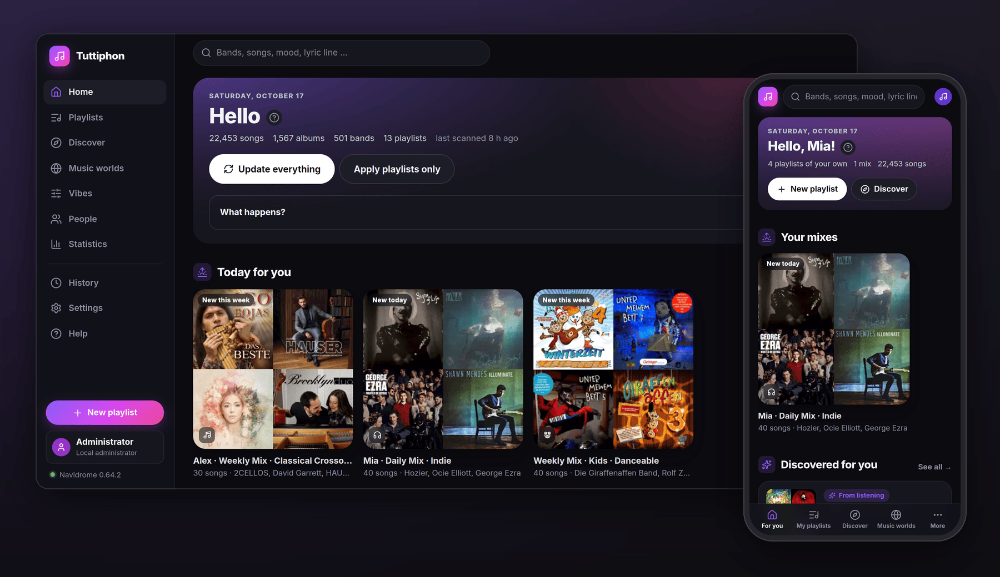

<p align="center">
  
</p>

<h1 align="center">Tuttiphon</h1>

<p align="center">
  A companion for <a href="https://www.navidrome.org/">Navidrome</a> – playlists, conversion, star ratings, lyrics
  and sound analysis for the whole family.
</p>

<p align="center">
  <a href="https://github.com/seluce/tuttiphon/actions/workflows/ci.yaml"></a>
  <a href="https://github.com/seluce/tuttiphon/pkgs/container/tuttiphon"></a>
  <a href="LICENSE"></a>
</p>

<p align="center">
  
</p>

Tuttiphon is a set of tools around Navidrome that takes care of most things on its own if you want: it builds
playlists, converts lossless files, rates songs, finds lyrics and listens to every song. Everything ends up in
Navidrome as ordinary playlists, ratings and files, so every Subsonic app benefits. It runs as a small Docker
container – made for a NAS, local, no cloud, no GPU.

## Features

- **Playlists that build themselves** – music world × vibe × person, as smart playlists or mixes that renew daily,
  weekly or monthly, with smooth transitions and learning from what is played and skipped.
- **FLAC to Opus or AAC** – smaller files for Android or Apple devices; tags, covers and lyrics move along, and the
  original is only touched after the new file was checked.
- **Star ratings from Deezer** – popularity as one to five stars, so top tracks in apps like Symfonium make sense;
  stars given by hand are kept.
- **Lyrics** – synced (`.lrc`) or plain (`.txt`), tidied up automatically, searchable by a line, with a kid-safe mode.
- **Understanding the music** – tempo, key, mood, instruments, music styles and similar songs from a local AI
  analysis (Essentia).
- **Instant Mix by sound** – with the Tuttiphon plugin for Navidrome, Instant Mix, song and artist radio and
  “similar songs” in Symfonium and other apps follow the sound of your own files.
- **For the whole family** – everyone signs in with their own Navidrome account and gets their own view; in
  English, German, French, Dutch, Spanish, Italian, Portuguese and Polish; installable as an app.
- **Housekeeping** – folder watch for new music, duplicates found by audio fingerprints, covers, even loudness,
  statistics, backups and notifications.

More in [Features](docs/features.md).

## Quick start

Requirements: Navidrome with an admin account, Docker with Compose on x86-64 (amd64), write access to the music folder.

1. Put [`docker-compose.yaml`](docker-compose.yaml) into a new folder and adjust the lines marked `CHANGE`.
2. Create the folders for the user from `user:` – otherwise Docker creates them for root and the container keeps
   restarting:
   ```bash
   mkdir -p config backups /path/to/music-archive
   chown 1000:1000 config backups /path/to/music-archive
   ```
3. Start it: `docker compose up -d`
4. Open `http://<server>:8765` and set the password of the **local administrator** – with the one-time setup
   code from the container log (`docker logs tuttiphon`). The setup assistant takes it from there.

Updating: `docker compose pull && docker compose up -d`. All details, settings and environment variables:
[Installation and configuration](docs/installation.md).

## Documentation

- [Features](docs/features.md) – what Tuttiphon does, privacy and external services
- [Installation and configuration](docs/installation.md) – setup, updates, environment variables, reverse proxy
- [Technical handbook](docs/README.md) – architecture, data model, API, operation
- [Changelog](CHANGELOG.md)

## Why these models?

Everything has to run on a small NAS next to Navidrome. Tuttiphon therefore uses Essentia with the compact
Discogs-EffNet model – one pass feeds all AI properties at once – instead of larger models that would need a GPU or
weeks per pass. The reasoning for each choice: [Under the hood](docs/features.md#under-the-hood-why-these-models).

## Development

Python 3 (standard library) and Node.js 22 (Svelte 5, Vite, Tailwind). `npm ci`, `npm run build`, `./tuttiphon.sh`
starts it on the PC; tests: `npm run test:py` and `npm run test:i18n`. More in the
[technical handbook](docs/README.md) and [frontend/README.md](frontend/README.md).

Translations are dictionaries in `frontend/src/locales/<lang>/` (interface) and `app/locales/<lang>/` (server). French,
Dutch, Spanish, Italian, Portuguese and Polish were translated with AI help – corrections are very welcome as an issue
or pull request.

## Acknowledgements

The Deezer star ratings build on [dztnr](https://github.com/scatolo/dztnr) by scatolo, a fork of
[sptnr](https://github.com/krestaino/sptnr) by Kevin Restaino – the idea of turning Deezer's popularity rank into
stars and its rank levels come from there. Thanks also to [Navidrome](https://www.navidrome.org/), the
[Essentia](https://essentia.upf.edu/) team at the Music Technology Group, [LRCLIB](https://lrclib.net) and
[AcoustID/Chromaprint](https://acoustid.org/chromaprint).

## License

[AGPL-3.0-or-later](LICENSE). The AI models are by the Music Technology Group, Universitat Pompeu Fabra, under
[CC BY-NC-SA 4.0](https://creativecommons.org/licenses/by-nc-sa/4.0/) – non-commercial use only. Other components:
[THIRD-PARTY-NOTICES.md](THIRD-PARTY-NOTICES.md).

Tuttiphon is an independent project and not affiliated with Navidrome, Deezer, Last.fm, LRCLIB or Symfonium.
