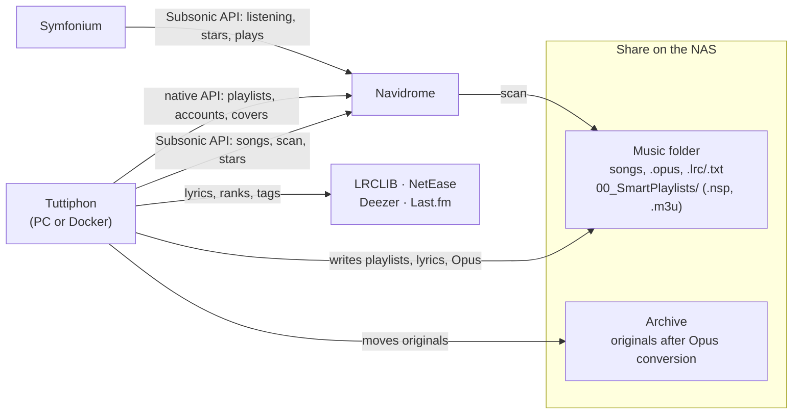

# 01 – Architecture

This chapter shows where Tuttiphon sits between Navidrome and Symfonium, what the running process consists of and
how the project is structured. It ends with the command line and all environment variables. Details on data,
endpoints and processes are in the topic chapters: [Data model](02-data-model.md),
[API](03-api.md), [Playlists](04-playlists.md), [Maintenance](05-maintenance.md),
[Security](07-security.md), [Operations](08-operations.md).

## How Navidrome, Tuttiphon and Symfonium work together

- **Navidrome** is the music server (usually as a container on a NAS; Tuttiphon reaches it via `NAV_URL`). It reads the
  music folder during a scan and stores the library, playlists, stars and plays per account.
- **Symfonium** is the app on the phones. It only talks to Navidrome (Subsonic API) and knows nothing about Tuttiphon.
- **Tuttiphon** is a Python server (PC or Docker container). It changes Navidrome in two ways: through **files**
  in the music folder that Navidrome reads in at the next scan, and through **API calls** to Navidrome.



### Two interfaces to Navidrome

Both clients are in `app/navidrome.py`.

| | Subsonic API (`/rest/…`), class `Navidrome` | Native API (`/api/…`), class `NativeApi` |
|---|---|---|
| Authentication | token + salt (MD5) with every request, API version 1.16.1, client `tuttiphon`, JSON response | once `POST /auth/login` → token in the header `X-ND-Authorization: Bearer …`; Navidrome renews it with every response |
| Accounts | admin account (`NAV_ADMIN_USER`/`NAV_ADMIN_PASS`) and individual accounts with `NAV_PASS_<ACCOUNT>` | admin account only |
| Address | `_check_url()` before every connection: if `NAV_URL` is missing or doesn't start with `http://`/`https://`, an understandable `NavidromeError` is raised right away (“Navidrome address missing – Settings → Navidrome” or “Navidrome address invalid …”) – the interface keeps running | the same; if the admin access is missing: “Navidrome admin access missing – Settings → Navidrome” |
| Calls | `ping` (sign-in, testing access, status) · `search3` with an empty query, 500 per page (all songs from one account's view incl. stars, favorites, plays) · `getScanStatus`, `startScan` · `setRating` · `createPlaylist` · `getPlaylist` (as owner: song count of a smart playlist for the self-check, `selfcheck.owner_count()`) · `getCoverArt`, `getArtistInfo2` | `GET /api/user` · `GET /api/playlist` · `PUT`/`DELETE /api/playlist/{id}` · `POST`/`DELETE /api/playlist/{id}/image` · `GET /api/playlist/{id}/tracks` + `GET /api/playlist/{id}` (song count of a mix for the self-check, `playlist_count()`) · `GET /api/album`, `/api/artist` (image present?, main color) · `GET /api/song` (real file paths, embedded lyrics) |

Navidrome rate-limits sign-ins at `/auth/login` (HTTP 429). That is why `native_session()` keeps one session per address,
user and password for the whole lifetime of the process. On HTTP 401, `NativeApi` signs in again once; on
HTTP 429 it waits up to three times (`Retry-After`, otherwise 5, 10, 15 s).

### What Tuttiphon creates and changes in Navidrome

| What | How | Code | What Symfonium sees |
|---|---|---|---|
| Smart playlists | `.nsp` file (JSON rules) in the playlist folder; by default the file name starts with `Auto – ` (setting `filePrefix`) | `playlists.write()` | a playlist whose contents Navidrome builds from the rules |
| Mixes | `.m3u` with a fixed song list and paths relative to the playlist folder; changes daily, weekly or monthly | `mixer.m3u()` | a fixed playlist that only changes at the changeover |
| Name, description, visibility, owner | native API, after every scan | `playlists.sync_navidrome()` | the playlist belongs to the person's account; public ones are visible to everyone |
| Removing paused and deleted playlists | delete the file (a taken-over file that Tuttiphon has never written is first backed up to `backup/`), then `DELETE /api/playlist/{id}` | `playlists.write()`, `sync_navidrome()` | the playlist disappears |
| Playlist covers | native API (upload/delete image) | `covers.upload()`, `TaskRunner._refresh_covers()` | the cover |
| “Keep this mix” / “Save as fixed playlist” | `createPlaylist` (Subsonic) + owner/visibility via the native API; no file | `playlists.snapshot()` | a fixed playlist “… – Oct 2026” |
| Stars | `setRating` per account | `deezer.run()` | the stars of the user's own account |
| Lyrics | `.lrc` (synced, also “instrumental”) or `.txt` next to the song; duplicate `.txt` files are deleted | `app/lyrics.py` | lyrics, after the next scan |
| Opus/AAC | `.opus` or `.m4a` (AAC, tags transferred with mutagen) next to the original, original to the archive (or keep/delete); an embedded cover is first saved to the folder as `cover.jpg`/`cover.png` if there is no cover image there yet | `app/opus.py` | Opus instead of FLAC, after the next scan |
| Scan | `startScan` (changes only or full) | `TaskRunner._step_scan()` | – |

Navidrome identifies a playlist by its **file path**. That is why every playlist keeps its file name (field `file` in
`config.json`) – even after renaming, it stays the same playlist in Navidrome and Symfonium (same ID, the offline copy
stays). Navidrome reads name, description and visibility from the file only on the first import; after that
Tuttiphon sets them via the API. Which Navidrome playlist belongs to which file is determined by `navidrome_index()` via the
path: only playlists whose folder has exactly the same name as the playlist folder count. So Tuttiphon's and
Navidrome's mount points may differ, but the folder name may not.

Tuttiphon recognizes its own files by the comment starting with `Tuttiphon` (`.nsp`), by the header line `# Tuttiphon`
(`.m3u`) and by `state/managed_playlists.json`. It only touches handmade `.nsp` files after a takeover –
see [Playlists](04-playlists.md).

Because Navidrome only sees files during a scan, the `playlists` step is always followed by a `scan`. Only then does
Tuttiphon sync name, owner and visibility.

### What Tuttiphon reads from Navidrome

- **Song list** (`library.CACHE`, valid for 15 minutes): from the view of the default person's account if its password
  is stored (then stars and favorites are exact), otherwise via the admin account (stars only approximate).
- **Plays:** Symfonium reports every play to Navidrome. Tuttiphon reads `playCount` and `played` per account for
  statistics, recap and mixes – see [Intelligence](06-intelligence.md).
- **Accounts** with the admin flag: the basis of the roles. An account that doesn't exist in Navidrome has no access
  to Tuttiphon. The most recently read account list is stored in `state/navidrome_users.json` and applies as long as Navidrome
  can't be reached. Signing in to Tuttiphon checks the password with `ping` directly at Navidrome – see
  [Security](07-security.md).

## One process, several threads

`python3 tuttiphon.py serve` starts a single Python process. Startup goes like this:

1. `tuttiphon.py` reads the options and calls `config.ensure_dirs()`: creates the data folder, `state/`, `logs/`, `backup/`,
   write test. If that fails, the process exits with code 2.
2. If the server is to be reachable not only via loopback and `TUTTIPHON_ADMIN_PASSWORD` is set (environment or
   `.env`), it must not be weak (`config.weak_password()`, see [command line](#tuttiphonpy)). Otherwise the process
   exits with code 2 (with `--unsafe-no-password` only a warning). Without any administrator password – neither that
   variable nor one set in the browser (`localadmin.source()`) – it starts anyway, in
   [setup mode](07-security.md#setup-mode).
3. `web.serve(host, port, strict)` sets `Handler.network` for a non-loopback address (`strict=False` with
   `--unsafe-no-password`): from then on the server answers every request with `503` while `TUTTIPHON_ADMIN_PASSWORD`
   is weak, and without any administrator password it requires sign-in and only lets the setup with the setup code
   through ([Security](07-security.md#running-without-a-password)). It opens the `ThreadingHTTPServer` (with
   an IPv6 address such as `::1` or `::` with `AF_INET6`) and starts `warm_up()`. Without `TUTTIPHON_NO_SCHEDULER=1` these follow: `heartbeat()` (instance registration, `app/instances.py`), a
   thread for `rueckblick.snapshot_all()` and the scheduler thread `daily_loop()`.
4. `web.startup_report()` writes an overview to the server log (`events.say()`): version, storage locations with
   their state, Navidrome address, AI sound analysis, schedules. In the container “Ready – port 8765” follows, on the PC the line
   “Tuttiphon is running at http://…/ (Ctrl+C quits)”. In setup mode the line with the setup code comes last
   (`localadmin.setup_code()`, at every start while the setup is pending). See [Operations](08-operations.md#server-log).
5. After 0.8 s a timer opens the browser (not with `--no-browser`).
6. The main thread runs `serve_forever()` until Ctrl+C or `SIGTERM` (e.g. `docker stop`) arrives. If a
   run is in progress then, `RUNNER.cancel()` cancels it, and the process waits up to 20 s so that the run can save its state
   (the template `docker-compose.yaml` sets `stop_grace_period: 30s` for this). At the end, “Shut down.” appears in the log.

| Thread | Start | Duration | Task | Turn off |
|---|---|---|---|---|
| Main thread | at startup | permanent | accepts connections (`serve_forever()`) | – |
| Request threads | per HTTP request (daemon threads) | until the response, socket timeout 30 s | `Handler._handle()`; the signed-in person is thread-local (`auth.set_current()`) | – |
| Warm-up | at startup; again 2.5 s after saving the configuration or credentials (`schedule_warm()`) | once | fills caches: song list, playlist status, “To review”, suggestions | – |
| Open browser | 0.8 s after startup | once | `webbrowser.open()` | `--no-browser` |
| Recap start | at startup | once | record the counter state per account (`rueckblick.snapshot_all()`) | `TUTTIPHON_NO_SCHEDULER=1` |
| Scheduler | at startup | every 60 s, first pass after 60 s | instance registration, tidy-up, freeing memory, recap, backup, folder watch, night analysis, daily refresh (see below) | `TUTTIPHON_NO_SCHEDULER=1` |
| Auto-apply | 8 s after `PUT /api/config` or a takeover; every further change restarts the wait | once per scheduling | starts the run “Applied automatically” (`playlists` + `scan`) if something is pending – if a pausable run is already in progress, it pauses that run briefly | setting `autoApply` |
| Run | when a run starts (interface, scheduler, folder watch, auto-apply), after `TaskRunner.start()` has acquired the lock against other instances | until the run is finished | `TaskRunner._run()` executes the steps one after another | Cancel in the interface |
| Continuation | at the end of a run that `pause_for()` paused | until the queued runs have started and finished | `TaskRunner._continue()`: waits for the run thread to end, first starts the apply run, then the rest of the paused run (“… (continued)”); if a start fails, up to 30 attempts 2 s apart | – |
| Workers in steps | within a run | per step | thread pools: Opus `opus.jobs` (default 1), lyrics `lyrics.workers` (default 6), sound analysis `analysis.workers` (0 = half the core count), Deezer 4; the AI sound analysis works song by song in its own process (`analysis.mlThreads` cores, default 2) | Settings |

In addition there are subprocesses for `ffmpeg`/`ffprobe` and – only during the AI sound analysis – a separate Python process
`app/ml_worker.py` that loads TensorFlow (low priority, at most `analysis.mlThreads` cores, ends with the
step; the server itself never loads TensorFlow, see [Intelligence](06-intelligence.md#ai-sound-analysis)). On cancel,
`TaskRunner.cancel()` sets a stop signal and terminates the process groups of the tracked processes (the `ffmpeg` calls
of the Opus conversion and of the sound analysis, the AI's analysis process).
Opus, lyrics, sound analysis, AI sound analysis and Deezer check the stop signal before every file or song, and so does
waiting for the Navidrome scan. The step currently running and all steps not yet started get the result
`abgebrochen` (canceled).

**Auto-apply** (`web.AutoApply`): it uses `pending_count()` to count the playlists in the states `neu`, `geändert`,
`scan` or `entfernen` (new, changed, awaiting scan, to be removed) plus orphaned files. If a run is in progress when the timer expires and something is pending,
it pauses that run briefly with `RUNNER.pause_for()` – but only if all of its open steps are pausable (`flac`, `lyrics`,
`analyse`, `deezer`); “Applied automatically” runs first, then the rest of the run as “… (continued)” (see
[Maintenance](05-maintenance.md#short-pause-for-an-apply-pause_for)). If that isn't possible (the run itself still writes
playlists), it reschedules itself 30 s later; meanwhile `state()` reports `{"waiting": true}` instead of a countdown, and the
interface shows “Changes follow after the running task” (otherwise the countdown would keep starting over
during a long run). If nothing is running and nothing is pending, nothing happens. If Navidrome can't be reached,
it tries again 60 s later; if the run can't be started (e.g. because another instance is working), 20 s
later. A run started by hand and “Cancel” call off a scheduled auto-apply; applying immediately (`POST /api/apply/now`) does so only
once its run has really started or the pause has been queued.

### The schedule (`daily_loop()`)

In every pass the scheduler does the following, in order:

1. **Instance registration:** `heartbeat()` writes its own file `instance-<id>.json` into the shared folder
   `<playlist folder>/.tuttiphon/` (see [Operations](08-operations.md#multiple-instances)).
2. **Tidy-up:** once a day `tasks.tidy()` – deletes old logs and cached images, shortens the history (see
   [Maintenance](05-maintenance.md#daily-tidy-up)). Each instance tidies up its own data folder, including a PC instance
   next to a container. The day already done is kept only in memory.
3. **Free memory:** `stats.purge()` releases song lists of other accounts that were loaded more than 10 minutes ago
   (statistics, mixes from a person's view; around 15 MB per account) – in every instance – and then returns the memory
   to the system (`library.release_memory()`).
4. **Container priority:** if Tuttiphon runs on the PC and a Docker instance is active (registration younger than 180 s),
   the pass ends here. Recap, backup, folder watch, night analysis and daily refresh are then handled by
   the container. For this, both must see the same shared folder – normally the playlist folder on the
   NAS share, even with separate data folders ([Operations](08-operations.md#multiple-instances)).
5. **Recap:** once a day from the time `dailyAt` on, record the counter state per account. Which day is already
   done is kept only in memory; after a restart the state is therefore recorded once more.
6. **Backup:** `_backup_daily()` – from `dailyAt` on, once a day, if turned on and there is none for today yet
   ([Operations](08-operations.md#built-in-backup-appbackuppy)).
7. **Folder watch:** `watch.check()` – only if turned on, every `watch.interval` minutes. See
   [Maintenance](05-maintenance.md).
8. **Night analysis:** `_night_analysis()` – in the time window `analysis.night` (default 01:00–05:00), once per night an
   `analyse` run in which sound analysis and AI may work until the end of the window – only if one of them
   still has songs left ([Maintenance](05-maintenance.md#night-analysis)).
9. **Daily refresh:** `dailyMode` = `playlists` (steps `playlists` + `scan`), `alles` (the steps of
   “Update everything”) or `aus` (off). It starts from `dailyAt` on (default 05:30) if no run is in progress and
   `state/daily.json` doesn't already carry today's date. Only once the run has really started does it write the
   date there; if another instance is working right now, it tries again in the next pass. If the server wasn't running
   at that time, the first pass after startup catches up on the refresh. If a step ends with `fehler` (error)
   (e.g. Navidrome currently unreachable), it starts again – up to 4 attempts at least 15 minutes apart
   ([Maintenance](05-maintenance.md#daily-refresh)).

The scheduler catches errors and tries again in the next pass.

### Shared state in the process

| What | Where | Behavior |
|---|---|---|
| Run control | `web.RUNNER` (one `TaskRunner` instance) | at most one run per process (`start_lock`); across processes and computers additionally the registrations of the other instances and the lock file `task.lock` in the shared folder (`tasks._InstanceLock`) |
| Instance registration | `instances._state` | whether a run is currently in progress in this process; the shared folder is determined anew at most once per minute |
| Song list | `library.CACHE` | reloaded in the background after 15 min – until then the previous one applies, nobody waits (if loading fails, again after one minute). `invalidate()` after a scan, set stars, new credentials: the next request waits for the fresh one. After that the memory of the old one is returned to the system (`release_memory()`, glibc `malloc_trim`). `GET /api/library?refresh=1` reloads only for administrators and at most once per minute. Kept lean: only the needed fields, recurring values (album, band, genres, artist and genre entries) exist only once (`navidrome._slim()`) – 22,400 songs take about 26 MB |
| Computed pages | `web._memoized()` | valid as long as `config.json`, the song list and the date don't change; outdated states drop out with the next entry, otherwise at most 60 entries (least recently used first); playlist status at most 20 s old |
| New music worlds during warm-up | `web._sync_welten()` | `autowelten.sync()` only if the song list, worlds, hidden scenes or `settings.welten` have changed since the last time |
| World assignment | `autowelten._memo` | per loaded song list (weak reference), recomputed on new Last.fm tags, AI results, scene catalog or after a completed lyrics read-in (`liedtext.generation()`) |
| Lyrics index | `liedtext.derb()`, `liedtext.languages()` | until `liedtexte.db` or `liedtexte.db-wal` changes; if reading fails (locked), the last result applies |
| Deezer numbers | `deezer.stats()` | until `state/deezer.json` changes (modification time + size) |
| Plays per period | `rueckblick.plays_between()` | per account and period, until the folder `state/plays/<account>/` changes; at most 32 entries, callers get a copy |
| Playlist covers for display | `images._live` | the last 200 (version in the key; older versions of the same cover drop out) |
| Configuration, credentials | `config.load_config()`, `config.load_env()` | in memory until the file changes (modification time + size); writing under a lock – see [Data model](02-data-model.md) |
| Navidrome sessions | `navidrome.native_session()` | one per account, for the lifetime of the process |
| Navidrome accounts | `auth.navidrome_users()` | cached for 10 min; if the query fails (any exception), the last state applies, after a restart the one from `state/navidrome_users.json`, and for 60 s it doesn't ask again |
| Sessions | `auth._load_sessions()` | `state/sessions.json` in memory until the file changes |
| Administrator password | `Handler._pw_cache`, `localadmin._cache` | source and plain password, read again at most every 10 s (`Handler._admin()`); the hash from `state/admin_password.json` in memory until the file changes; setting a password resets both |
| Song lists of other accounts | `stats._cache` | 10 min per account; the scheduler releases older ones every minute (`stats.purge()`). Only one request per account loads at a time, a second one waits for it. Loaded page by page and laid over the default list (`stats.overlay()`): songs with the same stars, favorites and plays are the same entries, only the rest are copies – around 15 MB per account instead of a second full list |
| Live log | `TaskRunner.lines` | the last up to 4,000 lines, available via `GET /api/task?since=…` |
| Queued runs | `TaskRunner._chain` | after `pause_for()`: the apply run and the continuation; empty as long as nothing is paused |
| Server log | `events.say()` | writes lines with a timestamp to standard output, under a lock so that lines from several threads don't get mixed up |
| Tour/welcome seen | `auth._seen_cache` | `state/seen.json` (and the older `tour_seen.json`) in memory until one of the files changes |

`python3 tuttiphon.py run` doesn't start a server. A `TaskRunner` executes the steps in the foreground and additionally
writes the log to standard output. It writes its instance registration only at the start and at the end of the
run.

## Modules in `app/`

| File | Purpose |
|---|---|
| `web.py` | HTTP server with JSON API, serves `web/` and images; auto-apply, scheduler |
| `auth.py` | sign-in via Navidrome or as local administrator, signed sessions with a server-side session list, roles, per-account filters |
| `localadmin.py` | password of the local administrator: source (`TUTTIPHON_ADMIN_PASSWORD` or a hash set in the browser, `state/admin_password.json`), checking, setting, the one-time setup code of the first start ([Security](07-security.md#local-administrator)) |
| `config.py` | paths, credentials (`.env`; which keys the interface may set: `EDITABLE_ENV`; `weak_password()`), loading, checking, migrating and saving `config.json`; `write_atomic()`, `read_text()` |
| `tasks.py` | runs: `TaskRunner` executes steps, logs, writes the history, pauses briefly for an apply run (`pause_for()`); instance lock; daily tidy-up (`tidy()`) |
| `events.py` | server log: `say()` writes short lines with date and time to standard output (in the container `docker logs`) |
| `version.py` | `VERSION` – the program version (startup message, `GET /api/status`, release); matches the top section in `CHANGELOG.md` |
| `instances.py` | multiple instances (PC, container): registration every minute, the ID of the installation (`install_id()`, `state/install_id`) and the location of the lock file in the shared folder `<playlist folder>/.tuttiphon/` |
| `watch.py` | folder watch: detects new files by checking regularly (only changed folders) and starts a run |
| `langzeit.py` | long-term maintenance, once a week at the start of a run: empty the trash after 30 days, forget entries of vanished songs, remove old skip marks, compact the lyrics index |
| `navidrome.py` | clients for Navidrome's Subsonic API and native API |
| `library.py` | caches the song list from Navidrome, plus album and artist details and real file paths |
| `rules.py` | music world × vibe × person → rules of a smart playlist; local evaluation for preview and song counts |
| `playlists.py` | playlist lifecycle: writing, syncing with Navidrome, taking over, keeping a mix |
| `mixer.py` | mixes: song selection with limits per band and album, randomness depending on the date, generating the `.m3u` |
| `feedback.py` | mix learning: mix history, demoting skipped songs, excluding 1-star ratings given by hand |
| `selfcheck.py` | self-check after the scan: song counts in Navidrome against Tuttiphon's own evaluation |
| `suggest.py` | ready-made playlist suggestions and the “To review” list |
| `scenes.py` | scene catalog from `scenes.json`: typical bands and identifying features per music world |
| `autowelten.py` | music worlds emerge on their own: classifies bands by genres, Last.fm, AI style, language and decade, creates missing worlds ([Intelligence](06-intelligence.md#automatic-music-worlds-appautoweltenpy)) |
| `liedtext.py` | lyrics index (SQLite FTS5): search for lyric lines, language per song, kid-safe mode |
| `notify.py` | notifications to the phone: which events go to whom, once per event; sent via the app (`webpush.py`) and ntfy |
| `webpush.py` | notifications via the app itself (web push): devices per account, encryption (RFC 8291) and sender keys (VAPID) |
| `i18n.py` | languages of the server texts: English in the code, German from `app/locales/de/*.json`; `_()` in the request's language, `_s()` in the server's (`settings.language`) for run logs, notifications and names; every translated text also carries its English form for the server log, which is always English (`Text`, `english()`, `join()`, `said()`) |
| `pflege.py` | library check: duplicates, missing covers, gaps, suspicious files |
| `fingerprint.py` | audio fingerprints (Chromaprint `fpcalc`) and their comparison: the same recording stored twice |
| `covers.py` | designs playlist covers (with Pillow) and uploads them to Navidrome |
| `images.py` | fetches covers and artist images from Navidrome and caches them on disk (fetched fresh after 14 days); artist info |
| `deezer.py` | popularity on Deezer → stars per account |
| `lyrics.py` | searches for missing lyrics (LRCLIB, NetEase) and cleans up duplicates |
| `opus.py` | converts lossless files to Opus or AAC (for AAC, transfers tags and cover), saves embedded covers, archives originals |
| `audio.py` | sound analysis with `ffmpeg`: tempo, energy, danceability, mood; mood labels (`MOODS`, `moods()`) |
| `ml.py` | AI sound analysis (Essentia): run, state `state/ml.json`, merging with Tuttiphon's own measurement (`fuse()`), music styles per band – doesn't load TensorFlow itself |
| `ml_worker.py` | analysis process of the AI sound analysis (started by `ml.py`); downloads the models when the image is built (`--download`) |
| `lastfm.py` | similar bands and tags from Last.fm, cached for 30 days |
| `classify.py` | merges features per song (`song_features()`), assigns bands to a music world (suggestions, automatic classification, `state/auto_assigned.json`), radio, “You’re still missing” |
| `taste.py` | taste per account from plays, favorites and stars given by hand ([Intelligence](06-intelligence.md#taste-per-account-apptastepy)) |
| `soundtaste.py` | sound taste per account: a few typical sounds of what the account plays, from the AI's sound vectors ([Intelligence](06-intelligence.md#sound-taste-appsoundtastepy)) |
| `sonic.py` | answers for the Navidrome plugin – similar songs, artist radio, similar bands, sound paths – and its key ([Intelligence](06-intelligence.md#for-navidrome-the-plugin-appsonicpy)); the plugin itself (Go, built with TinyGo to WebAssembly) is in `navidrome-plugin/` ([Operations](08-operations.md#navidrome-plugin)) |
| `stats.py` | listening statistics per account from the play counters |
| `rueckblick.py` | daily counter states → “Played this week” and recap |
| `backup.py` | built-in backup of the data folder as a ZIP ([Operations](08-operations.md#built-in-backup-appbackuppy)) |
| `default_config.json` | default configuration: template for a new `config.json` and for missing settings |
| `scenes.json` | catalog of music worlds (scenes): name, icon, typical bands, identifying words, language, period |
| `__init__.py` | empty (makes `app/` a package) |

Shared foundations: paths and settings come from `config.py`, all Navidrome access goes through
`navidrome.py`, the song list through `library.CACHE`.

## Folder structure

```
Tuttiphon/
├── tuttiphon.py            entry point: interface (serve) or runs (run)
├── tuttiphon.sh            start on the PC: set paths, build the interface, open the browser
├── app/                   Python: server and logic (standard library, optional Pillow)
├── frontend/              interface sources (Svelte 5, Vite 8, Tailwind 4) → 09-interface.md
│   ├── public/            copied unchanged: icons, manifest, sw.js
│   └── svelte.config.js   compiler options (runes) – used by the build and tools/compile-check.mjs
├── web/                   built interface (npm run build) – not in Git; with third-party-licenses.md (licenses of
│                          the bundled packages)
├── models/                AI models (Essentia, 29 files, about 30 MB) – only in the Docker image as /app/models,
│                          downloaded during the build; on the PC only if you download them yourself (TUTTIPHON_MODELS)
├── tests/e2e/             browser tests (Playwright)
├── tests/python/          Python tests for app/ (unittest, temp folder, no network) → 09-interface.md
├── tools/                 testserver.sh (test server with a data copy), screens.mjs (screenshots),
│                          release.sh (release folder for the NAS, npm run release)
├── docs/                  this handbook
├── CHANGELOG.md           changes per version (GET /api/changelog, Settings → General, README.txt)
├── LICENSE                AGPL-3.0-or-later
├── THIRD-PARTY-NOTICES.md licenses of the parts by others in the interface and the Docker image
├── data/                  data – not in Git, in the container /config → 02-data-model.md
│   ├── config.json
│   ├── .env
│   ├── state/
│   ├── logs/
│   └── backup/
├── Dockerfile, docker-compose.yaml, .dockerignore
├── .github/workflows/     ci.yaml (checks on every push), docker.yaml (publishes the image for a release)
├── package.json, package-lock.json, vite.config.js, playwright.config.js
├── .env.example           template for data/.env
└── .gitignore             keeps data/, web/, node_modules/, test-results/ out of Git
```

Generated and not in Git: `web/`, `node_modules/`, `test-results/`, `playwright-report/`.

The **Navidrome folder** (`TUTTIPHON_BASE`; on the PC from `dev.local.env`, otherwise the folder above the project folder; in
the Docker image `/nas`) contains `Music/` by default (with `00_SmartPlaylists/` inside, which holds the hidden folder
`.tuttiphon/` for instance registrations and the run lock) and `Archiv/`. The template `docker-compose.yaml` mounts the
music folder and the archive individually instead (`MUSIC_DIR=/music`, `ARCHIVE_DIR=/archive`).

## Command line

### `tuttiphon.py`

```bash
python3 tuttiphon.py                                  # = serve with default values
python3 tuttiphon.py serve --host 0.0.0.0 --port 8765 --no-browser
python3 tuttiphon.py run                              # steps of “Update everything”
python3 tuttiphon.py run lyrics deezer --dry-run      # individual steps, dry run
python3 tuttiphon.py run deezer --deezer-mode full
```

**`serve`** – web interface (default, also without a subcommand):

| Option | Default | Effect |
|---|---|---|
| `--host` | `127.0.0.1` | address the server binds to; IPv6 addresses (`::1`, `::`) work too. For anything other than `127.0.0.1`, `localhost`, `::1`, sign-in is always required: a `TUTTIPHON_ADMIN_PASSWORD` that is set must not be weak (`config.weak_password()`: at least 8 characters and not the placeholder `change-me` in any spelling; otherwise code 2, the message names what is wrong and where the value comes from); without any administrator password the server starts in [setup mode](07-security.md#setup-mode) and writes the setup code to the log. While running, it stays locked (`503`) if the variable becomes weak, and goes back to setup mode if the password goes missing. For `0.0.0.0` the startup message shows the address `http://127.0.0.1:<port>/`, for `::` `http://[::1]:<port>/`, other IPv6 addresses in square brackets. |
| `--port` | `8765` | port |
| `--no-browser` | off | don't open a browser |
| `--unsafe-no-password` | off | start on the network despite a too short password, and without setup mode when there is none; also turns off the lock while running (`serve(…, strict=False)`). Only a warning appears: with a too short password or the placeholder “… but the administrator password is too short or still the placeholder!”, without a password the notice that there is then no sign-in and the server only answers requests via `127.0.0.1`/`localhost` and the names in `TUTTIPHON_HOSTS` – see [Security](07-security.md). |

**`run`** – steps without the interface (for cron or a systemd timer):

| Argument/option | Default | Effect |
|---|---|---|
| `steps …` | `all` | any number of `flac`, `lyrics`, `analyse`, `playlists`, `scan`, `deezer`, `all`. `all` = the steps chosen under Settings → Automation (`settings.pipeline`) in a fixed order; steps named individually run in the given order. |
| `--deezer-mode` | setting `deezer.pipelineMode`: `new` new songs, `missing` new ones and those not found so far | `new` new songs · `missing` only those not found so far · `full` all, resumable · `recalc` recompute stars from stored ranks |
| `--overwrite-manual` | setting `deezer.overwriteManual` | Deezer also overwrites stars given by hand |
| `--lyrics-all` | off | lyrics: also songs searched recently without success, without a time limit |
| `--full-scan` | setting `navidrome.scan` | full instead of quick Navidrome scan |
| `--dry-run` | off | dry run: no step changes anything. `scan` starts no Navidrome scan and no sync, `analyse` measures and saves nothing (only reports the number of confident classification suggestions). Lyrics and Deezer still query their services – see [Maintenance](05-maintenance.md#dry-run). |

The options `lyrics_full` and `analyse_full` (without a time limit) are only available via the API (`POST /api/task`), not on
the command line.

**Exit codes:** `0` = done; for `run` only if every step is `ok`. `1` = at least one step `warnung`,
`fehler` or `abgebrochen` (warning, error, canceled) – or the run couldn't start at all because another instance is working (message “✕ Another
Tuttiphon instance (PC or Docker) is working right now – please try again later.”). `2` = data folder not
writable or network start with a weak `TUTTIPHON_ADMIN_PASSWORD`.

`tuttiphon.py` sets `sys.dont_write_bytecode` so that no `__pycache__` folders are created.

### `tuttiphon.sh`

The start script for the PC. It changes to the project folder (also via a symlink), reads the optional file
`dev.local.env` there (not in Git; personal settings such as `TUTTIPHON_BASE=/path/to/navidrome-folder` or
`TUTTIPHON_TEST_USER=<account>` for `tools/testserver.sh`) and sets `TUTTIPHON_DATA` (default `<project>/data`) if it
isn't set yet. Without `TUTTIPHON_BASE`, the folder above the project folder counts as the Navidrome folder.

| Call | Effect |
|---|---|
| `./tuttiphon.sh` | If a server already answers at `http://127.0.0.1:8765/api/config`, the script only opens the browser (`xdg-open`). Otherwise it builds the interface if needed and starts `tuttiphon.py serve --port 8765`. |
| `./tuttiphon.sh install-launcher` | creates `~/.local/share/applications/tuttiphon.desktop` (menu entry “Tuttiphon”, starts `tuttiphon.sh`, without a terminal) |
| `./tuttiphon.sh <other …>` | passes everything on to `python3 tuttiphon.py`, e.g. `./tuttiphon.sh run deezer --deezer-mode recalc`. In this case the script doesn't build the interface and doesn't check whether a server is already running. |

When the script builds the interface is described in [Operations](08-operations.md#running-on-the-pc). The port is fixed to
8765 in the script.

## Environment variables

**Paths and runtime** – read directly from the environment:

| Variable | Effect | Default | Code |
|---|---|---|---|
| `TUTTIPHON_DATA` | data folder (`config.json`, `.env`, `state/`, `logs/`, `backup/`) | `<project>/data` (created at startup; never the project folder itself) · Docker: `/config` | `config.py` |
| `TUTTIPHON_BASE` | Navidrome folder: basis for the default music folder (`Music/`) and for relative music folder paths | the folder above the project folder · `tuttiphon.sh`: from `dev.local.env` · Docker image: `/nas` (matters only for defaults and relative paths) | `config.py` |
| `TUTTIPHON_WEB` | folder of the built interface (for tests with a separate build) | `<project>/web` | `config.py` |
| `TUTTIPHON_MODELS` | folder of the AI models | `<project>/models` · Docker image: `/app/models` | `ml.py` |
| `MUSIC_DIR` | music folder, takes precedence over the settings; relative to `TUTTIPHON_BASE` | – · `docker-compose.yaml`: `/music` | `config.paths()` |
| `PLAYLIST_DIR` | playlist folder, absolute or relative to the music folder | – | `config.paths()` |
| `ARCHIVE_DIR` | archive folder, absolute or relative to the folder above the music folder | – · `docker-compose.yaml`: `/archive` | `config.paths()` |
| `BACKUP_DIR` | backup folder, if the setting `backup.dir` is empty; absolute or relative to `TUTTIPHON_BASE` | `<data folder>/sicherungen` · `docker-compose.yaml`: `/backup` | `backup.folder()` |
| `TUTTIPHON_SHARED_DIR` | folder for instance registrations and the run lock. Without the variable `<playlist folder>/.tuttiphon/`; if that isn't writable, `state/` in the data folder. | – · `tools/testserver.sh`: `<workdir>/shared` | `instances.shared_dir()` |
| `TUTTIPHON_DOCKER` | `1` = this instance counts as Docker. Even without the variable it counts as Docker if `/.dockerenv` exists. | Docker: `1` | `instances.py` |
| `TUTTIPHON_NO_SCHEDULER` | `1` = no regular instance registration (only during a run), no recap start, no scheduler, no tidy-up, no folder watch (for test servers). Auto-apply stays active; only the setting `autoApply` turns it off. | – | `web.serve()` |

The order of the storage locations (environment > settings > default) is described in [Operations](08-operations.md#storage-locations).

**Credentials and switches** – via `config.load_env()`. The sources in ascending priority: `<data>/.env` (empty
values don't count), then the environment. From the environment Tuttiphon takes all variables starting with `NAV_` or
`TUTTIPHON_`, as well as `RATING_USERS`, `LASTFM_API_KEY` and `NTFY_TOKEN` – only with a
non-empty value; an empty variable (e.g. `NAV_ADMIN_PASS: ""` in `docker-compose.yaml`) doesn't override the `.env`.

| Variable | Effect | Can be saved via `PUT /api/env` |
|---|---|---|
| `NAV_URL` | Navidrome's address (a trailing `/` is removed) | yes |
| `NAV_PUBLIC_URL` | address for “Open in Navidrome” links; empty = `NAV_URL` | yes |
| `NAV_ADMIN_USER`, `NAV_ADMIN_PASS` | admin account for scan, native API, images and song list | yes |
| `NAV_PASS_<ACCOUNT>` | password of a Navidrome account for stars, statistics and an exact preview. Account name in upper case; characters other than letters, digits and `_` become `_` (`config.pass_key()`). | yes |
| `RATING_USERS` | comma-separated accounts for which Deezer sets stars (`config.rating_users()`). Only applies as long as the setting `deezer.users` is not a list (default `null`); without either: all accounts of the people. | yes (the interface has no field for it) |
| `LASTFM_API_KEY` | key for Last.fm | yes |
| `TUTTIPHON_ADMIN_PASSWORD` | optional: the password of the [local administrator](07-security.md#local-administrator) in plain text instead of one set in the browser – it wins over a stored one and can then only be changed here; turns on sign-in. On the network it must not be weak | no, only `.env` or environment |
| `TUTTIPHON_HOSTS` | additional allowed host names, comma-separated (only effective without a password) | no, only `.env` or environment |
| `TUTTIPHON_TRUSTED_PROXIES` | reverse proxies whose `X-Forwarded-For`/`X-Forwarded-Proto` count, addresses or networks, comma-separated (e.g. `172.16.0.0/12`): the sign-in lockout then counts each person's own address, sign-ins via https get the `Secure` cookie ([Security](07-security.md#behind-a-reverse-proxy)) | no, only `.env` or environment |

Whatever is set with a value in the environment takes precedence. Of the keys the interface may set
(`config.EDITABLE_ENV`: the “yes” rows above plus `NTFY_TOKEN`), the interface receives those set in the environment in
`GET /api/status` as `env.locked` and locks the fields. Which keys `save_env()` may write is described in [Data model](02-data-model.md).

**Set only in the Docker image:**

| Variable | Value | Purpose |
|---|---|---|
| `TZ` | `Europe/Berlin` | local time for `dailyAt`, logs and mixes (`tzdata` is installed) |
| `HOME` | `/tmp` | writable home directory for any UID from `user:` |
| `PYTHONDONTWRITEBYTECODE` | `1` | no `.pyc` files |
| `PYTHONUNBUFFERED` | `1` | output appears immediately in the container log |

For the browser tests there is also `CHROME_PATH` (path to Chromium) – see [Interface](09-interface.md).
