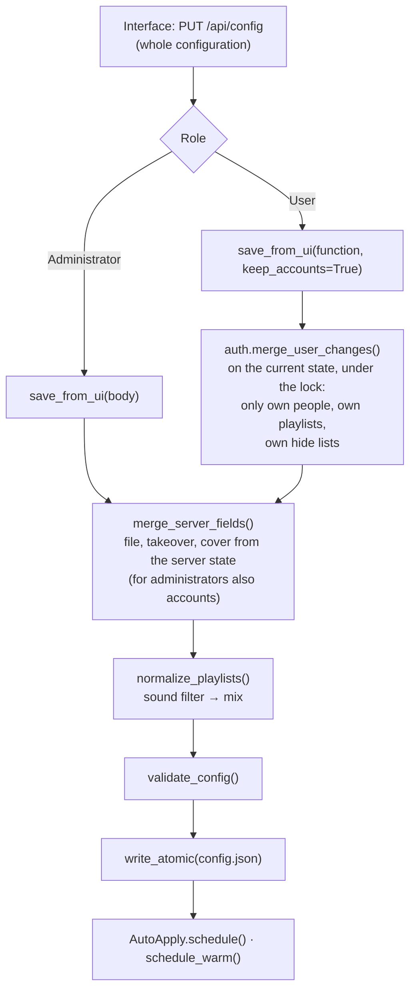

# Data model

This chapter describes everything Tuttiphon stores permanently: the configuration `config.json` with every field, its
migration, the credentials in `.env`, the files in `state/`, `logs/` and `backup/`, and the shared folder
`.tuttiphon/` of the instances. For each item it states
who writes a field (the interface or only the server), which values are valid and what happens when a file is deleted.
How the values take effect is described in the topic chapters – [Playlists](04-playlists.md), [Maintenance](05-maintenance.md),
[Intelligence](06-intelligence.md), [Security](07-security.md).

## The data folder

All data lives in a dedicated data folder that never goes into Git. `app/config.py` sets the paths on import:

| Variable | Value |
|---|---|
| `DATA_DIR` | `TUTTIPHON_DATA`, otherwise always `data/` in the project folder (created at startup) – never the project folder itself, where backups with credentials could end up in Git |
| `CONFIG_FILE` | `DATA_DIR/config.json` |
| `ENV_FILE` | `DATA_DIR/.env` |
| `STATE_DIR` | `DATA_DIR/state` |
| `LOG_DIR` | `DATA_DIR/logs` |
| `BACKUP_DIR` | `DATA_DIR/backup` |
| `BASE` | `TUTTIPHON_BASE`, otherwise the folder above the project folder – the Navidrome folder with `Music/` |

`tuttiphon.sh` sets `TUTTIPHON_DATA=data/` and takes `TUTTIPHON_BASE` from the optional `dev.local.env`, the Docker
image sets `TUTTIPHON_DATA=/config` and `TUTTIPHON_BASE=/nas` (the template `docker-compose.yaml` sets the music folder
itself with `MUSIC_DIR=/music`).
At startup (`tuttiphon.py`, both `serve` and `run`), `ensure_dirs()` creates the data folder and the three subfolders
and checks with a short probe file `.schreibtest` whether it is writable; if not, startup aborts with a
message.

```text
data/                      (in the container: /config)
├── config.json            configuration: settings, people, music worlds, vibes, playlists, accounts
├── .env                   credentials (permissions 600 – on every write and at every start; every other file 640)
├── setup-code.txt         one-time setup code, only while there is no administrator password (600, not in backups)
├── state/                 state, tracking files and caches
├── logs/                  one log per run
└── backup/                originals of overwritten playlist files, backups before a migration
```

`setup-code.txt` (`localadmin.CODE_FILE`) exists only while a server on the network waits for its setup – no
`TUTTIPHON_ADMIN_PASSWORD` and no `state/admin_password.json` ([Security](07-security.md#setup-mode)): the code as
`XXXX-XXXX`, the same until the password is set, then deleted. It lies outside `state/` and is therefore never part of
a backup.

In addition, there is a folder outside the data folder that all instances share: `<playlist folder>/.tuttiphon/`
(see [Shared folder .tuttiphon/](#shared-folder-tuttiphon)).

## config.json

### Top-level keys

| Key | Type | Content | Written by |
|---|---|---|---|
| `version` | number | format version, currently `11` (`CONFIG_VERSION`) | server (template, migration); the interface sends the value back unchanged |
| `settings` | object | all settings, see [settings](#settings) | interface (Settings); server only during migration |
| `personen` | list | people, see [personen](#personen) | interface; users only their own |
| `welten` | list | music worlds, see [welten](#welten) | interface; server adds `artists` during automatic classification |
| `stile` | list | vibes, see [stile](#stile) | interface; server during migration |
| `playlists` | list | playlists, see [playlists](#playlists) | interface; server creates taken-over playlists and maintains `file`, `takeover`, `cover` |
| `dismissed` | list | suggestions hidden by administrators | interface |
| `dismissedAt` | object | key from `dismissed` → day it was hidden | server (`config.stamp_dismissed()` on save) |
| `ignored` | list | notices under “To review” hidden by administrators | interface |
| `accounts` | object | role, last sign-in and hide lists per Navidrome account | server only |

`load_config()` adds missing lists (`welten`, `stile`, `playlists`, `personen`, `dismissed`, `ignored`) as `[]`;
`accounts` is missing until the first save from the interface or the first sign-in – the code expects this everywhere
(`cfg.get("accounts") or {}`).

```json
{
  "version": 10,
  "settings": { "defaultPerson": "familie", "autoApply": true, "...": "..." },
  "personen": [ { "id": "familie", "name": "Familie", "user": "familie", "public": true, "...": "..." } ],
  "welten": [ { "id": "kinder", "name": "Kinder", "...": "..." } ],
  "stile": [ { "id": "rock", "name": "Rock & Punk", "...": "..." } ],
  "playlists": [ { "id": "kinder-rock", "person": "familie", "welt": "kinder", "stil": "rock", "...": "..." } ],
  "dismissed": [],
  "ignored": [],
  "accounts": { "anna-lena": { "role": "user", "lastLogin": "2026-10-12 08:15" } }
}
```

The template for a fresh start is `app/default_config.json`: `version: 10`, all settings with default values
(`language: "en"`, `setup.done: false` – the setup assistant is still to come, conversion off), a single neutral
person `familie` (“Family”; public, without an account – `user` is empty – and without preferences), no music worlds
(they are created automatically from the scene catalog), 40 vibes with English names (groups Genre, Thema, Jahreszeit,
Zeitreise, Spezial, Klang – the group names are data) and no playlists. The German names come from
`app/locales/de/defaults.json` when the server language is German (`localize_defaults()`).

### settings

The default values come from `app/default_config.json`. If a key is missing in `config.json`, `_fill()` adds it on
load (nested keys too, e.g. `settings.lyrics.retryDays`) – only in memory; it reaches the disk with the
next save. Lists are not merged: an existing list stays as it is. The sections
are changed only through the interface (Settings); “Validation” names what `validate_config()` requires on
save.

#### Setup assistant

| Key | Type | Default | Meaning | Validation |
|---|---|---|---|---|
| `setup.done` | boolean | `false` (existing installations after the migration to v10: `true`) | the setup assistant ran or was skipped. While `false`, an administrator is led to `#/einrichtung` once per browser session after signing in ([Interface](09-interface.md#setup-assistant)) | yes/no |
| `setup.at` | string | – | day of “Finish” or “Skip setup” (`YYYY-MM-DD`); missing when the migration marked an existing installation as set up | `YYYY-MM-DD` |

**Safe defaults for new installations.** Since v10 a new installation converts nothing until someone chooses it:
`opus.enabled` is `false` in the template (before: `true`, with the originals moved to the archive). The other
defaults were checked for the same reason and stay: `lyrics.fetch` and `covers.enabled` only add files next to the
music, `lyrics.cleanup`/`upgradePlain` only replace or delete a `.txt` next to an `.lrc` of the same name, the
analysis only reads, Deezer leaves stars given by hand alone (`deezer.overwriteManual: false`), the folder watch and
`loudness.enabled` (writes into the music files) were already off. Existing installations keep their behavior –
the migration to v10 writes the value they had ([Version and migration](#version-and-migration)).

#### Language

| Key | Type | Default | Meaning | Validation |
|---|---|---|---|---|
| `language` | string | `"en"` (existing installations after the migration to v6: `"de"`) | Server language: run logs, notifications, names and descriptions that Tuttiphon assigns itself (`i18n._s()`); the server log (`docker logs`) is always English. Messages to the interface follow the language of the request (header `X-Lang`). A switch also renames the bundled vibes, the person “Family” and `allName`, as long as they still carry their bundled name (`config.localize_defaults()`) | `en` or `de` |

Each device stores the interface language itself (`localStorage` `tuttiphon-lang`, Settings → General → Language);
without a choice, the browser language applies.

#### Playlists in general

| Key | Type | Default | Meaning |
|---|---|---|---|
| `defaultPerson` | string | `"familie"` | default person: applies to playlists without `person`, is entered when handmade playlists are taken over; with the password of its account, the library loads exact stars (`library.py`); must be an existing person |
| `namePattern` | string | `"{welt} · {stil}"` | name from music world and vibe (placeholders `{welt}`, `{stil}`); at most 200 characters, no other placeholders and no format details (`{welt:>9}`) – otherwise no playlist name could be built |
| `allName` | string | `"All"` (German: `"Alle"`) | word for “no music world” in the description (`rules.describe()`) |
| `filePrefix` | string | `"Auto – "` | start of new file names in the playlist folder (at most 60 characters) |
| `limit` | number 1–100000 | `100` | songs per smart playlist if the playlist specifies none |
| `minDuration` | number (s) 0–3600 | `120` | songs must be longer; a music world can override this (also 0–3600) |
| `allMinRating` | number 0–5 | `3` | minimum rating for playlists without a music world |
| `hitsShare` | number 0–1 | `0.3` | share for “Only the hits” (interface: 0.2–0.5) |
| `excludeTitles` | list | live, unplugged, instrumental, karaoke and playback markers | title keywords that are left out of every playlist (list of strings) |
| `public` | boolean | `true` | visibility if a playlist has no valid person |
| `mixLearn` | boolean | `true` | mixes learn from listening (Settings → Playlists, “Mixes that learn”): skipped songs come up less often, songs rated 1 star by hand not at all anymore ([Playlists](04-playlists.md#mixes-that-learn-appfeedbackpy)). The mix history is kept even with `false` |
| `smoothTransitions` | boolean | `true` | mixes in an order where one song leads into the next: similar sound, close tempo, compatible key, similar energy (`mixer.smooth()`, [Intelligence](06-intelligence.md#smooth-transitions-in-mixes)). Needs the AI sound analysis; without sound vectors or keys, and in mixes with an arc (falling asleep, good morning), the order stays as before. A change applies from the next mix period |
| `playlistDir` | string | `"Music/00_SmartPlaylists"` | only a fallback for the playlist folder if neither `PLAYLIST_DIR` nor `paths.playlists` is set (if the value starts with `Music/`, the rest is relative to the music folder, otherwise relative to `BASE`) |

#### Automation

| Key | Type | Default | Meaning | Validation |
|---|---|---|---|---|
| `autoApply` | boolean | `true` | auto-apply: after a change (8 s pause), write playlists and scan | – |
| `pipeline` | list | all seven steps | steps of “Update everything”; the order is always `flac, lyrics, cover, analyse, playlists, scan, deezer` | only known steps, no duplicates |
| `dailyMode` | string | `"playlists"` | daily refresh: `playlists` (playlists + scan), `alles` (the whole `pipeline`), `aus` (off) | one of the three values |
| `dailyAt` | string | `"05:30"` | time of the refresh (local time of the process); also the time the mixes switch (midnight with `dailyMode: aus`) and the time of the recap's counter snapshot | `HH:MM` |
| `watch.enabled` | boolean | `false` | folder watch | – |
| `watch.interval` | number (min) | `15` | interval between two looks into the music folder | 5–1440 |
| `watch.convert` | boolean | `true` | convert new lossless files (only if `opus.enabled`) | – |
| `watch.lyrics` | boolean | `true` | search lyrics for new files | – |
| `watch.deezer` | boolean | `true` | rate new songs via Deezer | – |
| `navidrome.scan` | string | `"quick"` | scan type in the `scan` step: `quick` (changes only) or `full` | one of the two values |
| `backup.enabled` | boolean | `true` | built-in backup once a day ([Operations](08-operations.md#built-in-backup-appbackuppy)) | – |
| `backup.keep` | number | `14` | this many backups are kept | 1–365 |
| `backup.dir` | string | `""` | backup folder; empty = environment variable `BACKUP_DIR` (template `docker-compose.yaml`: `/backup`), otherwise `<data folder>/sicherungen`; relative = inside the Navidrome folder | no `..`; not inside `state/` or `backup/` of the data folder |

#### Home page

| Key | Type | Default | Meaning |
|---|---|---|---|
| `start.sections` | list `{id, on}` | all on, in this order | sections of the home page and their order; allowed `id`: `heute`, `todo`, `woche`, `neu`, `playlists`, `karten`, `verlauf` (validated) |
| `start.showSteps` | boolean | `true` | show the steps of “Update everything” on the home page (interface only) |

#### Storage locations

| Key | Type | Default | Meaning |
|---|---|---|---|
| `paths.music` | string | `""` | music folder; relative = relative to `BASE` (not to the working directory of the process) |
| `paths.playlists` | string | `""` | playlist folder; relative = relative to the music folder |
| `paths.archive` | string | `""` | archive for originals; relative = relative to the folder above the music folder |

Empty means default. Only these three keys are allowed; relative paths must not contain `..`. The archive must not
be the music folder or lie inside it (also when it comes from `opus.archiveDir`).
`paths()` resolves the folders in this order (environment beats setting beats default); the rules for
relative paths apply equally to the environment variable and the setting:

| Folder | 1. Environment | 2. Setting | 3. Default |
|---|---|---|---|
| Music | `MUSIC_DIR` | `paths.music` | `BASE/Music` |
| Playlists | `PLAYLIST_DIR` | `paths.playlists` | from `playlistDir`, i.e. `<music>/00_SmartPlaylists` |
| Archive | `ARCHIVE_DIR` | `paths.archive` | `opus.archiveDir`, otherwise `Archiv` next to the music folder |

If the playlist folder is not inside the music folder, `playlists.playlist_dir()` writes to
`<music>/00_SmartPlaylists` instead – Navidrome reads playlists only from there.

#### Deezer

| Key | Type | Default | Meaning | Validation |
|---|---|---|---|---|
| `deezer.thresholds` | list | `[10000, 100000, 300000, 600000, 850000]` | rank levels: below `thresholds[k]` a song gets `k` stars, from the last value on 5 | five ascending integers ≥ 0 |
| `deezer.users` | list or `null` | `null` | accounts for which stars are set; `null` = `RATING_USERS`, otherwise every `user` of the people (`rating_users()`) | list of strings |
| `deezer.overwriteManual` | boolean | `false` | also overwrite stars changed by hand | – |
| `deezer.pipelineMode` | string | `"new"` | mode of the `deezer` step if the run doesn't specify its own: `new` (new songs) or `missing` (new songs **and** songs not found so far; the step then runs in mode `both`) | one of the two values |
| `deezer.topBoost` | boolean | `true` | one star more for the top songs of each band when too many songs would otherwise share the highest star count | – |
| `deezer.refresh` | boolean | `true` | recheck 1,500 songs on Deezer every night | – |
| `loudness.enabled` | boolean | `false` | even out loudness: measure loudness and write ReplayGain values into the music files ([Maintenance](05-maintenance.md#even-out-loudness)) | – |
| `loudness.album` | boolean | `true` | album values as well | – |
| `deezer.rate` | number | `9` | requests per second to Deezer | 1–15 |

#### Lyrics

| Key | Type | Default | Meaning | Validation |
|---|---|---|---|---|
| `lyrics.fetch` | boolean | `true` | search for missing lyrics | – |
| `lyrics.cleanup` | boolean | `true` | delete a `.txt` if a `.lrc` sits next to it | – |
| `lyrics.savePlain` | boolean | `true` | save lyrics without timestamps as `.txt` | – |
| `lyrics.upgradePlain` | boolean | `true` | keep searching songs that have a `.txt` for synced lyrics | – |
| `lyrics.instrumental` | string | `"mark"` | `mark`: create a `.lrc` with `[au: instrumental]`, `skip`: write nothing (the song then counts as not found) | one of the two values |
| `lyrics.retryDays` | number | `30` | songs searched without success are retried only after this many days (spread ±20%) | 1–365 |
| `lyrics.workers` | number | `6` | concurrent requests | 1–8 |
| `lyrics.budgetMinutes` | number | `5` | time limit in the full run, `0` = none | 0–600 |
| `lyrics.providers` | list `{id, on}` | `lrclib` on, `netease` off | providers in query order | only `lrclib`, `netease` |

#### Conversion (Opus or AAC)

| Key | Type | Default | Meaning | Validation |
|---|---|---|---|---|
| `opus.enabled` | boolean | `false` (until v9 `true`; existing installations keep their value, see migration 9 → 10) | the `flac` step converts | – |
| `opus.formats` | list | `["flac"]` | source formats: `flac`, `wav`, `aiff`, `ape`, `wv`, `alac` | only these |
| `opus.codec` | string | `"opus"` | target format: `opus` (`.opus`) or `aac` (`.m4a`, for Apple devices) | one of the two values |
| `opus.bitrate` | number (kbit/s) | `160` | Opus bitrate | 48–320 |
| `opus.aacBitrate` | number (kbit/s) | `224` | AAC bitrate | 64–320 |
| `opus.original` | string | `"archive"` | what happens to the original afterwards: `archive`, `keep` or `delete` | one of the three values |
| `opus.archiveDir` | string | `"Archiv"` | fallback for the archive folder (see Storage locations) | relative, without `..` |
| `opus.minAgeMinutes` | number | `10` | newer files are left alone | 0–1440 |
| `opus.owner` | string | `""` | `UID:GID` for new Opus/AAC files and archive folders (`chown`, if permitted); empty = the user Tuttiphon runs as. Installations from before 0.17.1 keep `"1000:10"` (migration 10 → 11) | empty or pattern `number:number` |
| `opus.jobs` | number | `1` | concurrent conversions | 1–8 |

#### Intelligence

| Key | Type | Default | Meaning | Validation |
|---|---|---|---|---|
| `analysis.enabled` | boolean | `true` | sound analysis in the `analyse` step (and during folder watch) | – |
| `analysis.depth` | string | `"standard"` | analysis depth: `schnell` (fast), `standard`, `gruendlich` (thorough), `tief` (deep) | one of the four values |
| `analysis.budgetMinutes` | number | `10` | time limit of the sound analysis per run, `0` = none | 0–1440 |
| `analysis.workers` | number | `0` | concurrent analyses, `0` = half the number of CPU cores | 0–32 |
| `analysis.lastfmBudget` | number | `3` | time limit for Last.fm per run, `0` = none | 0–600 |
| `analysis.classify` | string | `"suggest"` | classification of new bands: `off`, `suggest` (suggestions; with `autoNew`, new bands are assigned directly), `auto` (assign directly from the threshold on) | one of the three values |
| `analysis.autoThreshold` | number | `0.75` | minimum match rate for `auto` | 0.3–1 |
| `analysis.autoNew` | boolean | `true` | only with `classify: "suggest"`: classify new bands (first song at most 30 days in the library) right away from `max(0.75, autoThreshold)` on; interface: “Classify new bands right away” | – |
| `analysis.ml` | boolean | `true` | AI sound analysis in the `analyse` step (only takes effect together with `analysis.enabled` and when Essentia and the models are present) | – |
| `analysis.mlBudget` | number | `15` | time limit of the AI sound analysis per run (minutes), `0` = none | 0–1440 |
| `analysis.mlThreads` | number | `2` | maximum number of CPU cores the AI analysis process may use | 1–8 |
| `analysis.fingerprints` | boolean | `true` | audio fingerprints in the `analyse` step for the check “Same recording twice” in Check library (only takes effect when `fpcalc` is installed – in the Docker image) | – |
| `analysis.night.enabled` | boolean | `true` | night analysis: analyze pending songs at night without a time limit | – |
| `analysis.night.from`, `analysis.night.to` | string | `"01:00"`, `"05:00"` | time window of the night analysis (local time; may span midnight) | `HH:MM` |

#### Music worlds, kid-safe mode and notifications

| Key | Type | Default | Meaning | Validation |
|---|---|---|---|---|
| `welten.auto` | boolean | `true` | create music worlds automatically ([Intelligence](06-intelligence.md#automatic-music-worlds-appautoweltenpy)) | – |
| `covers.enabled` | boolean | `true` | fetch missing album covers ([Maintenance](05-maintenance.md#step-cover-fetch-missing-covers)) | – |
| `seasonRest` | boolean | `true` | seasonal playlists are in Navidrome only during their season ([Playlists](04-playlists.md#seasonal-playlists-rest)) | – |
| `kinderschutz.allow` | list | `[]` | song IDs that are allowed despite detected explicit lyrics (Settings → Lyrics) | strings |
| `notify.enabled` | boolean | `false` | notifications on – via the app on the signed-in devices and via ntfy | – |
| `notify.server` | string | `"https://ntfy.sh"` | ntfy server | `http(s)://…` |
| `notify.topic` | string | `""` | the administrator's topic (run failed, new music, classified bands) | `[A-Za-z0-9_-]{1,64}` |
| `notify.url` | string | `""` | Tuttiphon's address; tapping the message opens it (with a target, such as `#/verlauf`) | `http(s)://…` |
| `notify.events.<event>` | boolean | `true` | `failed`, `newMusic`, `autoAssigned` (to the administrator), `favorites`, `review` (to the people's topics) | – |

Of these, users see only `notify.enabled` and `notify.server` (`auth.view_config()`), so that the profile knows whether
to show the field for their own topic.

### personen

| Field | Type | Meaning |
|---|---|---|
| `id` | string | unique, not `*`. If a user creates their profile themselves, the `id` must match the pattern `[a-z0-9][a-z0-9_-]{0,40}` and must not be `neu` |
| `name` | string | display name |
| `icon` | string | icon as `i:<name>` (e.g. `i:home`) |
| `color` | string | avatar color (interface only; without a value, the interface computes one from the `id`) |
| `user` | string | Navidrome account: owner of the playlists, whose stars and favorites count; maps people to sign-ins (`auth.persons_of()`) |
| `public` | boolean | playlists are public in Navidrome; in addition, other accounts in Tuttiphon see these playlists (`auth.visible_playlist()`) and the person with name, icon, color and prefix (`auth.view_config()`). If the value is missing, the person counts as private everywhere (`rules.build_nsp()`, `auth.visible_playlist()`, `auth.view_config()`) |
| `prefix` | string | is put in front of the playlist names, e.g. `"Anna · "` |
| `likes.welten` / `likes.stile` / `likes.artists` | lists | favorite worlds, vibes and bands: basis for suggestions, radio and “You’re still missing” |
| `dislikes.artists` / `dislikes.genres` | lists | dislikes: left out of every playlist of this person |
| `clean` | boolean | kid-safe mode: songs with explicit lyrics are left out of all playlists and mixes of the person (`rules.clean_rules()`, [Intelligence](06-intelligence.md#lyrics-search-and-kid-safe-mode)) |
| `push` | string | own ntfy topic for notifications (`[A-Za-z0-9_-]{1,64}`): news from the favorite bands, monthly recap ([Operations](08-operations.md#notifications)); other accounts never see it. Notifications via the app need no topic – there the account's devices count (`state/push.json`) |

Several people may share the same account (e.g. a personal profile and the shared family).

`validate_config()` checks types (`_validate_types()`): `name`, `icon`, `color`, `prefix`, `user` must be strings,
`public` and `clean` booleans, `push` empty or a topic made of letters, digits, `-` and `_`, `likes`/`dislikes` an
object of string lists. Lengths: `name` at most 120, `prefix` 40, `icon` 64 characters, lists at most 2,000 entries of
at most 300 characters; `color` empty, `#rgb`, `#rrggbb` or `hsl(…)` (it goes into the page's styles).

```json
{ "id": "familie", "name": "Familie", "icon": "i:home", "user": "familie", "public": true, "prefix": "",
  "likes": { "welten": ["kinder"], "stile": [], "artists": [] },
  "dislikes": { "artists": [], "genres": [] } }
```

### welten

| Field | Type | Meaning |
|---|---|---|
| `id`, `name`, `icon` | string | unique ID (not `*`), display name, icon |
| `artists` | list | bands assigned by hand (track or album artists); automatic classification appends here |
| `scene` | string or `null` | linked scene from `app/scenes.json` |
| `autoScene` | boolean | matching bands belong to the world automatically: typical bands of the scene and those that `autowelten.py` assigns to this scene – new ones too |
| `auto` | date | created by Tuttiphon itself (`autowelten.sync()`) on the given day; missing for self-made worlds |
| `excludedArtists` | list | bands taken out of the scene |
| `albums` | list | albums whose name contains this text belong to the world (e.g. compilation series) |
| `genres` | list | genres containing this text belong to the world |
| `excludeTitles` / `excludeAlbums` | lists | title or album keywords that are left out of playlists of this world |
| `minRating` | number 0–5 | minimum rating for playlists of this world (missing: 0) |
| `minDuration` | number (s) or `null` | minimum length; `null` = `settings.minDuration` |
| `separate` | boolean | “Separate world”: its bands are left out of all playlists without a music world |

The interface creates new music worlds with all lists empty, `minRating: 3`, `minDuration: null` and
`separate: false`. Worlds that appear automatically (`autowelten.new_welt()`) get the same, plus `scene`, `autoScene: true`,
`auto` and `separate` from the catalog. The template `app/default_config.json` contains no music worlds – a new
installation gets them from its own collection. Deleting or unlinking a world with a scene enters
`scene|<id>` into `dismissed`, so that it doesn't come back on its own.

### stile

| Field | Type | Meaning |
|---|---|---|
| `id`, `name`, `icon` | string | unique ID (not `*`), display name, icon |
| `group` | string | group in the interface: `Genre`, `Thema` (theme), `Jahreszeit` (season), `Zeitreise` (time travel), `Spezial` (special), `Klang` (sound) (custom groups too) |
| `kind` | string | `normal` or `season` (“Right for the season”: collects all currently active seasonal vibes) |
| `genres` / `artists` / `albums` / `titles` | lists | what belongs to the vibe: genre contains, artist is, album contains, title contains (OR-combined) |
| `excludeElsewhere` | `{albums, titles, genres}` | keywords that are left out of all other playlists (themes and seasons) |
| `season` | `["MM-DD", "MM-DD"]` or `null` | season; may span the turn of the year (`["11-25", "01-06"]`) |
| `filters` | object | additional rules, see below |
| `sound` | object | sound filter, see below – makes the vibe a sound vibe (mix only) |

| `filters.…` | Type | Rule |
|---|---|---|
| `years` | `[from, to]` | release year within the range |
| `minRating` | number | raises the minimum rating |
| `loved` | boolean | favorites only |
| `addedDays` | number | added in the last n days |
| `notPlayedDays` | number | not played for n days |
| `neverPlayed` | boolean | never played (the server evaluates it; the interface doesn't offer it) |

**Sound filter (`sound`)** – same format on vibes and playlists:

| Key | Value |
|---|---|
| `energy`, `arousal`, `valence`, `dance` | `[from, to]` in the range 0–1 |
| `approachable`, `engaging` | `[from, to]` within 0–1 – values of the AI: how easy a song is to listen to (high = mainstream, low = demanding) and how much it asks for close listening (low = background music); only songs the AI has analyzed with version 3 – a song without the value never matches |
| `bpm` | `[from, to]` in BPM |
| `moods` | list from `config.MOOD_IDS`: `ruhig` (calm), `energie` (energetic), `tanzbar` (danceable), `froh` (cheerful), `melancholisch` (thoughtful), `schlaf` (for falling asleep), `instrumental` (“no vocals”), `akustisch` (acoustic) – only the AI sound analysis assigns the last two ([Intelligence](06-intelligence.md#moods)) |
| `instruments` | list of instrument IDs of the AI (`ml.INSTRUMENTS`: `piano`, `acousticguitar`, `electricguitar`, `violin`, `strings` … – 40 in all) – a song matches if at least one of them is clearly in it (strength ≥ 0.2); only songs the AI has analyzed with version 2. A playlist whose own filter requires instruments may be “All × Everything” |
| `themes` | list of theme IDs of the AI (`ml.THEMES`: `christmas`, `film`, `epic`, `dark`, `love`, `romantic`, `ballad`, `summer`, `space`) – a song matches if the AI hears at least one of them (strength from the theme's threshold, `ml.THEME_PRESENT`); every song the AI has analyzed has themes. A playlist whose own filter requires themes may be “All × Everything”; with `christmas` it may contain the songs the vibe `weihnachten` hides elsewhere ([Intelligence](06-intelligence.md#themes)) |

`validate_config()` ignores other keys (a feature of a newer version after going back to an older one – the filter
`audio.matches()` only looks at the known ones, so saving keeps working); ranges need two numbers (no `true`/`false`,
no endless values) with `from ≤ to` (`approachable` and `engaging` also within 0–1).

The template brings seven sound vibes (group `Klang`): `klang-schlaf` “Falling asleep” (`moods: ["schlaf"]`),
`klang-morgen` “Good morning”, `klang-ruhig` “Calm & gentle”, `klang-gute-laune` “Good mood”, `klang-tanzbar`
“Danceable”, `klang-toben` “Running wild”, `klang-power` “Full power” – and, from version 9 on, two with the AI's
values: `klang-hintergrund` “In the background” (`approachable [0.6, 1]`, `engaging [0, 0.6]`, `arousal [0, 0.55]`:
easy to listen to, not demanding attention, not wound up) and `klang-zuhoeren` “For listening closely” (`engaging
[0.75, 1]`, `dance [0, 0.55]` – without the dance floor, whose songs score the highest engagement in our library).

### playlists

A playlist is a smart playlist (`.nsp`), a mix (`type: "mix"`, `.m3u`) or a handmade playlist taken over
unchanged (`rules`). The interface's playlist editor removes empty fields instead of saving them empty.

**Identity and state**

| Field | Type | Default | Meaning | Written by |
|---|---|---|---|---|
| `id` | string | – | unique, not `*` | interface, takeover |
| `name` | string | – | custom name; without it, the name is built from prefix, music world and vibe (`rules.playlist_name()`) | interface |
| `person` | string | `settings.defaultPerson` | person (must exist) | interface |
| `status` | string | `aktiv` | `aktiv` (active), `pausiert` (paused) or `papierkorb` (trash); only active playlists are in Navidrome | interface |
| `created` | date | – | creation date (`YYYY-MM-DD`); not evaluated | interface, takeover |
| `source` | string | – | origin: `assistent`, `vorschlag`, `willkommen`, `radio`, `statistik`, `tabelle`, `eigene`, `handgemacht`; not evaluated | interface, takeover |
| `deletedAt` | date | – | day the playlist went to the trash; the interface removes it for any other status (e.g. “Restore”). After 30 days, [long-term maintenance](05-maintenance.md#long-term-maintenance) removes the playlist; if the field is missing on a playlist in the trash, it sets it to the day of its pass | interface, long-term maintenance |

**Content**

| Field | Type | Meaning | Validation |
|---|---|---|---|
| `welt` | string or list | music world ID, list of several IDs or `*` (all except “Separate world”) | IDs must exist |
| `stil` | string | vibe ID or `*` (everything) | ID must exist; `*` × `*` only as radio |
| `hits` | boolean | “Only the hits” (star threshold from `settings.hitsShare`) | boolean |
| `minRating` | number | minimum rating; replaces the one from music world and vibe (including `0`) | 0–5 |
| `addArtists` | list | additional bands | list of strings |
| `excludeArtists` | list | bands that are left out | list of strings |
| `notPlayedDays` | number | not played for n days | 1–3650 |
| `minDuration` | number (s) | minimum length; read, but the interface doesn't set it | 0–3600 or `null` |
| `sound` | object | own sound filter; read, but the interface sets it only on vibes | as above, only with `type: "mix"` (see below) |

In addition, `validate_config()` checks the types (`_validate_types()`): `name`, `file`, `person`, `stil`, `sort`, `icon`,
`color`, `status`, `source`, `created`, `sortRaw`, `originalName` must be strings, `excludeArtists`, `addArtists`,
`excludeTitles` lists of strings, `public` and `hits` booleans, `welt` a string or a list of strings, `rules` a list,
`rulesExtra` and `takeover` objects, `mix.flavor` a string; `name` at most 120 characters, `color` as for people.
Otherwise a wrong type would make writing all playlists fail. A playlist stored before with a value that can't be
built is left out when writing (its file stays) and shows `state: "fehler"` – it never stops the others.

A playlist with a sound filter – its own `sound` or that of its vibe – exists only as a mix. On save from the
interface, `config.normalize_playlists()` turns every such playlist (except those taken over unchanged with `rules`) into a
mix: `type: "mix"` and, if `mix` is missing, `{"size": 40, "perArtist": 3, "every": "week"}`. After that,
`validate_config()` rejects a sound filter without `type: "mix"`.

**Smart playlist**

| Field | Type | Default | Meaning | Validation |
|---|---|---|---|---|
| `limit` | number | `settings.limit` | at most this many songs | 1–100000 |
| `sort` | string | `random` | `random`, `neu` (newest first), `beliebt` (best rating first), `vergessen` (longest unplayed first) | – |

**Mix** (`type: "mix"` – `type` is either `"mix"` or missing; `validate_config()` rejects other values)

| `mix.…` | Type | Default | Meaning | Validation |
|---|---|---|---|---|
| `size` | number | `50` | songs in the mix | 5–500 |
| `perArtist` | number | `3` | at most this many per band, `0` = no limit | 0–20 |
| `perAlbum` | number | `2` | at most this many per album, `0` = no limit | 0–20 |
| `flavor` | string | `ausgewogen` | blend: `ausgewogen` (balanced), `hits`, `entdecken` (discover) | – |
| `avoidRecent` | number | `7` | songs played in the last n days come up rarely | 0–365 |
| `every` | string | `day` | new selection: `day`, `week` (from Monday), `month` (from the 1st) | one of the three values |
| `minutes` | number | – | fixed length instead of a song count: songs until the time is filled (“Good night”); `size` then doesn't apply | 10–240 |
| `salt` | string | – | random salt; “Reshuffle” sets a new one | – |

`flavor` also accepts `geschmack` (“Your sound”: the person's taste counts three times as much).

**Radio** (the interface creates it as a mix)

| Field | Type | Meaning | Validation |
|---|---|---|---|
| `radio.seed` | list | seed bands | at least one non-empty string |
| `radio.bands` | number | how many bands in total (including the seed bands), default 25 | whole number 1–100 |

**From listening** – with these fields, “All × Everything” is allowed ([Playlists](04-playlists.md#playlists-from-listening))

| Field | Type | Meaning | Validation |
|---|---|---|---|
| `fav` | object | “New from your favorite bands”: `{days}` – what the person's favorite bands added in the last `days` days; `rules.favorite_artists()` determines the bands | `days` 7–365, default 60 |
| `together` | list | family mix “What everyone likes”: people whose taste counts equally; everyone's dislikes and 1-star songs apply | at least two known people; users only their own and those visible to everyone (`auth.merge_user_changes()`) |
| `album` | boolean | `true`: “Album of the week” – one whole album the person's account has never played, by its taste, in album order, new every period (`mixer.album_order()`); “All × Everything” is allowed | only `true`, mix only |
| `unheard` | boolean | `true`: “Discovered for you” – only songs the person's account has never played, the taste decides (`mixer.unheard()`); “All × Everything” is allowed | only `true`, mix only |
| `daytime` | string | `"morning"`: “Good morning” from the listening clock – starts calm and gets livelier (`mixer.calm_down(rise=True)`), songs that sound like the mornings of the person's account come more often (`mixer.morning_sound()`); “All × Everything” is allowed | only `"morning"`, mix only |
| `review` | object | recap playlist: `{period}` = `month` (last full month) or `year` (year up to the end of last month, in January the previous year); the most played songs, the name moves along (“Your October 2026”) | mix only |

**Playlist taken over unchanged** (`rules` set; then `validate_config()` doesn't check music world and vibe)

| Field | Type | Meaning |
|---|---|---|
| `rules` | list | rules from the `.nsp`, unchanged |
| `rulesOp` | string | `all` or `any` |
| `sortRaw` | string | `sort` of the `.nsp` |
| `rulesExtra` | object | further keys of the `.nsp` (e.g. `order`) |
| `originalName` | string | original name |

In addition, the takeover (`playlists.takeover()`) sets `name`, `person` (= `settings.defaultPerson`), `status: "aktiv"`,
`file` (the existing file), `created`, `source: "handgemacht"`, `takeover`, `welt: "*"`, `stil: "*"` and `limit` from
the `.nsp`. With “Switch to the builder”, `welt`, `stil` (and possibly `minRating`, `limit`) are derived from the
recognized rules instead of the rule fields; if Tuttiphon recognizes nothing, the playlist is taken over unchanged.

**Fields only the server maintains**

| Field | Content |
|---|---|
| `file` | file name in the playlist folder (`.nsp` or `.m3u`). The `playlists` step assigns it (`settings.filePrefix` + name, with ` (2)` … if the name is taken) and enters it via `update_config()`. It stays the same when the playlist is renamed – that's how Navidrome recognizes the playlist. If the kind changes (smart ↔ mix), a new file is created |
| `takeover` | `{original, date, backup}`: file and day of the takeover; `backup` is `null` until the `playlists` step has copied the original to `backup/` (then it holds the file name of the backup) – on the first overwrite or, if the playlist was paused or moved to the trash before that, before the step removes the file |
| `cover` | designed or custom cover: `{style, sig, nid, at, rev}`. `style` = `mosaik` (mosaic), `band`, `farbe` (color), `album` or `eigenes` (custom); `sig` = fingerprint of the image material (for automatic renewal), `nid` = Navidrome ID of the playlist at upload, `at` = date, `rev` = timestamp (seconds). With `eigenes`: `style`, `at`, `rev` and `nid` (the copy is in `state/eigene-cover/`) |

On save, the server takes these three fields from its own state (see
[Saving from the interface](#saving-from-the-interface)). A new playlist may bring `file` along (e.g. after
“Undo”) – but only a plain file name that no other playlist uses and that isn't a handmade
file in the playlist folder ([Security](07-security.md#playlist-file-names)) – and never `cover`.

```json
{ "id": "kinder-rock", "person": "familie", "status": "aktiv", "created": "2026-10-01", "source": "assistent",
  "welt": "kinder", "stil": "rock", "minRating": 3, "file": "Auto – Kinder · Rock & Punk.nsp" }
```

```json
{ "id": "daily-kinder", "person": "familie", "status": "aktiv", "welt": "kinder", "stil": "*", "type": "mix",
  "mix": { "size": 50, "perArtist": 3, "every": "day", "salt": "k3x9qa" },
  "file": "Auto – Daily Mix · Kinder.m3u",
  "cover": { "style": "mosaik", "sig": "1f0c2b9a7d3e", "nid": "…", "at": "2026-10-12", "rev": 1760250000 } }
```

### accounts

One entry per Navidrome account, key = account name in lowercase. The server discards whatever the interface sends under
`accounts`; only `/api/accounts` changes the role, sign-in sets `lastLogin`, and `merge_user_changes()` takes the
users' hide lists from `dismissed`/`ignored`.

| Field | Type | Meaning | Written by |
|---|---|---|---|
| `role` | string | `admin`, `user` or `none` (no access); if missing: Navidrome admins are `admin`, everyone else `user`. If the account is missing from the known list of Navidrome accounts, `none` applies regardless | `api_accounts_save()` |
| `lastLogin` | string | last sign-in, `YYYY-MM-DD HH:MM` | `auth.login()` |
| `dismissed` / `ignored` | lists | hide lists of this user (at most 500 entries) | `auth.merge_user_changes()` |
| `dismissedAt` | object | as above: since when each entry in `dismissed` has been hidden | `auth.merge_user_changes()` |

Details on roles: [Security](07-security.md).

### dismissed and ignored

Both lists contain keys. For administrators, the lists at the top level of `config.json` apply; for users,
those in `accounts.<account>`; `/api/config` delivers each person their own under `dismissed`/`ignored`.

| List | Keys (examples) |
|---|---|
| `dismissed` – suggestions (`suggest.key_of()`) | `<person>\|<welt>\|<stil>\|<hits>[\|mix][\|radio:<bands>]`, e.g. `familie\|kinder\|*\|` or `familie\|kinder\|*\|\|mix`; several worlds joined with `+`; also `likes\|<person>` and `scene\|<scene>` |
| `ignored` – notices under “To review” | administrators: `cred`, `deezer-<n>`, `hand\|<file>`, `new\|<band>`, `class\|<band>`, `scenes-<n>`, `check\|<playlist>\|<songs in Navidrome>`, `low\|<playlist>\|<n>`, `gone\|<welt>\|<n>`, `untagged-<n>`; users: `profil`, `likes\|<person>`, `erste-playlist`, `passwort` |

Keys containing a number reappear as soon as the number changes. Hidden suggestions come back after
180 days ([long-term maintenance](05-maintenance.md#long-term-maintenance), `langzeit.expire_dismissed()`), so that “Discover” never
runs dry; `scene|<scene>` (a deleted music world) stays. The server stamps the date on save: known
keys keep theirs, new ones get the current day, vanished ones drop out – whatever the interface sends under `dismissedAt`
doesn't count. “Show again” under Discover and under My account empties the list except for `scene|…`.

### Version and migration

`load_config()` compares `version` (if missing: 1) with `CONFIG_VERSION`. If it is older, it backs up `config.json`
with `write_atomic()` to `backup/config_v<old>_<YYYYMMDD_HHMMSS>.json` (a second one in the same second gets `_2`, `_3` …),
calls `migrate()` and writes the result back immediately.

A **damaged** `config.json` (no valid JSON, not an object, `settings`/lists or `version` of the wrong type, a
migration that fails) is never replaced silently: before the first good state `load_config()` raises
`ConfigDamaged` – `web.serve()` then refuses to start with a clear message (“… is damaged and cannot be read …
please correct the file or replace it with a backup”). If the file becomes damaged while Tuttiphon is running, it keeps
working with the last good state from memory, copies the damaged file to `config.defekt-<YYYYMMDD-HHMMSS>.json`
next to it, says so once in the server log and writes the good state back with the next save. A byte order mark
(editor) and `null` for `settings` or a list are accepted; `NaN`/`Infinity` (an endless number an older version let
through) is read as `null`, so the value falls back to its default and `GET /api/config` stays valid JSON.
`migrate()` works through the stages in order:

| Stage | Changes |
|---|---|
| 1 → 2 | people introduced (default `DEFAULT_PERSONEN`), `dismissed`/`ignored` created, `settings.defaultPerson = "familie"`. Music worlds get `scene` (fixed mapping `WELT_SCENES`), `autoScene` and `excludedArtists`; in the world `kinder`, a known wrong entry is removed. Playlists get an `id` (from world and vibe, `*` → `alle`), `person: "familie"`, `status: "aktiv"`, `created` and – via the name from the old format of `state/managed_playlists.json` – their existing file as `file` |
| 2 → 3 | emoji icons of music worlds, vibes and people become `i:<name>` (table `EMOJI_ICON`) |
| 3 → 4 | the sound vibes (group `Klang`) from the template are added where their `id` is missing; the `analyse` step is inserted into `settings.pipeline` after `lyrics` (otherwise at the front) |
| 4 → 5 | the `cover` step is inserted into `settings.pipeline` after `lyrics`; the sound vibe “Good morning” is added |
| 5 → 6 | `settings.language` is added: existing installations get `"de"` (new ones start with `"en"` from the template) |
| 6 → 7 | no new fields: the sound vibes added by 3 → 4 and 4 → 5 came with their English names, also in German installations |
| 7 → 8 | “Mix” only for real mixes: a smart playlist that still carries the name an earlier suggestion gave it – “<name>’s mix” or “<Name> Mix” (German), no vibe, no `type: "mix"` – is renamed to “<name>’s All Sorts” / “<Name> Querbeet” in the server language (`suggest.rename_all_sorts()`); names someone typed stay, `file` stays (same playlist in Navidrome) |
| 8 → 9 | the sound vibes “In the background” (`klang-hintergrund`) and “For listening closely” (`klang-zuhoeren`) from the template are added where their `id` is missing – only these two, so a delivered vibe someone deleted earlier stays deleted; a configuration at version 9 is not migrated again, so whoever deletes the two later keeps them deleted |
| 9 → 10 | setup assistant: an existing installation counts as set up – `settings.setup.done = true` (other keys in `setup` stay, no `at`). Defaults that changed for new installations keep their earlier effective value: if `settings.opus.enabled` is missing, it becomes `true` (before `_fill()` could bring the new default `false`); an explicit value stays |
| 10 → 11 | new files no longer get the owner `1000:10` by default (new installations: empty = the user Tuttiphon runs as). If `settings.opus.owner` is missing, it becomes `"1000:10"` – an existing installation keeps its earlier behavior; an explicit value stays |

After the last stage, `migrate()` calls `localize_defaults()` with `settings.language`: whatever a stage added gets its
name in the server language, and bundled vibes, the person “Family” and `allName` that still carry a bundled name in
another language follow it too. Names someone chose stay as they are.

### Loading and saving

**Loading – `load_config()`**
- If `config.json` is missing, it is created from `app/default_config.json`.
- The configuration read stays in memory until the file's modification time or size changes; each call
  gets a deep copy and may modify it freely.
- After reading: migration (if needed), `_fill()` of the settings, creating missing lists (see above).
  `validate_config()` doesn't run on load – a file broken by hand editing is only noticed on the next
  save.

**Saving**

| Function | Purpose |
|---|---|
| `save_config(cfg)` | `validate_config()`, then `_write()` – JSON with indent 2, umlauts and other non-ASCII characters unescaped, trailing newline |
| `update_config(fn)` | load fresh, apply `fn(cfg)`, save – all under one lock. This is how the server writes its own changes (`file`, `takeover`, `cover`, newly taken-over playlists, `accounts`, automatically classified bands) |
| `save_from_ui(incoming, keep_accounts)` | configuration from the interface, all under the lock: load the current state; if `incoming` is a function, it builds the new configuration from a copy of this state (this is how users save); then `merge_server_fields()`, `normalize_playlists()` and `save_config()` |
| `write_atomic(path, data, mode)` | create the temporary file `.<name>.<pid>.<thread>.<random>.tmp` right away with the target permissions (`os.open(…, mode)` with `O_EXCL \| O_NOFOLLOW`, default `664`), write it, set the permissions explicitly once more, then replace, and set them once more after the rename (NAS share). The permissions are always set with `fchmod` on the open file, never via the path – in a shared folder someone could have put a link there in the meantime. Used for `config.json`, `.env` (`600`), the migration backup, the files in `state/` (except appending to `history.jsonl`), the files in `.tuttiphon/`, and playlist and lyrics files on the NAS share |

`validate_config()` checks: required keys `welten`, `stile`, `playlists`, `settings`, `personen`; unique,
non-empty IDs (not `*`) per list; the field types of people and playlists (`_validate_types()`, see above);
references from playlists to music worlds, vibes and people; the value ranges from the tables above; roles in
`accounts`. On an error, nothing is written and the request
ends with status 400.

**Locks:** `config.py` has a process-wide lock (`threading.RLock`) that wraps loading, saving, `update_config()`,
`save_from_ui()` and `save_env()`. There is no lock on `config.json` between two processes; only
runs lock each other out (via `.tuttiphon/`, see [below](#shared-folder-tuttiphon)).

#### Saving from the interface

After every change (450 ms pause), the interface sends the whole configuration with `PUT /api/config`.



- **Administrators:** Everything from the interface is applied except `accounts` and the server fields of the
  playlists (`file`, `takeover`, `cover`), which come from the current state; the `cover` of a new playlist is
  discarded. Anything else the server changed in the meantime – newly taken-over playlists, automatically classified
  bands in `welten[].artists` – is overwritten by an older copy from the interface. That's why the interface fetches
  the server state after every run and takes `file`, `takeover`, `cover` and the bands the server added to a
  music world from it (`mergeServerFields()` in `frontend/src/lib/state.svelte.js`).
- **Users:** `save_from_ui()` gets a function that applies `auth.merge_user_changes()` to the current server state
  under the lock – so changes the server made in the meantime (e.g. `lastLogin`, roles) are not lost. Only these are
  applied: the fields `name`, `icon`, `color`, `prefix`, `likes`, `dislikes`, `public` of the user's
  own people (or the newly created own profile), the playlists of their own people (create, change, delete –
  without `rules`, `rulesExtra`, `sortRaw`, `takeover`, `originalName`, which only the server and administrators set)
  and `dismissed`/`ignored` into `accounts.<account>`. Settings, music worlds, vibes and other people's playlists
  stay as they are. What `/api/config` delivers to users and why: [Security](07-security.md).

## .env – credentials

### Format and sources

One line per value: `KEY=value`. Empty lines and lines starting with `#` don't count; whitespace around the value
is dropped, then exactly one pair of matching quotes (`"…"` or `'…'`) around the value is removed.
`load_env()` merges two sources – the later one wins:

| Rank | Source | What is read from it |
|---|---|---|
| 1 (weaker) | `.env` in the data folder | all keys with a non-empty value |
| 2 (stronger) | environment variables of the process (e.g. from docker-compose) | all that start with `NAV_` or `TUTTIPHON_`, plus `RATING_USERS`, `LASTFM_API_KEY` and `NTFY_TOKEN` – only with content: an empty (or whitespace-only) variable, such as `NAV_ADMIN_PASS: ""` in docker-compose, doesn't override the file |

Afterwards, trailing `/` are removed from `NAV_URL`. The result stays in memory until the file changes
(modification time, size). `/api/status` reports under `env.locked` which of the keys the interface may
set (`config.EDITABLE_ENV`, see [Writing](#writing--save_env)) are set non-empty in the environment – the interface
locks these fields. Other variables (`TUTTIPHON_DATA`, `TUTTIPHON_HOSTS` …) are not listed.

### Keys

| Key | Meaning | Set via |
|---|---|---|
| `NAV_URL` | Navidrome address, e.g. `http://192.168.1.10:4533` | Settings → Navidrome, environment |
| `NAV_PUBLIC_URL` | address for “Open in Navidrome” links; empty = `NAV_URL` | Settings → Navidrome, environment |
| `NAV_ADMIN_USER`, `NAV_ADMIN_PASS` | admin access: song list, scan, playlist sync, accounts, covers | Settings → Navidrome, environment |
| `NAV_PASS_<ACCOUNT>` | password of a Navidrome account (for stars, personal statistics, mixes from the person's perspective, exact preview) | administrators: password dialog (e.g. Settings → Navidrome), “New person” assistant; users: Settings → My account (`/api/me/password`); sign-in with “Turn on statistics & stars” (not for the admin account) |
| `RATING_USERS` | accounts for Deezer stars, comma-separated; applies only if `settings.deezer.users` is not set | by hand, environment |
| `TUTTIPHON_ADMIN_PASSWORD` | optional: password of the [local administrator](07-security.md#local-administrator) in plain text; if it is set, Tuttiphon requires sign-in, and it wins over a password set in the browser (`state/admin_password.json`, see [admin_password.json](#admin_passwordjson)). On the network it must not be weak (`config.weak_password()`): at least 8 characters and not the placeholder (`config.PASSWORD_PLACEHOLDERS`: `change-me`), compared without surrounding spaces and in lowercase; otherwise the start fails and a running server stays locked ([Security](07-security.md#running-without-a-password)). Read via `config.admin_password()` | environment (docker-compose), by hand – not via `PUT /api/env` (“Unknown key”) |
| `NTFY_TOKEN` | access token for protected topics on your own ntfy server; `/api/status` only reports whether one exists (`env.ntfyToken`) | by hand, environment |
| `TUTTIPHON_HOSTS` | additional host names, comma-separated, through which Tuttiphon is reachable without a password (otherwise only `127.0.0.1`, `localhost`, `::1`) | by hand, environment |
| `TUTTIPHON_TRUSTED_PROXIES` | reverse proxies whose `X-Forwarded-For` and `X-Forwarded-Proto` count: addresses or networks, comma-separated (e.g. `172.16.0.0/12`). Then the sign-in lockout counts each person's own address, and sign-ins via https get the `Secure` cookie ([Security](07-security.md#client-address)) | by hand, environment |
| `LASTFM_API_KEY` | key for Last.fm | Settings → Intelligence, environment |

**`pass_key()`:** `"NAV_PASS_"` + account name in uppercase; every character except letters, digits and `_` becomes
`_` (Unicode-aware). Example: account `Anna-Lena` → `NAV_PASS_ANNA_LENA`. The interface builds the key the same way
(`passKey()` in `frontend/src/lib/state.svelte.js`).

**`user_password(env, user)`:** first `NAV_PASS_<ACCOUNT>`; if the account is the admin (`NAV_ADMIN_USER`,
case-insensitive), then `NAV_ADMIN_PASS`.

**`rating_users(env, cfg)`:** `settings.deezer.users` if it is a list (only non-empty strings); otherwise
`RATING_USERS`; otherwise the `user` of all people (without duplicates, case-insensitive). The same list is used by
the `deezer` step, the notice “Passwords missing” under “To review” and `env.users` in `/api/status`.

### Writing – `save_env()`

- allowed keys (`config.EDITABLE_ENV`): `NAV_URL`, `NAV_PUBLIC_URL`, `NAV_ADMIN_USER`, `NAV_ADMIN_PASS`, `NAV_PASS_…`,
  `RATING_USERS`, `LASTFM_API_KEY`, `NTFY_TOKEN` – the server rejects others (also `TUTTIPHON_ADMIN_PASSWORD`: a
  password set in the browser goes to `state/admin_password.json` as a hash, a hand-written line stays untouched);
- empty string: skipped – the value stays unchanged; otherwise only printable text without line breaks;
- `null` deletes only a real line `KEY=…`; a commented-out template `# KEY=…` stays;
- setting replaces the real line; if there is none, a commented-out template is replaced, otherwise the line is appended;
- if a value starts or ends with whitespace or a quote character, `save_env()` writes it in double
  quotes (`KEY=" value"`) – so `load_env()` reads back exactly the stored value;
- written with `write_atomic(…, mode=0o600)`; `ensure_dirs()` sets a hand-made `.env` to
  `0600` at startup (errors, e.g. with a different owner, are ignored).

Before `save_env()`, `PUT /api/env` (`api_env_save()`) checks: `NAV_URL` and `NAV_PUBLIC_URL` must start with
`http://` or `https://`.

The server never outputs passwords and keys; `/api/status` only reports whether they are present (administrators see the
server address and the name of the admin account there in plain text).

### Environment variables outside .env

The code reads these directly from the process environment; entered in `.env`, they have no effect.

| Variable | Meaning |
|---|---|
| `TUTTIPHON_DATA` | data folder (default `<project>/data`) |
| `TUTTIPHON_BASE` | Navidrome folder (`BASE`) |
| `MUSIC_DIR`, `PLAYLIST_DIR`, `ARCHIVE_DIR` | storage locations, override the settings (template `docker-compose.yaml`: `MUSIC_DIR=/music`, `ARCHIVE_DIR=/archive`; the image itself doesn't set them) |
| `BACKUP_DIR` | backup folder, applies only while the setting `backup.dir` is empty (template `docker-compose.yaml`: `/backup`; the image itself doesn't set it) |
| `TUTTIPHON_WEB` | folder of the built interface (default `web/`; for tests) |
| `TUTTIPHON_MODELS` | folder of the AI models (default `<project>/models`, Docker image `/app/models`) |
| `TUTTIPHON_FPCALC` | program file of Chromaprint's `fpcalc` for the audio fingerprints (default: `fpcalc` from the search path; Docker image: Debian package `libchromaprint-tools`) |
| `TUTTIPHON_DOCKER` | `1` = this instance counts as Docker (otherwise only if `/.dockerenv` exists) |
| `TUTTIPHON_SHARED_DIR` | folder for instance heartbeats and the run lock instead of `<playlist folder>/.tuttiphon/` (test servers must not touch the real playlist folder; `tools/testserver.sh` sets it) |
| `TUTTIPHON_NO_SCHEDULER` | `1` = no daily refresh, no folder watch, no daily tidy-up, no per-minute instance heartbeat, no recap counter snapshot at startup (for tests). A run that is started still reports itself in `.tuttiphon/` at its start and end |

`TUTTIPHON_HOSTS` and `TUTTIPHON_TRUSTED_PROXIES`, on the other hand, are read via `load_env()` – they work in the
environment and in `.env` ([Keys](#keys)).

## state/

| Path | Content | Written by | Kind |
|---|---|---|---|
| `secret` | key for the session cookies | `auth._secret()` | important, secret |
| `sessions.json` | valid sessions (sign-ins) | `auth.make_token()`, `auth.end_session()` | secret; deleting it signs everyone out |
| `admin_password.json` | hash of the administrator password set in the browser ([below](#admin_passwordjson)) | `localadmin.set_password()` (`POST /api/setup`, `POST /api/admin-password`) | secret, permissions 0600, in the backup; deleting it = password forgotten: on the network setup mode with a new code, on the PC no sign-in |
| `navidrome_users.json` | last known Navidrome accounts | `auth.navidrome_users()` | fallback, deletable |
| `install_id` | random ID of this installation (16 hex characters) – tells announcements of the own installation in `.tuttiphon/` apart from those of another one ([Shared folder .tuttiphon/](#shared-folder-tuttiphon)) | `instances.install_id()` on first need – a new one only if the file is missing or doesn't contain a valid ID; if it is briefly unreadable, no new one (that would look like another installation), it is read again later | state, deletable (a new one is created at the next start); not in the backup (`backup.SKIP_STATE`) – a copy elsewhere is another installation |
| `deezer.json` | Deezer rank and stars set per song | `deezer` step, `/api/deezer/ranks` | important |
| `lautstaerke.json` | measured loudness and peak per song, and which of it has already been written to the file | `analyse` step (`lautstaerke.run()`) | state; deleting = measure everything again (only what changes is written) |
| `plays/<account>/` | plays per day for the recap | `rueckblick.snapshot()` | important, not recoverable |
| `managed_playlists.json` | which files in the playlist folder belong to Tuttiphon | `playlists` step | important |
| `history.jsonl` | history of the runs | `TaskRunner`, trimmed by `tasks.tidy()` | history |
| `audio.json` | raw measurements of the sound analysis | `analyse` step | cache, recomputing takes hours |
| `ml.json` | results of the AI sound analysis per song | `analyse` step | cache, recomputing takes several nights on the NAS |
| `sound_vectors.json` | sound vector of the AI per song (128 bytes, base64) – for sound similarity | `analyse` step (`ml.run()`) | cache like `ml.json` (about 4.5 MB for 25,000 songs); deleting = the AI analyzes all songs again |
| `fingerprints.json` | audio fingerprint per song (about 3.3 KB each) | `analyse` step (`fingerprint.run()`) | cache, deletable (renewed by itself in the next nights); not in the backup |
| `fingerprint_matches.json` | result of the last comparison of the fingerprints – groups of the same recording – and counters for the status | `analyse` step (`fingerprint.run()`) | state, small; deleting = compared again in the next run |
| `lastfm.json` | tags and similar bands from Last.fm | `analyse` step | cache (30 days) |
| `lyrics.json` | when each song was last searched | `lyrics` step | state, deletable |
| `liedtexte.db` (with `-wal`/`-shm`) | full-text index of all lyrics (SQLite FTS5, WAL mode) with source, modification time, language and “explicit” per song – for lyrics search, kid-safe mode and automatic music worlds | `scan` step, first search (`liedtext.update()`) | cache, deletable (re-indexed in the background, a few minutes); not in the backup |
| `covers.json` | per album: when a cover was searched, whether one was found and where from (`t`, `ok`, `src`) | `cover` step | state, deletable (then everything is searched again) |
| `notified.json` | which notifications have been delivered (key → date, 400 days) – entered only after successful sending | `notify.once()` | state, deletable (then a message may arrive twice, once) |
| `push.json` | devices for notifications via the app, per account (lowercase): the browser's push address, its two keys, whether signed in as administrator, Tuttiphon's address, date; at most 10 per account, expired ones drop out when sending | `webpush.add()`, `webpush.remove()` | state, deletable (then turn on each device again) |
| `push_keys.json` | key pair with which Tuttiphon identifies itself to the push services (VAPID, P-256), permissions 0600 | `webpush._keys()` on first need | secret; belongs in the backup – a new key invalidates all registered devices |
| `eigene-cover/<playlist-id>.img` | copy of every uploaded custom playlist cover – if Navidrome recreates the playlist (seasonal rest, trash and back), the scan step uploads it again (`covers.refresh_auto()`) | `/api/cover/upload`, cleaned up by `refresh_auto()` | state; deleting = custom covers don't come back after a recreation |
| `mixes.json` | written selection per mix | `playlists` step | state, deletable |
| `mix_history.json` | selection of the last periods per mix (basis for “Mixes that learn”) | `playlists` step | state, deletable (learning starts over) |
| `feedback/<account>.json` | what was learned per account: skipped and played songs from mixes | `playlists` step (`feedback.learn()`) | state, not recoverable; deleting = forget everything |
| `selfcheck.json` | result of the last self-check after the scan | `scan` step | state, deletable |
| `auto_assigned.json` | bands that classification has ever assigned to a music world automatically, with world, match rate and time | `analyse` step (`classify.auto_assign()`) | state; deleting = bands that were taken out can be classified automatically again, and “To review” no longer shows “Undo” entries |
| `audio.defekt-<YYYYMMDD-HHMMSS>.json`, `ml.defekt-…json`, `sound_vectors.defekt-…json`, `fingerprints.defekt-…json`, `deezer.defekt-…json`, `push_keys.defekt-…json`, `mix_history.defekt-…json`, `feedback/<account>.defekt-…json`, `plays/<account>/baseline.defekt-…json` (also `first.…`, `<YYYY-MM-DD>.…`), `liedtexte.defekt-…db` | the file set aside because it was no longer valid (JSON or SQLite) – instead of being overwritten by an empty state | the step that wanted to write it | for manual rescue, otherwise deletable; not in the backup |
| `passwords.json` | per account whether Navidrome last accepted the stored password: `{account: {"ok": true/false, "at": time}}` – no passwords | `auth.note_password()`, background check (`auth.check_password_soon()`, at most every 6 hours) | state, deletable (checked again) |
| `daily.json` | day, attempt and result of the last daily refresh | scheduler | state, deletable |
| `watch.json` | state of the folder watch | scheduler | state, deletable |
| `watch_files.json` | folders of the music folder with modification time, audio files and subfolders at the last look; written only when something changed | scheduler (`watch.check()`) | state, deletable (the next look reads everything and only takes note); not in the backup |
| `langzeit.json` | state of [long-term maintenance](05-maintenance.md#long-term-maintenance): last pass, last compaction, usual size of the song list, vanished song IDs with date | `langzeit.run()` | state, deletable (then the 30 days for vanished songs start over) |
| `seen.json` | `{"tour": [account, …], "welcome": [account, …]}` – accounts (lowercase, `""` without sign-in) that have completed the tour or the welcome assistant; an older `tour_seen.json` (list of accounts, tour only) is read as well and carried over on the next write | `POST /api/seen` or `POST /api/tour/seen` (`auth.mark_seen()`) | state, deletable (then both come back once – the tour only if `tour_seen.json` is missing too, and not on devices that remembered it in the browser, `tuttiphon-tour:<account>`/`tuttiphon-welcome:<account>`) |
| `cache/img/`, `cache/artist_info.json` | images and artist info from Navidrome | `images.py`, cleaned up by `tasks.tidy()` | cache, deletable |

Tuttiphon writes all JSON files with `write_atomic()`; only `history.jsonl` is appended to. If a file is missing or
doesn't contain valid JSON, the module concerned starts with an empty state – files that are written again right
after are first set aside as `….defekt-….json` (the work of many nights): `audio.json`, `ml.json`, `sound_vectors.json`
and `fingerprints.json` in the `analyse` step, `deezer.json` in the `deezer` step (the step then stops; the next run
starts with fresh ranks), `mix_history.json` and `feedback/<account>.json` when mixes learn, the files in
`plays/<account>/` at the counter snapshot, `push_keys.json` (then a new key – devices sign up again). A damaged
`liedtexte.db` is set aside as `liedtexte.defekt-….db` and indexed anew right away; when that finds rude songs and
someone has kid-safe mode on, the playlists are written again (also without “apply automatically”). A file that is
only briefly not readable (NAS) is never replaced: the snapshot or step waits for the next time.

If the playlist folder isn't writable, the files from `.tuttiphon/` (`instance-*.json`, `task.lock`) also land
in `state/` – see [Shared folder .tuttiphon/](#shared-folder-tuttiphon).

### Tidying up – `tasks.tidy()`

Once a day (in the server's scheduler, `web._tidy_daily()`; not with `TUTTIPHON_NO_SCHEDULER=1`; each instance for
its own data folder, including a PC instance next to a container), `tasks.tidy()` deletes:

| What | Rule |
|---|---|
| `logs/` | files older than 90 days (modification time) |
| `state/cache/img/` | images that haven't been refreshed for 60 days (`images.get_image()` refreshes images in use every 14 days) |
| `state/history.jsonl` | trims it to the last 2000 lines |

`backup/` is left untouched.

### secret

64 hex characters (32 random bytes), permissions `600` (`ensure_dirs()` sets them again at startup), created on
first need. The server uses it to sign the session cookies (HMAC-SHA256) and to derive the marker of the administrator
password in `sessions.json`. Deleting the file signs everyone out. See [Security](07-security.md).

### sessions.json

```json
{ "<session-id-1>": { "u": "anna-lena", "e": 1767950000 },
  "<session-id-2>": { "u": "@notfall", "e": 1767950000, "p": "3f9c0a1b2d4e5f60" } }
```

One entry per sign-in: the key is the random session ID from the token (`secrets.token_urlsafe(12)`),
`u` the account (`@notfall` for the local administrator), `e` the expiry in Unix seconds; sessions of the local
administrator additionally carry `p`, a marker of the administrator password (`auth._notfall_mark()`, derived from
`localadmin.identity()`) – if `TUTTIPHON_ADMIN_PASSWORD` or the hash in `admin_password.json` changes, they are no
longer valid. Permissions `600` (`ensure_dirs()` sets them again at startup). Expired entries are dropped on every write
(sign-in, sign-out, role `none` – which removes all entries of the account). A token is valid only as long as its ID is listed here with the same
account; deleting the file signs everyone out. The server keeps the content in memory until modification time or
size change; if the file is briefly unreadable, the last state applies. See [Security](07-security.md#sessions).

### admin_password.json

```json
{ "hash": "scrypt:16384:8:1:<salt>:<hash>", "at": 1767950000 }
```

The password of the local administrator when it was set in the browser – at the first start with the setup code
(`POST /api/setup`) or under Settings → Users & permissions (`POST /api/admin-password`); `at` is the time in Unix
seconds. Only the hash is stored (`localadmin.make_hash()`): scrypt with `n = 16384`, `r = 8`, `p = 1`, a random
16-byte salt and 32 bytes of result, salt and hash in base64url without `=`; where Python has no scrypt
`pbkdf2:600000:<salt>:<hash>` (PBKDF2-SHA256, 600,000 rounds). Every new password gets a new salt. Permissions `600`,
written with `write_atomic()`; the server reads the file again only when modification time or size change (briefly
unreadable: the last state). It counts only as long as `TUTTIPHON_ADMIN_PASSWORD` is not set – the environment wins
(`localadmin.source()`), and while it is set, no new hash can be stored. Deleting the file resets a forgotten password:
on the network the server is in setup mode again within about 10 s and writes a new setup code to the log, on the PC
without network binding sign-in is off again ([Security](07-security.md#local-administrator)).

### navidrome_users.json

`[{name, admin, fullName}]` – the Navidrome accounts as `auth.navidrome_users()` last read them via admin
access. Written only when the list changes. The file is read only when the query fails
(Navidrome unreachable, broken response …) and the process has no list in memory yet (e.g. right after
a restart) – so that roles are correct even then. After a failure, the server doesn't ask again for 60 s.

### deezer.json

```json
{ "version": 1, "lastRun": "12.10.2026 05:41", "lastFull": "01.10.2026 03:10",
  "full": { "started": 1760240000, "total": 22400 },
  "songs": {
    "<song-id-1>": { "r": 412345, "s": 3, "t": 1760240000, "u": { "anna-lena": 3 } },
    "<song-id-2>": { "r": null, "s": null, "t": 1760240000, "u": {} } } }
```

| Field | Meaning |
|---|---|
| `r` | Deezer rank; `null` = not found on Deezer |
| `s` | stars computed from it |
| `t` | time of the check (seconds) |
| `u` | stars Tuttiphon has set per account. A star in Navidrome that matches neither the new value nor `u` (and isn't 0) counts as set by hand and stays – except with `overwriteManual` |
| `v` | 2 = checked with the exact search (band and title must match); missing on older entries – the nightly refresh checks those first |
| `i` | ISRC through which the song was found (MusicBrainz → Deezer) – used directly on the next check |
| `b` | 1 = as a top song of its band, one star more than the levels give |
| `full` | only while a full check (mode `full`) is running or interrupted: start and song count; afterwards the end is in `lastFull` |

If `deezer.json` is missing, all songs count as new. Process and modes: [Maintenance](05-maintenance.md).

### plays/

One folder `plays/<account>/` per Navidrome account (name via `slug()`, i.e. lowercase and without special characters):

| File | Content |
|---|---|
| `baseline.json` | `{since, at, counts}`: start of recording, last counter snapshot, play counter per song ID |
| `<YYYY-MM-DD>.json` | `{song-id: n}`: new plays of this listening day – the day midway between the previous and this measurement (measurement at 05:30 or 07:00: the previous day; a second one in the afternoon: today); without an earlier measurement, the time minus 6 hours |
| `first.json` | `{song-id: day}`: when a song was counted for the first time |
| `moments.json` | `{"v": 1, "moments": [[song-id, played], …]}`: listening clock – for every song with new plays its last play (`played` from Navidrome, UTC) at the time of the snapshot, so a later play doesn't erase it; kept 120 days, at most 30,000 (`listenclock.record()`, [06](06-intelligence.md#listening-clock-applistenclockpy)) |

Navidrome only knows counters, not a history – what is missing here can't be recovered. Counter snapshots are taken at
server start, once a day from `settings.dailyAt` on and when the recap is fetched (at most every 30 minutes); only for
accounts with a password. See [Intelligence](06-intelligence.md).

### managed_playlists.json

```json
{ "current": { "Auto – Kinder · Rock & Punk.nsp": "kinder-rock" }, "ever": ["Auto – Kinder · Rock & Punk.nsp"] }
```

`current` maps each file that Tuttiphon manages after the last `playlists` step to its playlist ID; `ever`
collects all files Tuttiphon has ever written. With this, `playlists.py` decides which files it may change or
delete and which count as handmade. The older format `{file: name}` is converted on read.
See [Playlists](04-playlists.md).

### history.jsonl

One JSON line per run, appended at the end of the run (permissions `664`). `tasks.tidy()` trims the file once a day to
the last 2000 lines.

```json
{ "start": "2026-10-12T05:30:09", "end": "2026-10-12T05:30:20", "name": "Daily refresh",
  "steps": ["playlists", "scan"], "results": { "playlists": "ok", "scan": "ok" },
  "summary": { "playlists": { "written": 0, "unchanged": 19, "removed": 0, "failed": 0 },
               "scan": { "files": 22407, "changed": 0, "deleted": 0, "missing": 0 } },
  "log": "2026-10-12_053009_playlists-scan.log", "dryRun": false }
```

`results` per step: `ok`, `warnung` (warning), `fehler` (error) or `abgebrochen` (canceled – after “Cancel” or, with a short pause
to apply changes, also for the step that was running; the continuation gets its own entry named
“… (continued)”). If a step appears twice in `steps` (folder watch: `scan` before and after `analyse`),
`results` holds only the result of the last one. After a scan, `summary` additionally contains `selfcheck: {checked, problems}`; after `analyse`, one entry per part:
`lastfm`, `audio`, `ml` and possibly `assigned`. A run that the lock against other instances doesn't even let start leaves no entry.
`tasks.history()` reads the file and adds runs from logs in `logs/` that have no entry. An
entry may refer to a log that tidy-up has already deleted.

### audio.json

`{songs, lastRun, open}`: per song ID, the raw measurements of the sound analysis
`{v, depth, bpm, beat, loud, dyn, cent, flat, flux, path}` (for unreadable files `{v, path, error: true, depth, t}`
with `t` = time of the attempt), plus the time of the last run and the number of pending songs. `audio.derive()`
computes the 0–1 values only on read. A song is measured again if `v` (analysis version, currently 2) or `path`
changes or the configured depth is more thorough than `depth` (if `depth` is missing, `standard` applies). An unreadable file
(including a measurement taking over 600 s) is retried as soon as the last attempt is at least 30 days ago (if
`t` is missing, immediately) – regardless of the depth. If a song with a good measurement (e.g. due again for a new
path) cannot be read, the measurement stays and gets `retry` (time of the attempt); the song is due again 30 days
later.
During the run, the file is saved every 2 minutes and at the end; a measurement interrupted by “Cancel” is not
saved. If the file isn't valid JSON when a run starts, `audio.run()` sets it aside as
`audio.defekt-<YYYYMMDD-HHMMSS>.json` and starts over instead of silently overwriting it. See [Intelligence](06-intelligence.md).

### fingerprints.json, fingerprint_matches.json

`fingerprints.json`: `{v, songs, failed, missing}` (`v` = `fingerprint.VERSION`, currently 1; `missing` only while
songs are kept although the song list lacks them: per song ID the time since when). `songs`: per song ID
`[duration, packed, path]` – duration in seconds from fpcalc, the fingerprint of the first 120 s (Chromaprint, one
32-bit value per 0.124 s; packed: every value XOR the one before, little-endian, zlib, base64), the file path at the
time of the fingerprint (relative to the music folder). `failed`: per song ID `[path, time]` for files fpcalc could
not read – tried again after 30 days or as soon as the path changes. A song is fingerprinted again when its path
changes or its length (Navidrome) differs from the fingerprint's by more than 5 s; IDs without a file path are
dropped at the start of every run (unless no song has a path – Navidrome briefly away; and only once they have been
missing for 7 days if the song list holds less than 80 % of the known songs and more than 100 are missing). Saved every 5 minutes and at
the end, only if something changed (the file is large); a broken file is set aside as
`fingerprints.defekt-<YYYYMMDD-HHMMSS>.json`. Not in the backup (`backup.SKIP_NAMES`).

`fingerprint_matches.json`: `{v, sig, at, groups, paths, songs, errors, open, lastRun, quick}` – `quick` =
`{lib, file, until}`: signature of the song list (IDs, paths, lengths), time and size of `fingerprints.json` and when
the next retry is due – only written when the last run left nothing open; while it fits, the run and `pending()` do not
read the large file. `v` = rules of the
comparison (`MATCH_VERSION`), `sig` = number and checksum of the fingerprinted IDs and paths at the comparison (if it
differs, the next run compares again), `at` = time of the comparison, `groups` = `[{"ids": [...], "sim": 0–1}]`,
`paths` = path per song ID in a group, `songs`/`errors` = fingerprinted/unreadable songs, `open` = left over in the
last run because of the time limit, `lastRun`. See [Intelligence](06-intelligence.md#same-recording-twice-appfingerprintpy).

### ml.json

`{v, songs, lastRun, open}` – results of the AI sound analysis (`v` = `ml_worker.VERSION`, currently 3), time of the
last run and the number of pending songs. Per song ID:

| Field | Content |
|---|---|
| `v`, `path`, `depth` | version, file path at the time of analysis (relative to the music folder), AI analysis depth (at most `gruendlich`) |
| `m` | `happy`, `sad`, `relaxed`, `aggressive`, `party`, `acoustic`, `electronic`, `dance`, `voice` – probability 0–1 per feature; since version 3 also `approachable` and `engaging` – scores of the two regression heads, clamped to 0–1 (missing if the model returned no number) |
| `g` | up to 6 music styles (Discogs, `Genre---Style`, e.g. `Rock---Power Metal`) with strength ≥ 0.02, strongest first |
| `t` | up to 6 themes from MTG-Jamendo (56 classes: `christmas`, `film`, `epic`, `calm` …) with strength ≥ 0.02, strongest first – the nine of `ml.THEMES` count from their threshold `ml.THEME_PRESENT` ([Intelligence](06-intelligence.md#themes)) |
| `i` | up to 5 instruments from MTG-Jamendo (40 classes, ids such as `piano`, `electricguitar`, `violin` – list in `ml.INSTRUMENTS`) with strength ≥ 0.1, strongest first (since version 2) |
| `k`, `ks` | key in Essentia's spelling (`"A minor"`, `"C# major"`, `"Eb minor"`) and its strength 0–1 (since version 2) |
| `b`, `bc` | tempo in BPM and the share 0–1 of the analysis windows (about 30 s each) that agree on it (since version 2) |
| `nosv` | `1` if the analysis produced no usable sound vector (e.g. silence) – so the song is not due again and again |

Unreadable songs are listed as `{v, path, depth, error: true, at}` (`at` = time in seconds) and are retried after
30 days. If a song that already has a good result cannot be read again, the result (and its sound vector) stays and
gets `retry` (time of the attempt) – the song is retried after 30 days. A song is analyzed again if `v` is older than
the current version (a newer one, left by a newer Tuttiphon, counts as current) or `path` changes, the configured
depth is more thorough than `depth`, or its sound vector is missing from `sound_vectors.json` (unless `nosv`). Songs the AI has never heard come first, then
the ones to analyze again. Entries of an older version stay usable until their song is redone – they only lack the
newer fields. The file is saved every 2 minutes and at the end of the run; a canceled song is not saved. `ml.run()`
sets a damaged file aside as `ml.defekt-<YYYYMMDD-HHMMSS>.json` and starts over. See
[Intelligence](06-intelligence.md#ai-sound-analysis).

### sound_vectors.json

`{v, dim, songs}` – the AI's sound vectors, kept apart so that `ml.json` stays small: `v` = `similar.VERSION`
(currently 1; belongs to the projection of the analysis process – vectors of another version are ignored), `dim` =
128, `songs` = per song ID the vector as base64 (128 signed bytes: the mean Discogs-EffNet embedding over the
song's patches, projected with a fixed random ±1 matrix to 128 dimensions, length 1, largest component ±127).
Written by `ml.run()` together with `ml.json` (every 2 minutes and at the end, `write_atomic()`); a song that turns
out unreadable loses its vector. A damaged file is set aside as `sound_vectors.defekt-<YYYYMMDD-HHMMSS>.json`; the
songs concerned are then simply analyzed again. Read by `app/similar.py`
([Sound similarity](06-intelligence.md#sound-similarity-appsimilarpy)).

### lastfm.json

`{artists, lastRun}`: per band name `{t, tags, similar}` – fetch time, up to 30 tags `[name, weight]` and up to
60 similar bands `[name, match]`. Entries older than 30 days are fetched again on the next run.

### lyrics.json

`{songs, lastRun, backlog, summary}`: per song ID `[time, result]` with `synced`, `plain`, `instrumental`,
`none`, `plain-had` (text was already there, nothing synced found) or `skip` (instrumental, but
`lyrics.instrumental = "skip"` – nothing was written); `backlog` = songs waiting for the next run because of the time limit; `summary` =
`{total, synced, plain, missing}` for the settings. Without the file, the `retryDays` waiting time doesn't apply: every song without
lyrics (or with only a `.txt`, if `upgradePlain` is on) is searched again on the next run.

### mixes.json

`{playlist-id: {day, key, ids}}`: start of the period (`YYYY-MM-DD`), fingerprint of the mix settings
(`mixer.settings_key()`) and the written song IDs. As long as period and fingerprint match, the mix delivers
exactly this selection. Entries of playlists that are no longer in `config.json` drop out on the next write.
Without the file, the selection is recomputed; it may then differ slightly.

### mix_history.json

`{playlist-id: [{day, every, user, ids, done}]}` – per mix, the selection of the last up to 12 periods: start of the
period (`YYYY-MM-DD`), `day`/`week`/`month`, the person's Navidrome account and the song IDs in play order.
`feedback.record()` writes the entry every time the `.m3u` is written (not in a dry run; nothing if the person has no
account); `feedback.learn()` sets `done: true` as soon as the period has been evaluated. `feedback.forget_removed()`
removes entries of playlists that are no longer in `config.json` before every write. The history is kept even with
`settings.mixLearn: false`.

### feedback/

One file `feedback/<account>.json` per Navidrome account (name via `slug()`):

```json
{ "<song-id>": { "s": ["2026-10-05", "2026-10-11"], "p": 1 } }
```

`s` = last days of the periods in which the song was skipped (at most one mark per week, the last 10),
`p` = how often it was played from a mix (only from periods that were played in sequence). From this, `feedback.factors()` computes the weights for this account's mixes
([Playlists](04-playlists.md#mixes-that-learn-appfeedbackpy)). 1-star ratings given by hand are not stored here – they come from
Navidrome and `deezer.json` when the mix is put together.

### selfcheck.json

`{at, checked, skipped, mismatch, problems}`: time of the last self-check, number of checked and
skipped playlists (those without their owner's stars), all deviations above the tolerance (`mismatch`) and the
ones reported (`problems`), each `{id, name, kind, expected, actual}` with `kind` = `smart` or `mix`. `problems`
appear under “To review”; the next check needs `mismatch` so that small deviations are only reported the second
time. See [Maintenance](05-maintenance.md#self-check).

### auto_assigned.json

```json
{"band a": {"name": "Band A", "welt": "mittelalter", "score": 0.82, "at": "2026-10-13T05:31:12"}}
```

The key is the band name in lowercase; the value holds the name in its original spelling, the music world, the match rate
and the time of assignment. `classify.auto_log()` also reads the older version, a list of names
(`["band a", …]`), and turns it into `{"band a": {"name": "band a"}}`; the next write produces the new form
(old entries keep only `name`). Each band
is classified automatically at most once: if someone takes it out again, it doesn't come back. Entries with
`at` from the last 14 days whose band is still in the world's `artists` appear under “To review” with
“Undo” ([Playlists](04-playlists.md#to-review-inbox)); entries of the old version have no `at` and don't appear
there. If the file is missing or unreadable, the memory counts as empty. See
[Intelligence](06-intelligence.md#suggestion-or-automatic).

### daily.json, watch.json, watch_files.json

| File | Format | Meaning |
|---|---|---|
| `daily.json` | `{date, mode, attempt, at, result}` | day and kind (`playlists`/`alles`) of the most recently started daily refresh, which attempt of the day it was (`attempt`, 1–4), start time in Unix seconds (`at`) and – added as soon as the run is over – `result` (`ok`, or `fehler` if a step ended with `fehler`). On `fehler`, the scheduler starts a new attempt no earlier than 15 minutes after `at`, until `attempt` reaches 4 ([Maintenance](05-maintenance.md#daily-refresh)). Written only once the run has actually started – if the start fails (something is already running, another instance is working), the scheduler tries again the next minute. If the file is missing, the refresh runs once more today (after `dailyAt`) |
| `watch.json` | `{last, checked, found, lastRun}` | files with a modification time (`max(ctime, mtime)`) after `last` count as new if their path isn't in `watch_files.json`; `checked` = last look. `last` only advances if there was nothing new or the run for the new files has started. Turning the watch off empties the file; turning it on starts watching from that moment |
| `watch_files.json` | `{"v": 2, "dirs": {"Band/Album": [mtime in ns or null, ["01 Title.flac", …], [subfolders …]], …}}` (the music folder itself as `""`) | per folder, what it contained at the last look; `null` = read again next time. The known paths follow from this. Rewritten if there was nothing new or the run for the new files has started. If the file is missing, nothing counts as new at the next look – it only takes note. This way, changed permissions or tags (new `ctime`) don't turn an old file into “new music”. The older form (just a list of paths) is read; the folder state is then built at the next look |

### Shared folder .tuttiphon/

The PC and the Docker container don't necessarily share a data folder, but they do share the playlist folder on the
NAS share. That's why instance heartbeats and the run lock live in its hidden subfolder
`<playlist folder>/.tuttiphon/` (Navidrome skips hidden folders). `instances.shared_dir()` creates it and sets
permissions `777` so that instances running as different users can write into it; the path is cached for one
minute. `TUTTIPHON_SHARED_DIR` sets a different folder. If the folder can't be created or written
(or the settings can't be read), Tuttiphon falls back to `state/` – then only instances with a
shared data folder see each other.

Because everyone may write into this folder, Tuttiphon never follows a link there: a folder that is itself a symlink
is not used (fallback `state/`), the permissions `777` are set through the opened folder (`O_DIRECTORY | O_NOFOLLOW`,
`fchmod`), the files are written with `write_atomic()` (`O_EXCL | O_NOFOLLOW`, permissions via `fchmod`), and
`task.lock` is opened with `O_NOFOLLOW` – a link in its place is removed first.

| File | Format | Meaning |
|---|---|---|
| `instance-<id>.json` | `{id, ts, host, docker, running, install}` | heartbeat of an instance, permissions `666`. `<id>` = `pc:<host>` or `docker:<host>` (hostname; the template `docker-compose.yaml` sets a fixed `hostname: tuttiphon`, i.e. `docker:tuttiphon`); in the file name, every character except letters, digits, `_`, `.` and `-` becomes `_` (e.g. `instance-pc_my-pc.json`). Written at server start, every minute in the scheduler (`heartbeat()`) and immediately at the start and end of a run (`running`). `install` = ID of the installation (`state/install_id`). Another instance counts as present for 180 s (`others()`); `others()` deletes heartbeats older than 7 days and skips broken or foreign files (not JSON, not an object, `ts` not a number). For the notice “Tuttiphon is running twice” and `/api/status` (`others(foreign_only=True)`), heartbeats with the own `install` don't count – e.g. the container from before an update under another host name |
| `task.lock` | empty | POSIX lock (`fcntl.lockf`, non-blocking) during a run, permissions `666` (set with `fchmod` on the open file). If the file system can't lock or the file isn't usable, only the `running` heartbeat of the other instances decides |

Before every run, `TaskRunner.start()` acquires the lock (`tasks._InstanceLock`): if another instance reports `running`
(`instances.busy_elsewhere()`, also one of the own installation, e.g. `tuttiphon.py run`) or holds `task.lock`, no run
starts. See [Operations](08-operations.md).

### cache/

| Path | Content |
|---|---|
| `cache/img/<xx>/<sha1>.<webp\|jpeg\|png>` | album covers and artist images from Navidrome; name = SHA-1 of image ID and size (64, 150, 300 or 600), `<xx>` = the first two characters. If an image is older than 14 days, `images.get_image()` fetches it again on the next request (Navidrome unreachable: the old image; Navidrome no longer has one: the file is deleted). `tasks.tidy()` deletes images that haven't been refreshed for 60 days |
| `cache/artist_info.json` | `{artist-id: {t, bio, url, similar}}` – biography and similar artists from Navidrome, valid for one week |

Playlist covers (`pl-…`) never land on disk, only briefly in memory.

## logs/

One log per run: `<YYYY-MM-DD_HHMMSS>_<step>-<step>….log`, e.g. `2026-10-12_053009_playlists-scan.log`.
Every line starts with `[HH:MM:SS]`; the first names the run and its start (`▶ …`), the last the result per step
(`■ Done. …`). Permissions `664`. `tasks.tidy()` deletes logs older than 90 days. Administrators read
them via `/api/log` (the last 400,000 characters). A run that doesn't start because of another instance creates no
log. A run paused to apply changes (`pause_for()`) and its continuation “… (continued)” each have
their own file. The server log (startup, sign-ins, errors, run summaries) doesn't go to
`logs/` but to standard output ([Operations](08-operations.md#server-log)).

## backup/

Before Tuttiphon overwrites or removes a file in the playlist folder that doesn't certainly belong to it,
`playlists._backup()` copies it to `backup/<YYYY-MM-DD_HHMMSS>_<filename>` (permissions `664`):

- on the first overwrite of a taken-over handmade `.nsp` – the name of the backup goes into `takeover.backup`;
- before a taken-over playlist that is paused or in the trash is removed without Tuttiphon ever having
  written it – also recorded in `takeover.backup`;
- when a foreign file has the same name as a Tuttiphon playlist.

In a dry run, this is only logged (on removal, not even that). In addition, `load_config()` creates
`backup/config_v<old>_<YYYYMMDD_HHMMSS>.json` before a migration (see [Version and migration](#version-and-migration)). Backups
are never deleted automatically. See [Playlists](04-playlists.md).

## Temporary files

- `.<name>.<pid>.<thread>.<random>.tmp` – temporary file of `write_atomic()`; only left behind after a crash.
- `.tuttiphon-sicherung-….zip.<pid>.<random>.tmp` in the backup folder – temporary file of `backup.create()`
  (permissions `600`); removed again if the backup fails.
- `.schreibtest` in the data folder – probe file of `ensure_dirs()`, deleted again immediately.
