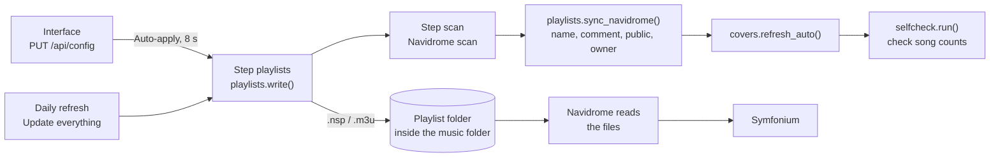

# Playlists: music world × vibe × person

This chapter describes how a playlist definition in `config.json` becomes a smart playlist (`.nsp`) or a mix (`.m3u`)
in Navidrome: the model behind it, the rules, writing and syncing, taking over handmade playlists, suggestions and
combined search, the scene catalog, covers and images. The HTTP endpoints for this are in [API](03-api.md), all
configuration fields in [Data model](02-data-model.md).

Modules involved: `app/rules.py` (build rules and evaluate them locally), `app/playlists.py` (write files, sync with
Navidrome, takeover, “Keep this mix”), `app/mixer.py` (mixes), `app/feedback.py` (mixes that learn),
`app/selfcheck.py` (self-check after the scan), `app/suggest.py` (suggestions, “To review”), `app/web.py`
(combined search), `app/scenes.py` +
`app/scenes.json` (scenes), `app/covers.py`, `app/images.py`, `app/library.py`, `app/navidrome.py`.



## The model

A playlist is a combination of **music world** (who plays), **vibe** (what is played) and **person**
(for whom). In the code, music worlds are called `welt` and vibes `stil`.

### Music world (`welt`)

A music world is a group of bands, extended by album series and genres.

| Field | Effect |
|---|---|
| `artists` | bands added by hand; rule per band `is artist` **or** `is albumartist` |
| `scene`, `autoScene` | link to a scene from `app/scenes.json`; with `autoScene: true`, its typical bands belong to the world, plus all bands that `autowelten.py` assigns to this scene (genres, Last.fm, AI style, language, decade) – including ones added later |
| `auto` | created by Tuttiphon itself (date) – see [Intelligence](06-intelligence.md#automatic-music-worlds-appautoweltenpy) |
| `excludedArtists` | bands taken out of the scene (affect only the automatically recognized ones) |
| `albums` | album series: `contains album` (the album name contains the text) |
| `genres` | `contains genre` – every song with this genre belongs to the world |
| `excludeTitles`, `excludeAlbums` | hidden in playlists of this world (`notContains title/album`) |
| `minRating` | minimum rating of the world (0 = none) |
| `minDuration` | minimum length in seconds; `null` = the setting `settings.minDuration` |
| `separate` | “separate world”: stays out of all *All* playlists |

`welt_artists()` returns the bands of a world: first `artists`, then the scene bands (`scene_members()` →
`autowelten.members()`: typical and recognized) without `excludedArtists`. Scene bands can only be determined with the
library (`BuildContext.lib`); without the library only the typical or manual bands count. `auto_artists()` returns the
scene bands that are not already included manually (for the “automatic” display).

The `welt` field of a playlist is either `"*"` (**All**), an ID or a **list** of IDs (several worlds whose rules are
merged into one shared OR block). *All* means: the whole library without the worlds with `separate: true` – for each
such world, its bands are added as `isNot artist`/`isNot albumartist`, its albums as `notContains album` and its genres
as `notContains genre` (`welt_negation()`). Because Navidrome has no “does not start with”, the world block also
includes albums via `contains` – so exactly what the separate world includes drops out of *All*. Bands from the
playlist's `addArtists` get no `isNot` rules (`welt_negation(keep=…)`); the album and genre exclusions still apply to
them.

**Child profile.** For a person with `child: true` (set only by the administrator) the children's music belongs to *All*:
`rules.child_worlds()` names the separate worlds that are not negated for them – every separate world except audio
plays & audiobooks (`scene: "hoerspiel"`, `SPOKEN_SCENE`), which do not belong in a music mix. So discovered, album of
the week, own sound, good morning, rediscover and every “All × vibe” playlist of a child include children's songs;
`summary()` names only the worlds still left out. `mixer.settings_key()` adds `{"child": true}` (only when set, so
existing mixes keep their fingerprint), so mixes are picked anew right away. Everyone else's *All* stays as it is.

### Vibe (`stil`)

A vibe describes *what* is played. All criteria are in one OR block (`stil_block()`), filters are added as AND
rules.

| Field | Effect |
|---|---|
| `group` | group in the interface and in suggestions: `Genre`, `Thema`, `Jahreszeit`, `Zeitreise`, `Spezial`, `Klang` (shown as Genre, Topic, Season, Time travel, Special, Sound) |
| `kind` | `normal` or `season` (the aggregate vibe “Right for the season”) |
| `genres` | `contains genre` |
| `artists` | `is artist` (track artists only) – e.g. artists without genre tags that were assigned under vibes |
| `albums`, `titles` | keywords: `contains album` / `contains title` |
| `filters` | AND filters, see below |
| `season` | `["MM-DD", "MM-DD"]` – the period in which the vibe “fits right now”; may span the turn of the year |
| `excludeElsewhere` | `albums`/`titles`/`genres` that are hidden in **all other** playlists |
| `sound` | sound filter (sound vibes only), see [Mixes](#sound-filter) |

| Filter (`filters`) | Rule |
|---|---|
| `years: [from, to]` | `inTheRange year` |
| `loved: true` | `is loved` |
| `addedDays: n` | `inTheLast dateadded n` |
| `notPlayedDays: n` | `notInTheLast lastplayed n` |
| `neverPlayed: true` | `is playcount 0` (cannot be set in the interface) |
| `minRating: n` | raises the minimum rating (see [Rating](#rating-and-only-the-hits)) |

The groups of the bundled vibes (`app/default_config.json`): **Genre** (genre lists), **Thema** (“Topic”: keywords in
album/title, e.g. dancing, sleep, summer), **Jahreszeit** (“Season”: spring, autumn, Halloween, winter, Christmas with
`season` and `excludeElsewhere`; plus “Right for the season”), **Zeitreise** (“Time travel”: decades via `years`),
**Spezial** (“Special”: Top hits `minRating: 4`, Favorite songs `loved`, Newly added `addedDays: 60`, Not heard in a
while `notPlayedDays: 90` + `minRating: 3`) and **Klang** (“Sound”: Falling asleep, Calm & gentle, Good mood,
Danceable, Running wild, Full power – only with `sound`).

**Season dates.** `season_active()` compares `MM-DD` as text: if `start <= end`, the range is inclusive,
otherwise (e.g. `["11-25", "01-06"]`) “from start or until end”. February 29 counts as February 28 – otherwise a
winter “until `02-28`” would end a day too early in leap years. `season_soon()` checks today, in 10 and in 21 days
(for suggestions). `active_season_stile()` returns all vibes with an active season except the aggregate vibe itself.

**Right for the season** (`kind: "season"`) builds its OR block from the `stil_block()`s of all currently active
season vibes; their `filters` are not carried over. If no season is active, the placeholder rule
`{"is": {"title": "– no season active –"}}` is used – the playlist is then empty instead of “everything”. The comment
gets “(currently: …)” appended. Because the rules change with the date, the daily refresh rewrites the file as soon as
a season begins or ends.

### Person

| Field | Contribution |
|---|---|
| `user` | Navidrome account that **owns** the playlist. Navidrome evaluates `rating`/`loved` with that account's stars and favorites; mixes pick from that account's point of view (see [Mixes](#person-and-view)) |
| `public` | visibility in Navidrome (the playlist's `public`) and for other Tuttiphon users (`auth.visible_playlist`, see [Security](07-security.md)); if the value is missing, the person is private in both cases |
| `prefix` | prepended to the built name, e.g. `"Kind · "` |
| `likes` | `welten`, `stile`, `artists` – the basis of the [suggestions](#suggestions) |
| `dislikes` | dislikes: `artists` (`isNot artist`/`albumartist`) and `genres` (`notContains genre`) in **every** playlist of the person |

If a playlist has no `person`, `settings.defaultPerson` applies (`person_of()`) – also for visibility in Tuttiphon
(`auth.visible_playlist()`). The default person also determines from whose point of view the
[library cache](#library-cache-applibrarypy) loads. If the default person does not exist either, `public` in the
`.nsp` falls back to `settings.public`.

### Playlist entry

The most important fields of an entry in `config.json → playlists` (complete list in [Data model](02-data-model.md)):

| Field | Meaning |
|---|---|
| `welt`, `stil`, `person` | the model; `"*"` = All or Everything |
| `hits` | “Only the hits” |
| `minRating` | minimum rating; overrides world and vibe |
| `sort`, `limit`, `notPlayedDays` | sort order, maximum number, “not played for” (smart playlists only) |
| `minDuration` | minimum length; overrides world and setting |
| `addArtists`, `excludeArtists` | single bands added or never included |
| `type: "mix"`, `mix` | mix instead of smart playlist, with [options](#options) |
| `radio` | `{"seed": [Bands], "bands": 25}` – [Radio](#radio) |
| `sound` | its own sound filter (otherwise the vibe's) |
| `name` | custom name; replaces the built name completely (without prefix) |
| `status` | `aktiv`, `pausiert`, `papierkorb` (active, paused, trash; plus `deletedAt`) |
| `file`, `takeover`, `cover` | maintained only by the server (see below) |
| `rules`, `rulesOp`, `sortRaw`, `limit`, `rulesExtra`, `originalName` | handmade rules taken over unchanged |
| `created`, `source` | creation date, origin (e.g. `handgemacht`, `radio`, `statistik`) |

### Names and description

`playlist_name()` in this order:

1. `name` set → exactly this name.
2. rules taken over (`rules`) → `originalName`.
3. otherwise the person's prefix +
   - radio: `Radio · A & B …` (at most two seed bands, then “…”),
   - mix: `Daily Mix · <worlds> · <vibe>` (or Weekly/Monthly; without world and vibe “Everything”),
   - otherwise `base_name()`: without a vibe `<worlds> · All Sorts` (German “Querbeet” – “Mix” is only for real
     mixes) or `<worlds> · The Hits`; without a world only the vibe name; otherwise `settings.namePattern`
     (default `{welt} · {stil}`), for hits with “ (Hits)” after the vibe name. Several worlds are joined with “ + ”.

`describe()` returns the short description `<worlds or settings.allName> × <vibe or Everything>` (radio:
“A and similar bands”; mix: “Daily Mix – …, max. 3 per band, renewed daily”). It follows the marker
`Tuttiphon: ` in the comment of every generated playlist. This marker (`config.MARKER`) is how
Tuttiphon recognizes its own files and Navidrome playlists.

`summary()` describes the rules in plain language for the detail page. It derives two lines from the actual
rules:

- **“Without …”** is built from `settings.excludeTitles` plus the `excludeTitles` of the selected worlds
  (`_title_filters_text()`): keywords containing “live” become “live recordings”, “unplugged”, “instrumental” and
  “karaoke”/“playback” become “unplugged, instrumental and karaoke versions”; other keywords appear as
  “titles with “…”” (at most three, then “…”). Without title exclusions the line is missing.
- **“Hidden:”** names all other vibes with `excludeElsewhere` (`albums`, `titles` or `genres`); for
  “Right for the season”, the currently active seasons do not count – as in `build_nsp()`.

In addition:

- **“From ★★★ (or marked as favorite)”** names the effective minimum rating (`_min_rating()`, as in `build_nsp()`):
  the playlist's own, otherwise the one inherited from the music world or `settings.allMinRating` and the vibe's filter
  (see [Rating](#rating-and-only-the-hits)). With “Only the hits”, the hits line appears instead; without a
  minimum rating the line is missing.
- **“Learns as you listen: …”** appears for mixes as long as `settings.mixLearn` is on ([Mixes that learn](#mixes-that-learn-appfeedbackpy)).

## Rules (`app/rules.py`)

### Structure of an `.nsp`

`build_nsp(cfg, playlist, ctx)` creates the JSON that Navidrome reads as a smart playlist. `ctx` is a
`BuildContext` with the library (for scene bands, radio and the hits threshold) and the date (for seasons).
At the top are `name`, `comment` (`Tuttiphon: …`) and `public`, then an `all` block (all rules must match)
in this order:

| # | Block | Content |
|---|---|---|
| 1 | **Who** | radio: `any` over seed bands + similar bands. Worlds: `any` over all `welt_block()`s. *All*: exclusion of the `separate` worlds. `addArtists` go into the `any` block; with *All* there is none, so `welt_negation()` exempts them from the band exclusion |
| 2 | **What** | `any` over `stil_block()` (for “Right for the season” over the active seasons) + `filter_rules()` |
| 3 | **Hide topics** | `excludeElsewhere` of every other vibe as `notContains album/title/genre` |
| 4 | **Dislikes** | the person's `dislikes` and the playlist's `excludeArtists` |
| 5 | **Tidy up** | `settings.excludeTitles` + `excludeTitles` of all selected worlds (`notContains title`), the worlds' `excludeAlbums`, minimum length `gt duration` |
| 6 | **Rating** | `any: [gt rating (n−1), is loved true]` |
| 7 | **not played** | `notInTheLast lastplayed` from `playlist.notPlayedDays` |
| 8 | **present** | `{"is": {"missing": false}}` – always (see below) |

Then `sort` and `limit` (`playlist.limit` › `settings.limit` › 100). `_dedupe()` removes duplicate rules.

**Topics that are hidden everywhere else.** For every vibe except the playlist's own (and except the currently active
seasons in “Right for the season”), its `excludeElsewhere` keywords are added to the playlist as exclusions.
That way Christmas, lantern or lullaby songs appear all year only in their own vibe or in the
season collection – also in mixes and radios.

**Live, instrumental & co.** `settings.excludeTitles` (the default includes “(Live”, “Live at”, “Unplugged”,
“Instrumental”, “Karaoke”, “Playback”) applies in every playlist. With several worlds, the `excludeTitles` and
`excludeAlbums` of *all* selected worlds apply to all songs of the playlist.

**Minimum length.** `playlist.minDuration`, otherwise with exactly one world its `minDuration` (or
`settings.minDuration`), with several worlds the minimum over the worlds (each the world value or the setting),
without a world `settings.minDuration`. 0 or empty = no rule.

### Example

Music world “kinder” (two bands, genre “Children”, `separate`, `minDuration: 45`, `minRating: 0`, one title and one
album exclusion) × vibe “Tanzen & Toben” (keywords) for the person “familie” (dislike “Band X”); another
vibe “Weihnachten” has `excludeElsewhere`; `settings.excludeTitles` is shortened to three entries here.
Output of `build_nsp()` (example data from a German-language installation; formatted compactly for readability only,
content unchanged):

```json
{
  "name": "Kinder · Tanzen & Toben",
  "comment": "Tuttiphon: Kinder × Tanzen & Toben",
  "public": true,
  "all": [
    {"any": [
      {"is": {"artist": "Band A"}},
      {"is": {"albumartist": "Band A"}},
      {"is": {"artist": "Band B"}},
      {"is": {"albumartist": "Band B"}},
      {"contains": {"genre": "Children"}}
    ]},
    {"any": [
      {"contains": {"album": "Tanz"}},
      {"contains": {"album": "Party"}},
      {"contains": {"title": "Tanz"}}
    ]},
    {"notContains": {"album": "Weihnacht"}},
    {"notContains": {"title": "Jingle Bell"}},
    {"notContains": {"genre": "Christmas"}},
    {"isNot": {"artist": "Band X"}},
    {"isNot": {"albumartist": "Band X"}},
    {"notContains": {"title": "(Live"}},
    {"notContains": {"title": "Instrumental"}},
    {"notContains": {"title": "Karaoke"}},
    {"notContains": {"title": "(Kapitel"}},
    {"notContains": {"album": "Hörspiel"}},
    {"gt": {"duration": 45}},
    {"is": {"missing": false}}
  ],
  "sort": "random",
  "limit": 100
}
```

The same configuration as *All* × “80er” (filter `years`) with “Only the hits” and sort order `beliebt` (most popular):
instead of the world block there is the exclusion of the separate world “kinder”, the minimum length comes from
`settings.minDuration`, and the rating comes at the end. Without the library, the hits threshold is 4 stars because
`settings.allMinRating` is 3:

```json
{
  "name": "80er (Hits)",
  "comment": "Tuttiphon: Alle × 80er",
  "public": true,
  "all": [
    {"isNot": {"artist": "Band A"}},
    {"isNot": {"albumartist": "Band A"}},
    {"isNot": {"artist": "Band B"}},
    {"isNot": {"albumartist": "Band B"}},
    {"notContains": {"genre": "Children"}},
    {"inTheRange": {"year": [1980, 1989]}},
    {"notContains": {"album": "Weihnacht"}},
    {"notContains": {"title": "Jingle Bell"}},
    {"notContains": {"genre": "Christmas"}},
    {"isNot": {"artist": "Band X"}},
    {"isNot": {"albumartist": "Band X"}},
    {"notContains": {"title": "(Live"}},
    {"notContains": {"title": "Instrumental"}},
    {"notContains": {"title": "Karaoke"}},
    {"gt": {"duration": 120}},
    {"any": [{"gt": {"rating": 3}}, {"is": {"loved": true}}]},
    {"is": {"missing": false}}
  ],
  "sort": "-rating",
  "limit": 100
}
```

The last rule `{"is": {"missing": false}}` is in every `.nsp` that `build_nsp()` builds itself (not for
rules taken over unchanged, see below): Navidrome keeps files that no
longer exist (e.g. the old FLAC after the conversion to Opus) as “missing” and counts them in the evaluation
– Symfonium leaves them out, so the playlist there would be shorter than its limit. Locally (`Library`), `missing` is
always `false` because the song list from Navidrome contains only existing files.

### Rating and “Only the hits”

The minimum rating is `playlist.minRating` if set. Otherwise the minimum of the `minRating` of all selected worlds
(for *All*: `settings.allMinRating`), but at least the vibe's `filters.minRating`. The rule is always
“rating ≥ n **or** favorite” (`any: [gt rating n−1, is loved true]`). Navidrome decides whose stars count:
those of the playlist owner. Where the stars come from (Deezer rating) is described in [Maintenance](05-maintenance.md).

**Only the hits** (`hits: true`) replaces the minimum rating with a calculated threshold (`hits_threshold()`),
roughly the most popular third of what would be in the playlist without a rating rule:

1. Base set: all songs that match rules 1–5 (evaluated locally).
2. `at_least(t)` counts songs with a rating ≥ t − 0.25 or favorite; the base count is `at_least(minimum rating)`
   (without a minimum rating: all).
3. Target: `max(min(25, base count), settings.hitsShare × base count)` (default `hitsShare` 0.3).
4. The highest threshold from 5 down to minimum rating + 1 that reaches the target is chosen; otherwise
   minimum rating + 1 – even if only a few songs remain then: “The hits” are never simply all songs. Only if the
   base count is 0 does the minimum rating stay.

Without the library (e.g. when building without Navidrome), `max(minimum rating + 1, 3)` applies. The threshold is
recalculated on every write and stored in the file as a fixed value.

### Sorting

| `sort` | in the `.nsp` | Meaning |
|---|---|---|
| `random` (default) | `random` | Navidrome shuffles anew on every request |
| `neu` | `-dateadded` | newest first |
| `beliebt` | `-rating` | most popular first |
| `vergessen` | `lastplayed` | longest unplayed first |

Mixes have no sort order; their order is set by the [mixer](#selection).

### Rules taken over unchanged

If a playlist has `rules` (takeover “unchanged”), `build_nsp()` builds nothing itself: header (name = `name`, otherwise
`originalName`; comment `Tuttiphon: custom rules (taken over unchanged)`, `public` of the person) + `rulesOp`
(`all`/`any`) with the original rules + `sortRaw` + `limit` + all other original keys from `rulesExtra`
(e.g. `order`).

### Local evaluation (`Library`)

Navidrome evaluates the `.nsp` itself. For preview, song counts, matrix, suggestions and mixes, Tuttiphon recomputes
the same rules locally against the song list (`Library.ids()`, `Library.match()`). The class replicates the SQL logic
of Navidrome 0.64 (`persistence/criteria_sql.go`):

| Topic | Behavior |
|---|---|
| multi-valued fields | `artist`, `albumartist`, `genre` are lists (tags/roles); a rule matches if one value matches |
| negations | for multi-valued fields like `NOT EXISTS` (a song without a genre passes `notContains genre`); for columns like `NOT LIKE` (missing value = no match) |
| text | `contains`/`startsWith`/`endsWith` case-insensitive; `is` exact |
| rating | missing = 0 |
| `gt duration` | Navidrome stores seconds with decimals, the API returns them truncated – hence `v + 0.999 > value` |
| date | `inTheLast`/`notInTheLast` compare the date (first 10 characters) with today − n days. As in Navidrome (timestamp > `'YYYY-MM-DD'`), the boundary day belongs to `inTheLast` (date ≥ boundary); `notInTheLast` matches songs without a date or with a date before the boundary |
| `filepath` | as in Navidrome, the real file path (`Library._load_paths()` → `library.real_paths()`, native `GET /api/song`); Subsonic only returns a path built from tags. If Navidrome cannot be reached for this, that built path serves as an approximation – for this loaded library |

Supported fields: `artist`, `albumartist`, `genre`, `album`, `title`, `filepath`, `year`, `duration`, `rating`,
`loved`, `playcount`, `lastplayed`, `dateadded`. Operators: `contains`, `notContains`, `startsWith`, `endsWith`,
`is`, `isNot`, `gt`, `lt`, `inTheRange`, `inTheLast`, `notInTheLast`. Anything else raises `ValueError` (“is not
supported in the preview”) – for handmade rules, the takeover then shows no song count. Results are cached
per rule (as a JSON key, a bit mask) in the `Library` object; `all` intersects, `any` unites. A rule part is not
tested song by song but looked up in an index of the field's distinct values (value → songs, lowercased text →
songs), built once per field – a band rule takes microseconds, so music worlds with hundreds of bands cost little.
Account lists with the same songs in the same order as the default list share these caches for the fields that do not
depend on the account (bands, genres, album, title, year, length, date added – not `filepath`, not “in the last n
days”) – see [Statistics](06-intelligence.md#statistics).

**Accuracy.** The library is loaded from the default person's point of view (see [Library cache](#library-cache-applibrarypy)).
If that person's password is stored, the ratings are exact (`ratings_exact`); otherwise the local evaluation uses the
average rating as an approximation. Smart playlists of other people are also precomputed with the stars of the
default person – Navidrome uses the owner's. Mixes compute from their person's point of view.

**Functions built on this:**

| Function | Purpose |
|---|---|
| `preview()` | name, song count, limit, `nsp`, top artists, cover, main color, sample (with tempo/mood from the sound analysis) and `summary()`. For mixes exactly the current selection (`mixer.pick()`), plus `pool` = size of the pool |
| `count()` | song count of a playlist (incl. sound filter) |
| `matrix()` | song count for every combination world × vibe (incl. *All*/*Everything*, without *All* × *Everything*), person = default person; plus the active seasons |
| `similar_artists()` | bands without a world that fit a world by genre (TF-IDF cosine: rare genres count more; ≥ 5 songs; threshold 0.35; a world genre found in the name of a band genre counts at least 0.9) |
| `untagged_artists()` | bands with ≥ 5 songs of which ≥ 80 % have no genre |
| `library_index()` | artists, genres, albums, formats, MP3 albums, favorites, played songs |

## Writing and sync (`app/playlists.py`)

### Playlist folder

`playlist_dir()` returns the playlist folder from the storage locations (`config.paths()`, see
[Operations](08-operations.md)) – but only if it is **inside the music folder**, because Navidrome only reads playlists there.
Otherwise `<music folder>/00_SmartPlaylists` applies. If the folder is missing, `write()` creates it (provided the music
folder exists).

On the NAS share, writing happens exclusively with `write_atomic()` (temporary file, permissions explicitly 664,
then rename) and reading with retries (`read_text()`); the rename changes the folder time, so
Navidrome's quick scan sees the change.

### Stable file names

Navidrome identifies playlists by their file path. That is why every playlist keeps its file (field `file`), even when
its name, rules or person change – in Navidrome and Symfonium it stays the same playlist (same ID).

`plan()` goes through all active playlists and assigns missing file names:

1. If the extension no longer matches the type (`.nsp` ↔ `.m3u`, e.g. a smart playlist became a mix), `file` is removed
   – a new file is created, and `write()` cleans up the old one.
2. If the playlist already had a file before (according to `managed_playlists.json`), it is reused.
3. Otherwise: `settings.filePrefix` (default `Auto – `) + sanitized name + extension, e.g.
   `Auto – Kinder · Tanzen & Toben.nsp`. Invalid characters become `-`, the name is shortened to 180 bytes.
   On a collision with assigned, handmade or foreign files, ` (2)`, ` (3)` … is appended; an existing
   file with the Tuttiphon marker that belongs to no playlist (e.g. after an aborted run) is
   reused.

The file name is set on the first write and carried into the configuration by the run
(`tasks._step_playlists`). After that, only the server maintains `file` (see [Fields owned by the server](#fields-owned-by-the-server)).

### `state/managed_playlists.json`

```json
{
  "current": {"Auto – Kinder · Tanzen & Toben.nsp": "kinder-tanzen", "Auto – Daily Mix · Kinder.m3u": "mix-kinder"},
  "ever": ["Auto – Daily Mix · Kinder.m3u", "Auto – Kinder · Tanzen & Toben.nsp"]
}
```

`current`: file → playlist ID for everything Tuttiphon manages after the last run. `ever`: all files
Tuttiphon has ever written. An older format `{file: name}` is converted on reading. `owned_files()` =
`current` ∪ `ever` ∪ all `file` fields of the configuration.

**What Tuttiphon may touch** (`_is_ours()`): files in `current`, files with the Tuttiphon marker (`.nsp`: the comment
starts with `Tuttiphon`; `.m3u`: `# Tuttiphon` in the first 400 characters) and taken-over files whose original
is already backed up. Everything else is considered foreign.

### `write()`

1. `plan()` – active playlists with file name and built `.nsp`.
2. For each playlist, generate the content (`render()`: `.nsp` as JSON with indentation 2, mix as `.m3u`).
   For mixes, the selection is remembered in `state/mixes.json` and in the mix history (`state/mix_history.json`).
3. Same content as on disk → *unchanged*. Otherwise write – back up first if
   - it is a takeover without a backup (first takeover: original to `backup/`, name in `takeover.backup`), or
   - the existing file is foreign (a foreign file with the same name is never overwritten without a backup).
   Backups are named `backup/YYYY-MM-DD_HHMMSS_<file>`.
4. An error in one playlist does not stop the others (*with errors*).
5. Files from `current` or the configuration that no longer belong to an active playlist and belong to Tuttiphon
   are deleted (“removed from Navidrome”). Foreign files are left alone. If the file belongs to a taken-over
   playlist that Tuttiphon has never written (`takeover.backup` empty), `write()` first backs up the original
   to `backup/` and records the backup in `takeover.backup` – so the file counts as its own and is removed.
6. `managed_playlists.json` is saved even after an error – otherwise the next run would create duplicates.

Return value: `written`, `unchanged`, `removed`, `failed`. If all playlists fail, `write()` raises an error.
`dry_run` (dry run) writes, backs up and deletes nothing and remembers no mix selection. New file names and
`takeover.backup` are then carried into the current configuration by `tasks._step_playlists()` via `update_config()`.

### When files are written

Playlist files are created only in the `playlists` step of a run (runs: [Maintenance](05-maintenance.md)):

| Trigger | Steps |
|---|---|
| **Auto-apply** after saving the configuration or a takeover | `playlists`, `scan` (“Applied automatically”) |
| “Apply now” (`/api/apply/now`) | `playlists`, `scan` |
| daily refresh, `settings.dailyMode = "playlists"` | `playlists`, `scan` |
| daily refresh, `dailyMode = "alles"` / “Update everything” | all configured steps (`settings.pipeline`), provided `playlists` is one of them |
| folder watch, if classification may assign new bands by itself (`analysis.classify` = `auto`, or `suggest` with `analysis.autoNew`) | `playlists`, `scan` after `analyse` – newly classified bands thus go straight into the playlists of their music world |

Without this classification, the folder watch starts no `playlists` step, but it does start `scan` – and with it the sync
([Maintenance](05-maintenance.md#folder-watch)). If the daily refresh cannot start (something is already running,
or another instance is working), the schedule tries again in the next minute.

**Auto-apply** (`web.AutoApply`, switch `settings.autoApply`, default on): every save via
`PUT /api/config` and every takeover schedules a run in **8 seconds**; saving again postpones the time.
When it fires: if no run is in progress and `pending_count()` says there is nothing to do (no playlist in the state *neu*,
*geändert*, *scan* or *entfernen*, no orphaned files) → nothing. If a run is in progress, something is pending and
the run has only pausable steps left (`flac`, `lyrics`, `analyse`, `deezer` – e.g. the night analysis),
`RUNNER.pause_for()` pauses it briefly: first “Applied automatically” runs, then the rest as “… (continued)”
([Maintenance](05-maintenance.md#short-pause-for-an-apply-pause_for)). If the current run still writes playlists itself
(or nothing is pending during the run) → again in 30 s. If the lock against other instances prevents a start → again in 20 s. If Navidrome is
unreachable → again in 60 s. Starting a run manually cancels the scheduled time; “Apply now” only does so
once its run has actually started or the pause is registered (if the start fails, the scheduled time remains); “Apply now”
also pauses a pausable run. The remaining seconds are in `/api/task` under `auto.due`,
waiting for a running run as `auto.waiting`.

### Sync with Navidrome (`sync_navidrome()`)

Runs in the `scan` step after the Navidrome scan, via Navidrome's own REST API (`NativeApi`, admin access). In a
dry run (`dry_run`), scan and sync are skipped entirely.

1. `navidrome_index()`: Navidrome playlists whose file is in the playlist folder (the name of the
   parent folder is compared), as file name → playlist.
2. For each active playlist, the target values `name`, `comment`, `public` and – if the person's account exists in
   Navidrome – `ownerId`. Only differing fields are set via `PUT /api/playlist/{id}`. If the account does not
   exist, a warning appears in the log; likewise if the person has no Navidrome account at all (“person without a
   Navidrome account – stars/favorites come from the admin account”: the playlist stays with the admin, Navidrome
   evaluates the admin's stars). If setting the values fails for a playlist (`NavidromeError`), the log reports “⚠ …: not
   updated in Navidrome”, and the sync continues with the others.
3. If a playlist is missing in Navidrome (e.g. deleted there by hand), its file gets a new modification time
   (`os.utime`) so the next scan reads it in again. The step then starts a second, quick scan
   and syncs again; it only counts as successful if nothing is missing afterwards.
4. Navidrome playlists from the folder that belong to no active playlist, belong to Tuttiphon (file in
   `owned_files()` or comment with the marker) and whose file no longer exists are deleted in Navidrome.
   If that fails, “⚠ …: not removed from Navidrome” appears in the log, and it continues with the next one.
5. Then `covers.refresh_auto()` renews designed covers (see [Covers](#covers-appcoverspy)).
6. Finally, the self-check (`selfcheck.run()`) checks whether Navidrome shows as many songs for each playlist as
   Tuttiphon expects – deviations appear under “To review” ([Maintenance](05-maintenance.md#self-check)).

**Why the owner must be set.** Navidrome creates a playlist file it reads in – including one that is read in again
after deletion – as a playlist of the first administrator, not of the account it is meant for.
But Navidrome evaluates rules on `rating` and `loved` with the owner's stars and favorites. On later
scans, Navidrome no longer takes name, comment,
visibility and owner from the file but keeps the values from its database. That is why
Tuttiphon sets these four fields via the API after every scan; the file only provides the initial value.

### States

`status()` returns a state (`state`) for each playlist for the interface. The Navidrome data in it is
at most 20 seconds old (`api_playlists()` is cached accordingly). It only picks mixes if they are active
and not resting – once; the selection also serves the file comparison (`file_state(…, order=…)`); for paused,
resting or deleted mixes the pool size counts (at most `mix.size`).

| State | Meaning |
|---|---|
| `aktuell` (up to date) | file matches (for `.nsp` compared without `name`/`comment`/`public`), playlist is in Navidrome, name, visibility and owner match |
| `neu` (new) | no file yet |
| `geändert` (changed) | file content differs (for mixes: today's selection is a different one), file unreadable, takeover still without a backup, or name/visibility/owner differ in Navidrome |
| `scan` | file matches, but Navidrome does not know the playlist yet |
| `entfernen` (remove) | paused or in the trash, but still in Navidrome, or its own file still exists |
| `pausiert`, `papierkorb` (paused, trash) | removed from Navidrome, the definition stays in the tool |
| `fehler` (error) | rules cannot be built (e.g. world or vibe deleted); message in `error` |

If Navidrome is unreachable, the Navidrome checks are skipped (the message is then in
`navidromeError`, if any). In addition, `status()` returns `orphans`: files from `current` that belong to no active
playlist but still exist.

### Rename, pause, delete, duplicate

These actions only change the configuration (interface → `PUT /api/config`); the next run does the rest.

| Action | What happens |
|---|---|
| **Rename** | `name` changes → new content in the **same** file → the sync sets the name via the API |
| **Pause** | `status: "pausiert"` → `write()` deletes its own file (a takeover that was never written only after backing up the original) → the sync deletes the Navidrome playlist. The definition stays; “Reactivate” writes the same file again, and Navidrome creates the playlist with a new ID |
| **Trash** | like pausing, plus `deletedAt`; “Restore” removes `deletedAt` again |
| **Delete permanently** | the entry disappears from the configuration; a file that still exists is in `current` and is removed on the next run |
| **Pause from “To review”** | `pause`/`pauseAll`: playlists from which no song has played on any account for 90 days (`suggest.unused_playlists()` – only once the recap has been counting that long, only for playlists that old, never for seasonal playlists), with “Undo”; duplicate playlists of the same person with exactly the same selection are reported by `duplicate_playlists()` – all fields that select or order are compared (`suggest.CONTENT_FIELDS`, lists regardless of order) |
| **Empty trash** | on the Playlists page: like “Delete permanently” for all playlists the trash currently shows (with filter by person and search; users only their own), after a confirmation and with “Undo” (`purgeAll()`) |
| **Duplicate** | only in the interface: copy without `file`, `takeover`, `cover`, `deletedAt`, with a new ID and the name “… (copy)” (for other people's playlists, for the user's own person) – gets its own file |
| **Undo** | restores the previous state including `file`; the playlist ends up in its old file again |

### Fields owned by the server

`config.merge_server_fields()` protects the fields `file`, `takeover` and `cover` when saving from the interface:
for existing playlists, the server's state always applies; `cover` from the interface is discarded. Only for
new playlists (or playlists brought back via undo) is `file` taken from the interface – only a plain
file name that no other playlist uses and that is not a handmade file in the playlist folder
([Security](07-security.md#playlist-file-names)). `file` and
`takeover.backup` are written back by the `playlists` step; `cover` is set only by the cover endpoints and the sync.

### Taking over handmade playlists (`takeover`)

`handmade()` lists `.nsp` files in the playlist folder that are not in `owned_files()` and carry no Tuttiphon marker
(broken files appear with empty content). They appear under “To review”; they are only touched
after a takeover. Handmade `.m3u` files are not recognized.

`takeover_preview()` shows the song count of the original rules (local; `null` if they cannot be recomputed) and
a guessed mapping. `takeover(cfg, file, mode)` creates a playlist entry (ID from the name, person =
default person, `file` = the existing file, `source: "handgemacht"`, `takeover: {original, date, backup: null}`):

| Mode | Result |
|---|---|
| `unveraendert` (“Take over unchanged”, default) | `welt`/`stil` = `*`, original rules in `rules`/`rulesOp`, `sortRaw`, `limit`, `originalName`, other keys in `rulesExtra` |
| `baukasten` (builder) | `guess_mapping()` maps world × vibe (+ `minRating`, `limit`); if that fails, it is silently taken over as `unveraendert` |

`guess_mapping()`: if the rules contain `is artist`, the world is the one with the largest share of these bands in its
manual `artists` (at least 50 %, otherwise no mapping); without such rules *All*. Vibe = the first one
(except the aggregate vibe) whose name occurs in the playlist name or whose album keywords (only for vibes
with `excludeElsewhere.albums`) are in the `contains album` rules; otherwise the one with the largest genre overlap
(≥ 50 %). If world and vibe both remain `*`, there is no mapping. `minRating` = largest `gt rating` value + 1.
The same function serves “Switch to the builder” in the editor (`/api/mapping`).

The file and the Navidrome playlist stay the same. On the first write, `write()` backs up the original to
`backup/` (until then the state is `geändert`), after that the file carries the Tuttiphon marker. If the playlist
is paused or moved to the trash before Tuttiphon has ever written it, `write()` likewise backs up the original
before removing the file. Only the server creates takeovers: `auth.merge_user_changes()` never accepts the fields
`rules`, `rulesExtra`, `sortRaw`, `takeover` and `originalName` from users – existing playlists
keep the server's state, new ones lose them.

### “Keep this mix” (`snapshot()`)

Saves the current selection as a normal, fixed Navidrome playlist – without a file, without an entry in the configuration.
On the playlist page it is in the “…” sheet: “Keep this mix” for a mix, “Save as fixed playlist” for a smart
playlist ([Interface](09-interface.md#playlist-page-and-playlist-cards)).

- Mix: the current mix selection. Smart playlist: all matching songs (local), with sorting by
  `dateadded`/`rating`/`lastplayed` in that order, otherwise random; at most `limit`.
- Name `<name> – <month> <year>`, e.g. “Kinder · Tanzen & Toben – Oct 2026”.
- Created via Subsonic `createPlaylist` (admin, POST with all song IDs), then comment
  (“Saved mix from …”), `public` and owner are set via the native API.

The comment does not start with the marker, and the playlist has no file in the playlist folder – Tuttiphon never
touches it again.

## Mixes (`app/mixer.py`)

A mix (`type: "mix"`) is a fixed selection that Tuttiphon compiles itself and writes as `.m3u`.
Between renewals the list stays the same – good for offline playlists in Symfonium. The rules
(world, vibe, person, dislikes etc.) are the same as for smart playlists: `build_nsp()` determines the pool, the
mixer picks from it.

### Options

`options()` = `DEFAULTS` overridden by `playlist.mix`:

| Key | Default | Meaning |
|---|---|---|
| `size` | 50 | number of songs (at least 5) |
| `perArtist` | 3 | at most this many songs per band; 0 = no limit |
| `perAlbum` | 2 | at most this many per album; 0 = no limit |
| `flavor` | `ausgewogen` | `ausgewogen` (balanced), `hits` (mostly the hits), `entdecken` (mostly unknown songs), `geschmack` (“Your sound”: the person's taste decides – weight factor cubed; the only mix allowed to be “All × Everything”) |
| `avoidRecent` | 7 | songs played recently (in the last n days) only rarely; 0 = off |
| `every` | `day` | `day`, `week`, `month` (missing/`null` = `day`) |
| `minutes` | – | fixed length in minutes instead of `size`: `select()` takes songs until the total length is reached (at most 500) |
| `salt` | – | random addition from “Reshuffle” |

**Taste:** if the person has a Navidrome account with a stored password and `settings.mixLearn` is on,
`pick()` multiplies the weight of every song by `taste.factor(similarity)` = 0.6 … 1.4 – songs that sound like what the
person likes to hear (sound, the band's AI style) come up more often ([Intelligence](06-intelligence.md#taste-per-account-apptastepy));
with the AI's sound vectors half of it is the [sound taste](06-intelligence.md#sound-taste-appsoundtastepy) of the
account, in “Your sound” 70%.

### Mix day and period

`mix_day()`: the mix day changes at the time of the daily refresh (`settings.dailyAt`, default 05:30), not
at midnight – otherwise all mixes would be “changed” at night. With `dailyMode = "aus"` (off) it changes at midnight.
`period_start()` turns it into the first day of the period: the mix day, the Monday of the week or the first of the month.

### Selection

`select()` returns the song indices in playback order:

1. **Remembered selection.** If `state/mixes.json` contains the same period and the same
   fingerprint (`settings_key()`) for this playlist, exactly that selection is used (without songs that are no longer in the pool).
   That way the mix stays stable over the period, and preview and Navidrome show the same thing.
2. **Randomness with a fixed seed.** Seed `<period start>|<playlist ID>|<salt>`; every song gets its
   own random value from `sha1(seed|song ID)`. So a new album does not shift the whole selection.
3. **Weighted order** following Efraimidis–Spirakis: key `log(u) / weight`, sorted in descending order.
4. **Limits.** Take songs in order as long as the band (`_main_artist()`: album artist, for compilations the
   track artist) and the album have not reached their limit, until `size` is reached.
5. **Order.** With `settings.smoothTransitions` (default on) and without an arc (see below), `smooth()` orders the
   new selection so that one song leads into the next – similar sound, close tempo, compatible key, similar energy
   ([Intelligence](06-intelligence.md#smooth-transitions-in-mixes)); never the same band twice in a row. If fewer
   than half of the songs have a sound vector or a key from the AI (or the setting is off), **spread** (`spread()`)
   orders as before: greedily always the band with the most remaining songs, but never the same as the previous
   one; within a band the weighted order is kept. A remembered selection (step 1) keeps its order – switching the
   setting applies from the next period.

**Weights** (`weight()`, r = own rating, otherwise the average; favorite = marked in Navidrome):

| Flavor | Weight |
|---|---|
| `ausgewogen` | 1 + 0.6·r + 2 (favorite) |
| `hits` | 0.15 + 0.5·r² + 3 (favorite) |
| `entdecken` | 1 + 2 (never played) + 0.8 (r ≤ 2) − 0.5 (r ≥ 4) + 0.5 (favorite) |

With `avoidRecent`, the weight is multiplied by 0.08 if the song was played in the n days before the start of the period (first mix day at the
time of the refresh). Plays **after** that start (UTC comparison with Navidrome's `played`)
do not count yet – otherwise just listening would change today's selection. Minimum weight 0.01. If
`settings.mixLearn` is on, `pick()` first removes the songs rated 1 star by hand from the pool, and `select()`
multiplies the weight by the song's learned factor (see [Mixes that learn](#mixes-that-learn-appfeedbackpy)).

`settings_key()` is a fingerprint of everything that determines the selection: `welt`, `stil`, `person`, `hits`,
`minRating`, `addArtists`, `excludeArtists`, `mix`, `type`, `rules`, `rulesOp`, the definitions of the selected worlds
and the vibe – without `name`, `icon`, `color`, `description` and `group`, so renaming or a new icon does not
reshuffle the mixes –, the person's account and dislikes, the settings `minDuration`, `allMinRating`, `excludeTitles`,
`hitsShare` and – only if set on the playlist – the playlist's `radio`, `sound`, `minDuration` and `notPlayedDays`
(so the fingerprint of mixes without these fields does not change). If any of this changes, a new selection is made
immediately. `state/mixes.json` contains, per playlist ID,
`{"day", "key", "ids"}` and is trimmed to existing playlists on writing.

**Reshuffle** sets a new `mix.salt` in the interface – this changes seed and fingerprint, and
the next run writes a different selection.

### Person and view

`person_lib()`: if the mix belongs to a person with a different Navidrome account than the library cache, the mixer loads
the song list from that account's point of view (`stats.songs_for()`: its stars, favorites, plays; cached for 10 minutes).
Without a stored password for the account, it uses the default library. The selection is then mapped back to the
indices of the default library.

### Mixes that learn (`app/feedback.py`)

Mixes learn locally from listening, per Navidrome account of the person. Switch: `settings.mixLearn` (default on;
Settings → Playlists, card “Mixes that learn”). If it is off, none of this has any effect – the history is still
kept.

| Signal | Source | Effect |
|---|---|---|
| skipped | mix history + the account's daily play increments (recap, `state/plays/<account>/`) – or, with the Navidrome plugin, live: a song left within 30 s for another one | weight drops, recovers over time |
| played | the same – live: every scrobble | partly offsets skipping |
| 1 star by hand | the account's star in Navidrome (e.g. given in Symfonium) that was not set by the Deezer rating (rules below) | the song no longer appears in this person's mixes |

**Remembering.** `mixer.remember()` calls `feedback.record()` when writing the `.m3u`: start of the period, `every`, account
and song IDs go to `state/mix_history.json` – per mix the last 12 periods (`KEEP_PERIODS`). If the
person has no account, nothing is remembered.

**Evaluating.** Before writing, the `playlists` step calls `feedback.learn()` and `forget_removed()` (not in a
dry run; an error there does not stop the writing, it appears in the log as “⚠ Learning from mixes: …”). `learn()`
takes every period not yet evaluated whose last day is before today:

1. The account needs recap counter snapshots that started before the beginning of the period (`since`). If they are missing,
   the entry waits – up to 14 days after the end of the period, then it is discarded (e.g. no password for the account).
2. Only once a counter snapshot from 04:00 on the following day exists (`at`) are the plays of the last day final;
   until then the entry waits. Counter snapshots are taken daily from `dailyAt`, at server start and when viewing the
   recap ([Intelligence](06-intelligence.md#recap)).
3. Played = songs of the mix with plays in the period (`rueckblick.plays_between()`; whether from the mix or elsewhere,
   Navidrome cannot tell). If fewer than 3 were played (`MIN_HEARD`), the period says nothing and is only marked as
   done.
4. **Played in order?** Of the positions up to the last played song, at least half must have played
   (`SEQUENTIAL` = 0.5). Otherwise listening was shuffled or limited to single songs (e.g. from albums) – skipping
   cannot be detected then, and the period is only marked as done (without `s` and without `p`).
5. Otherwise every song **before the last played one** that did not play counts as skipped: the last day of the period
   goes into its list `s` (at most 10 entries) – at most one mark per song and week: if the last mark
   is less than 7 days old, no new one is added (daily mixes repeat songs). Every played song gets
   `p + 1`.

The result is stored per account in `state/feedback/<account>.json`; the log reports “Mixes learn: n periods
evaluated – k× skipped, m× played.”

**Live plays** (the Navidrome plugin as scrobbler, `app/listen.py`): Navidrome hands every start (“now playing”),
every play (scrobble, with the time it started) and the players' reports (state, position, player) to the plugin,
which passes them to `POST /api/sonic/listen` ([API](03-api.md#navidrome-plugin)) – only for accounts with a person in
Tuttiphon that are not blocked. `listen.skips()`: per player from its reports – a song that gave way to another one
before 30 s (`SKIP_SECONDS`; the furthest position reported or the time until the next song, whichever is more) and
was not scrobbled counts as skipped on that day. Not a skip: a moment of another song between two parts of the same
song (under 5 s, `SHORT_PIECE` – a cross-fade, a report arriving late), going back to the song before (“previous”),
the first song on a player after a pause of 30 minutes (`IDLE_SECONDS` – a resumed queue), a short track left less
than 5 s before its end (the limit is then its length − 5 s, at least 3 s). Without reports from the starts of the
account near the beginning of a song (position up to 15 s, `START_SECONDS`; two devices playing at once on one account
can look like a skip there). `factors()` adds
these skips like the marks of the mix history (half-life 60 days) for every song, not only mix songs, and every live
play makes up for half a skip (`_live_effect()`, cached per account, day and state of the live files). A mix period
with live plays of the account is only marked as done in `learn()` – no guess from the mix history, nothing counts
twice.

**How much a mix is listened to** (`feedback.usage()`, read only, also with `mixLearn` off): the same finished and
counted periods of the mix history (rules 1–2 above, without waiting or discarding) – per mix the number of editions
(`periods`), those with at least `MIN_HEARD` = 3 of their songs played in their period (`heard`), songs and played
songs over all of them (`songs`, `played`), the days covered and the first day of the last edition heard (`last`).
Songs played elsewhere in the period count too. Shown on the playlist page (“Is it listened to?”, `GET /api/playlist` →
`usage`, only for own playlists and administrators); a mix whose finished editions cover at least 12 days
(`UNHEARD_MIX_DAYS`) without a single played song gets the hint “Nobody listens to …” with “Pause” under “To review”
(`suggest.playlist_tidy_items()`, key `unheard-mix|<id>`, not for seasonal vibes and not if the 90-day hint already
names it).

**Applying.** `factors(account)` computes per song (cached until the file or the day changes):

```text
effective = Σ 0.5^(age of the skip in days / 60)  −  0.5 × p
factor    = 0.55^min(effective, 4)      only if effective > 0.05, otherwise 1
```

A fresh skip lowers the weight to 0.55; after 60 days it only counts half (`HALF_LIFE`). Devaluation never goes
below 0.55⁴ ≈ 0.09 – a song should only disappear completely with 1 star.

`manual_dislikes()` returns the songs the account rated 1 star **by hand**. An own star of 1 counts as
by hand if

- the Deezer rating never rated the song (no entry in `state/deezer.json`), or
- it set something other than 1 for this account or did not rate this account at all (field `u` of the entry).

Entries without accounts in `u` do not say who got which star; there the star counts as
automatic – otherwise machine-assigned 1 stars would drop out of the mixes for good. This only works if the song list
contains exactly this account's stars (`person_lib()` with a stored password, or the default library with
exact stars of the same account); otherwise nothing is excluded.

Because the selection of a period stays remembered (`state/mixes.json`), what was learned – and also switching
`mixLearn` – only takes effect in the next newly compiled mix. For mixes, `summary()` shows “Learns as you listen: skipped songs
come up less often, songs rated 1 star by hand not at all”.

### Sound filter

Vibes of the group Klang (“Sound”) (or a playlist with its own `sound`) filter by features from the sound analysis
(`sound_of()`, `apply_sound()` with `audio.matches()`; meaning of the values in [Intelligence](06-intelligence.md)).
Navidrome does not know these features – the filter only works locally: in the preview, song counts and the mix selection.
That is why sound vibes exist only as mixes: the interface (assistant, editor) and the suggestions switch such
playlists to `type: "mix"`, and the server enforces it on saving: `config.normalize_playlists()` turns every
playlist with its own or inherited sound filter (except those taken over unchanged) into a mix, fills in missing
mix options with `{"size": 40, "perArtist": 3, "every": "week"}`, and `validate_config()` rejects a sound filter
without `type: "mix"`. Songs without analysis never match.

Filtering uses the merged features (`classify.song_features()`: own measurement, refined by the
AI sound analysis and Last.fm tags). The moods `instrumental` (“no vocals”) and `akustisch` (acoustic) are only assigned by the AI –
so a filter on them only finds songs the AI has already analyzed. None of the bundled vibes uses them;
custom sound vibes can select them. The same goes for `instruments`: a list of instrument IDs of the AI
(`ml.INSTRUMENTS`, e.g. `["piano"]`, `["violin", "cello"]`) – a song matches if at least one of them is clearly in it
(strength ≥ `audio.INSTRUMENT_PRESENT` = 0.2); `validate_config()` only accepts known IDs. And for `themes`: a list of
theme IDs of the AI (`ml.THEMES`: `christmas`, `film`, `epic`, `dark`, `love`, `romantic`, `ballad`, `summer`,
`space`) – a song matches if the AI hears at least one of them (each theme from its own threshold,
`ml.THEME_PRESENT`; which themes and why: [Intelligence](06-intelligence.md#themes)). A filter with the theme
`christmas` may contain the songs that the vibe “Christmas” otherwise hides from all other playlists
(`rules.shown_vibes()`, `ml.THEME_VIBES`); the preview's summary then does not list that vibe under “Hidden”.

Two more ranges come from the AI only (since its version 3): `approachable` – how easy a song is to listen to (high =
mainstream, easy to get into; low = demanding, experimental) – and `engaging` – how much it asks for close listening
(low = background music). Two bundled vibes use them: **“In the background”** (`klang-hintergrund`: approachable 0.6–1,
engaging 0–0.6, liveliness 0–0.55) and **“For listening closely”** (`klang-zuhoeren`: engaging 0.75–1, danceability
0–0.55 – in our library dance-floor songs score the highest engagement, so they are left out). A song the AI has not
analyzed again yet has no value and does not match; after the update the vibes fill up night after night
([Intelligence](06-intelligence.md#approachability-and-engagement)). In the editor the two ranges appear as “Easy to
listen to” and “For close listening” (any / low / high) once the AI has analyzed songs.

If the filter contains the mood `schlaf` (sleep) or `ruhig` (calm), `calm_down()` sorts the finished selection by
liveliness in descending order – the mix gets calmer and calmer towards the end. The same band never comes twice in a row:
if the next song is by the previous band, `calm_down()` takes the next one by another band from the whole remaining
list; only if there is no other band left does the same band follow.

### Seasonal playlists rest

A playlist whose vibe has a season (`season`, e.g. Christmas `11-25`–`01-06`; not “Right for the
season”) is not in Navidrome outside that time: `rules.resting()` then returns the day from which it is due
again, `plan()` leaves it out – `write()` removes its file as for a paused playlist, and on the next write during
the season it is created again (in Navidrome with a new ID). `status()` shows `ruht` (resting) (or `entfernen` as long as
it is still in Navidrome) and `back` = date. Exceptions: `yearRound: true` on the playlist (“All year in Symfonium”) or
`settings.seasonRest: false`. A custom cover comes back with it (see [Covers](#covers-appcoverspy)).

### Falling asleep and “Good night”

If the sound filter requires `schlaf` or `ruhig`, `calm_down()` orders the mix by liveliness in descending order – never
the same band twice in a row. If the mix has a fixed length (`minutes`), up to three songs without
vocals (AI feature `inst` ≥ 0.8) are additionally placed at the end (`quiet_end`) so it fades out without a voice. The suggestion “Good night ·
<world>” is such a mix: vibe `klang-schlaf`, 30 minutes, at most 2 per band, new every day.

### Good morning

The sound vibe `klang-morgen` (“Good morning”, mood cheerful, liveliness 0.25–0.7) has `arc: "rise"`:
`calm_down(rise=True)` orders ascending – start calm, then livelier, never the same band twice in a row.
Suggestion “Good morning · <world>”: 30 minutes, new every day – only for people without listening data (no stored
password); for the others “Good morning” comes from the listening clock (`daytime: "morning"`, see
[Playlists from listening](#playlists-from-listening)). The **Car ride** suggestion for the shared person
takes the family's favorite and played worlds (with children's songs), the sound filter liveliness ≥ 0.35
(nothing for falling asleep), 60 minutes, new every day – and with `together` as soon as two accounts have listened enough.

### Radio

`radio: {"seed": ["Band A"], "bands": 25}` replaces the world block: the rules include the seed bands and similar
bands from the library (`classify.radio_artists()`): seed bands count 10, similar bands according to Last.fm with
a match ≥ 0.12 count their value, and – with the AI's sound vectors – bands that sound like a seed band (centroid
cosine ≥ 0.4) count 0.8 × their similarity in addition; if Last.fm finds nothing, genre similarity counts too
(cosine > 0.45). The best `bands` (default 25) go into the `any` block. Without the library, only the seed bands. In the
mix, `mixer.radio_sound()` multiplies each song's weight by 0.6 … 1.4 depending on how much it sounds like the
closest seed band (songs without a sound vector stay as they are). The interface creates radios as a
weekly mix (`size` 50, `perArtist` 3, `every` week).

## Playlists from listening

These kinds pick their songs from what is listened to and liked – without music world and vibe (“All × Everything” is
allowed for them). They are offered as suggestions (`suggest.suggestions()`); with “Customize” they can be adjusted in the
editor.

| Kind | Field | How | Suggestion |
|---|---|---|---|
| New from the favorite bands | `fav: {days}` | smart playlist: `build_nsp()` replaces the world block with the person's favorite bands (`rules.favorite_artists()`: those chosen by hand, plus the most played from `taste.profile()` with at least a 1 % share, without dislikes, at most 30) and requires `inTheLast dateadded days`. Without favorite bands it stays empty. Newest first, `minRating` 0 (new songs have no stars yet) | “New from our favorite bands” or “New from Mia’s favorite bands”, from 5 songs |
| What everyone likes | `together: [people]` | mix of the shared person: dislikes and kid-safe mode of everyone involved in the rules, 1-star songs of all accounts drop out (`mixer._never()`) – also from people who are private by now (protection comes first). Taste counts only with consent (`rules.together_of()`: visible to everyone, the same account, or a mix of the default person), then every account counts equally – weight × (product of the `taste.factor()`)^(3/count) | for the default person, as soon as two accounts have listened enough; worlds = favorite worlds and played worlds of everyone; weekly, 50 songs, 2 per band |
| Good night | `mix.minutes` | see [Falling asleep](#falling-asleep-and-good-night) | per favorite world (children's worlds preferred) |
| Album of the week | `album: true` | one whole album instead of a selection (`mixer.album_order()`): candidates (`album_candidates()`) are albums with at least 6 songs (`ALBUM_MIN_TRACKS`), at most 3 bands (`ALBUM_MAX_ARTISTS`, no compilations), at least half of them in the playlist's selection (music world, filters, dislikes) and not a single song played on the account; weight = `taste.factor()` of the mean taste similarity of its songs (sound as for “Your sound”)³ × 2 for a favorite band × (0.5 + 0.25 × mean stars). One album per period by weighted random choice with a value fixed for (period, playlist, `salt`), in album order (disc, track); remembered in `state/mixes.json`, so it stays all week even once played | one per account with a listening profile and at least 5 candidates (`MIN_ALBUMS`); weekly; the card counts the candidate albums and shows the 12 best fitting; name “Our album of the week” (shared person) or “Album of the week for <name>”, score 2.5, core set |
| Discovered for you | `unheard: true` | mix of the whole library (`allMinRating` applies) restricted to the songs the person's account has **never played** (`mixer.unheard()`: `playCount` 0 in its song list); the taste counts as with “Your sound” (sound share `FLAVOR_SOUND`, power 3) – like Spotify's Discover Weekly, but inside the own library | one per account (its own person before the shared one) with a listening profile and at least 60 such songs (`MIN_UNHEARD`); 30 songs, 2 per band, 1 per album, weekly (new on Monday); name “Discovered for us” (shared person) or “Discovered for <name>”, score 2.6 |
| Good morning | `daytime: "morning"` | mix in the order calm → livelier (`calm_down(rise=True)`, without a sound vibe); `mixer.morning_sound()` multiplies the weight of every song with a sound vector by `taste.factor()` of its closeness to the **sound of the mornings** (`listenclock.morning_taste()`: sound prototypes of the account's morning plays, `soundtaste.compute()`) to the power of 3 – without sound vectors only the order | only from the [listening clock](06-intelligence.md#listening-clock-applistenclockpy): one per account (its own person before the shared one) when it listens in the morning; length = its usual morning round, worlds = those with ≥ 20 % of the morning plays (at most three, otherwise the whole library), daily, 2 per band, recently played (3 days) rarely; name “Good morning” (shared person) or “Good morning, <name>” |
| Recap | `review: {period}` | mix without randomness: `mixer.review_order()` takes the most played songs of the period from `rueckblick.plays_between()` (most first, `size` songs) – without dislike bands and genres, without songs rated 1 star and, with kid-safe mode, without explicit songs. `month` = last full month, `year` = year up to the end of last month (in January the whole previous year), each counted from the mix day (`rules.review_period()`). Name “<prefix>Your October 2026” or “Our …” for the default person (`rules.review_name()`) – it moves along, Navidrome keeps the playlist | “Your October 2026” from 20 played songs, “Your year 2026” |

A **recap playlist** changes by itself on the first of the month; there is always just one. Anyone who wants to keep a
period saves it in the statistics with “Keep as playlist” (`POST /api/rueckblick/keep`) or on the
playlist page with “Keep this mix” as a fixed playlist.

**Kid-safe mode** (`person.clean`): `build_nsp()` appends, for every affected person (also with `together`),
`{"isNot": {"title": …}}` for every title whose song in the pool is recognized as explicit (`liedtext.derb()`, without
`settings.kinderschutz.allow`) or is marked as “explicit” in the file (`clean_rules()`). By title, because
Navidrome evaluates smart playlists itself and does not know the lyrics detection – another song with exactly
the same title in the same pool drops out too. Mixes get the same rules. The pool is built without
account-dependent rules (`rules._account_free()`: stars, favorites, plays) – Navidrome evaluates those with
the person's account, but Tuttiphon only has one account's song list; that way a child's explicit favorite song
drops out too. An OR block with such rules is dropped completely; this only makes the selection larger, never smaller.

### `.m3u` and real paths

For mixes, `render()` writes an extended M3U (`m3u()`). The third line names the kind of mix
(`mixer.label()`: `Daily Mix`, `Weekly Mix` or `Monthly Mix`); `playlists._has_marker()` recognizes its own files by
the `# Tuttiphon` at its start:

```text
#EXTM3U
#PLAYLIST:Weekly Mix · Kinder
# Tuttiphon Weekly Mix – created automatically, please make changes in Tuttiphon
#EXTINF:187,Band A - Erster Song
../Band A/Album/01 Erster Song.opus
```

The paths are relative to the playlist folder (`music_root_rel()`, with `Music/00_SmartPlaylists` that is `..`). Both
folders are resolved for this (`resolve()`) – otherwise a symlink could create a path out of the library. Navidrome
needs the **real** file path; the Subsonic API, however, only returns one built from tags. That is why
`Library.real_path()` loads all paths once via the native API on first use (`library.real_paths()`,
`GET /api/song`, without songs marked as missing). If that fails, it is tried again next time. Songs
without a path are left out; if no path is found for any song, writing this mix is aborted instead of writing an
empty list. When reading it in, Navidrome keeps the playlist's ID, name and owner as with `.nsp`; the
sync sets them as above.

## Suggestions and “To review” (`app/suggest.py`)

### Suggestions

`suggestions()` returns ready-made playlist ideas for “Discover” and the “New person” assistant. Every idea is a
complete playlist entry that can be applied with one click.

**What is not suggested.** Key `key_of()` = `person|world|vibe|hits[|mix][|radio:…]`. Ideas are left out
if they already exist (playlists except the trash and except taken-over rules), were dismissed
(`cfg.dismissed` – they come back after 180 days, see [Data model](02-data-model.md#dismissed-and-ignored)), have fewer than 25 songs or are essentially just one band (fewer than 2 bands, or one
band with over 80 % among fewer than 4 bands). Content that already exists as a public playlist (of a person with `public`) or as a
handmade playlist is not suggested a second time – except for a non-public person
with dislikes. In `only_person` mode they appear anyway, marked with `shared` and ranked lower.

**Ideas per person** (based on `likes` and – for people with an account and enough listening – the taste profile
`taste.profile()`, see [Intelligence](06-intelligence.md#taste-per-account-apptastepy)). Favorite worlds are the
`likes.welten` plus up to three worlds with at least 8 % of what was played. Without favorite worlds and vibes, people
other than the default person only get the card “What does … like to listen to?”:

| Idea | Condition |
|---|---|
| World × Everything (`<world> · All Sorts`, smart playlist) | per favorite world; for a world recognized from listening with `because: "Played often"` |
| World – The Hits | if the hits are ≤ 75 % of the world playlist |
| World × vibe | vibes except Zeitreise/Spezial (time travel/special); season vibes only if the season begins within ≤ 21 days or is running; ≥ 25 songs; not almost the same as the world mix (share ≤ 60 %, for `separate` worlds ≤ 85 %; does not apply to seasons); for normal worlds coherence ≥ 50 % (`coherence()`: share of songs by bands that lie at least half in this vibe) |
| All × vibe | for the default person or the favorite vibes; without the aggregate vibe, without topics with `excludeElsewhere.albums` (except seasons), “Not heard in a while” only from 100 played songs, “Favorite songs” from 15 marked songs |
| Daily Mix per favorite world | 50 songs, 3 per band |
| `<name>’s Daily Mix`, `Discoveries for <name>` | from two favorite worlds on, not for the default person |
| Radio | up to three favorite bands (without dislikes), otherwise the three most played bands from the profile (`because: "Played often"`), otherwise the two largest bands of the first favorite world; weekly |
| “Your sound” (`<name>’s sound`, for the default person “Our sound”) | with a taste profile: mix `flavor: geschmack` across the whole library, 50 songs, 2 per band, daily, `avoidRecent` 14, `minRating` 0; `because: "From listening"` |
| All × Not heard in a while | with a taste profile, if the vibe `wiederentdecken` exists; `because: "From listening"` |
| Sound mixes | Falling asleep, Running wild, Good mood for the first two favorite worlds; weekly |
| `<name>’s All Sorts` (smart playlist from ★★★, German “<Name> Querbeet”), `New for <name>` | from two favorite worlds on, not for the default person |

**New music worlds** (not in `only_person` mode): every scene of the catalog that is not linked to a world and
not dismissed, of which at least 4 bands are in the library and which yields at least 25 songs as a trial world (`minRating` 3).
If the scene's bands together make up at least 3 % of what was played in a taste profile,
it moves up and gets `because: "Played often: <up to three bands>"`.

`because` is a short label for why an idea is suggested; `null` without a reason. The suggestion cards
(Discover, “For you”) show it as a small tag ([Interface](09-interface.md#for-you-and-the-home-page)).

**Core set.** A few formats with a fixed rhythm carry `core: true` – the ones that work at the big streaming
services too: “Discovered for you”, “Album of the week”, “Your sound”, “New from the favorite bands”, “Rediscover”,
“Your October” (not “Your year”), “Good morning” from the listening clock, “What everyone likes” and the Daily Mixes
of the person's two most played worlds (`core_worlds`: worlds by their share of what was played, then the liked ones),
plus the request “What does … like to listen to?”. They come first and don't count against the limit; the other
ideas (worlds × vibes, “The Hits”, radio, sound mixes …) follow by score – per group (person) at most `per_person`
(10), in the groups `saison` and `welten` at most 12. Discover shows them folded under “n more ideas”. Users only get ideas for their own people and no new
music worlds (filter in `web.api_suggestions()`).

### “To review” (`inbox()`)

| Entry | When | Action |
|---|---|---|
| Passwords missing | an account from `rating_users` without a password | “Enter” (settings) |
| new songs without a rating | according to the Deezer state | “Rate now” (starts the Deezer step) |
| handmade playlist | per file from `handmade()` | “Take over …” |
| New: band (`new\|<band>`) | added in the last 45 days, ≥ 3 songs, in no world (not even taken out) | `fits <scene> (new world)` if the band is in an unlinked scene; otherwise, if classification finds a world, `→ <world> (<match rate> %)` to add it directly (the text then names the reason); always “Assign music world …” (`do: "artist"`: opens the band window, where the world is chosen) |
| `“<band>” is now in <world>` (`auto\|<band>`) | classification assigned the band by itself (`state/auto_assigned.json`, mode `auto` or `suggest` with `autoNew`): timestamp within the last 14 days, the band is still in the world's `artists`. The text names the match rate | “Undo” (`undoAssign`): the interface takes the band out of `artists`, adds it to the world's `excludedArtists` and saves (with “Undo” in the notice); the entry disappears immediately |
| `“<band>” fits <world> (xx %)` (`class\|<band>`) | bands without a world that do not already appear as “New”, with a classification match rate ≥ 0.6; at most five | `Add to <world>` |
| music worlds discovered | unlinked, not dismissed scenes with ≥ 4 bands | “View” |
| “<playlist>”: Navidrome shows n instead of m songs (`check\|<id>\|<n>`, warning) | the last [self-check](05-maintenance.md#self-check) reported a deviation (`state/selfcheck.json`, `problems`). Text for mixes: the paths in the mix file are wrong; for smart playlists: Tuttiphon evaluates the rules differently from Navidrome | “View” (edit playlist) |
| playlist has only n songs | active playlist with < 15 songs | “Edit” |
| bands no longer there | manual bands of a world that no longer exist in the library | “Remove from the list” |
| bands without genre tags | `untagged_artists()` that are not assigned to any vibe | “Assign” (vibes) |
| “<world>” counts for <name>’s taste (`taste-world\|<person>\|<world>`) | `taste_hints()`: a separate world makes up at least 20 % of what the person's account plays and the person keeps it in their taste ([Intelligence](06-intelligence.md#taste-per-person)) | “Set it” (profile); for children's music also “Child profile” |
| Is <name> a child? (`child\|<person>`) | children's music makes up at least half of what the account plays (each song once, without audio plays) | “Child profile” (`childProfile`: sets `child` and `clean`, with “Undo”), “Keep it out” (profile) |

Classification comes from `classify.suggestions()` (Last.fm tags, similar bands, genres, scenes; per band the world with
the highest match rate, from 0.3). If `settings.analysis.classify` is `off`, it is skipped: no
world action for “New”, no `class|…` entries. The `auto|…` entries do not depend on it; a classified band
is in a world and therefore no longer appears as “New”. Because a band that was taken back is then in `excludedArtists` and
stays in `state/auto_assigned.json`, classification never assigns it by itself again. Titles and texts name music worlds and scenes only by name, without
an icon. Entries whose key is in `cfg.ignored` are dropped. `web.api_inbox()` prepends a warning
if an instance of another installation reports in ([Operations](08-operations.md#multiple-instances)). Users get `web.user_inbox()` instead (profile, preferences, first
playlist, password, tidying up and the taste hints of their own people – never the child question). How classification calculates is described in [Intelligence](06-intelligence.md).

### Combined search

The search in the header suggests a mix right away for inputs such as “ruhige Kinderlieder”, “tanzbare 90er” or “Weihnachten Kinder”
(`web._search_combos()`, part `combos` of `GET /api/search`):

1. **Words:** the input is lowercased, “ohne gesang” becomes “instrumental”, then it is split at everything except `a–z`, `äöüß`
   and digits.
2. **Mood first:** a word is a mood if it starts with a key from `web.MOOD_WORDS` (e.g.
   “ruhige” → `ruhig`, “tanzbare” → `tanzbar`, “fröhlicher” → `froh`, “traurig” → `melancholisch`, “unplugged” →
   `akustisch`) or is at least 5 characters long and a key starts with it. Every word counts only once: “ruhige”
   is a mood, not the vibe “Ruhig & Chill”.
3. **Music world:** the remaining words are compared with the words (from 3 characters) of the name or ID of every music world
   – if both are at least 5 characters long, matching first 5 letters suffice (“kinder” ~ “Kinderlieder”),
   otherwise the word must be equal.
4. **Vibe:** the words still free are compared in the same way with the names of the vibes, except sound vibes (with
   `sound`) and “Right for the season” (`kind: season`).
   **Listening words** (`web.LISTEN_WORDS`, checked right after the moods): „Hintergrundmusik“, „nebenbei“,
   „Berieselung“, “background music”, “easy listening” → the vibe “In the background”; „zum Zuhören“, „hinhören“,
   “listening closely”, “close listening” → “For listening closely” (two-word terms merged first,
   `web.LISTEN_PHRASES`; a started word counts from 6 letters). The word stands for the bundled sound vibe – as long
   as it exists (a deleted vibe is not offered) and no vibe was recognized by name; the combination then keeps the
   vibe's filter, and a mood or instrument from the input is added to a copy of it (`sound` of the playlist replaces
   that of the vibe). The search also lists the vibe on its own under “Mood” with the number of matching songs
   (`web._listen_vibes()`, also when its name is typed).
5. **Instrument:** of the words no world or vibe has taken, the first one that starts with a search word from
   `ml.INSTRUMENT_WORDS` (all interface languages: „Klavier“, „Gitarre“, „Streicher“, „Geige“, “piano”, “strings” …; the
   longest match wins, so „Akustikgitarre“ is the acoustic guitar, not every guitar) – “ruhige Klaviermusik”. Two-word
   terms such as „E-Gitarre“ or “acoustic guitar” are merged first (`ml.INSTRUMENT_PHRASES`).
6. **Theme:** likewise with `ml.THEME_WORDS` – „episch“, „Filmmusik“, „düster“, „Liebeslieder“, “dark” … (two-word
   terms such as “film music” or “love song” merged first, `ml.THEME_PHRASES`) – “düstere Mittelalter” = world
   Mittelalter + theme dark. Only the first theme counts. Because worlds and vibes come first, „Kinder“ stays the music
   world and „Weihnachten“ the vibe “Christmas”; the delivered vibe linked to a theme (`ml.THEME_VIBES`: `christmas` →
   `weihnachten`) takes its place even under another name (an English installation's “Christmas” for
   „Weihnachtsmusik“) – its keywords find Christmas songs far more precisely than the AI. Only without that vibe does
   “ruhige Weihnachtsmusik” become calm + the theme Christmas.
7. At least **two** of the five kinds must be recognized; the search finds single worlds, moods, instruments and themes
   anyway.

From this, playlist entries `{person, welt, stil, type: "mix", mix: {size: 40, perArtist: 3, every: "week"}}` are created,
with a mood additionally `sound: {moods: [<first mood>]}`, with an instrument `sound.instruments` (all IDs of the
search word, e.g. all guitars), with a theme `sound.themes`; if world or vibe is missing, `*` is used there – with an
instrument or theme even both (“ruhige Klaviermusik” = the whole library, calm, with piano: `validate_config()` allows
“All × Everything” when the playlist's own sound filter requires instruments or themes). The first two
recognized worlds are combined with the first two vibes; if there are world, vibe **and** mood, instrument or theme,
the variant without vibe is added per world. If there are vibes and the first world has already produced suggestions, it stays
with that world. Every entry is counted with `rules.count()` and only taken from **15 songs** on; title “world · vibe ·
mood · instrument · theme” (only the recognized parts, no duplicate titles), at most **three** suggestions. The person is, for
users, their first own person, for administrators (and accounts without their own person)
`settings.defaultPerson`.

The interface shows the suggestions as the group “Create as mix” at the very top; a tap opens the last step of the
assistant with the preview – person, world, vibe and mood as URL parameters, the title as the suggested name – and
nothing is created until “Create playlist” there ([Interface](09-interface.md#search)). If the vibe is a sound vibe
(“For listening closely” + „ruhige“), the assistant starts the playlist's own filter from a copy of the vibe's and
adds mood, instruments and themes to it.

`MOOD_WORDS` holds search words of all interface languages (the start of a word is enough: „ruhige“, „tanzbare“, “calm”,
“sleep”, “danc…”). Two-word phrases are merged first: „gute laune“ / “good mood” → cheerful, „ohne gesang“ /
“without vocals” / “no vocals” → `instrumental`.

## Scene catalog (`app/scenes.py`, `app/scenes.json`)

The catalog knows the typical bands for 30 kinds of music. A music world with `scene` and `autoScene: true`
includes all catalog bands that occur in the library.

```json
{
  "id": "kinder",
  "name": "Kids' music",
  "icon": "i:teddy",
  "description": "Children's songs, kids' rock and rap, sing-along songs",
  "genres": ["Children"],
  "bands": ["Band A", "Band B"]
}
```

| Field | Use |
|---|---|
| `id` | key for `welt.scene`; also the ID of a world created from it |
| `name`, `icon`, `description` | display (catalog, “New music world” suggestion, artist panel); name and description are English, `catalog()`/`scene()` return them translated (`app/locales/de/scenes.json`) – in the request language, otherwise the server language |
| `bands` | the typical bands |
| `genres` | currently not evaluated by the code |

**Name matching.** `norm()` makes names comparable: Unicode NFKC, case (casefold), apostrophe and
hyphen variants unified, a leading “The ” removed, punctuation to spaces.
`members(scene_id, artist_index)` looks up every catalog band in the library's artist index (normalized name →
exact names from Navidrome, track and album artists) and returns the **exact** Navidrome names – the rules
(`is artist`) need the exact spelling. `scenes_for_artist()` returns all scenes of a band.

**Extending.** Append an entry with a new `id` or add bands; thanks to `norm()`, the spelling is
not critical. The catalog is loaded once per process (`lru_cache`) – restart Tuttiphon after a change.
In the Docker image, the file is part of the program (rebuild the image).

## Covers (`app/covers.py`)

Designed playlist covers (600 × 600 JPEG) are rendered with Pillow and uploaded to Navidrome as the playlist image
via the native API.

| Style | Content | needs Pillow |
|---|---|---|
| `format` | only for the formats (`format_kind()`): its own gradient per format (`FORMAT_COLORS`), the wordmark, three fanned album covers (album of the week: the album itself, as big as fits above the text), the format's name large (`format_title()`: “Discovered”, “Album of the week”, “Good morning” …, own sound and “your month” keep their name), above it for whom (album of the week: band – album), below it the rhythm (“new every Monday”, “25 minutes every morning”) | yes |
| `mosaik` | 2 × 2 album covers (from 4 covers on, otherwise the first one large, otherwise a gradient), darkening at the bottom, title | yes |
| `band` | photo of the largest band with a real image (otherwise a gradient), tinted 22 % in the main color, title | yes |
| `farbe` | gradient from the main color with a light spot, up to four round band photos, title at the top | yes |
| `album` | the cover of the most represented album, unchanged | no |
| `eigenes` | uploaded image (JPEG, PNG or WebP, detected by its first bytes; up to 10 MB) | no |

Material comes from `rules.preview()`: covers of the most represented albums, top artists, main color (Navidrome's
`dominantColor` of the most represented album with cover and color). Title = playlist name without the person prefix and without
“Daily Mix · ”, subtitle = mix kind and the three largest bands (`_fit_parts()` shortens until it fits). Font:
DejaVu Sans Bold, otherwise Pillow's default font; emojis are removed. Without Pillow, `available_styles()` returns only
`album`; `available_styles(playlist)` (`/api/cover/styles?id=`) offers `format` only for a format.

**Formats.** `format_kind()`: `album` (album of the week), `unheard` (discovered), `daytime: "morning"`, `review`,
`together`, `fav`, mixes with `flavor: "geschmack"` (own sound) and the vibe `wiederentdecken` – `together`, `fav` and
`wiederentdecken` only over the whole library (per world, e.g. the car ride, they keep the ordinary styles, so several
of them stay apart) – every other playlist is none. They look the same every week, so they are recognizable in the app; the format cover is their default
(`default_style()`).

**Flow.** `/cover?id=&style=` returns a preview. Apply (`/api/cover/apply`): render, upload
(`POST /api/playlist/{id}/image`), save `cover = {style, sig, nid, at, rev, hash}` in the configuration (`hash`: the
first 16 hex digits of the SHA-256 of the uploaded image, `covers.digest()`). Own image
(`/api/cover/upload`): `cover = {style: "eigenes", at, rev}`. Remove (`/api/cover/remove`): delete the image in Navidrome,
remove `cover` – for a format `cover = {style: "none"}` instead, so that it does not get its format cover again
(`status()` treats `none` like no cover; the sheet offers “Navidrome default” for a format even before its cover first
came). All of them require the playlist to be in Navidrome already. After applying, the image name Navidrome reports
for the playlist (`uploadedImage`, `covers.image_name()`) is kept as `cover.img`.

**Automatic renewal.** `refresh_auto()` runs after every sync: for every active playlist with a designed
style (not `eigenes`) that is in Navidrome, the signature (`signature()`: hash of covers, the four largest
bands, name and color) is recalculated. If it differs from `cover.sig` or Navidrome has created the playlist anew
(`cover.nid` ≠ ID), it is rendered and uploaded again – first it checks in the fresh configuration whether
the same style is still selected. That way a new Daily Mix gets its matching cover every day. Errors with one cover
do not stop the run.

**Formats get their cover by themselves.** A format without `cover` gets the style of `default_style()` in the same
pass – but only if Navidrome reports no image of its own for it (`uploadedImage` empty, so an image set in Navidrome
stays) and not after it was removed (`none`). It is noted as `cover = {style: "format", auto: true, at, sig, nid, img}`.
For the format style the signature also covers its texts (format, title, the person's name, default person, minutes,
rhythm, server language), so a renamed person or another language gets a new cover. A playlist that is no longer a
format (e.g. rediscover moved to one world) loses its format cover again: the image in Navidrome is deleted and
`cover` removed. The checklist (“Give a playlist a cover”) does not count `auto` covers.

**Images set in Navidrome itself stay.** After every upload `refresh_auto()` reads once which image Navidrome now
reports (`uploadedImage`) and keeps it as `cover.img`, and the checksum of the uploaded image as `cover.hash`. If
Navidrome later reports another name for the same playlist (`nid` unchanged), it was set there by hand: `cover =
{style: "navidrome", at, rev, nid}` – never renewed, shown as the playlist's image in Tuttiphon, the sheet says so. If
it reports none any more, it was removed there: `none`. The name alone is not enough: Navidrome names the file after
the playlist (`<id>_<name>.<type>`), so an image of the same type set by hand keeps it. Therefore, before every
renewal, `set_by_hand()` fetches the image Navidrome serves (`getCoverArt` of `pl-<id>` without a size – the uploaded
file byte for byte, `NativeApi.playlist_image()`) and compares its checksum with `cover.hash`: another image, the
same name – set by hand, it stays. Without `hash` (uploaded before 1.6) or when the image cannot be fetched, only the
name counts, and the cover is renewed as before. Without the field `uploadedImage` (older Navidrome) nothing is
compared.

**Writing back.** `tasks._refresh_covers()` keeps a copy of every `cover` before the pass and writes its results into
the fresh configuration only where `cover` is still exactly as before – a choice made during the run wins. If a cover
was removed (`none`) while it was being uploaded, the image is deleted in Navidrome again.

**Own images stay.** `/api/cover/upload` stores a copy under `state/eigene-cover/<playlist-id>.img` and
remembers the Navidrome ID in `cover.nid`. If Navidrome has created the playlist anew (season over and back again, pause,
trash and back), `refresh_auto()` uploads the copy again (`_restore_own()`). Older own covers without a
copy only take over the new ID. `refresh_auto()` cleans up copies of playlists without their own cover (nothing
younger than an hour); `/api/cover/remove` deletes the copy along with it.

**The `cover` field belongs to the server** (see [above](#fields-owned-by-the-server)): the interface cannot
set it; it reads the version `v` (`rev` + `sig` or `at`) from it in `status()` for the image URL.

## Images (`app/images.py`)

The interface loads images only through Tuttiphon; the Navidrome credentials stay in the server.

| Path | Source | Cache |
|---|---|---|
| `/img/<id>?s=<size>` | Subsonic `getCoverArt` (admin) for album (`al-…`) and artist images (`ar-…`) | disk: `state/cache/img/<2 chars>/<sha1>.<webp\|jpeg\|png>`; after 14 days the next request fetches the image again (see below); browser 7 days, “no image” (404) 1 hour |
| `/live/pl-<id>?s=<size>&v=<version>` | playlist image from Navidrome (changes) | in memory only, key (ID, size, version), cleared from 200 entries on; browser 1 day |
| `/cover?id=&style=` | rendered preview | none |

IDs must match `^[A-Za-z0-9_:.\-]{3,120}$`, `/live/` only accepts `pl-…`. The size is rounded to 64, 150, 300 or
600. The version `v` for `/live/` comes from the playlist's state; a new cover results in a new URL.

**Image cache on disk** (`get_image()`): if the file is younger than 14 days (`MAX_AGE`, modification time), it comes
straight from disk. Otherwise Tuttiphon asks Navidrome again – so a cover changed in Navidrome appears by itself.
If Navidrome is unreachable, the old image applies; if Navidrome no longer returns an image, the file is deleted.
`tasks.tidy()` deletes images once a day that have not been renewed for 60 days ([Data model](02-data-model.md#tidying-up--taskstidy)).

**Placeholders.** For artists without their own image, Navidrome returns a placeholder (star) instead of an error.
That is why the library cache asks the native API which artists and albums have a real image
(`imageHash`). By default, `Library.artist_ids()` only returns artists with a real image, `Library.covers()` only
albums with a cover; where no ID comes back, the interface shows its own placeholder (record or initials).

`artist_info()` fetches the biography (without links), Last.fm address and similar artists via Subsonic `getArtistInfo2`
and keeps them for a week in `state/cache/artist_info.json`; if the request fails, the old data applies.

## Library cache (`app/library.py`)

`CACHE` (`LibraryCache`) holds the song list as `rules.Library` for preview, matrix, suggestions and writing.

- **Loading:** Subsonic `search3` with an empty query in pages of 500 (`Navidrome.all_songs()`). If a password is stored
  for the default person's account, from that account's point of view (exact ratings, `source` = account); otherwise with the
  admin access and average ratings as an approximation.
- **Additional data** via the native API: `album_meta()` (album → has cover, `dominantColor`) and `artist_meta()`
  (artist → has image); if they fail, all count as “with image”. Real file paths and embedded lyrics are loaded by
  `real_paths()` only when needed (`path_loader`).
- **Validity:** 15 minutes; `get(force=True)` and `invalidate()` force a reload (after every scan, after
  changing the credentials or one's own password). Loading runs under a lock – parallel requests
  wait for it.
- `loaded_at` goes into the cache keys of `web._memoized()`; together with the modification time of
  `config.json` and the date, it determines when expensive responses (playlists, suggestions, matrix …) are
  recalculated.

## Navidrome calls in this chapter

`app/navidrome.py` encapsulates both APIs (structure: [Architecture](01-architecture.md)). The Subsonic API authenticates on every
call with a token (MD5 of password and salt); the native API (`NativeApi`) signs in once, renews its
token with every response, signs in again once on HTTP 401 and waits on HTTP 429 (sign-in limit). Sessions
are reused per account (`native_session()`).

| Call | API | Used for |
|---|---|---|
| `search3` | Subsonic | song list for the library cache |
| `getCoverArt` | Subsonic | images, cover material |
| `getArtistInfo2` | Subsonic | biography, similar artists |
| `createPlaylist` | Subsonic | “Keep this mix” |
| `GET /api/playlist` | native | Navidrome playlists with path, owner, `public` |
| `PUT /api/playlist/{id}` | native | name, comment, `public`, `ownerId` (only the fields sent) |
| `getPlaylist` (signed in as the owner) | Subsonic | self-check for smart playlists: Navidrome evaluates a smart playlist freshly only for its owner; the returned entries are counted, without missing files (`selfcheck.owner_count()`) |
| `GET /api/playlist/{id}/tracks` (`_end=1`), then `GET /api/playlist/{id}` | native | self-check for mixes: `songCount` (`NativeApi.playlist_count()`) |
| `DELETE /api/playlist/{id}` | native | delete removed playlists |
| `POST`/`DELETE /api/playlist/{id}/image` | native | upload or remove covers |
| `GET /api/user` | native | accounts → IDs for `ownerId`; the same list determines roles (`auth.navidrome_users()`, [Security](07-security.md#roles)) |
| `GET /api/album`, `/api/artist`, `/api/song` | native | image info, main color, real file paths |
