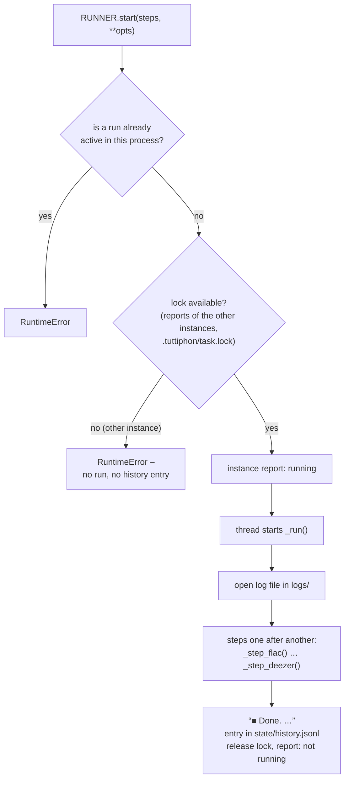

# Maintenance: runs and steps

This chapter describes how Tuttiphon maintains the library: how a run is started, locked, logged, canceled and briefly
paused for an apply, what “Update everything” does and how each step works in detail – Opus conversion, lyrics,
Navidrome scan with self-check, Deezer stars. It also covers the schedules (daily refresh, night analysis, daily
tidy-up, folder watch) and the command line. Sound analysis, AI sound analysis, Last.fm and classification are in
[06-intelligence.md](06-intelligence.md); writing and syncing the playlists and learning the mixes are in
[04-playlists.md](04-playlists.md).

## The steps

A **run** executes one or more **steps** one after another. There are seven steps; their fixed order is defined in
`PIPELINE` (`app/tasks.py`):

| Step | Title in the log | Code | Summary |
|---|---|---|---|
| `flac` | Convert music | `app/opus.py` | lossless files → Opus or AAC, archive/keep/delete the original |
| `lyrics` | Find & tidy up lyrics | `app/lyrics.py` | delete duplicate `.txt`, search LRCLIB/NetEase for missing lyrics |
| `cover` | Fetch missing covers | `app/albumcover.py` | for albums with no image at all, save a cover from the Cover Art Archive or Deezer as `cover.jpg` ([below](#step-cover-fetch-missing-covers)) |
| `analyse` | Understand music (sound, AI & Last.fm) | `app/audio.py`, `app/ml.py`, `app/lastfm.py`, `app/classify.py`, `app/fingerprint.py` | Last.fm data, sound analysis, AI sound analysis, classification of new bands, audio fingerprints (same recording twice) |
| `playlists` | Write playlists | `app/playlists.py`, `app/feedback.py` | evaluate expired mix periods (learning mixes), write `.nsp`/`.m3u` to the playlist folder |
| `scan` | Navidrome scan & sync | `app/navidrome.py`, `app/playlists.py`, `app/selfcheck.py` | trigger the scan and wait for it, sync playlists in Navidrome, renew covers, self-check |
| `deezer` | Deezer rating | `app/deezer.py` | popularity on Deezer → stars in Navidrome |

Each step is a method `_step_<name>()` of the class `TaskRunner`.

## Runs

### Who starts runs

The server has exactly one `TaskRunner` (`RUNNER` in `app/web.py`). All triggers go through `RUNNER.start()`:

| Trigger | Steps | Run name | Code |
|---|---|---|---|
| Interface (administrator only) | any selection; without one, `pipeline()` | automatic (see below) | `api_task_start()` → `POST /api/task` |
| “Apply now” | `playlists`, `scan` | Apply playlists in Navidrome | `POST /api/apply/now` (during a running run via `pause_for()`) |
| Auto-apply | `playlists`, `scan` | Applied automatically | `AutoApply._fire()` (during a running run via `pause_for()`) |
| Daily refresh | `playlists`, `scan` or `pipeline()` | Daily refresh / Daily refresh (everything) | `daily_loop()` |
| Folder watch | depending on the settings, see below | Process new music (N files) | `watch.check()` |
| Night analysis | `analyse` with `night_until` | Sound analysis (at night) | `_night_analysis()`, see [below](#night-analysis) |
| Continuation after a pause | the steps that were still open when the run was paused | name of the paused run + “ (continued)” | `TaskRunner._continue()`, see [Short pause](#short-pause-for-an-apply-pause_for) |
| Command line | arguments or `pipeline()` | automatic | `tuttiphon.py run` |

Without a given name, `_start()` names the run as follows: exactly the steps of `pipeline()` → “Update everything”;
`playlists` + `scan` → “Apply playlists in Navidrome”; only `deezer` → depending on the option `deezer_mode` (without
the option, the mode from the settings, `deezer_pipeline_mode()`) “Deezer: new songs”, “… new + not found”, “… songs
not found, once more”, “… full check” or “… recalculate stars”; otherwise the step titles joined with “ + ”.

`start()` checks for unknown steps (`ValueError`) and whether a run is already in progress (`RuntimeError` “A task is
already running.”). Then it acquires the lock against other instances (see [below](#lock-against-concurrent-runs));
if that fails, it ends with `RuntimeError` “Another Tuttiphon instance (PC or Docker) is working right now – please
try again later.”. Checking, locking and starting happen under `start_lock`, so that a double click does not start two
runs. The run itself executes in a daemon thread; only the command line calls it in the foreground with
`background=False`.

### How a run proceeds



For each step, `_run_locked()` writes a heading (“━━ Title ━━”), calls `_step_<name>(ctx, **opts)` and records the
duration. An exception in one step does not stop the others. The shared `ctx["summary"]` collects each step's figures
for the history. Once the stop signal is set, the remaining steps are not started.

### Results

| Result | When |
|---|---|
| `ok` | the step ran through and did not return `False` |
| `warnung` (warning) | the step returned `False` (see the table below) |
| `fehler` (error) | exception in the step; the log gets “❌ message”, and for exceptions other than `RuntimeError` also the last line of the traceback |
| `abgebrochen` (canceled) | the stop signal was set – before the step began or while it was running (this also applies to the step that was running at the moment of cancellation, as long as it ends without an exception); likewise after a [short pause](#short-pause-for-an-apply-pause_for) for an apply |

When a step reports `warnung`:

| Step | `warnung` if … |
|---|---|
| `flac` | at least one file failed |
| `lyrics` | at least one search failed (e.g. network down) |
| `scan` | stopped waiting for the scan after 4 h, or playlists are still missing after the second scan |

`analyse`, `playlists` and `deezer` never report `warnung`: `analyse` and `deezer` return `False` only after a
cancellation (then `abgebrochen` applies); for `playlists`, errors in individual playlists only appear in the log, and
if not a single one is written, the result is `fehler`.

### Lock against concurrent runs

Within one process, `start_lock` + `running()` prevent a second run. Across process and machine boundaries (PC via NFS
and Docker container on the NAS, or `tuttiphon.py run` next to the server), `_InstanceLock` ensures that only one
instance works at a time. `TaskRunner.start()` acquires the lock before the run thread starts:

1. `instances.busy_elsewhere()`: if another instance reports `running` in the shared folder (report younger than
   180 s), there is no lock.
2. Lock file `task.lock` in the shared folder (`<playlist folder>/.tuttiphon/`, see
   [08-operations.md](08-operations.md#multiple-instances)), locked with `fcntl.lockf(LOCK_EX | LOCK_NB)` (POSIX lock,
   works over NFS if the server supports locks). The file gets permissions `0666` (via `fchmod` on the open file) so
   that PC and container can open it even as different users; if it has permissions `000` on the share, they are
   repaired. Because the shared folder is writable for everyone, the file is opened with `O_NOFOLLOW` – a link someone
   put in its place is removed first. If the lock fails
   (`EAGAIN`/`EACCES`), another instance is working right now.
3. If the file system does not support locks (`ENOLCK`, no `fcntl`, file cannot be created), only point 1 decides,
   instead of blocking everything.

Once it has the lock, `start()` immediately writes its own instance report with `running: true`, so that other
instances do not see it only a minute later. At the end of the run, `_run()` closes the lock file (which releases the
lock) and reports `running: false`.

Without the lock nothing starts: no run thread, no log file, no history entry. The caller gets the `RuntimeError` and
reacts on its own:

| Caller | Reaction |
|---|---|
| Interface, “Apply now” | HTTP 400 response with the message |
| Auto-apply | reschedules itself 20 s later |
| Daily refresh | does not record the day (or the new attempt) in `state/daily.json` and tries again in the next minute |
| Folder watch | does not advance `last` in `state/watch.json`, does not write `state/watch_files.json` and looks again in the next minute – the same files then still count as new (see [Folder watch](#folder-watch)) |
| Night analysis | does not mark the night as done and tries again in the next minute |
| Command line | prints “✕ …” and exits with code 1 |

### Live log and status

`TaskRunner.log()` strips ANSI color codes, splits multi-line text and appends each line as
`(sequence number, time, text)` to `lines`. The buffer holds at most 4000 lines; beyond that, the oldest 1000 are
discarded. Each line also goes to the log file at the same time (immediate `flush`). On the command line
(`TaskRunner(echo=True)`) each line additionally goes unchanged to standard output; in the server only the
non-indented, non-empty lines – header “▶ …”, step headings “━━ … ━━”, step messages, “❌ …”, “⏸ …” and “■ Done. …” –
go to the server log with date and time (`events.say()`, see [08-operations.md](08-operations.md#server-log)).
Indented detail lines, such as the duration “   (12 s)” or individual files, are only in the log file.

`status(since)` returns `running`, `name`, `steps`, the current `step`, the `results` so far, `finishedAt` and all
lines with a number greater than `since`. The interface polls `GET /api/task?since=<n>` regularly and so gets only new
lines. Users only see whether something is running – `lines` is always empty for them. The response also contains
`auto` = `AutoApply.state()`: `due` (seconds until the next auto-apply, or `null`) and, as long as an auto-apply is
scheduled and a run is in progress, `waiting: true` (see [Auto-apply](#auto-apply)). Details on the endpoints:
[03-api.md](03-api.md).

### Canceling

`POST /api/task/cancel` (administrator only) calls `RUNNER.cancel()` and calls off a scheduled auto-apply.
`cancel()`

1. sets the stop signal `stop` (a `threading.Event`), which the steps check between two units (file, song, artist,
   block, scan status query) – only `playlists` always runs to the end –, and
2. terminates all registered subprocesses including their process group with `SIGTERM` (`os.killpg`). Subprocesses are
   started with `start_new_session=True` and registered and unregistered via `_track()`; a subprocess that only starts
   after the stop is terminated immediately.

Registered are the ffmpeg processes of the Opus conversion (including the complete decoding that checks the new file),
of the sound analysis and of the loudness measurement, `fpcalc`, as well as the analysis process of the AI sound
analysis (`ml_worker.py`). An Opus conversion terminated this way leaves no file behind (the `.part`
file is deleted, the original stays); a canceled sound measurement or AI analysis is discarded and repeated in the next
run. Short `ffprobe` calls (length, codec, tags) and extracting a cover run to completion. A running Navidrome scan
continues in Navidrome; Tuttiphon only stops waiting. The step that was running at the moment of cancellation gets the
result `abgebrochen`, as do all following ones.

### Short pause for an apply (`pause_for()`)

So that changed playlists do not wait for hours for an analysis or a Deezer full check, a run can pause briefly for an
apply. `TaskRunner.pause_for(steps, name, **opts)` pauses the running run, runs `steps` in between and then continues
with the rest. Only steps that pick up where they left off at the next start may be paused (`PAUSABLE` = `flac`,
`lyrics`, `analyse`, `deezer`): Opus converts the remaining files, lyrics and Deezer skip what has already been
searched or rated, sound analysis and AI know their finished songs from `state/audio.json` and `state/ml.json`.

`pause_for()` checks under `start_lock` and returns `False` (nothing happens) if

- no run is in progress, the run is already being canceled (`stop` set) or a pause is already queued (`_chain` not
  empty),
- the open steps – the running one and all not yet started, i.e. all without an entry in `results` – are not **all**
  in `PAUSABLE`. A run that still has `playlists` or `scan` ahead of it writes the changes anyway and is waited for.

Otherwise it queues two runs in `_chain` – `(steps, opts, name)` and `(open steps, options of the running run,
“<name> (continued)”)`; if the name already ends in “(continued)”, it stays as it is –, writes “⏸ Short pause for
“<name>” – this run continues afterwards.” to the log and calls `cancel()`. The paused run ends as after “Cancel”
(running and open steps `abgebrochen`, its own history entry). At the end of `_run()` it hands `_chain` over to
`_continue()`: a separate thread waits for the run thread to end and starts the queued runs one after another via
`start()`, each only after the previous one has ended. If a start fails (`RuntimeError`, e.g. another instance or
another trigger was faster), it retries up to 30 times at 2 s intervals; after that it gives up, and the following
queued runs are dropped too.

| Run | When pausable |
|---|---|
| Night analysis and all runs that consist only of `flac`, `lyrics`, `analyse`, `deezer` | always |
| “Update everything”, daily refresh `alles` (with all steps) | only in the last step `deezer` – before that, `playlists` and `scan` are still pending |
| Folder watch | only once the first `scan` is done and no `playlists` is pending: without classification during `analyse` and `deezer`, with classification (second `playlists` + `scan`) during the second `scan` (if `deezer` follows) and during `deezer` |
| `playlists` + `scan` (applies, daily refresh `playlists`) | never |

The continuation gets the same options as the paused run (for the night analysis the same `night_until`, for the folder
watch the same file lists). Time limits (`budgetMinutes` etc.) start afresh in the continuation. Callers are
`AutoApply._fire()` and `POST /api/apply/now`, both with `["playlists", "scan"]`.

Known deviation: `pause_for()` determines the open steps by the names in `results`. If a step occurs twice (folder
watch: `scan` before and after `analyse`), the second `scan` no longer counts as open as soon as the first has a
result. If this second scan is running and `deezer` still follows, the run therefore counts as pausable: the scan is
canceled (sync, covers and self-check are dropped in this run), the inserted apply scans and syncs by itself
afterwards, and the continuation consists only of `deezer`.

### History and log files

Each run writes a log file `logs/<YYYY-MM-DD_HHMMSS>_<steps>.log` (e.g. `2026-10-12_053000_playlists-scan.log`), each
line prefixed with `[HH:MM:SS]`. At the end, `_run_locked()` appends a line to `state/history.jsonl` – also after an
exception (`finally`):

```json
{"start": "2026-10-12T05:30:00", "end": "2026-10-12T05:31:12", "name": "Daily refresh",
 "steps": ["playlists", "scan"], "results": {"playlists": "ok", "scan": "ok"},
 "summary": {"playlists": {"written": 3, "unchanged": 40, "removed": 0, "failed": 0},
             "scan": {"files": 22400, "changed": 1, "deleted": 0, "missing": 0}},
 "log": "2026-10-12_053000_playlists-scan.log", "dryRun": false}
```

Both files get permissions `0664`. A run that does not start at all because of the lock leaves neither a file nor an
entry. `history(limit)` reads `history.jsonl` and adds log files that have no entry: their name, start time and
results are reconstructed from the file name, the header line (“▶ …”) and the final line (“■ Done. …”). The daily
tidy-up deletes logs after 90 days and trims `history.jsonl` to the last 2000 lines ([Daily tidy-up](#daily-tidy-up)).
The interface shows the newest 60 (`GET /api/history`); a log file is served by `GET /api/log?file=…` (the last
400,000 characters, only files from `logs/`). What `summary` contains per step and how `state/` is structured:
[02-data-model.md](02-data-model.md).

### Dry run

The option `dry_run` is passed to every step. What each step does in a dry run:

| Step | In a dry run |
|---|---|
| `flac` | lists the files, what would happen to the original and which cover would be saved from the file; converts nothing. The archive checks run too (without the write test); an archive name taken by a different file shows the free name the original would get. |
| `lyrics` | lists the `.txt` files to be deleted; **still queries the providers**, but saves neither lyrics nor `state/lyrics.json` |
| `analyse` | measures nothing (no AI either), does not query Last.fm and saves nothing; only reports “(dry run) Last.fm and sound analysis skipped. Classification: N confident suggestions.” (confidence of 0.6 or more) |
| `playlists` | shows which files would be written or removed; writes nothing, does not change the configuration, does not evaluate mix periods and does not record a mix selection |
| `scan` | starts no Navidrome scan, no sync and no self-check; only reports “(dry run) [Full] Navidrome scan and sync skipped.” |
| `deezer` | queries Deezer and logs the stars; sets no stars and does not save `state/deezer.json` |

So a dry run changes neither music, lyrics or playlist files nor Navidrome nor `state/`. As in every run, only the
instance report and the lock file are written, plus the log file and the history entry with `"dryRun": true`.

### Run options

| Option | Step | Effect | Interface / command line |
|---|---|---|---|
| `dry_run` | all | dry run (see above) | home page “Dry run without changing anything”, lyrics/Opus “Dry run” / `--dry-run` |
| `full_scan` | `scan` | full instead of quick scan | home page / `--full-scan` |
| `deezer_mode` | `deezer` | `new`, `missing`, `full`, `recalc` | Deezer buttons / `--deezer-mode` |
| `overwrite_manual` | `deezer` | also overwrite manually set stars | Deezer card / `--overwrite-manual` |
| `lyrics_all` | `lyrics` | also songs recently searched without success, no time limit | “Retry recent misses too” / `--lyrics-all` |
| `lyrics_full` | `lyrics` | no time limit | “Search all missing now” / – |
| `analyse_full` | `analyse` | Last.fm, sound analysis and AI sound analysis without a time limit | “Analyze everything without a time limit” / – |
| `lyrics_files` | `lyrics` | only these files, tags from the file | folder watch only |
| `flac_files` | `flac` | convert only these files, without the waiting time `minAgeMinutes` | folder watch only |
| `night_until` | `analyse` | sound analysis and AI without a time limit, but at the latest until this point in time (a `time.time()` value); Last.fm keeps its time limit | night analysis only |

`api_task_start()` accepts only the first seven options from the request body and validates `deezer_mode`.

## “Update everything”

“Update everything” is the run with the steps from `pipeline()`: the list `settings.pipeline` from the configuration,
put into the fixed order of `PIPELINE` (the order in the configuration does not matter). If the key is missing, all
seven steps run. The selection is made under Settings → Automation; `_validate_settings()` only allows known steps
without duplicates.

```text
flac → lyrics → analyse → playlists → scan → deezer
```

The order has reasons: lyrics and sound analysis work with the new Opus files; the classification (`analyse`) can
assign bands to a music world before `playlists` writes; `scan` reads in the new playlists; after the scan, Deezer
also rates the songs that Navidrome has only just learned about.

Time limits keep a run from taking hours after large imports – whatever is not finished is handled in the next run:

| Part | Setting | Default | No limit |
|---|---|---|---|
| Lyrics search | `settings.lyrics.budgetMinutes` | 5 min | `0`, `lyrics_full`, `lyrics_all` |
| Last.fm | `settings.analysis.lastfmBudget` | 3 min | `0`, `analyse_full` |
| Sound analysis | `settings.analysis.budgetMinutes` | 10 min | `0`, `analyse_full`; night analysis until the end of its window |
| AI sound analysis | `settings.analysis.mlBudget` | 15 min | `0`, `analyse_full`; night analysis until the end of its window |
| Audio fingerprints | `settings.analysis.budgetMinutes` | 10 min | `0`, `analyse_full`; night analysis until the end of its window |
| Waiting for the scan | fixed | 4 h | – |

Opus conversion and Deezer have no time limit.

## Step `flac`: Convert music

`_step_flac()` calls `opus.run(cfg, log, stop, track, dry_run, files)`. If `settings.opus.enabled` is off, the step
ends with a message. Without `ffmpeg` or `ffprobe` in the `PATH`, without an existing music folder, and for AAC
without the package `mutagen`, it aborts with `RuntimeError`. With `original: "archive"` and files to convert it also
aborts – before converting anything – when the archive folder is the music folder or lies inside it (the originals there would be
converted again, and the archive would nest into itself), when it does not exist (it is never created – in the
container a missing `/archive` mount would otherwise put the originals into the container, where the next update
deletes them) or when it is not writable (`archive_problem()`, with a real write test). Otherwise every song would get
its new file while the original cannot be moved – and the next run would find the same originals again.

`opus.target()` determines the target from `settings.opus.codec`:

| `codec` | File | Bitrate | Intended for |
|---|---|---|---|
| `opus` (default) | `<name>.opus` | `bitrate`, default 160 | Android (Symfonium): smallest |
| `aac` | `<name>.m4a` | `aacBitrate`, default 224 | Apple devices: they play AAC everywhere |

The switch only applies to new conversions; finished files stay as they are (converting lossy into lossy would degrade
the sound).

### Which files

In a normal run (`files` is `None`), `find_sources()` searches the music folder (`paths()["music"]`, see
[08-operations.md](08-operations.md)) recursively:

- Folders starting with `@`, `#` or `.` are skipped (Synology metadata `@eaDir`, recycle bin `#recycle`, hidden
  folders), as are files starting with `._`.
- The extensions follow from `settings.opus.formats`:

  | Format | Extensions |
  |---|---|
  | `flac` | `.flac` |
  | `wav` | `.wav` |
  | `aiff` | `.aif`, `.aiff` |
  | `ape` | `.ape` |
  | `wv` | `.wv` |
  | `alac` | `.m4a` – only if `ffprobe` reports the codec `alac` (AAC in `.m4a` is left untouched) |

- Files whose last change (`max(mtime, ctime)`) is more recent than `minAgeMinutes` are left alone – an import may
  still be writing.
- With `original: "keep"`, originals that already have a file with the target extension (`.opus` or `.m4a`) next to
  them are dropped – they count as converted and are not checked again. ALAC → AAC would have the same name (`.m4a`);
  with `keep`, such a file is therefore left alone entirely.
- The list is sorted by path. For the settings page (`GET /api/opus/info`) it is cached for 10 minutes; the step itself
  always searches afresh.

The folder watch passes its new files instead (option `flac_files`). Of these, only those remain whose extension
matches `formats`, that still exist, that are really ALAC in the case of `.m4a` and – with `keep` – that do not yet
have a file with the target extension next to them. `minAgeMinutes` does not apply to this list; the watch reports
files only once they have been unchanged for 120 s.

### Conversion

For each file (`convert()`), in parallel with `settings.opus.jobs` threads:

```shell
# Opus
ffmpeg -nostdin -v error -y -i <source> -map 0:a:0 -c:a libopus -b:a <bitrate>k -f opus <folder>/.<file>.opus.part
# AAC
ffmpeg -nostdin -v error -y -i <source> -map 0:a:0 -map_metadata -1 -c:a aac -b:a <aacBitrate>k -movflags +faststart \
       -f ipod <folder>/.<file>.m4a.part
```

- The target is `<name>.opus` or `<name>.m4a` in the same folder. ffmpeg first writes to the hidden temporary file
  `.<file>.<ext>.part` – with the source's full file name (`.Song.flac.opus.part`), so two sources never share it.
- **Complete?** With `-v error`, ffmpeg prints only errors; any message while converting (a cut-off WAV, a damaged
  FLAC frame) counts as failure, even if ffmpeg ends with exit code 0. Then `verify()` decodes the new file
  completely (`ffmpeg -i <new> -map 0:a:0 -ac 1 -ar 8000 -f u8 -`, counting the samples) and compares that with the
  length the source **declares** (`declared_length()`): FLAC from `STREAMINFO` (total samples / sample rate), WAV from
  the size of the `data` chunk (PCM only), AIFF from the `COMM` chunk, everything else from `ffprobe`. A file that is
  still being copied or was never fully downloaded (zeros where audio should be – ffmpeg skips them silently) still
  declares its full length, the decoded result is shorter. More than 0.3 s difference (AAC pads up to one frame) or
  any decoding error → the conversion fails, the original stays. The decoding is registered with the runner like the
  conversion.
- **AAC tags:** In `.m4a`, ffmpeg writes only the common fields. `copy_tags_mp4()` therefore uses mutagen to transfer
  all tags of the source the way MusicBrainz Picard stores them in MP4 and Navidrome reads them (Navidrome's
  `resources/mappings.yaml`): title, artist, album etc. into the iTunes fields (`©nam`, `©ART`, `aART`, `trkn`,
  `disk`, `©lyr` …), MusicBrainz IDs as `----:com.apple.iTunes:MusicBrainz Track Id` etc., everything else (ISRC,
  LABEL, ARTISTS, REPLAYGAIN_* …) as `----:com.apple.iTunes:<NAME>`; multiple values stay multiple. Tags are read from
  Vorbis comments (FLAC), APEv2 (APE, WavPack) and ID3 (WAV, AIFF; `source_tags()`); if mutagen finds neither title
  nor artist there (RIFF `INFO` in WAV, text chunks in AIFF), the tags as `ffprobe` reads them fill the gaps. ALAC
  carries over its MP4 fields unchanged. The cover is added as `covr` (the front cover). Afterwards a spot check
  (title, artist, MusicBrainz ID) verifies that the values are really readable in the file; otherwise the conversion
  counts as failed.
- **Tags arrived?** For both formats: if `ffprobe` sees a title or an artist in the source, but neither in the new
  file (`tags_lost()`), the conversion counts as failed.
- **ALAC → AAC** keeps the same name (`.m4a`): with `archive`, the original first goes to the archive as a second
  name of the same file (hard link) or – on another volume – as a checked copy, while it stays in its place; then the
  new file replaces it in one step (`os.replace`). If that fails, the copy in the archive is taken back and the
  original stays. With `delete` the new file replaces the original in one go.
- Only the first audio stream is taken (`-map 0:a:0`). For Opus, ffmpeg takes the tags from the source according to
  its defaults; images embedded in the file (for FLAC a separate picture stream) are **not** carried over.
- That is why `embed_cover()` writes the front cover into the new Opus file with mutagen (`METADATA_BLOCK_PICTURE`,
  picture type 3, as in FLAC) – every song keeps its own cover, also in a folder of singles. `front_cover()` takes the
  picture marked as front cover (`Cover (front)`), otherwise the first one. A cover that cannot be written makes the
  conversion fail. Without mutagen (PC without the package) nothing is embedded.
- In addition `keep_cover()` saves the front cover as a file before converting (for both target formats) – only if
  there is no cover image in the folder yet (file name `cover`, `folder`, `front` or `album` with extension `.jpg`,
  `.jpeg`, `.png`, `.webp`) and all songs in the folder belong to the same album (`single_album()`: the same `album`
  tag – or none at all – according to `ffprobe`, remembered per folder for the run). A folder of singles or a mixed
  folder gets no common image. JPEG becomes `cover.jpg`, PNG becomes `cover.png`, other formats are not saved. The
  image goes into a hidden temporary file, which is renamed only if no other cover image has appeared in the
  meantime; permissions `0644`, owner as below. Existing cover files stay as they are.
- The ffmpeg process of the conversion is registered with the runner and terminated on cancel.
- `opus.RECENT` remembers every newly created file (path → time); the folder watch therefore does not mistake it for
  new music.

### Checks

| Check | Consequence |
|---|---|
| Another source in the same folder would become the same file (`Song.flac` and `Song.wav` with both formats on) | error for both, both stay – “please rename one of the two” |
| Mode `archive`, the archive folder has gone missing during the run | error, the original stays |
| Mode `archive` and a file with the same name already exists in the archive | byte-identical (an earlier run was interrupted after copying to another volume, or the original could not be deleted there): counts as archived – after the conversion only the original in the music folder is removed. Different: the original goes to the archive under a free name (`Song (2).flac`); the file there stays untouched. Cannot be compared right now: error, the original stays. Checked before the conversion and again before moving |
| Target file already exists (only possible with `archive`/`delete`; with `keep` such an original is not selected; not for ALAC → AAC) | not the target codec (`ffprobe`) → error, the original stays. Otherwise `verify()` as above: complete → “Opus/AAC already existed”, continue with the original; incomplete → error “The existing … file is incomplete …” – or, if the archive holds an original of the same name in another format, “… belongs to another original …” (that Opus file is not the one to delete) |
| ALAC → AAC with `original: "keep"` | error, the original stays (both would have the same name) |
| ffmpeg ends with an error or prints one, the tags or the cover cannot be written, title/artist got lost, or the decoded `.part` file is not as long as the source declares | `.part` is deleted, error with the reason (for ffmpeg the last 300 characters of its output), the original stays |
| everything fine | `os.replace()` turns `.part` into `.opus` or `.m4a` |

The original is touched only after a verified new file exists. An error in one file does not stop the others. At the
end the log says “Done: N converted, M errors.”, the history `{"converted": N, "errors": M}`.

### Archive, keep or delete the original

| `settings.opus.original` | What happens |
|---|---|
| `archive` (default) | move to `<archive>/<same relative folder>/<file>` (`move_to_archive()`: rename on the same volume; on another one a hidden copy, size checked, renamed, then the original deleted with a few attempts); never overwrites anything (see the checks above) |
| `keep` | the original stays next to the new file; later runs skip it as long as the file with the target extension is next to it |
| `delete` | the original is deleted |

The archive folder is `paths()["archive"]`: `ARCHIVE_DIR` from the environment, otherwise `settings.paths.archive`,
otherwise `settings.opus.archiveDir`, otherwise `Archiv`; relative paths are relative to the **parent** folder of the
music folder. It must lie outside the music folder: the settings refuse an archive that is the music folder or inside
it (`config.archive_in_music()`, also `POST /api/paths/check`), and the step does not run with such a folder from
`docker-compose.yaml` either. The archive folder itself must exist; only the subfolders below it are created.

### Owner and permissions

`_own()` sets permissions explicitly so that no unreadable files are created on the NAS share:

- the new file and a cover saved from the file: `chmod 0644`,
- every folder in the archive that is created now: `chmod 0755` (existing folders keep their permissions and owner –
  e.g. setgid or group write),
- in each case additionally `chown` to `settings.opus.owner` (`UID:GID`, e.g. `1000:1000`; empty = no `chown`). Without the right to do so
  (as a normal user over NFS), the owner silently stays as it is.

### Settings `settings.opus`

| Key | Default | Allowed | Meaning |
|---|---|---|---|
| `enabled` | `false` | | step on/off (installations from before configuration version 10 keep `true`) |
| `codec` | `"opus"` | `opus`, `aac` | target format |
| `bitrate` | `160` | 48–320 | kbit/s for Opus (libopus) |
| `aacBitrate` | `224` | 64–320 | kbit/s for AAC (ffmpeg's built-in encoder `aac`) |
| `formats` | `["flac"]` | `flac`, `wav`, `aiff`, `ape`, `wv`, `alac` | source formats |
| `original` | `"archive"` | `archive`, `keep`, `delete` | what happens to the original |
| `archiveDir` | `"Archiv"` | relative, without `..` | archive folder if neither `ARCHIVE_DIR` nor `settings.paths.archive` is set |
| `minAgeMinutes` | `10` | 0–1440 | waiting time after the last change to a file (not for files from the folder watch) |
| `owner` | `""` | `UID:GID` or empty | owner of new files and archive folders; empty = the user Tuttiphon runs as (installations from before 0.17.1 keep `"1000:10"`) |
| `jobs` | `1` | 1–8 | simultaneous conversions |

## Step `lyrics`: Find & tidy up lyrics

In a normal run, `_step_lyrics()` calls `lyrics.run(cfg, lib, …)` with the song list from the library cache
(`CACHE.get()`). Only the folder watch uses `fetch_files()` (see [below](#folder-watch)). `run()` needs the music
folder (otherwise `RuntimeError`) and does two things, each of which can be turned off separately:

1. **Tidy up** (`settings.lyrics.cleanup`): `cleanup()` searches the music folder (without `@`/`#`/`.` folders) and
   deletes every `<name>.txt` that has a `<name>.lrc` with synced lyrics next to it – at least one timed line with
   words (`has_synced_lines()`). Next to an empty `.lrc`, one with only header tags (`[ar: …]`) or only the
   instrumental marker `[au: instrumental]`, the `.txt` stays.
2. **Search** (`settings.lyrics.fetch`): `fetch()`.

### Which songs are searched

`_plan()` goes through all songs of the library. Navidrome's own API supplies the real file path
(`Library.real_path()`, relative to the music folder); it also reports which songs have embedded lyrics. There is a
single directory listing per folder.

| Situation | Decision |
|---|---|
| audio file not (or no longer) present | skipped, not counted |
| `<name>.lrc` present or lyrics embedded in the file | done (“synced”) |
| only `<name>.txt` present | “text only” – searched again if `upgradePlain` is on and the last attempt was not recent |
| nothing present | searched, unless the last attempt was recent |

“Recent” means: the last attempt (from `state/lyrics.json`) was less than `retryDays` × spread factor ago. The spread
factor (0.80 … 1.19) depends on the last bytes of the song ID, so that not all retries fall on the same day.
`lyrics_all` lifts this block. The list is sorted by date added, **new songs first**.

### Providers

`settings.lyrics.providers` is an ordered list `[{"id": "lrclib", "on": true}, {"id": "netease", "on": false}]`.
`lookup()` asks the enabled providers in order, each first with the artist name and then with a shortened version
(cut off before “ feat. ”, “ feat ”, “ ft. ”, “ featuring ”, “ & ” or “, ”):

- Synced lyrics win immediately.
- Plain text or “instrumental” is remembered, and the next provider is asked for a synced version. If none finds one:
  plain text beats “instrumental”; on a tie, the first find wins. So “instrumental” no longer ends the search.
- If a provider already returns something with the full artist name, `lookup()` does not ask it again with the
  shortened version.

| | LRCLIB (`Lrclib`) | NetEase (`NetEase`) |
|---|---|---|
| Interface | `https://lrclib.net/api` | `https://music.163.com/api` (unofficial) |
| Requests | at most 10/s | at most 2/s |
| Search | `/search?artist_name&track_name`; hits with more than 3 s length difference are dropped, as are hits with “instrumental” in the title if the song's own title does not contain the word (“Song (Instrumental)” is not the vocal version); scoring synced 3 > text 2 > instrumental 1, +0.5 for the same album | `/search/get` with “artist title”, 8 hits; the title must be the same (normalized) or start that way, the artist must be contained, length ±3 s |
| Follow-up | if there are hits but none with a matching length: `/get-cached` with artist, title, album, duration | `/song/lyric?id=…`; credit lines (作词, 作曲 …) are removed |

Both providers get the user agent `Tuttiphon/1.0 (…)`. Responses 400/404 count as “nothing found”; for 429 and 5xx as
well as network errors, the request is retried up to twice with a short pause, after which the song counts as an error
and is tried again in the next run.

### Saving

`_write()` puts the file next to the audio file, using `write_atomic()` (permissions `0664`):

| Result | File | Condition |
|---|---|---|
| synced | `<name>.lrc` | – |
| instrumental | `<name>.lrc` with `[au: instrumental]` | `instrumental: "mark"` and no `.txt` next to it – an existing text is never replaced by the marker (result `plain-had`, the `.txt` stays); with `"skip"` nothing is written (result `skip`) |
| text only | `<name>.txt` | `savePlain` on and no `.txt` there yet |

If a synced `.lrc` is written and a `.txt` was next to it, the `.txt` is deleted (if `cleanup` is on). Navidrome reads
both file types at the next scan.

Counting works like this: `synced`, `plain` and `instrumental` as found; `none` (nothing found) and `skip`
(instrumental, but not to be marked) as “not found”; `plain-had` (only plain text or “instrumental” found, and the
`.txt` was already there) neither as found nor as “not found”.

### Attempt list and time limit

`state/lyrics.json` remembers the last attempt per song ID as `[timestamp, result]` (result `synced`, `plain`,
`instrumental`, `plain-had`, `none`, `skip`). Failed attempts due to network errors are not remembered. In addition
there are `lastRun`, `backlog` (what stayed open because of the time limit or a cancellation) and `summary` (totals:
all, synced, text only, missing) for the settings page (`GET /api/lyrics/stats`). It is saved every 250 songs and at
the end; never in a dry run. The format is described in [02-data-model.md](02-data-model.md).

The time limit (`budgetMinutes`) is checked before each song. Whatever is still on the list after that is counted as
“later” and reported in the log as “… more follow in the next run (time limit)”. The search runs with
`settings.lyrics.workers` parallel threads.

### Settings `settings.lyrics`

| Key | Default | Allowed | Meaning |
|---|---|---|---|
| `cleanup` | `true` | | delete duplicate `.txt` (also after a synced find) |
| `fetch` | `true` | | search for missing lyrics (also in the folder watch) |
| `savePlain` | `true` | | also save plain text as `.txt` |
| `upgradePlain` | `true` | | search songs that only have a `.txt` again later for synced lyrics |
| `instrumental` | `"mark"` | `mark`, `skip` | mark instrumentals as `.lrc` or write nothing |
| `retryDays` | `30` | 1–365 | search again only after this many days (spread) |
| `workers` | `6` | 1–8 | simultaneous searches |
| `budgetMinutes` | `5` | 0–600 | time limit in the run, `0` = none |
| `providers` | LRCLIB on, NetEase off | `lrclib`, `netease` | order and on/off of the providers |

## Step `cover`: Fetch missing covers

`albumcover.run()` fetches Navidrome's album list (native API) and takes only albums for which Navidrome knows **no**
image at all (`imageHash` empty, not `missing`), whose songs are in exactly one folder – and that folder contains only
this album (otherwise loose files or a singles folder would get one image for all) –, that have been in Navidrome for
at least two days (Lidarr saves covers itself on import) and whose folder contains no image file
(`cover|folder|front|album` + `.jpg/.jpeg/.png/.webp`, `opus._folder_has_cover()`). Source: Cover Art Archive via
`mbzAlbumId`, then `mbzReleaseGroupId` (500 px), otherwise Deezer (album and artist name must match without
parenthetical additions, `cover_xl`). An image must be JPEG or PNG, at least 8 KB and – checked with Pillow – 250
pixels. It is saved as `cover.jpg`/`cover.png` with `write_atomic()` (permissions 0644, owner from
`settings.opus.owner`), never over an existing image – the step checks once more right before writing. At most 60
albums per run, a one-second pause per album; the result per album goes to `state/covers.json`, and anything not found
is tried again only after 30 days. Navidrome reads the covers at the next scan. Besides “Update everything”, the step
runs once a week in the night analysis (`albumcover.due()`: `state/covers.json` older than 7 days).
`settings.covers.enabled: false` turns off both.

## Step `analyse`: Understand music

`_step_analyse()` works in five parts one after another, each with a time limit:

1. **Last.fm** (only with a key): load tags and similar bands – first bands without a music world, then by number of
   songs. Any error from this – an invalid key as well as an unexpected exception – is logged as a warning
   “⚠ Last.fm: …”; sound analysis, AI and classification still run.
2. **Sound analysis** (if `settings.analysis.enabled`): measure songs not yet analyzed, new ones first
   (`audio.run()`, time limit `budgetMinutes`).
3. **AI sound analysis** (if `settings.analysis.ml` is also on and the run was not canceled): `ml.run()` over the
   songs the sound analysis already knows, new ones first, time limit `mlBudget`. If Essentia or the models are missing
   (e.g. on the PC), it skips itself without a message in the log; Settings → Intelligence shows the reason.
4. **Classification** according to `settings.analysis.classify`: `auto` puts all bands at or above `autoThreshold`
   directly into a music world (via `update_config()`; each band at most once, remembered in
   `state/auto_assigned.json`). `suggest`, with `settings.analysis.autoNew` (default on), directly assigns only **new**
   bands – first song in the library for at most 30 days, e.g. from Lidarr – at or above `max(0.75, autoThreshold)`
   (`auto_assign(…, new_only=True)`) and reports “Classification: N new band(s) classified automatically, M confident
   suggestions – …”, or without hits only the number of confident suggestions (0.6 or more). `off` does nothing. Each
   automatic assignment appears as an indented line “  ✓ band → world (xx %, reason)” in the log.
5. **Audio fingerprints** (if `settings.analysis.fingerprints` is on and `fpcalc` is installed – otherwise it skips
   itself without a message, like the AI): `fingerprint.run()` fingerprints songs without one, new ones first, with
   the time limit `budgetMinutes`, then compares them if anything changed – the result is the check “Same recording
   twice” in Settings → Check library ([06-intelligence.md](06-intelligence.md#same-recording-twice-appfingerprintpy)).
   Last, because it only produces a hint; an error in it only appears as “⚠ Audio fingerprints: …” in the log.

With `analyse_full`, parts 1–3 and 5 run without a time limit; with `night_until` (night analysis), parts 2, 3 and 5
run without a time limit, but at most until that point in time – first the sound analysis, then the AI (then
loudness) and the audio fingerprints get the remaining time. In a dry run all parts are skipped; the step only
reports the number of confident suggestions. If the run is canceled after part 1, the step ends immediately (result
`abgebrochen`). The history lists the figures per part (`lastfm`, `audio`, `ml`, `loudness`, `assigned`,
`fingerprints`). Everything else is in [06-intelligence.md](06-intelligence.md).

## Steps `playlists` and `scan`

**`playlists`** first evaluates expired mix periods (`feedback.learn()`, then `forget_removed()` for deleted
playlists; not in a dry run, and an error here is only logged – see
[Learning mixes](04-playlists.md#mixes-that-learn-appfeedbackpy)). Then it calls `playlists.write()` with a fresh
`BuildContext` and writes all active playlists as `.nsp`/`.m3u` to the playlist folder. Afterwards the step enters new
file names and takeover backups created in the process into the **current** configuration via `update_config()`. It
does not carry over a file name if that was changed elsewhere during the run or if the playlist has meanwhile switched
between smart playlist and mix. The history lists the counts `written`, `unchanged`, `removed`, `failed`.

**`scan`** (`_step_scan()`):

1. Scan type: `settings.navidrome.scan` (`quick` or `full`); the option `full_scan` forces `full`. In a dry run the
   step ends here with a message, without contacting Navidrome.
2. If Navidrome is already scanning, Tuttiphon waits for it; otherwise it starts the scan (`startScan`, with
   `fullScan=true` for the full one).
3. `wait_for_scan()` polls `getScanStatus` every 3 s, logs the progress and gives up after 4 h.
4. Afterwards the library cache is discarded (`CACHE.invalidate()`).
5. `playlists.sync_navidrome()` syncs name, description, visibility and owner and removes orphaned playlists. If
   playlists are missing in Navidrome, the sync touches their files (`os.utime`), and the step starts a second, quick
   scan followed by another sync.
6. `_refresh_covers()` renews designed covers whose material has changed, re-uploads custom covers of newly created
   playlists and enters `sig`/`nid` via `update_config()` – only if the cover has not been changed in the meantime.
7. **Lyrics index** (`_lyrics_index()`) and **new music worlds** (`_autowelten()`): always after runs with `flac`,
   `lyrics`, `cover` or `analyse`, otherwise – for example after saving a playlist – at most every 6 hours
   (`tasks.EXTRAS_EVERY`). If the index is currently being built in the background, the step does not wait for it. If
   there is no index yet, building starts in the background and the step continues. Otherwise `liedtext.update()`
   brings it up to date – only new and changed lyrics. If explicit lyrics are newly detected and a person has kid-safe
   mode on, the step rewrites the playlists like the `playlists` step (new file names go into the configuration), has
   Navidrome read them in briefly and syncs
   ([Intelligence](06-intelligence.md#lyrics-search-and-kid-safe-mode)).
8. **Notifications** to the people (`notify.for_persons()`), to the devices of their account and to their ntfy topic:
   news from their favorite bands and the monthly recap ([Operations](08-operations.md#notifications)). An error is only logged.
9. If the run was not canceled, the [self-check](#self-check) follows. An error in it is only logged
   (“⚠ Self-check: …”) and does not change the step's result.

After **every** run, `notify.after_run()` reports to the administrators' devices and the administrator's topic, if
turned on: steps with
errors (the same steps at most once a day), a fully processed folder-watch run (“Tuttiphon: New music has arrived” –
only if all steps are `ok` or `warnung`, not after a cancellation) and newly classified bands
(`summary.analyse.assignedBands`). Never in a dry run.

What exactly happens when writing and syncing is described in [04-playlists.md](04-playlists.md).

### Self-check

`selfcheck.run()` checks after every scan whether Navidrome delivers what Tuttiphon expects – also for folder-watch
runs, which scan as well. Every active playlist that Navidrome already knows is checked:

| Type | Expected | In Navidrome | Skipped if … |
|---|---|---|---|
| Smart playlist | Tuttiphon's own evaluation of the same rules (`Library.match()`, at most `limit`) – with the stars and favorites of the playlist owner (`mixer.person_lib()`) | `owner_count()`: Subsonic `getPlaylist`, signed in **as the owner** (with their password); the returned entries are counted. Navidrome evaluates a smart playlist freshly only for its owner; missing files are thus not counted – as in Symfonium | the owner's stars are not known (no password for their account – with average ratings there would be false alarms) or Tuttiphon cannot evaluate a rule |
| Mix | number of entries in the `.m3u` (if a song is missing in Navidrome, the paths are usually wrong) | `NativeApi.playlist_count()` (admin): `songCount` of the playlist | the `.m3u` is not readable |

If the query for a playlist fails, the log shows “⚠ Self-check <name>: …”, and the check continues with the
others.

Up to 2 songs of difference count as equal (`TOLERANCE`, e.g. for time rules such as “in the last 30 days”). A larger
deviation is reported if it amounts to more than 10 % of the expected number (`BIG`) **or** already existed at the
previous check – so freshly imported songs that Tuttiphon does not know yet do not raise an alarm. Reported deviations
appear in the log (“⚠ <name>: Navidrome shows n songs, expected m”, for mixes with “– check the paths in the .m3u”)
and under “To review” ([04-playlists.md](04-playlists.md#to-review-inbox)). Result: `state/selfcheck.json`, in the
history `selfcheck: {checked, problems}`. The summary in the log reads “Self-check: n playlists checked[, k skipped
without the owner's stars] – all as expected.” or “… – j differ.” Only read-only calls to Navidrome.

## Step `deezer`: Stars from Deezer popularity

Origin: the approach and the default rank levels come from [dztnr](https://github.com/scatolo/dztnr) (a fork of
[sptnr](https://github.com/krestaino/sptnr), MIT – notice in [THIRD-PARTY-NOTICES.md](../THIRD-PARTY-NOTICES.md)); `app/deezer.py` is
Tuttiphon's own implementation for several accounts.

`_step_deezer()` takes the mode from the option `deezer_mode`. Without the option, the setting
`settings.deezer.pipelineMode` applies: `"missing"` becomes the internal mode `both` (new **and** previously not found
songs), anything else becomes `new`. Then the step calls `deezer.run()`. If stars have changed, the library cache is
discarded.

### Procedure

1. Fetch all songs via the admin account (Subsonic `search3` with an empty query, in pages of 500).
2. Load `state/deezer.json` (missing or empty: all songs count as new).
3. For each account that should get stars, sign in with its password and read its current stars. If a password is
   missing, the account is skipped with a warning; if all are missing, the step aborts with an error (except in a dry run).
4. Select the songs according to the mode, look them up in blocks of 200 with 4 threads and set stars; after each
   block save `state/deezer.json` and, for more than 200 songs, log the progress with rate and remaining time.

### Search and rank

Purpose of the stars: Symfonium and Navidrome sort a band's top tracks by them (otherwise “Barbie Girl” would not be at
the top for Aqua).

`DeezerClient.best_rank(song)` searches `https://api.deezer.com/search` – first specifically `artist:"Band" track:"Title"`
(title without parenthetical additions), then freely “band title”, finally with further names of the band (for
“A, B & C” also the individual ones). A hit counts only if **band and title match** (`matches()`): names compared
without accents, apostrophes and punctuation, titles without parenthetical additions, “ - Remastered …” and “feat. …”;
equality, containment or at least 85 % similarity. Among the matching hits, the highest `rank` wins. Up to 0.10, the
search took the highest rank of the first three hits, no matter whose – in a sample, every twentieth song got the rank
of a different one (Pentatonix “Bored” got that of “Bohemian Rhapsody”).

If the search finds nothing, it goes via the **ISRC**: Navidrome's own API supplies the MusicBrainz ID of the recording
(`mbzRecordingID`, from Lidarr), MusicBrainz its ISRCs (`MusicBrainz.isrcs()`, at most one request per second), and
`https://api.deezer.com/track/isrc:<ISRC>` the exact song including its rank. The ISRC is remembered (`i`) and used
directly at the next check. In a sample, this route found two thirds of the songs not found before.
No hit → rank `null` (“not found”). If the song previously had stars that still come from Tuttiphon (the account's
star = the one last set), they are removed (`cleared`) – they came from a wrongly matched song.

**Top tracks** (`top_songs()`, `settings.deezer.topBoost`): if at least two different songs of a band (grouped by album
artist) share the highest star count and it is below 5, up to three of them get one more star – the most popular
ones, if they have at least 80 % of the rank of the leader and there are still songs on the same level after them.
The same title on several albums counts as one song. A pass at the end of every run adjusts only the stars that change
as a result (mode `top`, without asking Deezer, without a new check date); manually set stars stay as always.

**Refresh** (mode `refresh`, `settings.deezer.refresh`): every night, re-check `REFRESH_PER_RUN` = 1,500 songs – first
those rated with the old search (`v` missing), then those not checked for the longest time. This way everything has
been checked once with the exact search after about two weeks; after that the ranks stay current.

Requests are throttled to `settings.deezer.rate` per second (default 9; Deezer allows 50 in 5 s). Network errors and
error responses (e.g. quota exceeded) are retried up to six times with increasing pauses; after that the step aborts
with an error, and the progress so far is saved.

### Thresholds: rank → stars

`rank_to_stars()` compares the rank (0 to about 1 million, higher = more popular) with five ascending thresholds
`settings.deezer.thresholds`: `thresholds[k]` is the rank from which there are `k+1` stars.

| Rank | Stars (default thresholds `[10000, 100000, 300000, 600000, 850000]`) |
|---|---|
| below 10,000 | 0 (rating is removed) |
| 10,000 – 99,999 | 1 |
| 100,000 – 299,999 | 2 |
| 300,000 – 599,999 | 3 |
| 600,000 – 849,999 | 4 |
| 850,000 and above | 5 |

The settings page also shows the distribution of the stored ranks in buckets of 10,000 (`rank_histogram()`,
`GET /api/deezer/ranks`).

### Modes

| Mode | Which songs | Asks Deezer? |
|---|---|---|
| `new` | without an entry in `state/deezer.json` | yes |
| `missing` | with an entry, but rank `null` | yes |
| `both` | both: without an entry or with rank `null` | yes |
| `full` | all whose entry is older than the start of the full check | yes |
| `recalc` | all with a stored rank | no – only reapply the thresholds |

The full check can be resumed: at the start, `state/deezer.json` records the start time and song count under `full`.
A canceled run continues next time with the songs whose timestamp lies before that. Only when it runs through without
cancellation is `full` removed and `lastFull` set.

The setting `pipelineMode` (for “Update everything”, the daily refresh “alles” and `tuttiphon.py run` without
`--deezer-mode`) knows only `new` (“new songs only”) and `missing` (“new + not found”, internally `both`). The button
“Retry not found” and `--deezer-mode missing`, on the other hand, rate only the songs not found so far. `both`
cannot be selected directly, neither via `POST /api/task` nor on the command line. With `full` and `recalc`, the step
logs only songs whose stars change or are set manually.

### Manually set stars

For each account, `_apply()` compares the current star with the calculated one. A star counts as **set manually** if
it

- is not 0,
- differs from the calculated value and
- is not the value Tuttiphon last set for this account (`u` in the entry).

If `u` has no value for the account, Tuttiphon never set a star there – a differing star counts as set by hand and
stays.

Such stars stay, unless `overwrite_manual` (option) or `settings.deezer.overwriteManual` is on; the log then says
“<account>: N★ by hand, stays”. Otherwise Tuttiphon sets the star with `setRating` – signed in as the respective
account, because stars in Navidrome apply per account. If setting fails, the song is not saved and is processed again
in the next run.

### Accounts for the stars

`config.rating_users()` determines the accounts:

1. `settings.deezer.users`, if it contains a list (account names),
2. otherwise `RATING_USERS` (comma-separated) from `.env` or the environment,
3. otherwise all Navidrome accounts that are entered as `user` for a person.

The same list is used by the status (`GET /api/status`, `env.users`) and the “Passwords missing” notice in “To review”.
An account's password comes from `NAV_PASS_<ACCOUNT>` (uppercase, special characters → `_`), for the admin account from
`NAV_ADMIN_PASS` – see [02-data-model.md](02-data-model.md) and [07-security.md](07-security.md). If a password is
missing, the log refers to Settings → Navidrome.

### `state/deezer.json`

```json
{"version": 1,
 "songs": {"<song-id>": {"r": 412345, "s": 3, "t": 1760240000, "u": {"eltern": 3, "kind": 3}}},
 "lastRun": "12.10.2026 05:40", "lastFull": "01.10.2026 22:10", "full": {"started": 1760240000, "total": 22400}}
```

`r` rank (`null` = not found), `s` stars, `t` time of the check, `u` last set stars per account, `v` 2 = checked with
the exact search, `i` ISRC (if found that way), `b` 1 = one extra star as a top track. Full description in
[02-data-model.md](02-data-model.md).

### Settings `settings.deezer`

| Key | Default | Allowed | Meaning |
|---|---|---|---|
| `thresholds` | `[10000, 100000, 300000, 600000, 850000]` | 5 ascending integers ≥ 0 | thresholds rank → stars |
| `users` | `null` | list or `null` | accounts for the stars (`null` = automatic) |
| `overwriteManual` | `false` | | also overwrite manually set stars |
| `pipelineMode` | `"new"` | `new`, `missing` | mode when no Deezer mode is given (full run, daily refresh “alles”): `new` = new songs, `missing` = new + not found so far (internally `both`) |
| `rate` | `9` | 1–15 | requests per second to Deezer |
| `topBoost` | `true` | yes/no | one more star for a band's top tracks ([above](#search-and-rank)) |
| `refresh` | `true` | yes/no | re-check a batch every night ([Night analysis](#night-analysis)) |

## Even out loudness

`app/lautstaerke.py`, only with `settings.loudness.enabled` (Settings → Conversion, default off) and if ffmpeg and
mutagen are available (in the Docker image; on the PC otherwise “not installed”). Runs in the `analyse` step after
sound analysis and AI – at night until the end of the window, otherwise with `budgetMinutes`.

1. **Measure:** `ffmpeg … -af ebur128=peak=true -f null -` per song (integrated loudness in LUFS, true peak in dBFS),
   as many at a time as `analysis.workers`. What is still missing or whose path has changed gets measured; state in
   `state/lautstaerke.json` (`{"songs": {id: {"path", "l", "p", "d", "w", "x", "h", "err"}}}`).
2. **Album:** once every song of an album is measured, the album loudness is the length-weighted mean of the energy,
   and the album peak is the maximum (`album_loudness()`; off with `loudness.album: false`).
3. **Write:** `REPLAYGAIN_TRACK_GAIN` = −18 LUFS − loudness (“-8.20 dB”), `…_PEAK` linear, likewise for the album –
   as a Vorbis comment (Opus, Ogg, FLAC), ID3 `TXXX` (MP3) or iTunes field (M4A), with mutagen, never re-encoded.
   `write_tags()` first copies the file next to itself (`.<name>.tuttiphon-rg.tmp`), writes into the copy, verifies it
   (values readable, same length), gives it the permissions and the owner of the original (if the owner cannot be
   set – no root –, `settings.opus.owner` like for new files) and then replaces the original in one step. ID3 keeps
   its version (v2.3 stays v2.3). Tested on copies of real files: audio bit-identical, all other tags unchanged. If a
   file already has ReplayGain or R128 values that do not come from Tuttiphon, it is left untouched (`x`). Only what
   has changed is written (`w` = signature of song and album value) – if a song is added to an album, all songs of the
   album get the new album value.
4. **Hard links:** a file with a second name (`st_nlink > 1`, e.g. Lidarr imported a download by hard link and the
   torrent program still shares it) is not written – the copy would take the space twice, writing into the file
   would change the shared download. The song is marked (`h` = time) and tried again in every run; it only makes the
   night analysis due again after 7 days (`pending()`). Once the link is gone, the values are written. The log says
   how many songs wait for this.

The measurement runs with low priority (`nice -n 19`) in its own process group – “Cancel” ends it right away.

Navidrome reads the values at the next scan and passes them on to Symfonium; turn on ReplayGain there.

## Daily refresh

`daily_loop()` in `app/web.py` runs as a daemon thread as long as the server runs, and wakes up every minute:

1. `heartbeat()` – the instance reports in the shared folder `<playlist folder>/.tuttiphon/` (see
   [08-operations.md](08-operations.md#multiple-instances)).
2. `_tidy_daily()` – tidy up once a day (see [below](#daily-tidy-up)); each instance for its own data folder.
3. `stats.purge()` – release song lists of other accounts that were loaded more than 10 minutes ago (about 10–20 MB
   per account; [Statistics](06-intelligence.md#statistics)).
4. If this is **not** running in the container and a Docker instance has reported within the last 3 minutes, the
   round ends here: the container is in charge.
5. `_plays_snapshot_daily()` – once a day from `dailyAt` on, save the play counts for the recap (independent of
   `dailyMode`, see [06-intelligence.md](06-intelligence.md#recap)).
6. `_backup_daily()` – the built-in backup, once a day from `dailyAt` on ([08-operations.md](08-operations.md#backup)).
7. `watch.check(RUNNER)` – the folder watch.
8. `_night_analysis()` – the [night analysis](#night-analysis).
9. The refresh itself:

| `settings.dailyMode` | Steps |
|---|---|
| `playlists` (default) | `playlists`, `scan` |
| `alles` (everything) | `pipeline()` |
| `aus` (off) | none |

It starts as soon as the time `settings.dailyAt` (default `05:30`, format `HH:MM`) is reached, no run is in progress
and `state/daily.json` does not already carry today's date. Only once `RUNNER.start()` has actually started the run
does the loop write `{"date": "2026-10-12", "mode": "playlists", "attempt": 1, "at": <Unix time>}` to
`state/daily.json`.

**New attempt after an error:** once the run is over (`RUNNER.finished_at`, name starts with “Daily refresh”), the
next round records the outcome as `result`: `fehler` if a step ended with `fehler`, otherwise `ok`. With `fehler`, it
starts the refresh again as soon as more than 15 minutes have passed since the last start (`at`) and no run is in
progress – at most 4 attempts a day (`attempt`), shown in the history as “Daily refresh – attempt 2” etc. This way
Tuttiphon catches up on, for example, a scan that failed because Navidrome was just restarting. The outcome is only
recognized as long as the run is the last one of this process; after a restart, or if another run has happened since,
`result` stays empty and there is no further attempt.

**Catching up:** because only “already run today?” is checked, a server that starts after `dailyAt` (PC switched on in
the morning, container restarted) catches up on the refresh about one minute after starting. Missed previous days are
not caught up individually. If something is running at the start time – in this process or in another instance –,
it is retried every minute.

**Mix change:** which “mix day” applies is calculated by `mixer.mix_day()`: before `dailyAt` it is still the previous
day (with `dailyMode: "aus"` the day changes at midnight). Weekly mixes change on Monday, monthly ones on the first of
the month. The daily refresh writes the mixes of the new day and season-dependent smart playlists and has Navidrome
scan. How mixes are selected: [04-playlists.md](04-playlists.md).

With `TUTTIPHON_NO_SCHEDULER=1`, the server starts without this loop (no regular instance report, no refresh, no
tidy-up, no watch, no night analysis, no play-count snapshot at startup) – intended for test servers. If such a
server starts a run, it still reports at the start and end of the run.

## Night analysis

Sound analysis and AI sound analysis have a time limit in everyday use; the big remainder – such as the first pass over
the whole library or after increasing the analysis depth – is handled at night by `_night_analysis()` in `app/web.py`.
It is called in every round of the scheduler and starts a run if all of the following apply:

1. `settings.analysis.night.enabled` is on (default), and no run is in progress.
2. The time is within the window `night.from` to `night.to` (default 01:00–05:00; a window across midnight, e.g.
   23:00–05:00, works too).
3. No night analysis has run this night yet. What is remembered is the end of the window, only in memory – a canceled
   run counts too; after a restart it can start once more in the same night.
4. End = end of the window; with the daily refresh turned on (`dailyMode` ≠ `aus`), at the latest 10 minutes
   before `dailyAt`. If less than 10 minutes remain until then, nothing starts.
5. There is something to do: sound analysis or AI still have songs open (only with `settings.analysis.enabled`;
   `audio.pending()`, `ml.pending()` – the AI only counts if it is turned on and available), loudness has not yet been
   evened out everywhere (`lautstaerke.pending()`), songs still lack an audio fingerprint (`fingerprint.pending()`,
   only if turned on and `fpcalc` is installed), missing covers are due (once a week) or Deezer should be refreshed
   (`settings.deezer.refresh` and at least one account with a password). Otherwise the night counts as done.

Then `RUNNER.start([…], night_until=<end>, deezer_mode="refresh")` starts with the steps `cover`, `deezer`,
`analyse` – depending on what is due; name “Sound analysis (at night)”, “Refresh Deezer (at night)” or “Missing covers
(at night)”. The `analyse` step
works as usual (Last.fm with its time limit, classification at the end); only sound analysis and AI run without
`budgetMinutes`/`mlBudget` until the end: first the own measurement, then the AI with the remaining time. Whatever
stays open is handled the next night. If the run cannot be started (another instance is working), the next round tries
again. Like the other schedules, the night analysis is skipped on a PC instance as long as a container is
active.

While the run lasts, the [folder watch](#folder-watch) waits: it only looks when no run is in progress, and processes
new music afterwards. “Cancel” ends the night analysis like any run. An apply (auto-apply, “Apply now”), on the other
hand, only pauses it; afterwards it continues as “Sound analysis (at night) (continued)” with the same end
([Short pause](#short-pause-for-an-apply-pause_for)).

## Daily tidy-up

`tasks.tidy()` runs via `_tidy_daily()` once per calendar day in the scheduler, for the first time in the first round
after startup (about one minute after), independent of `dailyAt`. Which day is done is kept only in memory; after a restart it tidies up once more. Unlike
the recap and the refresh, it also runs on a PC instance while a container is active – each instance tidies up its own
data folder.

| What | Rule |
|---|---|
| `logs/` | files whose modification time is more than 90 days ago are deleted |
| `state/cache/img/` (image cache) | files not renewed for 60 days are deleted |
| `state/history.jsonl` | trimmed to the last 2000 lines (`write_atomic()`) |
| `backup/` | left untouched |

## Long-term maintenance

`langzeit.run()` keeps Tuttiphon lean over the years. It runs once a week at the start of a run (`TaskRunner._langzeit()`,
never in a dry run) – the run then holds the lock and no step writes the affected files. Errors in it are only logged
(“⚠ Long-term maintenance: …”), and the run continues. What it did appears as one line “Long-term maintenance: …” at
the beginning of the log. State in `state/langzeit.json`.

| What | Rule |
|---|---|
| Trash | playlists that have been in the trash for 30 days (`deletedAt`) and whose file is no longer in the playlist folder are removed from the configuration – like “Delete permanently”. Without `deletedAt` (older entries), the 30 days count from the first pass |
| Vanished songs | Navidrome gives a file a new ID when it moves or is converted (FLAC → Opus). Song IDs from `deezer.json`, `audio.json`, `ml.json`, `lyrics.json`, `sound_vectors.json`, `lautstaerke.json`, `feedback/<account>.json` and `plays/<account>/first.json` that are no longer in the song list are recorded in `missing` with a date; after 30 days they are dropped from all these files. If the ID reappears, its entry in `missing` is forgotten. The recap's daily files stay unchanged |
| Safeguard | if the song list is smaller than 80 % of its usual size (`maxSongs` – follows a shrunken collection by 3 % per week), nothing is forgotten and this is logged: for example when the music folder was not mounted during the scan and Navidrome lists the songs as missing |
| Hidden suggestions | entries in `dismissed` (administrators and every account) that have been hidden for 180 days (`dismissedAt`) are dropped – the suggestion reappears if it still fits then. `scene\|…` (deleted music worlds) stays; entries without a date count from the pass |
| Learning mixes | skip marks older than two years are dropped from `feedback/<account>.json` (with a 60-day half-life they hardly count anyway); entries without marks and without plays are dropped entirely |
| Lyrics index | once a month `liedtext.compact()`: merge FTS segments (`optimize`), `VACUUM`, empty the WAL – not while indexing is in progress |

Images in the cache that are in use stay fresh: `images.get_image()` re-fetches an image older than 14 days
(`MAX_AGE`) from Navidrome and rewrites it. If Navidrome cannot be reached, it returns the old image; if Navidrome no
longer has an image, it deletes the cache file. This way a changed cover appears on its own after 14 days at the
latest.

## Folder watch

`app/watch.py` detects new music by looking regularly instead of via file system events – this also works over NFS/SMB
and in the container. `check()` is called every minute from `daily_loop()`:

1. If `settings.watch.enabled` is off, `state/watch.json` is cleared (when it is turned on again, observation starts
   afresh, not retroactively).
2. The first time after turning it on, only the starting point is set (`last` = now − 2 min). The existing library
   does not count as new.
3. It only looks once at least `interval` minutes have passed since `checked` and no run is in progress – so not
   during the [night analysis](#night-analysis) either; new music is handled afterwards.
4. `scan()` searches the music folder for audio files (all extensions the lyrics step knows, plus the source formats of
   the Opus conversion) – **only in folders that have changed**: for every folder, `state/watch_files.json` records
   its modification time along with the audio files and subfolders from last time. A new, deleted or renamed file
   changes the time of its folder; if the time is unchanged, the remembered entries apply without checking the files
   individually (measured on 22,400 files in 2,000 folders over NFS: 27 s for the full pass, under 0.1 s afterwards). A
   time is only remembered if everything in the folder was finished and the folder has not changed within the last
   `SETTLE` seconds – otherwise it is read again next time. A file is **new** if both conditions hold:
   - `max(ctime, mtime)` is after the last look (with 5 s overlap) and before “now − 120 s” (`SETTLE`: a file must be
     unchanged this long; younger ones are handled next time);
   - its path (relative to the music folder) was not in `state/watch_files.json` at the last look.

   So if only permissions or tags of existing files change (new `ctime`), no run for the whole library starts.
   Hidden files and `@`/`#`/`.` folders do not count, nor do `.opus` files that Tuttiphon itself created in this process
   (`opus.RECENT`; `check()` removes entries older than 24 h before looking) – they count as known.
5. If `state/watch_files.json` did not exist yet or was unreadable, this look only records – nothing counts as new.
   `check()` writes the folder states only once nothing new was found or the run for the new files has started – and
   only if something has changed.
6. If there are new files, a run “Process new music (N files)” starts with `deezer_mode: "new"`, the whole file list
   as `lyrics_files` and the lossless files among them as `flac_files`. Only once the run has started does `last` in
   `state/watch.json` advance. If it cannot be started (another run, another instance), `last`, `checked` and the
   path list stay unchanged, and the next pass a minute later finds the same files again.

| Step | When |
|---|---|
| `flac` | `watch.convert` on, conversion turned on and at least one new file is lossless |
| `lyrics` | `watch.lyrics` on |
| `scan` | always |
| `analyse` | `settings.analysis.enabled` on (after the scan, so that Navidrome knows the new songs); only the new music (`new_files`): Last.fm for the bands of the new songs, sound analysis and AI for those songs, loudness and fingerprints at most 2 minutes – the rest of the analysis backlog follows in the regular runs and at night, so the playlists after it do not wait for it ([06-intelligence.md](06-intelligence.md#suggestion-or-automatic)) |
| `playlists`, `scan` (second time) | after `analyse`, if the classification may classify new bands by itself: `analysis.classify` = `auto` or `suggest` with `analysis.autoNew` (default) |
| `deezer` | `watch.deezer` on |

With the defaults, the run is therefore `flac`, `lyrics`, `scan`, `analyse`, `playlists`, `scan`, `deezer`: a new
band that `analyse` assigns to a music world is thus immediately in that world's playlists. Without this
classification (sound analysis off, `classify` = `off` or `suggest` without `autoNew`), `playlists` is missing; the
scan then only syncs the existing playlist files. `scan` thus occurs twice – the history shows the result per step
only once (that of the last `scan`), `steps` lists both.

The Opus conversion of this run converts exactly the new files passed to it, immediately and without the waiting time
`minAgeMinutes` – they have already been unchanged for 120 s (see [Which files](#which-files)). Other due files of the
library are left for the next run with the `flac` step.

In the lyrics step of this run, `fetch_files()` reads artist, title, album and duration directly from the files via
`ffprobe` – Navidrome does not know them yet before the scan. If a file has been converted in the meantime, the step
takes the `.opus` or `.m4a` with the same name. If `settings.lyrics.fetch` is off, it searches nothing. Files with an
existing `.lrc` or without artist/title are skipped; there is no time limit and no entry in `state/lyrics.json`.

`state/watch.json` contains `last` (observed up to when), `checked` (last look), `found` and `lastRun`;
`state/watch_files.json` contains the paths from the last look.

| Key `settings.watch` | Default | Allowed | Meaning |
|---|---|---|---|
| `enabled` | `false` | | watch on/off |
| `interval` | `15` | 5–1440 (interface: 5, 15, 30, 60) | minutes between two scans |
| `convert` | `true` | | convert new lossless files |
| `lyrics` | `true` | | search lyrics for the new files |
| `deezer` | `true` | | rate new songs on Deezer |

## Auto-apply

After every save of the configuration (`PUT /api/config`) and after an apply, `AutoApply.schedule()` schedules a run
`playlists` + `scan` in 8 seconds – only if `settings.autoApply` is on. Every new change postpones the time. When it
fires (`AutoApply._fire()`):

| Situation | Reaction |
|---|---|
| a run is in progress and `pending_count()` > 0 | `RUNNER.pause_for(["playlists", "scan"], name="Applied automatically")` – the run pauses briefly, then continues as “… (continued)” ([Short pause](#short-pause-for-an-apply-pause_for)) |
| a run is in progress, pause not possible (the run still writes playlists itself, is being canceled or is already paused), or nothing pending, or Navidrome not reachable | reschedule in 30 s |
| no run, `pending_count()` = 0 | nothing |
| no run, Navidrome not reachable | reschedule in 60 s |
| no run, something pending | `RUNNER.start(["playlists", "scan"], name="Applied automatically")`; if the start fails (e.g. another instance), reschedule in 20 s |

`AutoApply.state()` (in `GET /api/task` as `auto`) returns `{"due": null}` without a schedule,
`{"due": null, "waiting": true}` as long as a schedule exists and a run is in progress (no countdown that restarts
again and again during a long run), otherwise `{"due": <seconds>}`. After a successful pause, the schedule is done; so
`waiting` only remains when the apply has to wait for the end of the run. A manually started run and “Cancel” call off
a scheduled auto-apply; “Apply now” does so only once its run has really started or the pause is queued. “Apply now”
(`api_apply_now()`) pauses a running run in the same way (name “Apply playlists in Navidrome”); if the run cannot be
paused, it responds with `400 "A task is already running."`. Details:
[04-playlists.md](04-playlists.md).

## Command line

`tuttiphon.py run` runs steps in the foreground without the interface, e.g. for cron or a systemd timer.
`tuttiphon.sh run …` sets `TUTTIPHON_DATA` and `TUTTIPHON_BASE` beforehand and passes all arguments on.

```shell
python3 tuttiphon.py run                                   # Update everything (steps from settings.pipeline)
python3 tuttiphon.py run lyrics analyse                    # only these steps, in the given order
python3 tuttiphon.py run deezer --deezer-mode recalc       # recalculate stars from the stored ranks
python3 tuttiphon.py run playlists scan --dry-run          # dry run
```

| Argument | Meaning |
|---|---|
| `steps` | zero or more of `flac`, `lyrics`, `analyse`, `playlists`, `scan`, `deezer`, `all`; none or `all` → `pipeline()` |
| `--deezer-mode {new,missing,full,recalc}` | Deezer mode (`missing` = only songs not found so far); without it, `settings.deezer.pipelineMode` (where `missing` means “new + not found”) |
| `--overwrite-manual` | Deezer: also overwrite manually set stars |
| `--lyrics-all` | Lyrics: also songs recently searched without success, no time limit |
| `--full-scan` | full Navidrome scan |
| `--dry-run` | dry run for all steps, without a Navidrome scan (see [Dry run](#dry-run)) |

The log appears on standard output and, as with every run, in `logs/` and `state/history.jsonl`. The lock against
other instances applies here too: if a server or another instance is currently working on a run, nothing starts –
`run` prints “✕ Another Tuttiphon instance (PC or Docker) is working right now – please try again later.” and exits
with code 1, without a log file or history entry. Return value otherwise: `0` if all steps are `ok`, otherwise `1`;
`2` if the data folder is not writable (`ensure_dirs()`). Options for “no time limit” (`lyrics_full`, `analyse_full`)
do not exist on the command line.
