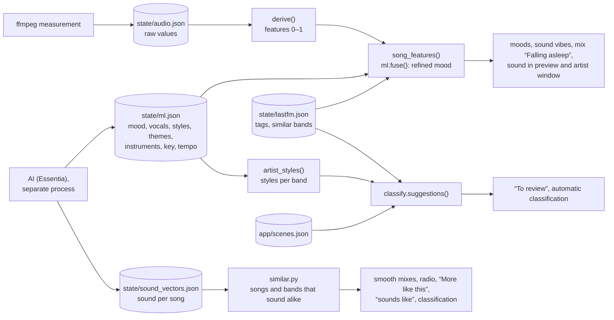

# Intelligence: sound, Last.fm, classification, statistics

Tuttiphon understands the music without cloud services and at no cost: ffmpeg measures the sound of every song, a local AI
(Essentia) picks out mood, vocals, music style, themes such as Christmas or film music, instruments, key and tempo, how
easy a song is to listen to and how much it asks for close listening, and describes each song's sound as a vector,
Last.fm supplies tags and similar bands, and from all this Tuttiphon assigns new bands to a music world. On top of that come the listening statistics per person and the recap over week,
month and year. This chapter describes how these parts compute and where their limits are. How the `analyse` step is
embedded in a run and when the night analysis runs is in [05-maintenance.md](05-maintenance.md); how sound vibes and
mixes use the results and how mixes learn from listening, in [04-playlists.md](04-playlists.md).

## Overview

| Part | Code | Data | Trigger |
|---|---|---|---|
| Sound analysis | `app/audio.py` | `state/audio.json` | step `analyse`, night analysis |
| AI sound analysis | `app/ml.py`, `app/ml_worker.py` | `state/ml.json`, `state/sound_vectors.json` | step `analyse` (after the sound analysis), night analysis |
| Sound similarity | `app/similar.py` | – (computed from `state/sound_vectors.json`) | mixes, radio, “More like this”, artist window, classification |
| Last.fm | `app/lastfm.py` | `state/lastfm.json` | step `analyse` |
| Merging features, classification, radio, “You’re still missing” | `app/classify.py` | – (computed from the files above) | step `analyse`, home page “To review”, Settings → Intelligence |
| Scene catalog | `app/scenes.py` | `app/scenes.json` (shipped with the program) | music worlds, classification, suggestions |
| Taste per account | `app/taste.py` | – (plays from Navidrome and `state/plays/`, `state/feedback/`, `state/deezer.json`) | suggestions, mixes, profile, welcome assistant, music world page |
| Statistics | `app/stats.py` | – (live from Navidrome) | Statistics page |
| Recap | `app/rueckblick.py` | `state/plays/<account>/` | server start, daily, when viewed |
| Mixes learn | `app/feedback.py` | `state/mix_history.json`, `state/feedback/` | step `playlists` – described in [04-playlists.md](04-playlists.md#mixes-that-learn-appfeedbackpy) |
| Lyrics search, kid-safe mode | `app/liedtext.py` | `state/liedtexte.db` | step `scan`, first search, Settings → Lyrics |
| Automatic music worlds | `app/autowelten.py`, `app/scenes.json` | – (computed from the song list, Last.fm, AI, lyrics language) | server start, after saving, steps `scan` and `analyse` |
| Check library | `app/pflege.py` | – (computed from the song list) | Settings → Check library |
| Same recording twice (audio fingerprints) | `app/fingerprint.py` | `state/fingerprints.json`, `state/fingerprint_matches.json` | step `analyse` (last part), night analysis; shown in Settings → Check library |



## Sound analysis

`app/audio.py` measures one or more excerpts per song with ffmpeg and stores **raw values**. Only `derive()` computes
the features on the 0–1 scale, at read time – so the scales can be improved without re-analyzing the library.

### Measuring with ffmpeg

`_measure()` calls ffmpeg with this filter chain (`CHAIN`) and reads the values from standard output:

| Filter | Effect |
|---|---|
| `aformat=…:channel_layouts=mono:sample_rates=22050` | mono, 22,050 Hz, floating point |
| `asetnsamples=n=512` | blocks of 512 samples ≈ 23 ms (≈ 43 measuring points per second, `FPS`) |
| `aspectralstats=win_size=1024:overlap=0.5:measure=centroid+flatness+flux` | spectral centroid (brightness), flatness (noise/distortion), flux (onsets) |
| `astats=…:measure_perchannel=RMS_level` | loudness (RMS in dB) per block |
| `ametadata=print:file=-` | print all values as `lavfi.…=value` |

For an excerpt, `-ss <start> -t <length>` is added; for the whole song, `-t 900` (at most 15 minutes). Non-finite values
become 0 or −120 dB. ffmpeg runs with lower priority (`nice 10`, `audio.NICE`, like the AI process) – playback in
Navidrome goes first. A call may take at most 600 s; after that `_measure()` ends ffmpeg and reports an error – the song
then counts as not readable (no half measurement). A file that cannot be read (ffmpeg error, no output) is tried up to
three times (`ATTEMPTS`), 0.3 and 0.6 s apart – files on the NAS share are sometimes briefly unreadable; a call that ran
into the time limit is not repeated. Every ffmpeg process is registered with the current run via `track`, so that
“Cancel” can end it immediately.

### Analysis depth

`settings.analysis.depth` sets which excerpts are measured (`DEPTHS`):

| Depth | Excerpts (position in the song, length) | Tempo |
|---|---|---|
| `schnell` (“fast”) | middle, 30 s | from the excerpt |
| `standard` (default) | middle, 60 s | from the excerpt |
| `gruendlich` (“thorough”) | at 20%, 50% and 80%, 40 s each | per excerpt, then consensus |
| `tief` (“deep – whole song”) | whole song (up to 15 min) | per 30 s window (step 15 s), then consensus |

An excerpt is centered on its position and shifted into the song. If the song is not longer than all excerpts together
plus 10 s – or its duration is unknown – it is measured as a whole. Songs measured as a whole with more than 45 s of
measurement always get their tempo from 30 s windows with consensus. The [AI sound analysis](#ai-sound-analysis) listens
to the same excerpts, but uses `gruendlich` instead of `tief`.

### Tempo

`_tempo()` determines the tempo from the spectral flux over time (at least 8 s needed):

1. Emphasize onsets: subtract a moving average over ±0.4 s, keep only positive values, smooth lightly twice.
2. Normalized autocorrelation for lags corresponding to 50 to 210 BPM.
3. Score per lag: autocorrelation + ½ × autocorrelation at twice the lag, multiplied by a soft preference for about
   120 BPM (normal distribution over `log2(bpm/120)`, width 0.9).
4. Fine-tuning with a parabola through the neighboring values.
5. Confidence `beat` (0–1): ratio to the strongest value of the autocorrelation × three times the height of the peak,
   both clamped to 0–1.

From several excerpts or windows, `_consensus()` forms one tempo: values at most 4% apart form a group; the group with
the largest weight (sum of the confidences + 0.05 per value) wins. The tempo is its weighted mean, the confidence the mean
of its confidences × its share of the total weight – if the sections disagree, it drops.

### Raw values

`analyse_file()` returns `None` if less than 5 s were measured; otherwise:

| Field | Content |
|---|---|
| `v` | version of the measurement (`VERSION`, currently 2) |
| `depth` | analysis depth used |
| `bpm`, `beat` | tempo and its confidence |
| `loud` | mean power in dB over all blocks louder than −60 dB |
| `dyn` | dynamics: 95th minus 10th percentile of these levels in dB |
| `cent` | median of the spectral centroid (Hz) |
| `flat` | median of the spectral flatness |
| `flux` | median of the spectral flux × 1000 |
| `path` | file path at the time of measurement (relative to the music folder) |

Unreadable songs (exception or less than 5 s measured) get
`{"v": 2, "path": …, "error": true, "depth": …, "t": <Unix time of the attempt>}`.

### Features

`derive()` converts the raw values into features. `clip()` clamps to 0–1. The scales are calibrated on our own library
(code comment: lullabies ≈ 0.2 energy, metal ≈ 0.9).

| Feature | Computation |
|---|---|
| Loudness (internal) | `clip((loud + 14) / 7)` – −14 dB … −7 dB |
| Onsets (internal) | `clip((flux − 25) / 70)` |
| `rough` (rough/distorted) | `clip((flat − 0.12) / 0.4)` |
| `energy` (energy) | 0.4 × loudness + 0.35 × onsets + 0.25 × `rough` |
| `bright` (brightness) | `clip((cent − 900) / 2000)` |
| Tempo (internal) | `clip((bpm − 70) / 90)`, without a tempo as for 100 BPM |
| `dance` (danceability) | `clip((beat − 0.4) / 0.55)` × (1 at 90–145 BPM, otherwise 0.6) × (0.4 + 0.6 × `energy`) |
| `arousal` (arousal) | `clip(0.55 × energy + 0.25 × tempo + 0.2 × dance)` |
| `valence` (basic mood) | `clip(0.3 × bright + 0.3 × tempo + 0.4 × dance − 0.25 × max(0, rough − 0.6))` |
| `bpm`, `beat` | unchanged |

`dyn` is stored but does not feed into any feature.

The basic mood from the sound is rough. `classify.song_features()` refines it: if the AI sound analysis has analyzed the
song, `ml.fuse()` merges measurement, AI and Last.fm (see [Merging](#merging-mlfuse)); otherwise, if `tag_valence()`
returns a value for the main artist, `valence = 0.45 × sound + 0.55 × tags` applies, and the song gets `vsrc: "tags"`.
`tag_valence()` sums the counts of positive tags (happy, upbeat, party, kinderlieder …) and negative tags (sad,
melancholic, dark, doom …) and returns `positive / (positive + negative)` – only if both together add up to at least 20.
`song_features()` stays in memory until `state/audio.json`, `state/ml.json` or `state/lastfm.json` change – one entry
per song list, up to eight (`ml.MEMO_SIZE`; entries of older measurements and of song lists that no longer exist –
e.g. after a reload, `rules.RELEASED` – are dropped with the next new entry), keyed by
`ml.songs_key(lib)`: account lists with the same songs in the same order as the default list share its entry
([Statistics](#statistics)). Everything that evaluates moods or sound filters reads through this function;
`rules.apply_sound()` additionally remembers per sound filter which songs fit (up to 64 filters).
`audio.features()` reads `state/audio.json` only once even when several requests ask at the same time (a lock with a
second check of the file's time and size).

### Moods

`moods()` assigns labels from the (merged) features (`a` = arousal, `v` = valence, `e` = energy). The IDs are in
`audio.MOODS` (with names) and `config.MOOD_IDS` (for validating sound filters); the interface has the same list in
`MOODS` (`frontend/src/lib/state.svelte.js`).

| Mood | Name in the interface | Condition |
|---|---|---|
| `ruhig` | calm & gentle | a < 0.33 |
| `energie` | energetic | a > 0.6 |
| `tanzbar` | danceable | dance > 0.55 |
| `froh` | cheerful | v > 0.6 and a > 0.35 |
| `melancholisch` | thoughtful | v < 0.35 and a < 0.55 **and** mood confirmed by Last.fm tags or AI (`vsrc` = `tags` or `ml`) |
| `schlaf` | for falling asleep | a < 0.3 and e < 0.3 and bpm < 118 and dance < 0.45 (no steady groove) |
| `instrumental` | no vocals | `inst` ≥ 0.8 – only with AI |
| `akustisch` | acoustic | `acoustic` ≥ 0.75 and `electronic` < 0.4 – only with AI |

### Where the features are used

- **Sound vibes:** A vibe can have a sound filter `sound` (ranges for `energy`, `bpm`, `arousal`, `valence`, `dance`
  and – from the AI – `approachable` and `engaging` (`audio.RANGE_KEYS`), a list `moods`, a list `instruments` and a
  list `themes`). `audio.matches()` only lets a song through if it is analyzed, every required range has a value and
  fits and – if moods, instruments or themes are required – at least one of each applies (an instrument from strength
  0.2, `audio.INSTRUMENT_PRESENT`, a theme from its own threshold, `ml.THEME_PRESENT` – both only with the AI, see
  [Themes](#themes)). `rules.apply_sound()` filters with it; because Navidrome does not know the sound, this only works
  for mixes.
- **Falling asleep:** If a mix requires the mood `schlaf` or `ruhig`, `mixer.calm_down()` sorts it by descending
  arousal; never the same band twice in a row – for that it searches the whole remaining list for the next different
  band if necessary.
- **Display:** tempo, energy and moods in playlist previews (`rules._with_sound()`) and the sound profile (median over
  the songs of a band – songs without the respective value, such as without a detected tempo, do not count –, the most
  frequent moods, plus the AI's music styles as “Sounds like: …”) in the artist window
  (`classify.artist_profile()`).
- **Inventory:** Settings → Intelligence counts the moods over the merged features (`audio.stats(feats)` in
  `GET /api/intel`) – so “no vocals” and “acoustic” only appear with the AI.
- **Search:** `GET /api/search` counts the songs per matching mood and names a sound vibe that requires exactly this
  mood, counts the songs per instrument (`ml.search_instruments()`, search words such as „Klavier“, „Gitarre“,
  “strings” in `ml.INSTRUMENT_WORDS`) and per theme (`ml.search_themes()`, „Weihnachten“, „Filmmusik“, „episch“,
  “dark” … in `ml.THEME_WORDS`, see [Themes](#themes)); the combined search recognizes mood words (German words such as
  “ruhige”, “tanzbare” …, `web.MOOD_WORDS`), listening words („Hintergrundmusik“, “easy listening”, „zum Zuhören“ …,
  `web.LISTEN_WORDS` – they stand for the vibes “In the background” and “For listening closely”), instrument and theme
  words and suggests a mix with a sound filter ([Playlists](04-playlists.md#combined-search)).

Details on sound vibes and mixes: [04-playlists.md](04-playlists.md).

### Run

`audio.run()` is called by the `analyse` step (only if `settings.analysis.enabled`):

- **What needs doing:** every song with a known file path that has no entry, whose entry has a different `VERSION` or a
  different path, or that was measured at a less thorough depth than set. So if the depth is raised, all songs are
  re-measured bit by bit; if it is lowered, everything stays. Entries with `error` (not readable) are re-measured
  regardless of the depth once the failed attempt (`t`) is more than 30 days ago (immediately if `t` is missing) – the
  file may have been replaced in the meantime. If the version or path changes, the song is retried immediately. If a
  song that already has a good measurement (e.g. due again for a new path) cannot be read, that measurement stays
  (the song keeps its sound and moods) and only `retry` (time of the attempt) is noted; the song is due again 30 days
  later.
- **Folder watch:** a run of the folder watch hands over the new files (`new_files`); then only their songs are
  measured (`only`, the rest of the backlog follows in the regular runs), the log says “… n of the new songs
  pending …”, and `open` keeps the count of the last regular run.
- **Order:** by date added, **new songs first**.
- **Time limit:** `settings.analysis.budgetMinutes` (default 10, `0` = none); “Analyze everything without a time limit”
  (`analyse_full`) runs without one, the night analysis without a time limit but at most until the end of its window
  (`until`). The check happens before each song; whatever is left is stored as `open` in `state/audio.json` and is
  handled in the next run.
- **Parallelism:** `settings.analysis.workers` threads; `0` = half as many as CPU cores (at least 1).
- **Saving:** every 2 minutes and at the end, with `lastRun` and `open` – a restart loses at most 2 minutes of work. If
  `state/audio.json` is not valid JSON at the start, it is set aside as `audio.defekt-<YYYYMMDD-HHMMSS>.json`
  (“⚠ Sound analysis: the results file was damaged – set aside as …, starting over.”) instead of being silently
  overwritten; if it is not readable, the sound analysis is skipped. Progress is logged every 500 songs. The inventory
  for Settings → Intelligence comes from `audio.stats()` (count, errors, depths, moods from the merged features, tempo
  distribution).
- **Cancel:** The stop signal is checked before each song. “Cancel” ends running ffmpeg calls immediately
  (`TaskRunner.cancel()`); a song whose measurement was interrupted is not saved, counts toward `open` and is handled in
  the next run.
- **Dry run:** The `analyse` step does not call `audio.run()` at all; nothing is measured and nothing is saved.

The rest of the program reads the features via `audio.features()` (kept in memory until `state/audio.json` changes).
File format: [02-data-model.md](02-data-model.md).

## AI sound analysis

`app/ml.py` complements our own measurement with pre-trained models from Essentia (Music Technology Group, Universitat
Pompeu Fabra) – locally, without a cloud. They pick out what cannot be read from loudness and spectrum: mood (happy,
sad, relaxed, aggressive, party), danceability, vocals or instrumental, acoustic or electronic, the music style out
of 400 Discogs styles, themes (56 classes, nine of them offered), the instruments (40 classes) and two scores: how easy a song is to listen to (approachability)
and how much it asks for close listening (engagement). Essentia's signal processing adds key and tempo, and the
embedding becomes a compact sound vector per song ([Sound similarity](#sound-similarity-appsimilarpy)). The AI only
analyzes songs that our own sound analysis already knows, and does not replace it: energy still comes from the
measurement; the tempo of the AI replaces ours when it is consistent (see [Merging](#merging-mlfuse)).

### Availability

`ml.available()` only checks files and does not load TensorFlow: the Python package `essentia` (from `essentia-tensorflow`)
must be installed, and all 29 model files from `ml_worker.FILES` must be in `MODELS_DIR`
(`TUTTIPHON_MODELS`, otherwise `<project>/models`). The Docker image contains both (`/app/models`). If something is
missing – on a PC usually Essentia –, the AI stays off, and Settings → Intelligence names the reason (“Essentia is not
installed (included in the Docker image).” or “AI models missing (n files) – rebuild the image.”). Moods, sound vibes
and classification then work as before with measurement and Last.fm.

### Models

| Model (`…-discogs-effnet-1`) | Value in `state/ml.json` |
|---|---|
| Embedding `discogs-effnet-bs64-1` | basis of all the others: one feature vector (1280 values) per patch of ~2 s; its mean becomes the sound vector in `state/sound_vectors.json` |
| `mood_happy`, `mood_sad`, `mood_relaxed`, `mood_aggressive`, `mood_party` | `m.happy` … `m.party` |
| `mood_acoustic`, `mood_electronic` | `m.acoustic`, `m.electronic` |
| `danceability` | `m.dance` (class “danceable”) |
| `voice_instrumental` | `m.voice` (class “voice”) |
| `approachability_regression` | `m.approachable`: score 0–1 (regression, `ml_worker.SCORES`) – high = mainstream, easy to get into; low = demanding, experimental |
| `engagement_regression` | `m.engaging`: score 0–1 (regression) – high = asks for close listening; low = background music |
| `genre_discogs400` | `g`: the strongest styles `Genre---Style` |
| `mtg_jamendo_moodtheme` | `t`: the strongest themes (56 classes: `christmas`, `film`, `epic`, `calm` …); nine of them are offered in sound filters and the search ([Themes](#themes)) |
| `mtg_jamendo_instrument` | `i`: the strongest instruments (40 classes: `piano`, `acousticguitar`, `electricguitar`, `violin`, `strings`, `synthesizer`, `drums` …) |
| – (Essentia `KeyExtractor`, profile `bgate`, 16 kHz) | `k`, `ks`: key and its strength |
| – (Essentia `PercivalBpmEstimator`, 16 kHz) | `b`, `bc`: tempo and the agreement of the analysis windows |

The source is `https://essentia.upf.edu/models/`, license **CC BY-NC-SA 4.0** (free for private, non-commercial use).
The models are downloaded when the Docker image is built, in a layer of their own
(`python3 app/ml_worker.py --download /app/models`, about 30 MB): up to three attempts per file, each one is verified
against its SHA-256 checksum in `ml_worker.FILES`. `model_path()` builds the folder on the server: the embedding lies
in `feature-extractors/discogs-effnet/`, every head in `classification-heads/<name>/` – the name without the variant,
so `approachability_regression-…` lies in `classification-heads/approachability/` (next to the `_2c`/`_3c` models). If the download fails, the image is still built; the AI then reports
“AI models missing” ([08-operations.md](08-operations.md#the-image-dockerfile)).

### Analysis process (`app/ml_worker.py`)

The server never loads TensorFlow. For the duration of the analysis, `ml.run()` starts a separate Python process
(`ml_worker.py <model folder>`) that ends afterwards – so the roughly 850 MB of memory for TensorFlow and the models
are only in use during the analysis.

- **Gentle:** priority `nice 10`, bound to at most `mlThreads` cores (`sched_setaffinity`, the last n cores),
  TensorFlow with as many threads (`TF_NUM_INTRAOP_THREADS`, `OMP_NUM_THREADS`; `TF_NUM_INTEROP_THREADS=1`), no GPU.
  `ml.py` passes `settings.analysis.mlThreads` (default 2) on as `TUTTIPHON_ML_THREADS` – the remaining cores stay free
  for Navidrome.
- **Protocol:** one JSON line per message over stdin/stdout. First the process reports `{"ready": VERSION}` (or
  `{"fatal": "…"}` if Essentia or a model is missing), then it answers each job `{"id", "path", "segments"}` with
  `{"id", "ml": {…}, "sv": "…"}` (`sv` = sound vector, see below) or `{"id", "error"}`. End: close stdin; the process exits with `os._exit(0)` because TensorFlow
  tends to crash on a regular shutdown.
- **Listening:** the same excerpts as the sound analysis (`audio._segments()`), but at most “thorough”
  (`ml._depth()`: `tief` → `gruendlich`, i.e. 3 × 40 s – the whole song would add little but cost many times as much on
  the NAS). ffmpeg decodes to mono, 16 kHz (Essentia's own loader cannot read Opus); a whole song at most 600 s. With
  less than 3 s of audio the song counts as not readable (“too short”).
- **One pass per song:** The sections are concatenated and computed in a single pass. The network always computes 64
  patches (~2 s each) at once; `Models.embedder()` chooses their spacing so that up to ~130 s of listening time fit into
  one pass – up to a good 60 s overlapping (hop of 62 mel frames, the model's default), above that without gaps (128).
- **Result:** Each classification model averages over the patches. Stored are `m` (9 probabilities 0–1 plus the
  two scores `approachable` and `engaging`, see [Approachability and engagement](#approachability-and-engagement)), `g` (up to 6 styles)
  and `t` (up to 6 themes), each with a strength ≥ 0.02, and `i` (up to 5 instruments with a strength ≥ 0.1 –
  absent instruments stay around 0.02–0.08; from about 0.2 an instrument is clearly there) – format in
  [02-data-model.md](02-data-model.md#mljson).
- **Key:** `KeyExtractor` (profile `bgate`, Essentia's default and in our measurements the most reliable on pop, rock
  and electronic music) over all excerpts at 16 kHz → `k` (`"A minor"`) and `ks` (strength 0–1). Measured on known
  songs: right or a neighbour on the Camelot wheel (relative or fifth) – e.g. “Billie Jean” F# minor, “Do I Wanna
  Know?” G minor, “Shape of You” F# minor instead of C# minor.
- **Tempo:** `PercivalBpmEstimator` at 16 kHz (`RhythmExtractor2013` assumes 44.1 kHz) per window of about 30 s – a
  60 s excerpt gives two, “thorough” three, a whole song up to 20 –, then consensus: the largest group of values at
  most 4 % apart wins (`consensus()`), `bc` = its share of the windows. The estimator keeps state between calls and
  is reset before every window. Measured on 10 songs with a known tempo: all steady ones right to ±1 BPM, while our
  own ffmpeg estimate was off for 4 of 10 (e.g. “Shape of You” 127 instead of 96, “Get Lucky” 66 instead of 116, a
  piano ballad at double tempo); on 177 songs of 59 bands the two differ by more than 4 % for a third of the songs.
- **Sound vector** (`"sv"` next to `"ml"` in the answer): the mean embedding over all patches, multiplied by a fixed
  random ±1 matrix 1280 × 128 (`sound_projection()`: bits from SHA-256 in counter mode with the seed `SOUND_SEED` –
  the same on every machine and with every numpy version), normalized to length 1, scaled so that the largest
  component is ±127 and stored as int8 in base64 (128 bytes per song). Random projections keep the angles between
  vectors (Johnson–Lindenstrauss): on our songs the cosines after projection and int8 correlate with those of the
  full 1280 dimensions at 0.95 (64 dimensions: 0.87, 256: 0.96). A learned reduction (PCA) would need the whole
  library and change with it; this one stays comparable across runs and installations.
- **Time:** key, tempo, instruments and vector add about 3 % (standard, 2.0 → 2.06 s per song on the PC with
  2 cores) to 6 % (thorough, 2.3 → 2.5 s) – almost everything is still the embedding. The two scores of version 3 add
  about 7 ms per song (0.2–0.3 %; all 14 heads together about 0.1 s of a thorough song's 2.9 s).

### Run

`ml.run()` runs in the `analyse` step after our own sound analysis, if `analysis.enabled` and `analysis.ml` are on:

- **What needs doing** (`_todo()`): songs with a file path that the sound analysis already knows (`audio.features()`),
  without an entry or with an older `VERSION`, a different path, a less thorough depth than set or without a sound
  vector in `state/sound_vectors.json` (unless the analysis found none, `nosv`); unreadable ones only 30 days after
  the last attempt (`RETRY_DAYS`), as well as songs whose good result was kept after a failed attempt (`retry`, see
  Errors). An entry of a newer `VERSION` (after going back to an older Tuttiphon) counts as current – it is not
  analyzed again. In a run of the folder watch only the songs of the new files (`only`; log “AI sound analysis: n of
  the new songs pending.”, `open` keeps the count of the last regular run). **Order:** songs the AI has never heard first, then the ones to analyze again –
  each newest first. After an update to a new `VERSION` (2: instruments, key, tempo, sound vector; 3: approachability
  and engagement), new music is
  therefore analyzed first and the rest of the library follows night after night; until then the older entries stay
  in use (they only lack the new fields), and everything that uses the new fields works with whatever share is
  already done.
- **Time limit:** `analysis.mlBudget` (default 15 min, `0` = none), checked before each song; “Analyze everything
  without a time limit” without one, the night analysis until the end of its window. Even before the analysis process
  starts, `ml.run()` checks the deadline: if less than 30 s remain, it does not start at all (“AI sound analysis: no
  time left in this run – continuing in the next one.”) – loading TensorFlow is not worth it then. Whatever remains
  open is stored as `open` in `state/ml.json`.
- **Saving:** every 2 minutes and at the end (`lastRun`, `open`), together with `state/sound_vectors.json` (the
  vectors are kept apart so that `ml.json` stays small; a song that turns out unreadable loses its vector) – a
  restart loses at most 2 minutes of work. In the
  log: “AI sound analysis: n songs done, m pending (until HH:MM).”, every 200 songs the progress with seconds per song,
  at the end “n newly analyzed, k not readable – j follow in the next run.” If `state/ml.json` is not valid JSON, it is
  set aside as `ml.defekt-<YYYYMMDD-HHMMSS>.json` (warning in the log), and the AI starts over; if it is not readable,
  the AI is skipped. A damaged `state/sound_vectors.json` is set aside the same way (`sound_vectors.defekt-…json`);
  the songs concerned are then simply due again.
- **Errors:** If the process answers a song with an error, it is asked twice more, 0.3 and 0.6 s apart (`ATTEMPTS`,
  `RETRY_PAUSE` – files on the NAS share are sometimes briefly unreadable). A broken file then gets `error` (new
  attempt after 30 days). If the song already has a good result (e.g. due again for a new version or path), that result
  and its sound vector stay and only `retry` (time of the attempt) is noted – a briefly unreadable share no longer
  takes moods, styles and vector away for 30 days. If the process crashes (e.g. out of memory), the song is handled the
  same way (without the second try), and `ml.run()` restarts the process; after more than three crashes the AI stops
  for this run (“⚠ AI sound analysis: the analysis process keeps crashing (not enough memory?) – continuing in the next
  run.”).
- **Watchdog:** If the process does not answer for a song within 600 s (`SONG_TIMEOUT`, e.g. TensorFlow or ffmpeg hangs
  on a broken file), a timer kills its process group (`SIGKILL`). The song then counts as not readable, and things
  continue as after a crash (it also counts toward the three crashes). Loading TensorFlow and the models is watched the
  same way: without “ready” within 300 s (`START_TIMEOUT`, at most until the end of the run, at least 30 s) the process
  is ended and the AI stops for this run (“⚠ AI sound analysis: The analysis process was not ready after n s (loading
  the models) – continuing in the next run.”) – the night window and the daily refresh no longer wait for it forever.
- **Cancel:** The process is registered with the run; “Cancel” ends it immediately, the song in progress is not saved.
  Canceled while the models are loading, the log says “AI sound analysis: canceled while the models were loading.”
  (not “does not start”).
- **Reading `state/ml.json`:** once per state of the file, even with parallel requests (a lock with a second check of
  time and size, `_refresh()`). The values are copied out of the parsed file entry by entry (`_copy()`, names once),
  and each parsed entry is freed right away – so nothing in memory points into the parsed file any more and its memory
  goes back to the system: about 75 MB instead of about 100 MB for 25,000 songs, and the parse no longer peaks together
  with the copies.
- **Dry run:** skipped entirely.
- **Pending:** `ml.pending()` counts the songs that would still be due – for the night analysis (0 if the AI is off or
  not available). `ml.stats()` supplies the inventory for Settings → Intelligence (`GET /api/intel`).

A song takes a few seconds on the NAS; the first pass over the whole library therefore spans several nights
([Night analysis](05-maintenance.md#night-analysis)).

### Merging (`ml.fuse()`)

If the AI has analyzed a song, `classify.song_features()` computes its features with `ml.fuse(f, m, tag_valence)` from
our own measurement `f`, the AI values `m` and the band's Last.fm mood. The AI recognizes mood much better than loudness
and spectrum do; energy still comes from the measurement, the tempo from the AI when its windows agree (below).

| Feature | Computation |
|---|---|
| AI basic mood (internal) | `clip(0.5 + 0.4 × (happy − sad) + 0.15 × (party − 0.5))` |
| AI arousal (internal) | `clip(0.5 + 0.45 × (max(aggressive, party) − relaxed))` – high arousal means aggressive **or** party (kids' pop is not aggressive, but just as lively) |
| `valence` | weighted mean of AI basic mood (0.6), sound (0.15) and Last.fm tags (0.25); without a tag value only the first two, i.e. 0.8 × AI + 0.2 × sound |
| `arousal` | 0.6 × sound + 0.4 × AI arousal |
| `dance` | 0.5 × sound + 0.5 × AI danceability |
| `inst` | 1 − `voice` (for “no vocals”) |
| `acoustic`, `electronic` | AI values (for “acoustic”) |
| `energy`, `beat`, `bright`, `rough` | unchanged from the measurement |
| `vsrc` | `"ml"` (counts like `tags` as confirmation for “thoughtful”) |

**Tempo, key and instruments** (`classify.song_features()` – the one accessor for the merged features; everything that
uses the tempo reads it there: sound filters, “for falling asleep”, mixes, artist profile, song rows):

- `bpm`: the AI tempo if at least 60 % of its windows agree (`ml.TEMPO_AGREE`) or our own measurement found no tempo;
  then `bsrc: "ml"`, and `audio.with_tempo()` recomputes what depends on the tempo – danceability, arousal and basic
  mood – with the formulas of `derive()` from our own energy, brightness, roughness and beat confidence, *before*
  `ml.fuse()` merges. Otherwise our own estimate stays (ffmpeg remains the fallback).
- `camelot`: the key on the Camelot wheel (`ml.camelot()`: `"A minor"` → `"8A"`, `"C major"` → `"8B"`; A = minor,
  B = major) if its strength is at least 0.5 (`ml.KEY_MIN`). `ml.key_distance()` counts the steps between two codes:
  0 same key, 1 neighbour (±1 or major/minor of the same number), … 7.
- `instr`: `{instrument: strength}` from `i` (shared with the cache of `ml.py`, not copied).
- `themes`: `{theme: strength}` from `t` – only the offered themes from their threshold (`ml.themes()`, see
  [Themes](#themes)).
- `approachable`, `engaging`: the two scores from `m` (`ml.scores()`), only for songs analyzed with version 3.

### Approachability and engagement

Two regression heads of the Discogs-EffNet embedding (`approachability_regression`, `engagement_regression`, trained by
the MTG on an in-house dataset of about 24,600 and 22,200 songs, Pearson correlation 0.85 and 0.73 according to their
model cards). They run in the same pass as the other heads and cost almost nothing. Each returns one linear score
(output `model/Identity`, class `approachability`/`engagement`); `Models.analyse()` averages it over the patches and
`ml_worker.score()` clamps it to 0–1 with 3 decimals – a value that is not a number is left out.

The two values are kept apart from the classification values (`ml_worker.SCORES`, not in `HEADS`/`ml.KEYS`): an entry
of version 2 has none, and a missing value must not count as a middle one. `ml.scores()` (song id →
`{"approachable", "engaging"}`), `ml.approachable(id)` and `ml.engaging(id)` read them; `classify.song_features()` puts
them into the merged features; sound filters require them as ranges (`audio.matches()`: no value = no match).

Measured on 131 songs of our library (one per band, 60 s from the middle) and 10 songs with thorough depth:

| | min | 10 % | median | 90 % | max | outside 0–1 |
|---|---|---|---|---|---|---|
| approachability (raw) | 0.04 | 0.35 | 0.68 | 0.90 | 1.08 | 1 |
| engagement (raw) | 0.34 | 0.53 | 0.79 | 0.97 | 1.06 | 8 |

- **Approachability** fits its name: pop hits, schlager and most children's songs 0.75–0.95, folk and indie in the
  middle, metal, folk metal, ritual music and experimental electronic 0.04–0.3. Correlation with the
  other AI values: aggressive −0.59, happy +0.53, voice +0.42.
- **Engagement** separates background music well – new age, ambient piano and calm folk 0.03–0.45 –, but at the top
  it is mostly arousal: relaxed −0.87, sad −0.86, acoustic −0.83, party +0.66. Eurodance and dance pop score just as
  high (0.9–1.0) as metal. That is why “For listening closely” also requires danceability 0–0.55 (what remains: metal,
  rock, folk rock, rap, audio plays), and “In the background” also liveliness 0–0.55.
- Share of the sample: “In the background” (approachable ≥ 0.6, engaging ≤ 0.6) and “For listening closely” (engaging
  ≥ 0.75, AI danceability < 0.6) about 12 % each.

### Themes

The mood/theme model (`mtg_jamendo_moodtheme`, MTG-Jamendo, 56 classes, multi-label) gives every class a probability;
the analysis stores the strongest six from 0.02 as `t` (since the first version, so every analyzed song has them).
It is the weakest of the models – its model card names a PR-AUC of 0.14 – and many classes repeat what Tuttiphon
already knows. `ml.THEMES` therefore offers nine of them (id → label, German from `app/locales/de/analysis.json`):

| Theme | Label (en / de) | Threshold (`ml.THEME_PRESENT`) | Share of one song per band |
|---|---|---|---|
| `christmas` | Christmas / Weihnachten | 0.2 | 2.5 % |
| `film` | film music / Filmmusik | 0.12 | 4.9 % |
| `epic` | epic / episch | 0.15 | 8.2 % |
| `dark` | dark / düster | 0.1 | 4.5 % |
| `love` | love songs / Liebeslieder | 0.2 | 10.7 % |
| `romantic` | romantic / romantisch | 0.08 | 6.2 % |
| `ballad` | ballads / Balladen | 0.12 | 6.6 % |
| `summer` | summer / Sommer | 0.08 | 3.7 % |
| `space` | space / Weltraum | 0.06 | 4.1 % |

Left out:

- **Repeats of a mood or a listening vibe:** calm, relaxing, soft, slow, meditative (→ calm & gentle, for falling
  asleep), energetic, powerful, fast, heavy, upbeat (→ energetic), happy, positive, fun, funny, uplifting, hopeful,
  inspiring, motivational (→ cheerful), sad, melancholic, emotional (→ thoughtful), party, groovy (→ danceable),
  background (→ “In the background”).
- **Vague:** cool, deep, melodic, dream, sexy, retro, commercial, corporate, advertising, drama, dramatic, soundscape.
- **Hardly ever recognized:** children, holiday, movie, travel, game, nature, documentary, trailer, sport, adventure,
  action – on the songs measured they never or almost never reach the stored six, and the few hits look random.
  `children` in particular never rose above 0.05, not even on 71 children's songs (its ranking separates children's
  songs from the rest no better than chance, AUC 0.54) – children's music stays a matter of the music world.

**Measured** on 367 songs of our library (60 s from the middle, as with the depth “standard”): one random song of each of
243 bands, 70 songs from 40 Christmas albums of 22 bands and 48 children's songs of 16 bands. The thresholds are set so that each theme takes a
few percent of the library (last column: share of the 243 songs, one per band); storing only the strongest six costs
little at these thresholds (the stored values miss at most three of the 367 songs). The ten strongest hits per
theme look right for epic (Blind Guardian, Nightwish, Xandria, Wardruna, Gregorian), film music (HAUSER, Adrian von
Ziegler, The Piano Guys “Batman Evolution”, Celtic Woman), dark (The Chemical Brothers, Heilung, Fever Ray, Subway to
Sally, Lord of the Lost), love songs and ballads (Hozier, Lewis Capaldi, Dermot Kennedy, Tim Bendzko) and space
(Daft Punk “Contact”, Schiller, Darude); summer and romantic are rougher (Bob Marley and Boney M., but also a
children's song; HAUSER, Enya, Celtic Woman). Christmas finds Christmas songs with bells, choirs and orchestra, but
not Christmas pop: of the 70 Christmas songs 13 reach 0.2 (19 %), of the 243 others 6 (2.5 % – mostly calm Celtic and
orchestral songs). On the whole library that is far less precise than the keywords of the vibe “Christmas”.

**In code:** `ml.themes()` (song id → `{theme: strength}`, only offered themes from their threshold) feeds
`classify.song_features()` (`themes`); `audio.matches()` requires at least one of the filter's themes;
`config._validate_sound()` only accepts ids from `ml.THEMES`; `ml.theme_catalog()` counts the songs per theme
(`GET /api/sound/catalog`, sound editor); `ml.song_info()` lists the song's themes in the song window; `ml.stats()` names
the eight most frequent ones. A playlist whose own sound filter requires themes may be “All × Everything”, like one
with instruments.

**Search words** (`ml.THEME_WORDS`, the start of a word is enough, as for instruments; `ml.THEME_PHRASES` merges “love
song”, “film music”, “x-mas” first): „Weihnacht…“, “christmas”, “xmas” → Christmas; „Filmmusik“, „filmisch“,
“soundtrack”, „Kino…“, “movie”, “cinematic” → film music; „episch“, “epic”; „düster“, „finster“, “dark”; „Liebeslied…“,
„Liebe“, “love song”, “love”; „romanti…“; „Ballade…“, “ballad”; „Sommer…“, “summer”; „Weltraum“, „Weltall“,
„kosmisch“, “space”, “cosmic”. **Precedence:** a music world or vibe of the same name takes a word before the AI –
„Kinder“ is the music world, „Weihnachten“ the vibe “Christmas”; the delivered vibe linked to a theme
(`ml.THEME_VIBES`: `christmas` → `weihnachten`) stands for it even under another name. The search's theme group leaves
a theme out when a music world's name contains the input, and offers the vibe instead of the theme when one stands for
it ([Playlists](04-playlists.md#combined-search)).

**Christmas songs in a theme filter:** the vibe “Christmas” hides its songs from every other playlist
(`excludeElsewhere`). A playlist whose sound filter (its own or its vibe's) asks for the theme `christmas` may contain
them all the same – `rules.shown_vibes()` counts the vibe linked by `ml.THEME_VIBES` as its own; otherwise such a filter
would only find the songs the keywords miss.

### Music styles per band

`ml.artist_styles(lib)` aggregates the styles per band (main artist): the strengths of all analyzed songs summed up
(only the style after `---`, lowercase), the eight strongest scaled relative to the strongest (= 1), styles below 0.15
are dropped. In memory, `ml.py` keeps the styles per song with shared names (`sys.intern()` – the same roughly 400 names
only once). It caches its result per song list under `ml.songs_key(lib)` – up to eight lists (`ml.MEMO_SIZE`), so the
default list and the account lists no longer push each other out; account lists that share the caches of the default
list (same songs, same order, `rules.Library.share_with()`) get its key and thus its result.
`classify.song_features()` and `similar.index()` work the same way; caches that depend on an account's plays (the
statistics, the taste) use `ml.lib_key(lib)`, a sequential number that the song list gets on first use (`id()` could
recur for a new list after garbage collection). This is used as follows:

- **Classifying new bands:** `_vectors()` gets one feature `k:<style>` per style (see
  [Signals](#signals-and-match-rate)) – this helps above all with bands that Last.fm does not know.
- **Suggesting vibes:** Without Last.fm tags, the styles replace the tags; the reason then reads “Sound: …”.
- **Artist window:** styles with a strength ≥ 0.4 (at most four) as “Sounds like: …”, spelled as in the models
  (`ml.style_label()`, e.g. “Alternative Rock”).
- **Settings → Intelligence:** the eight most frequent styles, counted over the strongest style per song
  (`ml.stats()`; it also supplies the eight most frequent instruments and themes and how many songs already have the
  current version, `current`, and a sound vector, `vectors`).

## Sound similarity (`app/similar.py`)

Which songs and bands sound alike – from the AI's sound vectors, with the standard library only (`array`,
`math.sumprod`, `heapq`).

**Centered cosine.** All embeddings share a large common part (it is music, recorded with today's means …); plain
cosines are therefore 0.2–0.6 between almost any two songs. `similar.py` measures against the mean direction m of all
stored vectors: u = (v − m) / |v − m| with v = the stored direction. When the file is read, it precomputes per song
s = 1 / (|q| · |v − m|), h = v · m − |m|² / 2 and w = 1 / |v − m|; then u_i · u_j = (q_i · q_j) · s_i · s_j − (h_i +
h_j) · w_i · w_j – one dot product of the int8 values per pair. m comes from the column sums of all vectors (fast:
slices of one byte string) divided by their mean length – any fixed centre keeps the formulas exact. Measured on 177
songs of 59 bands from 12 scenes (3 songs each):

| Pair | Mean | 10 % … 90 % |
|---|---|---|
| songs of the same band | 0.39 | 0.08 … 0.72 |
| songs of the same scene | 0.27 | −0.02 … 0.57 |
| other songs | −0.03 | −0.24 … 0.22 |
| bands of the same scene (centroids) | 0.44 | 0.17 … 0.71 |
| other bands | −0.05 | −0.32 … 0.27 |
| band and its own scene (without itself) | about 0.6 | – |

Examples: Nightwish → Xandria 0.71, HammerFall 0.61, Within Temptation 0.57; Wardruna → Danheim 0.72, Eihwar 0.62; Ed
Sheeran → Lewis Capaldi 0.68, Shawn Mendes 0.63; Sido → Fettes Brot 0.73, 257ers 0.67; Captain Jack → Vengaboys 0.76.

**Index** (`similar.index(lib)`, cached per song list – `ml.songs_key()` – and state of the file, at most eight; it
keeps only the main artist of each song with a vector, not the song list itself, so a cached index does not hold an
old, reloaded list in memory): `cos(i, j)`,
`neighbors(i, k)` (the k most similar songs, cached per song: 25,000 songs in about 0.08 s; loading and precomputing
the file about 0.25 s), `centroids()` (band → unit vector of the sum of its centered song vectors, from 2 songs,
`MIN_SONGS`; 2,000 bands in about 0.25 s), `similar_artists(band, k)` (cached per band), `closeness(i, vector)`.
Songs without a vector are simply left out – partial coverage is normal while the AI works through the library.

**Many songs at once** (`similar.batch(ids)` → `(song ids, Batch)`, all stored songs without `ids`; then
`Batch.positions` = song id → row): with the standard library one dot product costs about 3–5 µs per song – too slow
for comparing every song with several vectors ([sound taste](#sound-taste-appsoundtastepy)). `Batch` uses big
integers as lanes: per dimension one integer holds the value of every song (shifted to 0 … 255) in its own 32 bits;
multiplied by a vector's components (as integers 0 … 2¹⁶) and summed, it yields every song's dot product at once –
128 · 255 · 2¹⁶ < 2³², so there is no carry between the lanes. `closeness(vector)`: 25,000 songs in about 7 ms
(instead of 125 ms with `Index.closeness()` per song; preparing the lanes once per batch about 27 ms);
`sums(weights, groups)`: weighted sums of the centered song vectors per group, each song one integer with 48 bits per
dimension. Rounding costs less than 0.0001 in the cosine.

**What uses it:**

| Where | How |
|---|---|
| Mixes | [smooth transitions](#smooth-transitions-in-mixes) (`mixer.smooth()`) |
| Radio | `classify.radio_artists()`: bands whose centroid has a cosine ≥ 0.4 (`RADIO_SOUND_MIN`) to a seed band count 0.8 × the cosine in addition to Last.fm; in the mix `mixer.radio_sound()` weights each song by its closeness to the closest seed band: × 0.6 (cosine −0.1 and below) … × 1.4 (0.6 and above) |
| “More like this” | `classify.rank_like()`: distance = (1 − cosine to the song) + 0.5 × the previous feature distance (arousal, mood, tempo) + a little chance; songs without a vector count as unrelated (1). The pool is the radio of the song's band, so it includes the bands that sound alike |
| Artist window | `soundsLike` in `GET /api/artist` (`classify.artist_profile()`): up to 8 bands with a cosine ≥ 0.35 (`SOUNDS_LIKE_MIN`) |
| Classification | sound of the band against the sound of each music world ([Signals](#signals-and-match-rate)) |
| Taste | [sound taste](#sound-taste-appsoundtastepy): a few typical sounds of what each account plays – mixes, “Your sound”, suggestions |
| Navidrome | [the plugin](#for-navidrome-the-plugin-appsonicpy): Instant Mix, song and artist radio, similar artists, sound paths |

### Smooth transitions in mixes

`mixer.smooth(lib, chosen)` orders a new mix selection (`settings.smoothTransitions`, default on): starting with the
first song of the weighted selection, always the remaining song that follows the last one best – greedy and
deterministic, so the same selection always gives the same order. Cost of a transition (`transition_cost()`, 0 … 1;
a part without data on one of the two songs counts 0.5):

| Part | Weight | Cost |
|---|---|---|
| sound | 0.5 | `(0.7 − cosine) / 0.8`, clamped: 0 from a cosine of 0.7, 1 from −0.1 |
| energy | 0.2 | difference / 0.4, at most 1 |
| tempo | 0.15 | `|log2(b / a)| / log2(1.15)`: 15 % apart = 1; half or double tempo from 0.4 |
| key | 0.15 | Camelot steps 0 → 0, 1 → 0.2, 2 → 0.6, more → 1 |

Never the same band twice in a row: a band only comes next if the rest can still be arranged without repeats (after
it, no band may have more than half of the remaining songs); otherwise the band that would be left over goes first –
the same result as `spread()` where repeats cannot be avoided. With fewer than half of the songs having a sound vector
or a key, `smooth()` returns `None` and `spread()` orders as before; the same in mixes with an arc (sound filter with
`schlaf` or `ruhig`: `calm_down()`, `arc: "rise"`: good morning). Only new selections are ordered – a selection
already written in this period keeps its order ([Playlists](04-playlists.md#selection)). Measured on 30 random mixes
of 40 songs from the 177 songs above: energy jumps between neighbours 0.32 → 0.14, sound cosine of neighbours 0.0 →
0.33, tempo cost 0.83 → 0.63, Camelot steps 2.4 → 1.8; 6 ms per mix.

### For Navidrome: the plugin (`app/sonic.py`)

The Tuttiphon plugin hands Navidrome's questions to `GET /api/sonic/…` ([API](03-api.md#navidrome-plugin)) – so
Instant Mix, “similar songs”, the smart queue, song and artist radio in Navidrome and its apps (Symfonium, Feishin …) and the
OpenSubsonic extension `sonicSimilarity` follow the sound of the own files.

**What may come** (`_pool()`, cached per song list, configuration and worlds): Navidrome does not say who listens, so
“All” as for the shared person – minimum rating 0, without the separate worlds, without its dislikes, without live
recordings and the like (`excludeTitles`, `minDuration`), kid-safe as soon as any profile is a child profile or
has kid-safe mode on (`_view()`; without a shared person a stand-in without dislikes). If the song (or band, album) asked for is in a separate world, that world comes along – children's songs
lead to children's songs, a rock song never to an audio play.

| Question | How |
|---|---|
| Similar songs (`similar`) | every song by closeness to its sound (`_closest()`, all vectors at once with `similar.batch()`) within what may come – a song the AI has not analysed yet takes the mean sound of its album, otherwise of its band (`_sound()`); too few or no sound at all: the radio of the band (`classify.radio_artists()`) ordered by `classify.rank_like()` fills up, its similarity always below the last real one |
| Artist radio (`artist`) | every song by closeness to the band's mean sound (`Index.centroid()`), + 0.1 for bands of its radio (`RADIO_BONUS` – only for the order, the similarity shown stays the closeness); the band itself up to a third of the songs; without vectors the radio's bands, shuffled by the day, similarity falling from 0.5 |
| Album (`album`) | closeness to the mean sound of the album's songs (without vectors on the album: of its band), not from the album itself; without any sound like the artist radio of its band, without the album |
| Similar bands (`artists`) | `classify.radio_artists()` (Last.fm and sound) – only bands with songs that may come for this band (separate worlds only for a band of them), never the band itself, with Navidrome's artist id |
| Path (`path`) | from the start song to the end song in `count` steps: at step k the song nearest to the normalized point (1 − t)·a + t·b between the two centered sounds (t = k / (count − 1)), every song and recording once, at most `max(2, count / 8)` per band; both ends included; songs without a vector of their own take the sound of their album or band; without any sound the first half from the similar songs of the start, the second from those of the end; from a song to itself: the song and its similar songs |

Every answer: at most `max(2, count / 12)` songs per band (the band asked for a quarter, the artist radio a third),
every recording once (`_Seen`: the same title without “(…)”/“[…]” – but “(Part 2)”, “(2011)” stay – and band with
about the same length, ± 4 s), never the song asked for; similarity clamped to 0–1. Answers are remembered per song
list, configuration and sound vectors (256 for similar songs).
A band is found by Navidrome's artist id or name among all artists and album artists of a song (Navidrome also asks
for an artist who only takes part); it counts as the main artist of most of those songs (`_artist_songs()`).
Measured on the development PC with a made-up library of 25,000 songs: the first answer after the song list changed
about 1 s (what may come), then similar songs about 0.15 s (0.08 s for the same song again), an album 0.06 s, an
artist radio 0.25 s, a path of 25 songs 0.2 s.

## Last.fm

`app/lastfm.py` fetches tags and similar bands per band from Last.fm. This is free but needs your own
API key.

### Key

`api_key()` reads `LASTFM_API_KEY` from the credentials (`load_env()`: `.env` in the data folder, environment variables
take precedence). It is entered under Settings → Intelligence (`PUT /api/env`) or in `docker-compose.yaml`.
`POST /api/lastfm/test` checks a key with a sample request before it is saved. Without a key, the `analyse` step skips
Last.fm with a notice; classification and radio then work only with genres, scenes and – with the AI sound analysis –
the bands' music styles.

### Requests

`fetch_artist()` sends two requests per band to `https://ws.audioscrobbler.com/2.0/` (with `autocorrect=1`):

| Method | Stored |
|---|---|
| `artist.gettoptags` | up to 30 tags as `[name (lowercase), count]` |
| `artist.getsimilar` (`limit=60`) | up to 60 bands as `[name, similarity 0–1]` |

`Client` throttles to 4 requests per second. It retries up to twice with a pause: on HTTP 429, 500, 502, 503 and on
network errors, timeouts and aborted or broken responses (`URLError`, `HTTPException`, `OSError`, `ValueError` – e.g.
HTML instead of JSON). If it still fails, this becomes a `LastfmError` (“Last.fm not reachable: …”). Error code 6
(artist unknown) yields empty lists; codes 10 and 26 (invalid key) abort the fetch; other errors are logged per band
(“⚠ <band>: …”), and it continues with the next one. The `analyse` step catches every Last.fm error (“⚠ Last.fm: …”) –
sound analysis, AI and classification still run.

### Cache

`state/lastfm.json` holds per band name `{"t": <timestamp>, "tags": [...], "similar": [...]}` and `lastRun`. An entry
is valid for 30 days (`TTL`); after that it is fetched again in the next run. It is saved every 100 bands and at the end.
`load()` keeps the file in memory until it changes; `artist(name)` reads from it and never queries Last.fm itself.

### In the run

The `analyse` step passes all album artists of the library (`rules.artist_stats()`, without “Various Artists”), first
the bands without a music world, then by song count in descending order. `refresh()` fetches missing and expired entries
until `settings.analysis.lastfmBudget` minutes (default 3, `0` = no limit) are up; “Analyze everything without a time
limit” runs without a limit. In a dry run the step does not query Last.fm.

### Limits

- The data is tied to the band name as Navidrome delivers it. Last.fm corrects spellings (`autocorrect`), but the
  cache stays under the name from the library.
- Tags are user labels: classification hides meaningless ones (`NOISE`: “seen live”, “favorites”, “german” …)
  and only considers tags with a count ≥ 5.
- When someone listens to a song, Tuttiphon does not report it to Last.fm – it only reads.

## Scenes

`app/scenes.json` is a catalog of 30 scenes – the music worlds Tuttiphon knows – with the typical bands and
identifying features of a music genre (`id`, `name`, `icon`, `description`, `genres`, `bands`, `keys`, where needed
`lang`, `era`, `decade`, `broad`, `separate`, `niche`; see below). `scenes.members()` finds a scene's bands in the library; for this, names are
normalized (`norm()`: upper/lower case, apostrophe and hyphen variants, punctuation, leading “The”).

A music world with `scene` and `autoScene` automatically takes in the existing bands of its scene (except
`excludedArtists`) – the typical ones and the detected ones, see below and [04-playlists.md](04-playlists.md). The scene
also counts as a signal for classification (below). If `settings.welten.auto` is off, the home page and Discover suggest
new music worlds instead of creating them.

## Automatic music worlds (`app/autowelten.py`)

Music worlds do not come from a fixed list but from the collection: Tuttiphon describes every band and assigns it to
the scenes of the catalog. If a scene yields enough, it becomes a music world.

| Feature per band (from 2 songs, `profiles()`) | Source |
|---|---|
| Genres | genres of the files, share of the band's songs. Very common genres such as Rock or Pop count less (`_specificity()`: from 25% of all bands × 0.15, from 12% × 0.5 – only from 10 bands on) |
| Tags | Last.fm tags (`state/lastfm.json`), weight 0–1 |
| Music styles | AI sound analysis (`ml.artist_styles()`), only in the Docker image |
| Language | `de`/`en` from the lyrics (`liedtext.languages()`, detected per song when indexing), otherwise from song and album titles – by frequent short words |
| Era | `era` = early quarter of the release years, `mid` = middle; plus decade tags from Last.fm (“80s”) – so reissues and best-ofs barely shift a band's era |

**Score** (`score()`): typical band of the catalog = 1. Otherwise the strongest of genres (full match when half of the
songs carry a matching genre), tags and AI styles, plus a quarter of the other two, at most 0.99.
`lang`: wrong language × 0.15, unknown × 0.5. `era`: period as a condition (Rock classics, Oldies & disco). `broad`
(Pop & charts, German pop): × 0.8. Decade worlds (`decade`: The 80s, The 90s) count only the era: 0.8 with a
matching Last.fm decade, 0.65 if `era` lies in the decade and `mid` at most six years after it.

**Assignment** (`assign()`): Each band belongs to its best world from 0.45 (main world). Decade worlds additionally get
all bands from 0.6 – except those whose main world is a niche (`niche`: Kids' music, Audio plays & audiobooks,
Medieval rock & folk, Classical …). `members(scene)` = typical bands that exist, plus the assigned ones. Cached
until the song list, Last.fm, AI or lyrics index change.

**New worlds** (`candidates()`, `sync()`): A scene becomes a music world if it is not yet linked to any world,
is not in `dismissed`, at most half of its bands are already in another world (decade worlds do not count here –
they overlap with everything) and it yields enough –
from 4 bands and 60 songs, decade worlds from 5 bands and 80 songs, or from 2 bands and 20 songs if an account with a
taste profile listens to these bands at least 5% of the time. `sync()` creates it (`new_welt()`, `auto` = today) – at
server start and after every save (`warm_up()`, only if something has changed since), after the scan and after
“Understand music”. It never touches custom worlds; deleted ones do not come back. If the interface saves a state
that does not yet know a world created in the meantime, the world stays (`config.merge_server_fields()`) – it is only
gone if its scene is in `dismissed`. “To review” reports new worlds for 14 days (several in one entry), the
`autoAssigned` notification names them.

On a new installation, all worlds thus arise from the collection – depending on the music, e.g. Medieval rock & folk,
Kids' music, The 90s, Pop & charts, Eurodance & 90s dance or German rap & hip-hop. For users, the
music worlds page and the assistants sort the worlds by their own listening ([09](09-interface.md#music-worlds-sorted-by-listening)).

## Classifying new bands

`classify.suggestions()` looks for the best-matching music world for every band without one and returns a match rate
from 0 to 1 with a reason.

### Candidates

Album artists with at least 3 songs that are in no music world (neither by hand nor via the scene), are not excluded in
any music world and are not called “Various Artists”.

### Signals and match rate

1. **Tag, genre and sound profile:** `_vectors()` builds a vector per band from Last.fm tags (`t:`, count / 100),
   the genres in the files (`g:`, 0.6 × share of songs with this genre) and the music styles of the AI sound analysis
   (`k:`, 0.7 × strength from `ml.artist_styles()`), weighted with TF-IDF (`log((1 + bands) / (1 + bands with
   this feature)) + 0.5`) and normalized to length 1. Rare features thus count more than run-of-the-mill genres. A
   music world's profile is the normalized sum of the vectors of its bands. `tag_score` = cosine similarity of band and
   music world.
2. **Similar bands:** Last.fm's list of similar bands, limited to bands in the library. `sim_score` = sum
   of the similarity values of the hits that are in this music world, divided by 1.5, at most 1.
3. **Match rate:** `0.5 × tag_score + 0.5 × sim_score` if the band has similar bands in the library; otherwise
   `0.85 × tag_score`.
4. **Sound:** if the band has at least 3 songs with a sound vector and the music world at least 2 bands with a sound
   (`classify.sound_profiles()`: the world's sound = mean direction of its bands' centroids), `sound_score` = (cosine
   − 0.2) / 0.5, clamped to 0–1 (unrelated bands reach 0.2 at most in one case out of ten; a band and its own scene
   typically 0.6–0.7), and the match rate becomes `0.85 × rate + 0.15 × sound_score` (`SOUND_WEIGHT`). Without
   enough vectors, everything stays as before. On the 59 bands above, the sound alone puts 66 % in their own scene
   (left out of it); in a test with the AI styles but without tags and genres, 22 of 33 bands were classified right.
5. **Scene:** If the band is in the catalog of the scene the music world is linked to, the rate rises to at least
   0.9 (“typical band of the scene”) – but only if the music world has `autoScene`. Without `autoScene` (“add matching
   bands automatically” off) it only rises to at least 0.65: a confident suggestion, but below the threshold
   for automatic classification (default 0.75).

Per band the best music world counts, and only from 0.3. The reason names up to three similar bands in the world
(“similar to …”), with `tag_score` > 0.35 the three features that band and music world share most strongly
(sorted by weight in the band × weight in the world profile, not just the band's strongest; “matches “…””, AI styles
with the suffix “(sound)”, e.g. “matches “power metal” (sound)”), with a `sound_score` from 0.6 “sounds similar”,
otherwise “similar genres”.

### Suggestion or automatic

| Rate | What happens |
|---|---|
| from 0.3 | suggestion in Settings → Intelligence (the best 30, `GET /api/intel`). Bands with at least 3 songs whose first songs were added in the last 45 days always appear in “To review” as “New: …”; with a suggestion they get the button “→ music world (xx %)” and the reason in the text (if the band belongs to a scene that is not linked yet, the suggestion of a new music world instead) |
| from 0.6 | “confident suggestion”: up to 5 older bands additionally in “To review” (““Band” fits music world (xx %)” with the button “Add to …”); the `analyse` step reports this number in `suggest` mode and in a dry run |
| from `autoThreshold` (default 0.75) | in `auto` mode the `analyse` step adds the band directly to the music world (`auto_assign()` → the world's `artists`, via `update_config()`; not in a dry run). Each band at most once: `state/auto_assigned.json` remembers all automatically classified bands; if someone takes one out again, it does not come back (it can still appear as a suggestion) |
| from `max(0.75, autoThreshold)`, new bands only | in `suggest` mode with `settings.analysis.autoNew` (default on): like `auto`, but only for bands whose first song has been in the library for at most 30 days (`new_artists()`, e.g. from Lidarr); older bands remain suggestions |

`settings.analysis.classify` (`off` “nothing”, `suggest` “suggest”, `auto` “automatic”) controls what the `analyse` step
does, and whether “To review” shows classifications: with `off`, the button “→ music world (xx %)” and the
entries “… fits …” are missing there; the entries “New: …” (with “Assign music world …” and the scene suggestion) remain. The
server computes the suggestions under Settings → Intelligence in every mode. `suggest.inbox()` builds the “To review” notices.

**Classify new bands right away** (`autoNew`, only with `suggest`; Settings → Intelligence, card “Classify new
bands”, switch “Classify new bands right away”): `auto_assign(cfg, lib, threshold, new_only=True)` only takes
candidates from `classify.new_artists(lib, days=30)` – main artists whose earliest song (`created` from Navidrome)
is at most 30 days old (“New: …” in “To review”, by contrast, uses 45 days and the first song from
`rules.artist_stats()`). Because only candidates with at least 3 songs qualify here too, a band with
one or two songs remains a case for “New: …”. The interface's hint for the switch says “75% or more”; if `autoThreshold` is
higher (left over from `auto` mode), this higher value applies. What was classified appears for 14 days under “To review” as ““Band” is
now in World” with “Undo”; this takes the band out and adds it to `excludedArtists`
([Playlists](04-playlists.md#to-review-inbox)). These entries exist for automatically classified bands from both
modes. So that classifying new music takes effect immediately, the folder watch in this case (and with `auto`) appends
`playlists` and `scan` to its run ([Maintenance](05-maintenance.md#folder-watch)). Its `analyse` step only covers the
new music (`new_files` → `tasks.new_song_ids()`, matched by path without the extension, so FLAC converted to Opus or AAC
counts): Last.fm for the bands of the new songs, sound and AI for those songs, loudness and fingerprints with a time
limit of 2 minutes (`tasks.WATCH_BUDGET`; once the library is done, only the new songs are pending there, and the
fingerprints take new songs first anyway) – the playlists after it no longer wait for the
whole analysis backlog, which follows in the regular runs and at night.

`state/auto_assigned.json` stores `{name, welt, score, at}` per band; `auto_log()` still reads the older format (just a list of names)
([Data model](02-data-model.md#auto_assignedjson)).

An open interface does not know about such automatically assigned bands at first. After a run ends, it first takes over
from the server the bands newly added to a music world (except those from `excludedArtists`) into
its state (`mergeServerFields()` in `frontend/src/lib/state.svelte.js`), and only then saves its own pending
changes. This way the interface does not overwrite the server's assignments.

### Suggesting vibes

`stil_suggestions()` looks for matching vibes of the groups “Genre” and “Thema” (topic; not the seasons) for bands with
at least 3 songs whose files carry no genres at all: if a Last.fm tag of the band contains one of the vibe's genre terms
and these tags together reach a count of at least 40, the vibe is suggested
(Settings → Intelligence, the first 20; reason “Tags: …”). If the band has no Last.fm tags, the function
takes the AI's music styles instead (strength × 100 as the count; reason “Sound: …”).

### Radio and “You’re still missing”

- `radio_artists()` (for radio mixes): seed bands count 10, every similar band in the library with a similarity ≥ 0.12
  its similarity value, and with sound vectors every band that sounds like a seed band (centroid cosine ≥ 0.4) 0.8 ×
  the cosine in addition. If there is no Last.fm data, the cosine similarity of the vectors from `_vectors()`
  (genres and – with AI – sound styles; > 0.45, half weight) is added for the bands not yet in the list.
- `missing_artists()` (Discover → “Similar bands you are still missing”, `GET /api/missing`): similar bands (the first 30 per seed band,
  similarity ≥ 0.2) that are not in the library, by summed similarity. Seed bands are the person's favorite bands
  and their most played bands; without either, the twelve bands with the most songs.

## Taste per account (`app/taste.py`)

From what a person actually listens to in Navidrome or Symfonium, a taste profile emerges – only for accounts with a
stored password (otherwise Tuttiphon does not know the account's plays, favorites and stars).

| Signal per song | Weight |
|---|---|
| Plays in the last 60 days (recap, `state/plays/`) | 1 + 1.5 · ln(1 + n) |
| Total plays (`playCount`) | 0.6 · ln(1 + n) |
| Favorite | +1.5 |
| Star **by hand** ≥ 4 / ≤ 2 | +0.8 per star above 3 / −1 |
| 1 star by hand (`feedback.manual_dislikes`) | −3 (dislike) |
| skipped in mixes (`feedback.factors`) | factor on the weight |

Stars set by the Deezer rating (`state/deezer.json`, `u[account]`) only say something about popularity and
do not count – “by hand” means: the star differs from the one Deezer set last (`feedback.deezer_stars`). Below
`MIN_SIGNAL` (15) songs with a signal there is no profile (`enough: false`).

`profile()` returns favorite bands (share of what was played), favorite music worlds (share of the songs that fall into
the world's block), the averaged sound (`energy`, `arousal`, `valence`, `dance`, `inst`, `acoustic` from
`classify.song_features`), moods and the AI music styles of the bands played. Cached per account, day,
song list and state of the sound analysis/AI. With sound vectors it also carries the account's
[sound taste](#sound-taste-appsoundtastepy) (`soundTaste`).

**What for:**

| Where | What |
|---|---|
| Suggestions (`suggest.suggestions`) | worlds with ≥ 8% of what was played count as favorite worlds (even without likes set by hand, badge “Played often”); radios of the most played bands; “Your sound” (mix `flavor: geschmack` over the whole library, for the shared person “Our sound”); “Not heard in a while” for the person; scenes from the catalog whose bands are played often move up (“Played often: …”); with a sound taste, what sounds like what the person plays moves up ([below](#sound-taste-appsoundtastepy)) |
| Mixes (`mixer.pick`, with `settings.mixLearn`) | `taste.matcher()` rates every song 0–1 (60% distance to the averaged sound, 40% style similarity of the band; with a sound taste blended with its score, [below](#sound-taste-appsoundtastepy)); the weight is multiplied by `0.6 + 0.8 · similarity`, for “Your sound” cubed |
| Interface | `GET /api/taste?person=` or `?me=1` (`taste.summary()`: up to 12 bands, worlds from 5%, moods, up to 6 styles, `sound`: a sound taste is active): card “From your listening” in the profile (`TasteCard`, adopts worlds from 8% and the five most played bands into the likes) and preselection in the welcome assistant (same thresholds, only as long as nothing has been chosen there) |
| Music world page | `GET /api/welt` → `forMe`: up to 8 most played bands of the signed-in account from this world and their share of what was played (“Your favorites here”) |
| Favorite bands (`rules.favorite_artists()`) | bands chosen by hand plus most played bands (share ≥ 1%), without dislikes, at most 30: “New from your favorite bands”, badge “Favorite band” on new albums on the home page, notification about new albums |
| Family mix (`together`) | the taste of several accounts counts equally ([04](04-playlists.md#playlists-from-listening)) |

### Taste per person

A profile belongs to an account – but a parent's account also plays the children's music, and then discoveries, album
of the week, “Your sound” and the favorite bands of the parent fill up with children's songs. `person.tasteExclude`
(the card “Not part of your taste” in the profile) names music worlds that do not count for **this person**:

| Where | How |
|---|---|
| `taste.for_person(cfg, base, person)` | `profile()` with `exclude = taste.excluded(person)` (sorted ids); cached per exclusion too. The other people on the same account – e.g. the shared family – keep the full profile |
| `song_scores(…, exclude)` | the songs of these worlds (`excluded_ids()`: the world's block via `rules.welt_block()` in the account's song list, cached per song list, exclusion and configuration) count neither as liked nor as disliked – so the sound taste (`soundtaste.of(…, variant=exclude)`) does not learn from them either |
| Users of the profile | suggestions, mixes (each person of a family mix with its own exclusion), album of the week, “Good morning”, favorite bands (`rules.favorite_artists()`), the card “From your listening” (`/api/taste?person=`), “To review” for users |
| Listening clock | `morning_of(…, exclude)`: plays of these songs do not make a morning, nor do they shape its sound ([below](#listening-clock-applistenclockpy)) |

The playlists of the music world itself stay as they are – the exclusion is only about the taste. In the profile, the
toggles show the separate worlds (`separate`, e.g. children's music, audio plays) and the ones already excluded; any
other world can be added from a list. **Hint** (`suggest.taste_hints()`): if a separate world makes up at least 20 %
(`TASTE_HINT_SHARE`) of what an account plays and one of its own people (not the default person) does not exclude it
yet, “To review” says so once per person and world (`taste-world|<person>|<world>`, “Set it” opens the profile).

**A child's own account.** For a child, children's music *is* the own taste. A child profile (`person.child`, set only
by the administrator, [Playlists](04-playlists.md#music-world-welt)) gets neither the card nor the hint, and
`taste.excluded()` returns nothing for it – an exclusion from before has no effect. Before it is marked: `profile()`
also returns `childShare`, the share of what the account plays that falls into the children's music
(`rules.child_candidates()`: separate worlds except audio plays & audiobooks), each song once even if it is in several
worlds. From half (`CHILD_HINT_SHARE`) it is probably a child – unless the person already keeps children's music out
(then it is a parent) –: only the administrator's “To review” asks “Is <name> a child?” (`child|<person>`) with “Child
profile” (sets `child` and `clean`) and “Keep it out” (opens the profile, for a parent); nobody gets a hint to keep
music out then, so a child is never told to keep its own music out. Below half the hint per world stays; for
children's music the administrator's hint also offers “Child profile”.

**Family playlists keep it.** The exclusion is about one person's taste only. For the family suggestions (“What
everyone likes”, car ride) the worlds come from everything an account plays (`suggest.played_worlds()`: the profile
without exclusion), so the children's music on a parent's account stays in the family's music. In a family mix each
account counts once – with the playlist's own person first (its exclusion), not another profile of the same account.
`mixer.settings_key()` contains the exclusion (only when set), so a mix is picked anew right away when it changes.

### Sound taste (`app/soundtaste.py`)

With the AI's sound vectors ([Sound similarity](#sound-similarity-appsimilarpy)) the taste also learns what the songs
an account plays sound like. Not as one average: a family account plays children's songs and adult music, and the mean
of both sounds like neither. Instead a few **prototypes** – the typical sounds of what is played:

| Step | How |
|---|---|
| Liked songs | the positive weights from the table above (`taste.song_scores()`), without the disliked songs; at most the 4,000 most important (`MAX_SONGS`) |
| Disliked songs (`dislikes_of()`) | 1 star by hand 3, 2 stars by hand 1.5, skipped often in mixes (skip factor ≤ 0.55², i.e. at least two skips that still count) 1 … 3 – never favorites or songs with 4–5 stars by hand |
| Prototypes (`prototypes()`) | weighted spherical k-means in the centered space of `similar.py` (`Batch`): k = liked songs with a vector / 10, 1 … 4. Deterministic: it starts with the most important typical song (weight × (1 + closeness to the weighted mean)), then always the song with the largest weight × (1 − closeness to the nearest prototype); ties go to the song that comes first (by weight, then id). Two prototypes with a cosine above 0.6 (`MERGE`) become one, a prototype with less than 10% of the weight or fewer than 5 songs gives its songs to the others, and k-means runs again – so k follows the data. Disliked songs: the same with at most 2 prototypes (2 from 20 songs), from 3 songs |
| Score per song (0 … 1) | closeness to the nearest prototype ÷ its typical closeness (weighted mean over its own songs, at least 0.15), clamped: as close as a typical song of the prototype = 1, unrelated (0) or further = 0. With disliked prototypes (typical closeness at least 0.3 – scattered dislikes say little): where a song sounds more like the dislikes (d) than like the likes (x), it gets x − (d − x), at least 0 |
| None | without a profile (`enough: false`), without sound vectors or with fewer than 15 liked songs with a vector (`MIN_SONGS`): no sound taste, everything as before |

Computed once per account (whatever the spelling), day and state of `state/sound_vectors.json`, kept in memory
(`soundtaste._memo`, no file); the scores of all songs only when a mix or the suggestions need them – by song id, and
per song list as a list by index. People who share one Navidrome account share its sound taste; a mix only ever uses
the account of its person (a family mix each member's own, as before).

| Where | How |
|---|---|
| Mixes (`taste.matcher()`) | for songs with a vector: (1 − a) · previous similarity + a · score, with a = 0.5 × min(1, coverage / 0.5) – coverage is the share of the liked weight that has a vector, so the sound counts less while the AI is still working through the library. “Your sound” (`flavor: geschmack`): a × 1.4 (`taste.FLAVOR_SOUND`, 70% at full coverage) |
| Suggestions (`suggest.suggestions`) | for a person with a sound taste: score + 0.8 × (mean score of the suggestion's songs − mean score of all songs) × a / 0.5, at most ± 0.3 (`SoundTaste.bonus()`, from 10 songs with a vector that make up at least a quarter of the songs); from + 0.15 the badge “From listening” if it has no other |
| Interface | `GET /api/taste` → `sound: true`: the card “From your listening” adds “Also learns from the sound of what you play.” |

Time, measured on the development PC (Ryzen 5 5600H) with 25,000 songs with a vector, 2,000 of them played and 100
rated 1 star: 4 + 2 prototypes in about 0.08 s, the scores of all songs in about 0.1 s, a song list by index 7 ms –
about 0.2 s per account and day; an Intel N100 needs about twice as long.

## Listening clock (`app/listenclock.py`)

When someone listens – time of day, weekday, how long at a stretch – so that suggestions for a daily routine only
come when the habit is there. So far it decides **“Good morning”**: only for accounts that listen in the morning, with
the length of their usual morning round and the sound of their mornings
([04](04-playlists.md#playlists-from-listening)).

| Step | How |
|---|---|
| Moments | Navidrome keeps per account and song only the last play (`played`, UTC). Two sources together, each moment once (song + minute): the account's song list right now (the last play of every song – the clock works from the first day on) and `state/plays/<account>/moments.json`, which every recap snapshot extends with the last play of the songs with new plays (`listenclock.record()`), so a song played again later doesn't erase its earlier moment. With the Navidrome plugin also every play as it happens (`listen.moments()`: a start within the first 15 s of the song or a scrobble, a start and the scrobble of the same song within 10 minutes once) – exact, also several plays of a song a day. Local time (TZ of the container), the last 42 days (`DAYS`) |
| Sessions (`sessions()`) | moments less than 20 minutes apart belong together; a session lasts from its first to its last play plus 3.5 minutes |
| Morning (`morning()`) | a session of at least two songs starting from 05:00 to 09:59; the habit is there with at least 6 such mornings spread over at least 3 calendar weeks. Usual time = median of the first morning session per day (rounded to 5 minutes), usual length = median of the longest morning session per day (15–60 minutes), “weekdays” when at least 80 % of the mornings are Monday to Friday |
| Sound of the mornings (`morning_taste()`) | the morning songs (weight 1 + ln(1 + plays)) as liked songs for `soundtaste.compute()` – prototypes of the morning sound, scores 0–1 per song; None without sound vectors or with too few morning songs with one |

Only for accounts with a stored password (the song list of the account is needed). Songs of the music worlds the
person keeps out of their taste (`tasteExclude`, [above](#taste-per-person)) do not count (`morning(…, skip)`): a parent
whose mornings are the children's music has no morning habit of their own. Cached per account, day, song list, state
of `moments.json` and exclusion (`morning_of()`), the sound per account, day and sound vectors – in memory. On the
reference data (two family accounts, 25,000 songs) the habit shows from the plays of the past weeks right away.

## Lyrics search and kid-safe mode

`app/liedtext.py` reads all lyrics of the library into a full-text index (SQLite FTS5 with
`unicode61 remove_diacritics 2`, `state/liedtexte.db`):

| Part | How |
|---|---|
| Sources | `.lrc`, otherwise `.txt` next to the music file (one directory listing per folder) – without timestamps and header lines such as `[ar: …]` (`plain()`); plus lyrics embedded in the file, which `library.real_paths()` reads along from Navidrome's own API (`embedded_text()`) |
| Updating | `update(lib)`: only new and changed entries (modification time of the file or fingerprint of the embedded text), what has disappeared is dropped. If a folder or file is momentarily unreadable (NAS), the previous entry stays; only what is really missing is forgotten. Only real files up to 512 KB in the music folder, no symlinks. The very first indexing starts in the background (`update_soon()`); with about 18,000 lyrics it takes a few minutes; after that in the `scan` step. The database runs in WAL mode (searches keep reading while indexing runs); creating and migrating tables happens under a lock |
| Search | `search(q)`: all words must occur, the last one also as a prefix; only from two words or one word with at least five letters. Ranking by `bm25`, literal matches first; per song the line with the most words |
| Explicit lyrics | `rude()`: one word from `STRONG` (sexual terms, harsh swear words, insults, German and English) or at least two from `MILD` (such as “Scheiß…”, “Arschloch”, “shit”) – each at the start of a word, so “Marsch” does not count. The result is stored per song in the index (`files.rude`) |
| Kid-safe mode | `derb(allow)`: all explicit songs except the allowed ones (`settings.kinderschutz.allow`), cached until the next change of the index; if the database is briefly locked, the last result applies. `rules.clean_rules()` removes them from the playlists of people with `clean` – together with songs marked as “explicit” in the file ([04](04-playlists.md#playlists-from-listening)) |

Limits: The detection knows only words, not context – a song about a “Hure” (whore) in a ballad counts
just like rap. It does not check songs without lyrics. Individual songs can be allowed under Settings → Lyrics.

## Check library (`app/pflege.py`)

`report(cfg, lib)` only reads the song list and changes nothing:

| Check | Rule |
|---|---|
| Duplicate in the same album | same title (lowercase, without punctuation), same disc and same length (±3 s) at least twice; the detail names the formats, e.g. “FLAC and OPUS” |
| Same song on several albums | same main band, same title without edition suffixes such as “(Remastered 2011)” or “(Single Version)” – “(Playback)”, “(Live)” and remixes remain separate songs –, same length in 5 s steps, on more than one album |
| Albums without a cover | Navidrome knows no image (`album_meta`) |
| Albums with gaps | track numbers per disc (1–999, larger ones are usually a year), from 3 present ones; missing numbers up to the highest, at most as many as are present |
| Very short files | under 20 seconds |
| Songs without a genre | grouped by band |
| Low quality | MP3 below 128 kbit/s |
| Same recording twice (`aufnahme`) | groups from the last comparison of the audio fingerprints ([below](#same-recording-twice-appfingerprintpy)) whose songs still exist; only once a comparison has run (otherwise the check is missing instead of showing “all good”) |

For this, `navidrome.all_songs()` additionally supplies `track`, `discNumber`, `bitRate` and `explicitStatus`.

The check `aufnahme` has one row per group: the first copy (by path) as artist/album/title, as detail the formats
(“FLAC and OPUS · 2×”) or, with the same format, the albums (“on A, B · 2×”). In addition `similarity` (0–1, the lowest
of the group), `copies` (`id`, `title`, `artist`, `album`, `albumId`, `format`, `bitRate`, `duration`, `path` – the
real path relative to the music folder from the time of the fingerprint; `/api/pflege` is for administrators only),
`level: "info"` and `progress: {done, total}` (fingerprinted songs / songs in the library). The answer also carries
`fingerprints` – the status from `fingerprint.stats()` (see below).

## Same recording twice (`app/fingerprint.py`)

Finds the same recording stored more than once – in different formats, folders or albums: the FLAC file left next to
its converted Opus file, the same song on the album and on a best-of. It compares the sound itself, so titles and tags
don't matter. It does not count different recordings of a song: live and studio, a re-recording, karaoke or
instrumental versions stay separate.

| Part | How |
|---|---|
| Availability | `fpcalc` from Chromaprint (the fingerprint of AcoustID/MusicBrainz) – in the Docker image from the Debian package `libchromaprint-tools`; `TUTTIPHON_FPCALC` names another program file. Without it, `available()` reports “not installed” and nothing runs, like the AI |
| Setting | `settings.analysis.fingerprints` (default `true`) |
| Fingerprint | `nice -n 19 fpcalc -raw -json -length 120 <file>` – the first two minutes as 32-bit values, one every 0.124 s (about 970 per song), and the duration. Time limit 180 s per file; if fpcalc fails, two more attempts 0.3 and 0.6 s later (files on the NAS share are sometimes briefly unreadable) |
| When | last part of the `analyse` step, after the classification: as many at a time as `analysis.workers`, new songs first, with the time limit `budgetMinutes` – at night until the end of the window, with `analyse_full` without a limit. A song is fingerprinted again when its path changes or its length differs from that of the fingerprint by more than 5 s; songs without a file path any more are forgotten – right away if the song list holds at least 80 % of the known songs or only up to 100 are missing, otherwise (Navidrome delivered only part of the list) only after 7 days of missing (`missing` in the file); files that cannot be read are tried again after 30 days. Progress is saved every 5 minutes; the file is only written when something changed. The large file is only read when something can be due: `fingerprint_matches.json` keeps `quick` – a signature of the song list (ids, paths, lengths), the time and size of `fingerprints.json` and when the next retry is due; if all of it still fits, the run and `pending()` are done without reading it |
| Storage | `state/fingerprints.json`: per song `[duration, packed, path]`; packed = every value XOR the one before (mostly a few bits), zlib, base64 – about 3.3 KB per song, about 70 MB for 22,000 songs. Not in the backup (renewed by itself) |
| Comparison | `compare()` after every run in which fingerprints were added, replaced or removed (signature over IDs and paths) or the rules changed (`MATCH_VERSION`) |

**Comparison.** Only songs whose lengths differ by at most 3 s are compared. The songs are taken in order of their
length; every second value of a song goes into the index of its length bucket (3 s wide), and each song looks up its
values in its own bucket and the one below – values it shares with another song at the same offset (±1, at least 3
hits within ±48 values ≈ 6 s) make that song a candidate. A candidate is checked with the bit error rate over the
overlap at the best offset: the same recording has at most 15 % different bits overall and at most 20 % in every
10-second section but one (with fewer than three sections: in every one). The similarity is 1 − 2 × bit error rate.
Songs with less than 10 s of overlap, and fingerprints with more than 60 % repeated values (silence, a single tone),
are not compared. Matches are joined into groups (one copy matches the next). 25,000 songs take about 10 s (pure
Python: the fingerprints as large integers, XOR and bit counting run in C), the index needs about 50 MB at most.

Measured on copies of real songs (bit error rate at the best offset):

| Pair | Bit errors | Result |
|---|---|---|
| the same file as Opus, FLAC, MP3 (96–192 kbit/s), AAC; with 0.06–2.6 s more silence at the start or 0.37 s cut | 0–8 % (worst: half a step offset) | same |
| the same song on an album and on a best-of or a deluxe edition, remasters | 0–13 % (a heavy remaster at 15 % stays apart) | same |
| karaoke or instrumental version of the same backing track | 10–30 % overall, but in several sections 22–44 % | different |
| re-recording, new mix, another arrangement of the same song | 18–37 % | different |
| studio and live | 39–42 % | different |
| different songs (also of the same band, same length) | 37–56 % | different |

On the PC, fpcalc needs about 0.2–0.3 s per Opus file (MP3, AAC and FLAC are faster); two at a time manage about 8
songs per second there – 22,000 songs in under an hour of night time, on a slower NAS correspondingly longer. The
first time this happens after sound analysis, AI and loudness are through.

**Result** in `state/fingerprint_matches.json` (small; read by Check library and the status): `{"v", "sig", "at",
"groups": [{"ids": [...], "sim"}], "paths": {id: path}, "songs", "errors", "open", "lastRun"}`. Log in the run:
“Audio fingerprints: N songs done, M pending …”, “N fingerprinted, M not readable.” and “Audio fingerprints: N
recordings are there more than once (M extra files, compared in S s) – see Settings → Check library.”

**Status** `fingerprint.stats()` – in `/api/intel` and `/api/pflege` as `fingerprints`: `available`, `why` (“not
installed”), `enabled`, `songs` (fingerprinted), `total` (songs in the library), `errors` (not readable), `open`
(left over in the last run because of the time limit), `lastRun`, `comparedAt`, `groups`, `extra` (files beyond the
first of each group).

## Statistics

`app/stats.py` computes a person's listening statistics live from Navidrome's counters. Navidrome stores per song and
account only **how often** and **when last** it was played (Symfonium reports every play), no history.

### Why a password per account is needed

The Subsonic API delivers play counts, stars and favorites for the **signed-in** account.
`songs_for(user, base_lib)` therefore signs in as the person's account and loads its song list. The password
for this comes from `NAV_PASS_<ACCOUNT>` (for the admin account `NAV_ADMIN_PASS`). It is stored when someone signs in with
“Turn on statistics & stars”, under Settings → My account (`POST /api/me/password`, checked against
Navidrome first) or by administrators under Settings → Navidrome – see
[07-security.md](07-security.md).

Without a password there are no personal statistics for the account (error message “No password is stored for “…” –
personal statistics need one.”) and no recap. The Deezer stars need the same passwords ([05-maintenance.md](05-maintenance.md#accounts-for-the-stars)),
as do mixes that select by their person's plays and stars (`mixer.person_lib()`, without a password the
default library). If the library cache was already loaded with exactly this account (the default person's account,
if its password is stored), `songs_for()` uses it directly. Otherwise it keeps the song list per account in memory for
10 minutes; after that the scheduler releases it (`stats.purge()`, every minute). It lies as an overlay on the
default list (`stats.overlay()`) – only songs with different stars, favorites or plays get their own
entry. If the account sees the same songs in the same order as the default list (the normal case), the list also
shares the default list's account-independent caches (`rules.Library.share_with()`): the evaluated rules of music
worlds, vibes and exclusions, the value index, the sound features and the sound index are computed once, not once per
account – only rules on stars, favorites and plays (and “in the last n days”) are evaluated per account. Per account
that is about 10–20 MB (measured with 25,000 songs, 30 % of them with other values) and under a second to set up.

### What is computed

`compute(cfg, lib)` returns for `GET /api/stats?person=…`:

| Field | Content |
|---|---|
| `totals` | plays, listening hours (duration × plays), songs played, total songs, favorites, rated songs, bands |
| `topArtists`, `topSongs`, `topAlbums` | the 15 / 15 / 12 most played |
| `recent` | the 20 most recently played songs |
| `welten` | per music world: plays, songs, never played (without person, rating and length filters) |
| `decades`, `genres` | plays per decade (from 1950) and the 10 most frequent genres |
| `forgotten` | “Forgotten favorites”: favorites or played songs with ≥ 4 stars, not played for over 90 days (or never); favorites first, count and 12 examples |
| `neverPlayed` | songs without a play |

Users only get the statistics and recap of their own people (`_own_person()`).

## Recap

Because Navidrome stores no history, `app/rueckblick.py` regularly saves the counters and stores the **increments
per day**. From this come “Played this week” on the home page and the recap in the statistics.

### Snapshots

`snapshot(user, songs)` compares the current counters with the last state:

- The very first time, only the state is remembered (`since`); counting starts from then on.
- After that, every increment goes into the file of the **listening day**: time of the snapshot minus 6 hours. An
  increment detected at 05:30 thus belongs to the previous day.
- Songs whose counter rises from 0 go into `first.json` with this day (“newly discovered”).
- Then the new state is remembered. If a counter drops, no negative entry is created.

Snapshots are taken:

| When | Code |
|---|---|
| at server start, for all accounts | `serve()` → `snapshot_all()` |
| once a day from `settings.dailyAt` (also with `dailyMode: "aus"`), for all accounts | `daily_loop()` → `_plays_snapshot_daily()` |
| when the recap is requested, if the account's last snapshot is older than 30 minutes | `api_rueckblick()` |

`snapshot_all()` takes every Navidrome account that is entered for a person and skips accounts without a
password. With `TUTTIPHON_NO_SCHEDULER=1` the first two are dropped. A PC instance leaves the daily
snapshot to the Docker container if one is running ([05-maintenance.md](05-maintenance.md#daily-refresh)).

### Files

```text
state/plays/<account>/baseline.json     {"since": …, "at": …, "counts": {song ID: count}}
state/plays/<account>/<YYYY-MM-DD>.json {song ID: plays on this listening day}
state/plays/<account>/first.json        {song ID: day of the first play}
state/plays/<account>/moments.json      {"v": 1, "moments": [[song ID, last play], …]}  (listening clock)
```

`<account>` is the account name as a slug (`config.slug()`). More in [02-data-model.md](02-data-model.md). “Mixes
learn” uses the same daily files to evaluate expired mix periods
([04-playlists.md](04-playlists.md#mixes-that-learn-appfeedbackpy)).

### Periods

`summary(cfg, lib, user, kind, year)` for `GET /api/rueckblick?kind=…&person=…`:

| `kind` | Period | Timeline |
|---|---|---|
| `woche` | today and the 6 days before | per day |
| `monat` | today and the 29 days before | per day |
| `jahr` | January 1 to today (or December 31) of the year `year`, otherwise of the current year | per month |

Result: plays, listening hours, songs, bands, days with music, newly discovered songs and bands; the 10 most played
bands and songs, 8 albums, the strongest day, up to 8 discoveries, up to 6 music worlds, decades; plus `since`
(start of counting) and `lastSnapshot`.

### Limits

- The listening day results from the time of the snapshot minus 6 hours, not from the actual time of the
  play. Someone who listens in the afternoon and opens the recap in the evening sees the plays on the same day; without a request
  they are only counted at the next snapshot – with the daily one at 05:30, i.e. for the previous day.
- Counting only starts with an account's first snapshot; earlier plays are missing from the recap (the statistics
  include them).
- If Tuttiphon does not run for several days, all plays of that time fall on one day.

## Settings `settings.analysis`

| Key | Default | Allowed | Meaning |
|---|---|---|---|
| `enabled` | `true` | | sound analysis in the `analyse` step (also in the folder watch) |
| `depth` | `"standard"` | `schnell`, `standard`, `gruendlich`, `tief` | analysis depth |
| `budgetMinutes` | `10` | 0–1440 | time limit of the sound analysis per run, `0` = none |
| `workers` | `0` | 0–32 | concurrent analyses, `0` = half the number of cores |
| `lastfmBudget` | `3` | 0–600 | time limit for Last.fm per run (minutes), `0` = none |
| `classify` | `"suggest"` | `off`, `suggest`, `auto` | what the `analyse` step does with the classification; with `off` also no classification in “To review” |
| `autoThreshold` | `0.75` | 0.3–1 | minimum match rate for automatic classification |
| `autoNew` | `true` | | with `classify: "suggest"`: classify new bands (at most 30 days in the library) right away from `max(0.75, autoThreshold)` ([above](#suggestion-or-automatic)) |
| `ml` | `true` | | AI sound analysis (only together with `enabled` and if available) |
| `mlBudget` | `15` | 0–1440 | time limit of the AI sound analysis per run (minutes), `0` = none |
| `mlThreads` | `2` | 1–8 | at most this many processor cores for the AI's analysis process |
| `fingerprints` | `true` | | audio fingerprints for “Same recording twice” in Check library (only if `fpcalc` is installed) ([above](#same-recording-twice-appfingerprintpy)) |
| `night` | `{"enabled": true, "from": "01:00", "to": "05:00"}` | times `HH:MM` | night analysis and its time window ([05-maintenance.md](05-maintenance.md#night-analysis)) |

In the interface (Settings → Intelligence), sound analysis and AI are in **one** card “Sound analysis” with two
stages: switch `enabled` (“Turn on sound analysis”) and `ml` (“Add AI”, stage 2), analysis depth, night analysis
with time window; under “Daytime and performance” `budgetMinutes`, `mlBudget`, `workers` and `mlThreads`. `classify`,
`autoThreshold` (only with `auto`) and `autoNew` (only with `suggest`) are in the card “Classify new bands”, the
time limit for Last.fm in the card “Last.fm”. Stage 2 also shows how many songs the current AI version has analyzed
(key, tempo, instruments, approachability and engagement), how many have a sound vector and the most common instruments. `fingerprints` has its own card
“Same recording twice” with the progress of the fingerprints, the groups found and a button to Check library
([09](09-interface.md#settings--playlists-and-intelligence)).
