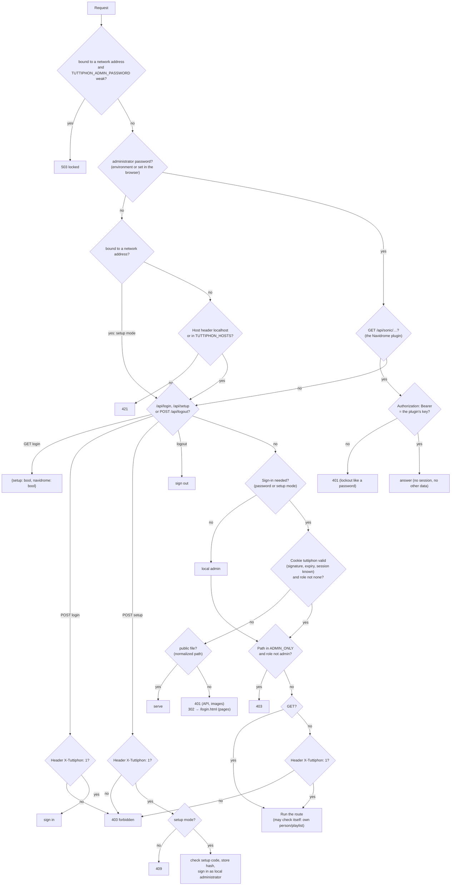

# 07 – Security

Tuttiphon runs either only on your own PC (without sign-in) or in the home network, e.g. as a Docker container on the NAS
(with sign-in via the family's Navidrome accounts). This chapter describes how the server implements sign-in, roles and
sessions, what it filters out for users, where credentials are stored and what to watch out for with new
endpoints. Code: `app/auth.py` and `Handler._handle()` in `app/web.py`; endpoints in detail:
[03 – API](03-api.md).

Principle: **the server checks permissions.** What the interface hides is a convenience; every response is already
filtered and every save is merged on the server side.

## Two operating modes

Which one applies is decided solely by whether the [local administrator](#local-administrator) has a password
(`localadmin.source()`, re-read by the server at most every 10 s, `Handler._admin()`): `"env"` –
`TUTTIPHON_ADMIN_PASSWORD` from the environment or `.env` (`config.admin_password()`), `"stored"` – set in the browser,
a hash in `state/admin_password.json`, `""` – none.

| | without an administrator password | with an administrator password |
|---|---|---|
| Sign-in | none | Navidrome account or local administrator |
| Who am I? | always “local admin” (`auth.me(None)`: `role = admin`, `local = true`, all people) | the signed-in account with its role |
| Reachable via | only the host names `127.0.0.1`, `localhost`, `::1` and those from `TUTTIPHON_HOSTS` – otherwise `421` | any host name |
| Typical use | `./tuttiphon.sh` on the PC | Docker container (password set in the browser at the first start, or `TUTTIPHON_ADMIN_PASSWORD` in `docker-compose.yaml`) |

Bound to a network address, the mode without a password doesn't exist (unless forced with `--unsafe-no-password`):
as long as there is no administrator password at all, the server is in [setup mode](#setup-mode) – sign-in is
required, and the password is set through the setup with a one-time code from the server log. A weak
`TUTTIPHON_ADMIN_PASSWORD` keeps it [locked](#running-without-a-password) instead of letting anyone in with it.

## Order of checks for a request



`_handle()` decides whether a file is public based on the normalized path (`posixpath.normpath()` after `unquote()`):
only `/login.html`, `/favicon.svg`, `/manifest.webmanifest`, `/sw.js`, `/icons/…` and `/assets/…` are public –
a path like `/assets/../…` doesn't count.

After the host check, `_handle()` sets the thread-local identity (`auth.set_current()`) to “nobody”, after the
session check to the result of `auth.me()`. All functions read it via `auth.current()`. When code runs outside
a request (background threads, runs, precomputation), `auth.current()` returns the local admin.

## Sign-in

### With the Navidrome account

`POST /api/login` with `{"username", "password", "remember"}` and the header `X-Tuttiphon: 1` (otherwise `403`, see
[Protection against third-party sites](#protection-against-third-party-sites)) calls `auth.login()`:

1. Empty password → error “Please enter the password.”
2. User name empty, `notfall` or `@notfall` → [local administrator](#local-administrator).
3. Tuttiphon checks name and password with a Subsonic `ping` directly against Navidrome (`NAV_URL`). Navidrome error 40
   or 41 → “User name or password is wrong …”, any other error → “Navidrome is not reachable right now. If needed,
   sign in as local administrator.”
4. The name is adopted in the spelling used by Navidrome (account list freshly loaded via the admin account).
5. If the account has the role `none` → “Tuttiphon is not enabled for this account …”.
6. If `remember` is set (the default), the password is stored – see the next section.
7. `accounts.<account>.lastLogin` in `config.json` gets the date and time.

The server then creates a new session and sets the session cookie ([Sessions](#sessions)). Tuttiphon
doesn't manage its own passwords for accounts; Navidrome is always authoritative. All errors respond with `401` and the
message. Every error is an `auth.LoginError`; its attribute `counts` says whether it counts toward the
[sign-in lockout](#sign-in-lockout) – not for an empty password and not for “Navidrome is not reachable
right now”.

### “Turn on statistics & stars”

The checkbox on the sign-in page is the `remember` parameter. If it is on, `auth.login()` stores the password just verified
in `.env` under `pass_key(name)` = `NAV_PASS_` + the name in uppercase, with non-word characters replaced by `_`
(e.g. `anna.b` → `NAV_PASS_ANNA_B`). Exceptions: the account from `NAV_ADMIN_USER` (its password is already in
`NAV_ADMIN_PASS`) and an unchanged password (then nothing is written). Without the checkbox, an already
stored password is kept.

The password is needed for everything that is read or written “from the point of view” of an account: personal
statistics and recap, the account's own Deezer stars, the exact preview with the default person's stars. It can be stored
later under Settings → My account, card “Statistics & stars” (“Turn on”, `POST /api/me/password`, verified with
Navidrome), or removed there with “Turn off” (the same call with `password: null`) – and by an admin for any account
via `PUT /api/env`.

Whether a stored password still works: `state/passwords.json` remembers per account whether Navidrome last accepted it
(`{account: {"ok", "at"}}`, no passwords). `auth.check_password_soon()` pings Navidrome with the stored password in
the background, at most every 6 hours per account – started when `/api/me` (the signed-in account) or `/api/status`
(all rating accounts) is served. Signing in with “remember” and `POST /api/me/password` mark it as working, a Deezer run
that gets “wrong user name or password” (Subsonic 40/41, `auth.wrong_password()`) marks it as rejected, a password
entered under Settings → Navidrome counts as not tried yet. An unreachable Navidrome never counts as rejected. The
interface reads it as `passwordRejected` (`/api/me`, `/api/accounts`) and `env.users[].rejected` (`/api/status`) and
asks for the password again.

### Local administrator

Tuttiphon's own administrator account, without a Navidrome account – for the first setup and for when Navidrome is
unreachable: user name empty (sign-in page → “Local administrator”, field “Administrator password”) and its password.
`app/localadmin.py` knows two sources; the environment wins (`localadmin.source()`):

| Source | `source()` | Where | Changed |
|---|---|---|---|
| `TUTTIPHON_ADMIN_PASSWORD` | `"env"` | environment (`docker-compose.yaml`) or `.env`, plain text, optional | only there – `PUT /api/env` refuses the key, `POST /api/admin-password` answers `400`; the interface shows a note |
| set in the browser | `"stored"` | `state/admin_password.json`, only a hash ([02](02-data-model.md#admin_passwordjson)) | Settings → Users & permissions with the current password (`POST /api/admin-password`) |
| none | `""` | – | on the PC no sign-in (set it under Settings → Users & permissions, no current password needed); on the network [setup mode](#setup-mode) |

The hash (`localadmin.make_hash()`) is scrypt (`n = 16384`, `r = 8`, `p = 1`: about 16 MB and 50 ms per check) with a
random 16-byte salt, stored as `scrypt:16384:8:1:<salt>:<hash>`; where Python has no scrypt, PBKDF2-SHA256 with
600,000 rounds. `verify_hash()` accepts only parameters within limits (scrypt `n` up to 2^20, `r` up to 32, `p` up
to 16; PBKDF2 up to 10,000,000 rounds), so an edited file can't make a check run for minutes. The file has permissions
`0600` and is part of the built-in backup. `localadmin.check()` compares a password from the environment in constant
time (`hmac.compare_digest`), a stored one via `verify_hash()`; a wrong password → “The administrator password is
wrong.”

As long as Navidrome is not connected (address or admin access missing), the sign-in page offers only this access: it
asks the public `GET /api/login`, which answers nothing but `{"setup": bool, "navidrome": bool}` – a Navidrome account
could not sign in yet, and without the admin access every account would count as a user. The session belongs to the
internal user `@notfall` (`auth.NOTFALL`):

- Role always `admin`, regardless of settings; display name “Administrator” (`/api/me` → `name`), in the server log
  “Local administrator” (`web._who()`).
- Sees all people but owns none (`own` is empty) – admin rights still apply to all playlists.
- Can't store a Navidrome password (`/api/me/password` → `400`); `remember` is ignored. Settings → My account shows a
  hint instead of the password field: its password is changed under Settings → Users & permissions, or in
  `docker-compose.yaml` when it comes from there.
- Never asks Navidrome: `role_of()` and `me()` don't look up `@notfall` in the account list – so the access
  works precisely when Navidrome is unreachable.
- The session carries an identifier of the administrator password in `state/sessions.json` (`p` = `_notfall_mark()`:
  the first 16 characters of HMAC-SHA256(`notfall:<identity>`) with the key from `state/secret`; `localadmin.identity()`
  is `env:<password>` or `hash:<stored hash>`). `read_token()` compares it on every request; when the password changes –
  `TUTTIPHON_ADMIN_PASSWORD` edited, or a new hash via `POST /api/admin-password` (new salt, so even the same password
  again) – all sessions of the local administrator end. If the local administrator changed it itself via
  `POST /api/admin-password`, its browser gets a new session right away.

**Forgotten password:** with source `stored`, delete `state/admin_password.json` in the data folder. Within about 10 s
(`Handler._admin()`) a server on the network is in setup mode again and writes a new setup code to the log; on the PC
without network binding, sign-in is simply off again. Sessions of Navidrome accounts stay valid. With source `env`,
set a new value in `docker-compose.yaml` and recreate the container (in `.env` it takes effect within 10 s).

If no administrator password is set, signing in as local administrator always fails. A Navidrome account named
`notfall` therefore can't sign in normally.

### Setup mode

A server bound to a network address (`Handler.network`) without any administrator password (`localadmin.source()`
is `""`) doesn't run without sign-in, but waits for its setup (`setup` in `_handle()`):

- The host check doesn't apply; every protected request needs a session – `401 {"error": "login"}` for the API and
  images, `302` → `/login.html` for pages. `GET /api/login` answers `{"setup": true, …}`, and the sign-in page shows
  the setup form instead of the sign-in ([Interface](09-interface.md#state-and-saving)).
- **Setup code:** `localadmin.setup_code()` draws 8 characters from `ABCDEFGHJKLMNPQRSTUVWXYZ23456789` (without
  `0`/`O` and `1`/`I`, `secrets.choice()`) and keeps them as `XXXX-XXXX` in `<data>/setup-code.txt` (permissions
  `0600`, outside `state/` and therefore never in a backup). The code stays the same until it is used, also across
  restarts; a missing or damaged file gets a new one. The server log (always English) shows it on a line of its own
  (`localadmin.announce()`): “No administrator password yet – open Tuttiphon in the browser and set it with the setup
  code.” and “Setup code: XXXX-XXXX  (also in setup-code.txt in the data folder)” – `tuttiphon.py` at every start while
  the setup is pending, `Handler._admin()` (at most every 10 s) as soon as setup mode begins while the server runs, e.g.
  after `admin_password.json` was deleted, and `GET /api/login` when the setup page is opened (`localadmin.remind()`, at
  most every 2 minutes) – so the code is near the end of the log even if it was rotated meanwhile. The setup page names
  both places (log line “Setup code:”, `docker logs tuttiphon`, `config/setup-code.txt`).
- **`POST /api/setup`** (`Handler._setup()`, public, only with `X-Tuttiphon: 1`) with `{"code", "password"}`: outside
  setup mode `409` “Tuttiphon is already set up – sign in as local administrator.” The code is compared without case
  and separators in constant time (`localadmin.check_code()`); a wrong one → `401` and counts toward the
  [lockout](#sign-in-lockout) under `setup|<address>` (10 in 10 minutes) and `setup` (50 from all addresses), then
  `429` – with 32^8 (about 10^12) possible codes guessing is hopeless. A weak password (`config.weak_password()`) →
  `401` “The administrator password needs at least 8 characters.”, not counted. Under `_setup_lock` the server checks
  once more that there is still no password – of two requests at the same moment only the first sets it.
- **Success:** `localadmin.set_password()` stores the hash and deletes `setup-code.txt`; the answer signs the browser
  in as `@notfall` (`Set-Cookie`, `Secure` via https through a trusted proxy), the log says “Setup: the password of
  the local administrator is set.” Then the setup assistant follows as with every new installation.

Why the code: without it, the first person to open the page would set the password and become administrator – on a
port that is reachable from outside, or behind a reverse proxy that already forwards from the internet before the
setup is done, that can be a stranger. The code proves access to the server: it is only in the container log and in
the data folder. Sign-ins with a Navidrome account keep working in setup mode (`POST /api/login`), although the
sign-in page doesn't offer them; an administrator signed in that way can set the password under Settings → Users &
permissions without the code – a Navidrome administrator has all rights anyway.

### Sign-in lockout

`Handler._limited(keys, label, attempt, status=401)` – used by `_login()`, `_setup()` and `_admin_password()` –
remembers failed attempts in memory (`_login_fails`: key → timestamps). A sign-in counts under three keys
at once. `<name>` is the name entered, without surrounding spaces, in lowercase; empty, `notfall` and `@notfall`
count together as `@notfall`. `<address>` is the address of the person ([below](#client-address)).

| Key | Limit in 10 minutes |
|---|---|
| `u:<name>\|<address>` – this account from this address | 10 failed attempts |
| `ip:<address>` – all accounts from this address | 30 failed attempts |
| `u:<name>` – this account from all addresses together | 50 failed attempts |

A wrong current password at `POST /api/admin-password` counts under the same three keys of `@notfall` (answered with
`400` instead of `401`, so the interface doesn't jump to the sign-in). The setup code of the
[setup mode](#setup-mode) has keys of its own: `setup|<address>` (10) and `setup` (50 from all addresses).

Once one of the limits is reached, the request is answered with `429` (“Too many failed attempts …”) until the oldest
attempt of that key drops out – even for the correct password; a blocked attempt doesn't count again. Only
`LoginError` with `counts` counts: wrong password, wrong administrator password, “not enabled”, a wrong setup code and
a wrong current password; an empty password, “Navidrome is not reachable right now” and a weak new password don't
count. Each counting failed attempt also waits 1 s.

Attempts that are still being checked with Navidrome count as well: before `auth.login()` the attempt is reserved
under the lock for all its keys (`_login_pending`), afterwards it becomes a failed attempt or is released (success,
not counting). So 200 attempts sent at the same moment don't all reach Navidrome – only as many as the limit allows.
The server log says “Sign-in blocked” once per block and key, not for every blocked attempt; the name in the log is
cut to 64 characters and without control characters (`web._who()`, `events.clean()`), so it can't fake log lines.

A stranger guessing from one address therefore blocks the account only for that address: the real owner signs in
from their own device as usual. Blocking a name for everyone takes 50 failed attempts, i.e. at least five
addresses. A restart resets the lockout.

### Client address

`web.client_of()` determines the address of the person and whether the request reached Tuttiphon via https:

- Normally that is the direct TCP peer (`client_address`), and https is never assumed – Tuttiphon itself only speaks
  HTTP.
- Only if the connection comes from a reverse proxy listed in `TUTTIPHON_TRUSTED_PROXIES` (addresses or networks,
  comma-separated, e.g. `172.16.0.0/12`; invalid entries are ignored) do the proxy headers count: from
  `X-Forwarded-For`, Tuttiphon takes the last address that wasn't added by a trusted proxy (entries from listed
  proxies are skipped from the end), and `X-Forwarded-Proto: https` marks the request as https. Without such an
  address in the header, the proxy's own address counts.
- From anyone else, these headers are ignored – otherwise every request could claim any address and evade the
  lockout.

The variable is read via `load_env()` on every sign-in (environment or `.env`); the interface can't set it. Setup:
[Behind a reverse proxy](#behind-a-reverse-proxy).

## Roles

There are three roles (`auth.ROLES`): `admin`, `user`, `none`. `auth.role_of()` determines them anew on **every** request:

| Order | Condition | Role |
|---|---|---|
| 1 | user is `@notfall` | `admin` |
| 2 | Tuttiphon knows Navidrome accounts (list not empty), but this account isn't among them (case-insensitive) | `none` |
| 3 | `config.json` → `accounts.<account in lowercase>.role` is `admin`, `user` or `none` | this value |
| 4 | the account is an administrator in Navidrome (`isAdmin`) | `admin` |
| 5 | otherwise | `user` |

- `auth.navidrome_users()` fetches the Navidrome accounts via the admin account and keeps them for 10 minutes. If the
  list changes, it writes it to `state/navidrome_users.json`. If the query fails – no matter how (unreachable,
  timeout, broken response, admin access missing) –, the last state in memory applies, after a restart the
  one from this file. The failure is remembered for 60 s: during that time Tuttiphon doesn't ask again, instead of making every request wait for
  Navidrome. Only if the file doesn't exist either is the list empty;
  then rule 2 doesn't apply, and Navidrome admins without an override are temporarily `user`. That's what the
  local administrator is for.
- If an account is deleted in Navidrome, it loses access to Tuttiphon with the next fresh account list (after 10 minutes
  at the latest) – even with an `admin` override.
- An admin sets the override under Settings → Users & permissions (`PUT /api/accounts`, `role: null` removes
  it). For one's own account, `api_accounts_save()` refuses to set the role to `user` or `none` and – if the
  account is not an administrator in Navidrome – to remove the override; both would cost the account its own admin
  role. Only the server changes `accounts`: when the configuration is saved normally, it always takes `accounts` from the
  current state.
- `none` locks the account out of Tuttiphon (Navidrome and Symfonium stay untouched): no new sign-in, and existing
  sessions count as not signed in from the next request on. If an admin sets the role `none` (`PUT /api/accounts`),
  `auth.end_sessions_of()` also ends all sessions of the account in `state/sessions.json` – including the one on a
  lost device; after being enabled again, the account has to sign in again. If the role falls to `none` for another reason
  (account deleted in Navidrome), the sessions stay stored and become valid again as soon as the account
  has a role again.
- **Own people** (`own`) of an account are all people whose `user` field matches the account name
  (`auth.persons_of()`, case-insensitive); the default person comes last. Admins see all people
  (`persons`), users only their own.

## Sessions

### Token

A session is a signed token in the cookie `tuttiphon` (`auth.make_token()` / `auth.read_token()`) with a
session ID that the server keeps in `state/sessions.json`:

```text
<payload>.<signature>
payload   = base64url(JSON {"u": "<account>", "e": <expiry as Unix time>, "s": "<session-id>"}) without "=" padding
signature = HMAC-SHA256(payload, key from state/secret), hexadecimal
```

- The key `state/secret` (32 random bytes as hex) is created on first use, file permissions `0600`.
- `make_token()` generates the ID with `secrets.token_urlsafe(12)` and records `{u, e}` under it in
  `state/sessions.json`, for the local administrator also `p` ([Local administrator](#local-administrator)) (permissions `0600`;
  expired entries drop out on every write).
- `read_token()` compares the signature in constant time, checks expiry and format, and requires the ID to be in
  `sessions.json` with the same account; otherwise the request counts as not signed in. Tokens without an ID are
  therefore not valid; a session of the local administrator is only valid as long as its `p` matches the current
  administrator password. The token contains
  only the name, **no role** – role changes take effect immediately.
- The server re-reads `sessions.json` only when its modification time or size changes; if the file is briefly unreadable
  (NFS), the last state applies. Several instances share sessions only if they use the same data folder.
- Validity: 90 days (`auth.SESSION_DAYS`), regardless of the checkbox on the sign-in page.

### Cookie

| Attribute | Value |
|---|---|
| Name | `tuttiphon` |
| `Path` | `/` |
| `Max-Age` | 7,776,000 (90 days) |
| `HttpOnly` | yes – invisible to JavaScript |
| `SameSite` | `Lax` – not sent with requests from other sites (except simple link navigations) |
| `Secure` | only if the sign-in came via https through a trusted reverse proxy (`X-Forwarded-Proto: https` from an address in `TUTTIPHON_TRUSTED_PROXIES`, see [Client address](#client-address)) – then the browser never sends the cookie unencrypted. Otherwise no: Tuttiphon itself only speaks HTTP |

### Sign-out and revocation

`POST /api/logout` removes the ID of the token sent along from `state/sessions.json` (`auth.end_session()`)
and sends an empty cookie with `Max-Age=0`. After that the token is no longer valid – not even as a copy on another
device. Other sessions of the same account remain. The role `none` locks an account out;
set via `PUT /api/accounts`, it also ends all of its sessions (`auth.end_sessions_of()`). A new
administrator password ends all sessions of the local administrator. Deleting `state/sessions.json` or `state/secret` ends all sessions
at once (a new key is created on the next call).

Independently of the sessions, the server remembers per account (in lowercase) whether the tour and the welcome assistant
are done (`state/seen.json`, `auth.mark_seen()`; `/api/me` returns `tourSeen` and `welcomeSeen`). Signing out, a
new device or a different address (IP instead of the domain behind the reverse proxy, with its own `localStorage`) therefore
doesn't bring them back. The entry contains only the account name.

## Running without a password

Without an administrator password – neither `TUTTIPHON_ADMIN_PASSWORD` nor one set in the browser – there is no
sign-in; whoever reaches the server is an administrator. Three safeguards keep this restricted to your own computer:

- **Start:** if `--host` is not `127.0.0.1`, `localhost` or `::1`, `tuttiphon.py serve` aborts with code 2 when
  `TUTTIPHON_ADMIN_PASSWORD` is set but weak (`config.weak_password()`): shorter than 8 characters or the placeholder
  (`config.PASSWORD_PLACEHOLDERS`: `change-me`) in any spelling – compared without surrounding spaces and in
  lowercase, so `Change-Me` counts too. The message names the placeholder or the number of characters and where the
  value comes from (`docker-compose.yaml`/environment or the `.env` in the data folder), and asks for a
  password with at least 8 characters – or for removing the line and setting the password in the browser. Without any
  administrator password the server starts in [setup mode](#setup-mode) and announces the setup code.
  `--unsafe-no-password` forces a start with a weak password (warning) or without sign-in on the network.
- **Network lock while running:** `web.serve(host, port, strict=True)` sets `Handler.network` if the server is bound
  to an address other than `127.0.0.1`, `localhost`, `::1` (`--unsafe-no-password` passes `strict=False` and turns this
  off). Then `_handle()` answers **every** request – the interface, static files and `/api/login` included – with
  `503 {"error": "Tuttiphon is locked: TUTTIPHON_ADMIN_PASSWORD is too short or still the placeholder – please set at
  least 8 characters."}` as long as the password from the environment or `.env` is weak, e.g. because the `.env` was
  edited while the server is running. A password that goes missing entirely – the line removed,
  `state/admin_password.json` deleted – switches to setup mode instead: sign-in stays required, never the mode without
  sign-in. The server re-reads the password every 10 s; once a proper one is back, it answers normally again, without
  a restart. Bound to loopback only (the PC on `127.0.0.1`), nothing changes: there, a missing password still means the
  mode without sign-in.
- **Host check** (`Handler._host_ok()`, against DNS rebinding): without a password and outside setup mode, the `Host`
  header (without port) must be one of `127.0.0.1`, `localhost`, `::1` or be listed in `TUTTIPHON_HOSTS`
  (comma-separated list, case-insensitive). Otherwise `421` (“Access only via 127.0.0.1 – or set an administrator
  password (Settings → Users & permissions).”) for every request, including static files. A third-party website whose
  name points to `127.0.0.1` thus fails on its own host name.

`TUTTIPHON_HOSTS` can only be set in `.env` or the environment; the interface can't set it. The host check
only protects against browsers (DNS rebinding): a program on the network can set the `Host` header freely. Without
an administrator password, Tuttiphon therefore never runs on a network address without sign-in (`--host 0.0.0.0`
then starts in setup mode; `--unsafe-no-password` deliberately overrides this). On the PC, sign-in is turned on under
Settings → Users & permissions: with source `""`, `POST /api/admin-password` needs no current password and signs
this browser in as local administrator. Via the interface the administrator password can only be replaced by one
that isn't weak, never deleted; `PUT /api/env` doesn't accept `TUTTIPHON_ADMIN_PASSWORD` at all.

## Behind a reverse proxy

Tuttiphon itself only speaks HTTP. For https (needed e.g. for notifications through the app), a reverse proxy goes in
front of it and forwards to `http://<NAS-IP>:8765`. Without further settings, Tuttiphon then sees every request as
coming from the proxy's address:

- the per-address limits of the [sign-in lockout](#sign-in-lockout) apply to everyone together – 30 failed
  attempts from anywhere block sign-in for everybody for 10 minutes, 10 for one name block that name for everybody;
- the session cookie has no `Secure` flag, although the browser speaks https.

`TUTTIPHON_TRUSTED_PROXIES` names the proxy (the address from which it connects to Tuttiphon, or its network, e.g.
`172.16.0.0/12` for the usual Docker networks). Then the lockout counts each person's own address from
`X-Forwarded-For`, and sign-ins via https get the `Secure` cookie ([Client address](#client-address)). The proxy must
append the client address to `X-Forwarded-For` and set `X-Forwarded-Proto`. List as narrowly as possible: everything
within the listed addresses can claim any address via these headers. The variable belongs in `docker-compose.yaml`
(see [Installation → Configuration](installation.md#configuration)) or in `.env`; the interface can't set it.

## Protection against third-party sites

Every `POST` and `PUT` request needs the header `X-Tuttiphon: 1`, otherwise `403 {"error": "forbidden"}`. A third-party
website can't send this header: a custom header forces a CORS preflight request in the browser
(`OPTIONS`), which Tuttiphon doesn't answer (`501`), and the server never sets CORS headers. This mainly protects the
mode without a password, where there is no cookie; with sign-in, `SameSite=Lax` adds to it. The interface sets the
header centrally in `frontend/src/lib/api.js`.

This includes `POST /api/login` and `POST /api/setup` (checked before the sign-in itself, so a refused request
doesn't count toward the [sign-in lockout](#sign-in-lockout)): a plain HTML form on a third-party site could otherwise send sign-in attempts
through a visitor's browser (a form needs no preflight), e.g. to guess passwords from inside the home network. The
sign-in page sends the header like the rest of the interface.

Only `POST /api/logout` is exempt. `GET` doesn't need the header – that's why changes never belong in a `GET`
endpoint.

## What the server filters for users

### Reading

| Endpoint | Users get |
|---|---|
| `GET /api/config` | `auth.view_config()`: only visible playlists; their own people in full, other people only if they are `public`, and then only `id`, `name`, `icon`, `color`, `prefix`, `public` (`PUBLIC_PERSON_FIELDS` – without preferences, dislikes and account names); from `settings` only `autoApply`, `defaultPerson`, `namePattern`, `allName`, `limit`, `minDuration`, `allMinRating`, `public`, `seasonRest` (`USER_SETTINGS` – no paths, accounts, owners), plus from `notify` only `enabled` and `server`; no `accounts`; `dismissed`/`ignored` from their own account, no `dismissedAt` |
| `GET /api/status` | reachability, version and scan state of Navidrome, the link address `webUrl`, only their own accounts under `env.users`; no access address, no admin name, no paths, no steps, no other instances, no Navidrome error message |
| `GET /api/playlists` | only visible playlists, no handmade ones, no orphaned files |
| `GET /api/playlist`, `/api/welt`, `/api/artist` | only visible playlists; `/api/playlist` for other people's playlists without `nsp` and without the lines “Never included: …” (dislikes), “New from the favorite bands in the last …” (favorite bands) and “Prefers what …” (family mix) in `summary`; for artists “Favorite”/“never” only for their own people; `forMe` in `/api/welt` always from the taste of the signed-in account (local administrator: `null`) |
| `GET /api/taste` | `person` only their own (`_own_person()`, otherwise `403`); `me=1` always the signed-in account (local administrator and without sign-in: `available: false`) |
| `GET /api/search` | songs, styles, moods and lyrics matches from the whole library; combo suggestions (`combos`) for the first own person. If one of their own people has kid-safe mode on, explicit songs (rude lyrics and songs tagged as explicit, `web._child_blocked()` like the song window) are missing from `songs` and `lyrics`. If there is no lyrics index yet, the search triggers reading the lyrics – at most every 6 hours (`liedtext.update_soon()`) |
| `GET /api/song`, `/api/song/more`, `/api/stream` | songs from the whole library (as in Symfonium), playlists in the song window only visible ones; the server fetches audio via the admin account, credentials never leave it. If one of their own people has kid-safe mode on, explicit songs can neither be played nor shown in the song window (`403`, `web._child_blocked()`); “More like this” uses the dislikes and kid-safe mode of their own person. Listening in doesn't count as a play in Navidrome |
| `GET /api/suggestions`, `/api/inbox` | only suggestions for their own people (no new music worlds), their own hide lists, their own “To review” list |
| `GET /api/task`, `POST /api/apply/now` | whether and what is running, but no log lines |
| `POST /api/preview`, `/api/counts` | computed with the stored state instead of the `config` sent along: for their own people only the storable fields (`PERSON_FIELDS`) come from the interface – `id` and account stay as on the server –, other people without `likes`/`dislikes`/`push` (`_preview_config()`). The playlist must belong to one of their own people (`_guard_preview()`, otherwise `403`) – otherwise recap, favorite-band or rule playlists could be used to query the listening, stars and favorites of other accounts; fields that only the server sets (`rules` …) are dropped, `together` only with their own and visible people, `sampleSize` at most 100, `mix.size` at most 500 |
| `POST /api/rueckblick/keep` | only their own people; a playlist with the same name can exist only once (`400`) |
| `GET /api/stats`, `/api/rueckblick`, `/api/missing` | only their own people, otherwise `403` |
| everything in `ADMIN_ONLY` | `403` |

A playlist is **visible** if it belongs to one of the user's own people or its person has `public: true`
(`auth.visible_playlist()`; if `person` is missing, the default person counts (`auth.person_id()`), if `public` is missing, the
person is private; if the person doesn't exist at all, the `public` setting applies, as in `build_nsp()`).
Users may **change** only their own (`auth.own_playlist()`): `/api/snapshot`, `/api/cover/*` and `/cover` check this with
`_own_playlist_id()`. `own_playlist()` and `merge_user_changes()` use the same assignment (`person_id()`): a
playlist without `person` belongs to the default person – its account and admins may see and change it.

Not filtered (they concern the whole library or shared data): `/api/library`, `/api/home`,
`/api/matrix`, `/api/cover/styles` without `id` (with `id` it is checked like `_own_playlist_id()`), `/api/changelog`, `/img/…`, `/live/…`, and in `/api/config` the music worlds and vibes. `POST /api/apply/now` (apply playlists right away) may deliberately be triggered by everyone
who is signed in – this is how users bring their own changes to Navidrome.

Cached results (`_memoized()`) always contain the admin view; `api_playlists()` and
`api_suggestions()` filter only afterwards. The cache key doesn't know the account.

### Writing: `merge_user_changes`

When a user saves the configuration (`PUT /api/config`), `api_save_config()` calls `save_from_ui()` with a
function: under the lock of `config.py`, it applies `auth.merge_user_changes()` to the state just stored.
Whatever the server has changed in the meantime (e.g. `lastLogin`, roles) is thus not lost – and what the
user never received (trimmed people and settings) they can't overwrite either. From the
incoming state, `merge_user_changes()` takes only:

| Area | allowed |
|---|---|
| own people | the fields `name`, `icon`, `color`, `prefix`, `likes`, `dislikes`, `public`, `clean`, `push` (`auth.PERSON_FIELDS`) – not `id`, not `user` |
| new person | if `id` is new and matches `^[a-z0-9][a-z0-9_-]{0,40}$` (not `neu`), `user` is their own account and `name` is not empty (welcome assistant); at most `MAX_USER_PERSONS` (20) people per account. If one of the account's people has kid-safe mode on, the new one gets it too – a second own profile is no way around it |
| limits | at most `MAX_USER_PLAYLISTS` (200) playlists for the account's people (trash included) – otherwise `400` “You can have at most …”; an account that already has more keeps them, but can't add any. Texts and lists are limited by `validate_config()` (name 120, prefix 40, icon 64 characters, lists 2,000 entries) |
| playlists of their own people | change, delete (missing from the incoming state), create; giving one of their own playlists to someone else's person is ignored. The fields `rules`, `rulesExtra`, `sortRaw`, `takeover`, `originalName` (`auth.SERVER_PLAYLIST_FIELDS`) are set only by the server and administrators: existing playlists keep the server's state, new ones lose them (only the server creates takeovers of handmade playlists) |
| their own hide lists | `dismissed` and `ignored` → `accounts.<account>`, strings only, at most 500 |
| family mix (`together`) | only their own people and people visible to everyone; others drop out, and if fewer than two remain, the field is dropped – so the taste of private profiles never flows into mixes of other accounts. In addition, `rules.together_of()` checks on every evaluation: the taste of members who have since become private and have a different account no longer counts (except in the mix of the shared person, which the administrator maintains). Their dislikes, 1-star songs and kid-safe mode still apply – protection comes first. If no member remains for an “All × Everything” playlist, it becomes a mix based on the user's own taste (`mix.flavor: "geschmack"`) |
| kid-safe mode (`clean`) | anyone may turn it on, only the administrator may turn it off – a stored `clean: true` stays in place when users save. The exclusion rules are built without account-dependent rules (stars, favorites, plays), so that explicit favorite songs of the account drop out too ([04](04-playlists.md#playlists-from-listening)) |

Everything else – other people's persons and playlists, music worlds, vibes, settings, global lists, other accounts –
comes unchanged from the server. Users can't delete people. Afterwards, as for admins,
`merge_server_fields()` (file name, takeover backup and cover of existing playlists from the server),
`normalize_playlists()` and `validate_config()` run.

### Playlist file names

The `file` field determines which file in the playlist folder is written and deleted during cleanup. So that
nobody can reach files outside the folder or other people's playlists through it, the following applies to **all** roles:

- `config.plain_playlist_file()` only allows plain file names: no `/` or `\`, not starting with `.`,
  extension `.nsp` or `.m3u`.
- `merge_server_fields()` takes `file` only for new playlists (or ones brought back via undo) and only if
  the name is plain, no other playlist uses it and it is not a handmade file in the playlist folder
  (a file there that isn't listed under `ever` in `state/managed_playlists.json`; if the folder isn't readable,
  this check is skipped) – otherwise the `playlists` step assigns a new one. This way no foreign file can be
  overwritten, applied in Navidrome and deleted.
- `playlists.plan()`, `write()` (cleanup) and the state calculation ignore names that aren't plain.

### The building blocks

| Building block | Location | Effect |
|---|---|---|
| `Handler.ADMIN_ONLY` | `app/web.py` | set of paths; applies to all methods of that path → `403` |
| `auth.require_admin()` | `app/auth.py` | inside the function, when only one method of a path needs admin (e.g. `POST /api/task`) |
| `_own_person(pid)` | `app/web.py` | `PermissionError` if the person isn't one of the user's own |
| `_own_playlist_id(pid)` | `app/web.py` | looks up the playlist (`400` if unknown) and checks `auth.own_playlist()` (`403`) |
| `auth.visible_playlist(p, cfg)` | `app/auth.py` | for filtering lists and detail views |
| `auth.view_config(cfg)` | `app/auth.py` | the configuration from the account's point of view; `USER_SETTINGS` and `PUBLIC_PERSON_FIELDS` define what users see of it |
| `auth.merge_user_changes()` | `app/auth.py` | saving by users |
| `auth.current()` | `app/auth.py` | `{user, role, own, persons, …}` of the current request |

## Credentials and secrets

### `.env`

All passwords and keys are in `.env` in the data folder (`data/.env` on the PC, `/config/.env` in the container) or in
environment variables. Format, keys and precedence: [02 – Data model](02-data-model.md#env--credentials).

- `save_env()` writes only the keys the interface may set (`config.EDITABLE_ENV`: `NAV_URL`, `NAV_PUBLIC_URL`,
  `NAV_ADMIN_USER`, `NAV_ADMIN_PASS`, `NAV_PASS_*`, `RATING_USERS`, `LASTFM_API_KEY`, `NTFY_TOKEN`), only printable
  values without line breaks, and always sets the file to permissions **`0600`** (`write_atomic(…, mode=0o600)`). An
  empty value is skipped. `TUTTIPHON_ADMIN_PASSWORD` is not among them (“Unknown key”): a hand-written line still
  counts, but the interface can neither set nor delete it. A password set in the browser never lands in `.env` –
  `state/admin_password.json` holds only its hash (permissions `0600`, [Local administrator](#local-administrator)).
  `write_atomic()` creates the temporary file with the target permissions right away
  (`os.open(…, mode)`), so it is never readable by others, not even briefly. `config.ensure_dirs()` sets a
  hand-made `.env` to `0600` at startup, as well as `state/secret` and
  `state/sessions.json` (if the file belongs to another user and that fails, Tuttiphon runs anyway).
- The ZIP files of the built-in backup contain `.env`; `backup.create()` creates them with `0600` right away, as a
  new file of its own (random suffix, `O_EXCL | O_NOFOLLOW`). If `config.json` or `.env` exists but can't be read,
  the backup fails instead of being written without them
  ([08 – Backup](08-operations.md#built-in-backup-appbackuppy)).
- The data folder is never the project folder: without `TUTTIPHON_DATA` it is always `<project>/data` – so backups
  with credentials can't end up in Git ([02 – Data folder](02-data-model.md#the-data-folder)).
- Environment variables (`NAV_*`, `TUTTIPHON_*`, `RATING_USERS`, `LASTFM_API_KEY`) take precedence over the file.
- **No response contains a password or a key**: the server only reports whether something is stored
  (`adminOk`, `users[].ok`, `passwordStored`, `lastfm`, `auth`, `adminPassword` – only the source).

### Navidrome access and images stay on the server

The browser never talks to Navidrome directly (apart from “Open in Navidrome” links to `NAV_PUBLIC_URL` or
`NAV_URL`). The interface loads images only through Tuttiphon:

- `/img/<id>` and `/live/<id>` fetch covers and artist images with the admin account (`images._client()`) and pass on only
  the image data. The ID is checked against `^[A-Za-z0-9_:.\-]{3,120}$`, `/live/` accepts only playlist images
  (`pl-…`).
- Cover uploads go through Navidrome's own API with the admin account; only JPEG, PNG and WebP are accepted, detected
  by their first bytes (no SVG).
- Subsonic calls (`app/navidrome.py`, `Navidrome.call()`) use token authentication: per call `md5(password + salt)`
  with a fresh salt, without the password itself. Navidrome's own API (`NativeApi`, for accounts, playlist owners and
  covers), on the other hand, signs in at `/auth/login` with the admin account's name and password and then works with its
  token.

Tuttiphon itself doesn't encrypt: without a [reverse proxy](#behind-a-reverse-proxy) with https, the sign-in password
travels over HTTP within the home network to Tuttiphon (with one, only from the proxy to Tuttiphon).

### The key of the Navidrome plugin

The plugin (`navidrome-plugin/`) does not sign in with a password or a session but with a key of its own
(`sonic.new_key()`: `tp_` + 32 random bytes, URL-safe). Only its SHA-256 is stored (`state/plugin_key.json`); the
interface shows the key once, after creating it. `sonic.check_key()` compares in constant time. It opens only
`GET /api/sonic/…` – song ids, titles, bands and albums of the whole library, as the shared person sees them (without
separate worlds unless asked for one of their songs, without the shared person's dislikes, kid-safe as soon as there is
a child profile) – nothing of accounts, people, playlists or settings. Wrong keys count toward a lockout like
passwords (`_limited()`, keys `plugin|<address>` 30, `plugin` 100 in 10 minutes). Creating, removing and the status
(`/api/plugin…`) and the download of the plugin are admin only. In Navidrome the key is in the plugin's settings
(password field); the plugin may reach every host (`requiredHosts: ["*"]`), because the address of Tuttiphon is typed
in there – since Navidrome 0.64 a host name alone never allows a private address.

### Further safeguards

| Where | What |
|---|---|
| `Handler._length()` / `_body()` | JSON at most 2,000,000 bytes, cover upload 10 MiB; JSON objects only; no `NaN`, `Infinity` or numbers beyond the float range (`1e999`) – they would become endless numbers that break `int()` when writing playlists |
| every answer | `X-Content-Type-Options: nosniff`, `X-Frame-Options: DENY` and `Content-Security-Policy: frame-ancestors 'none'` (no embedding in foreign pages), `Referrer-Policy: same-origin`; `Server: Tuttiphon` without the Python version. `HEAD` gets the headers of `GET` without the content. An unexpected error (`500`) only says “Something went wrong – the details are in the server log”; type and message are only in the server log |
| broken playlists | a playlist whose rules can't be built (a value an older version let through) is left out of `playlists.plan()` with a log line, keeps its file (it isn't removed from Navidrome), shows `state: "fehler"` in `playlists.status()` and is skipped in the band and song window – it never breaks writing or the pages of the others |
| `Handler.timeout` | 30 s per connection |
| `_static()`, `api_log()` | the resolved path must lie inside the build or log folder |
| `validate_config()` | every stored configuration is fully checked, including the field types of people and playlists (`_validate_types()`) – a wrong type would otherwise make writing all playlists, or whole pages, fail. Every number that ends up in `int()` has a range (`minDuration` 0–3600 or `null`, `radio.bands` 1–100, `limit`, `minRating` …), the name pattern only knows `{welt}` and `{stil}` (no format details), a person's `color` only `#rgb`, `#rrggbb` or `hsl(…)` (it goes into the page's styles – never `url(…)`). A wrong type the single checks don't foresee is a `ValueError` (`400`), never a crash |
| `auth.login()`, `Handler._login()` | constant-time comparison for the administrator password (`localadmin.check()`); only with `X-Tuttiphon: 1`; sign-in lockout per account and address, per address and per account ([Sign-in lockout](#sign-in-lockout)), 1 s delay per counting failed attempt; sign-ins, counting failed attempts and lockouts are in the server log with the account name (without password, without address) ([08](08-operations.md#server-log)) |
| `Handler.network` | bound to a network address: `503` for every request while `TUTTIPHON_ADMIN_PASSWORD` is weak ([Running without a password](#running-without-a-password)); without any administrator password setup mode – sign-in required, the password only via the setup code ([Setup mode](#setup-mode)) |
| `Handler._setup()` | only in setup mode (otherwise `409`) and only with `X-Tuttiphon: 1`; setup code compared in constant time, lockout `setup\|<address>` 10 and `setup` 50 in 10 minutes; `_setup_lock` – of two simultaneous requests only the first sets the password; `setup-code.txt` deleted on success, never in a backup |
| `Handler._admin_password()` | admin only (`ADMIN_ONLY`), only with `X-Tuttiphon: 1`; refused with source `env`; the new password must not be weak; with source `stored` only with the current password – a wrong one counts under the lockout keys of the local administrator (status `400`); all sessions of the local administrator end, the browser of the local administrator gets a new one |
| `localadmin.py` | only a hash of a password set in the browser (scrypt, PBKDF2 as fallback), permissions `0600`; parameters outside sensible limits are refused when checking ([Local administrator](#local-administrator)) |
| `POST /api/seen`, `POST /api/tour/seen` | record “tour/welcome done” only for the signed-in account (`auth.current()["user"]`), never for one sent along; only the values `tour` and `welcome` |
| `api_env_test()` | a stored password is only sent to the stored `NAV_URL`; for a new address the password must be sent along – so “Test connection” can't be used to send a stored password to a foreign server |
| `api_accounts_save()` | self-protection: one's own account can't take away its own admin role (see [Roles](#roles)); role `none` ends all sessions of the account |
| `api_env_save()` | `NAV_URL` and `NAV_PUBLIC_URL` only with `http://` or `https://` – the link address of the interface (`nav_web_url()`) also ignores any other value from the environment (no `javascript:` links); `TUTTIPHON_ADMIN_PASSWORD` can't be set or deleted this way (`save_env()`: “Unknown key”) |
| `POST /api/notify/test` | at most one test message per 30 seconds and account, topic only from letters, digits, `-`, `_`; users only with one of their own people and only to that person's topic (also the one just being entered) – never to the administrator's topic or one another person uses, and without a topic there is no fallback to the administrator's (`notify.test(fallback=False)`); without a person only administrators. `view_config()` gives users only `enabled` and `server` of `settings.notify` – never the administrator's topic; other people's ntfy topics stay private, like all person fields except name, icon, color, prefix |
| `POST /api/push/*` | devices always apply to the signed-in account; “administrator device” only with role `admin`. Only push addresses via `https` at the known push services are accepted (`webpush.PUSH_HOSTS`: Google, Mozilla, Apple, Microsoft) – so no subscription can make Tuttiphon request addresses in the local network; the subscription's keys are checked for length and form; at most 10 devices per account; test message at most every 30 seconds |
| Notifications through the app | content end-to-end encrypted (RFC 8291) – the push service only sees size and time; sender key `state/push_keys.json` with permissions 0600, never in a response (only the public part via `GET /api/push/key`) |
| Notifications via ntfy | go only to the configured ntfy server; content: band name, album name, music world, name of a run and, as the target when tapped, the configured address of Tuttiphon with the page – no credentials, no paths. `NTFY_TOKEN` is only sent over `https`. Anyone who knows a topic can read along on ntfy.sh; protected topics on your own server with `NTFY_TOKEN` |
| `config.write_atomic()` | temporary file with a random name, `O_EXCL` and `O_NOFOLLOW` – never writes through a symlink or into an existing file (important for covers on the music share); sets the permissions with `fchmod` on the open file, also after the rename – never via the path, where someone could have put a link in the meantime. Without an explicit mode: `0640` in the data folder (configuration and state are not for other users of the NAS), `0664` elsewhere (playlists and lyrics on the music share, which Navidrome reads); credentials `0600` |
| `.m3u` of the mixes | the name in `#PLAYLIST:` without line breaks (`mixer.m3u()`) – a name can't add entries |
| Shared folder `.tuttiphon/` | writable for everyone, so links there are never followed: `instances.shared_dir()` doesn't use a folder that is a symlink (falls back to `state/`) and sets `0777` through the opened folder (`O_DIRECTORY \| O_NOFOLLOW`, `fchmod`); `task.lock` is opened with `O_NOFOLLOW` (a link in its place is removed first), its permissions are set with `fchmod`; announcements whose `ts` isn't a number are skipped ([02](02-data-model.md#shared-folder-tuttiphon)) |
| `liedtext.update()` | reads only real files (no symlinks, `lstat`) up to 512 KB in folders inside the music folder – so a symlink to `/config/.env` never ends up in the search index |
| `albumcover` | writes only `cover.jpg`/`cover.png` into album folders that, once resolved, lie inside the music folder, never over an existing image |
| `Handler._handle()` | `PermissionError` with an error number (`errno`, from the file system, e.g. a brief `EACCES` on NFS) → `503` “A file was not accessible just now …”; only the server's permission checks (without `errno`) result in `403` |

## Securing a new endpoint

1. Write the function `api_…(query)` or `api_…(body)` in `app/web.py` and register it in `GET_ROUTES`, `POST_ROUTES` or
   `PUT_ROUTES`. Anything that changes something is `POST` or `PUT` – then the server checks `X-Tuttiphon`
   automatically.
2. **Admins only?** Add the path to `Handler.ADMIN_ONLY`. If only one method of the path needs admin rights,
   call `auth.require_admin()` at the start of the function instead.
3. **For everyone, but personal?** Check every parameter that names a person with `_own_person()`; fetch every playlist
   that gets changed with `_own_playlist_id()`; filter lists with `auth.visible_playlist()`. Trim responses that
   contain admin details (paths, logs, account names) for `auth.current()["role"] != "admin"`.
4. **Cache:** use `_memoized()` only for the admin view and filter afterwards – or add the account to the
   extra values of the key.
5. **Changing the configuration:** make server-side changes with `update_config(fn)`. If a new field should be changeable by users
   via `PUT /api/config`, it must appear in `auth.merge_user_changes()` (e.g. `PERSON_FIELDS`) –
   otherwise it is discarded for them. Add playlist fields that only the server sets to `SERVER_FIELDS` (`app/config.py`)
   – `merge_server_fields()` then takes them from the current state on save. Playlist fields that
   admins may set from the interface but users may not belong in `auth.SERVER_PLAYLIST_FIELDS`. Check new
   fields with a fixed type in `config._validate_types()`.
6. **Errors:** `ValueError` for input errors (`400`), `PermissionError("message")` for missing permissions (`403`) – only
   with a text, because a `PermissionError` with `errno` counts as a file system error (`503`). Never return passwords or
   keys, only `true`/`false`.
7. **Test** with a copy of the data and both roles: `tools/testserver.sh <port> <folder> --auth [--user <account>]`
   starts a test server and prints an admin cookie (local administrator) and a user cookie. `auth.make_token("<account>")`
   creates a cookie for a specific account – with the same `TUTTIPHON_DATA`, because the session must be in its
   `state/sessions.json`. See [08 – Operations](08-operations.md#testing-without-risk).

```python
def api_example(query):
    cfg = load_config()
    pid = query.get("person") or _default_person(cfg)
    _own_person(pid)                       # 403 for people that aren't the user's own
    person = next((p for p in cfg["personen"] if p["id"] == pid), None)
    if not person:
        raise ValueError(_("Unknown person"))   # 400 – texts through _() (app/i18n.py)
    return {"person": pid, "name": person["name"]}

# in Handler.GET_ROUTES:
#     "/api/example": api_example,
```

## Known limitations

What the code deliberately doesn't cover today, or doesn't cover yet:

| Point | Behavior |
|---|---|
| Images without a visibility check | `/img/<id>` and `/live/<id>` check only the sign-in. Anyone who knows an image ID (`al-…`, `ar-…`, `pl-…`) gets the image – including the cover of someone else's private playlist. |
| Same `.env` key for similar names | `pass_key()` turns all non-word characters into `_` and uppercases the name: `anna.b`, `anna-b` and `Anna_B` share `NAV_PASS_ANNA_B`. If one of these accounts signs in with “Turn on statistics & stars”, it overwrites the stored password of the other. |
| Locking out individual accounts from outside | The [sign-in lockout](#sign-in-lockout) for a name from all addresses together needs 50 wrong attempts – whoever has at least five addresses can block sign-in for a name, including the local administrator with an empty name, for 10 minutes – in setup mode likewise the setup code (key `setup`). |
| Address behind a reverse proxy | Without `TUTTIPHON_TRUSTED_PROXIES`, every request seems to come from the proxy: the per-address limits of the lockout then apply to everyone together ([Behind a reverse proxy](#behind-a-reverse-proxy)). |
| No session overview | Individual sessions of an account can only be signed out with the respective token; otherwise the options are the role `none` (ends all sessions of this account) or deleting `state/sessions.json` (all sessions). |
| No HTTPS of its own | Tuttiphon only speaks HTTP; https only via a reverse proxy. The cookie gets the `Secure` flag only via a trusted proxy that reports https (see [Cookie](#cookie)). |
