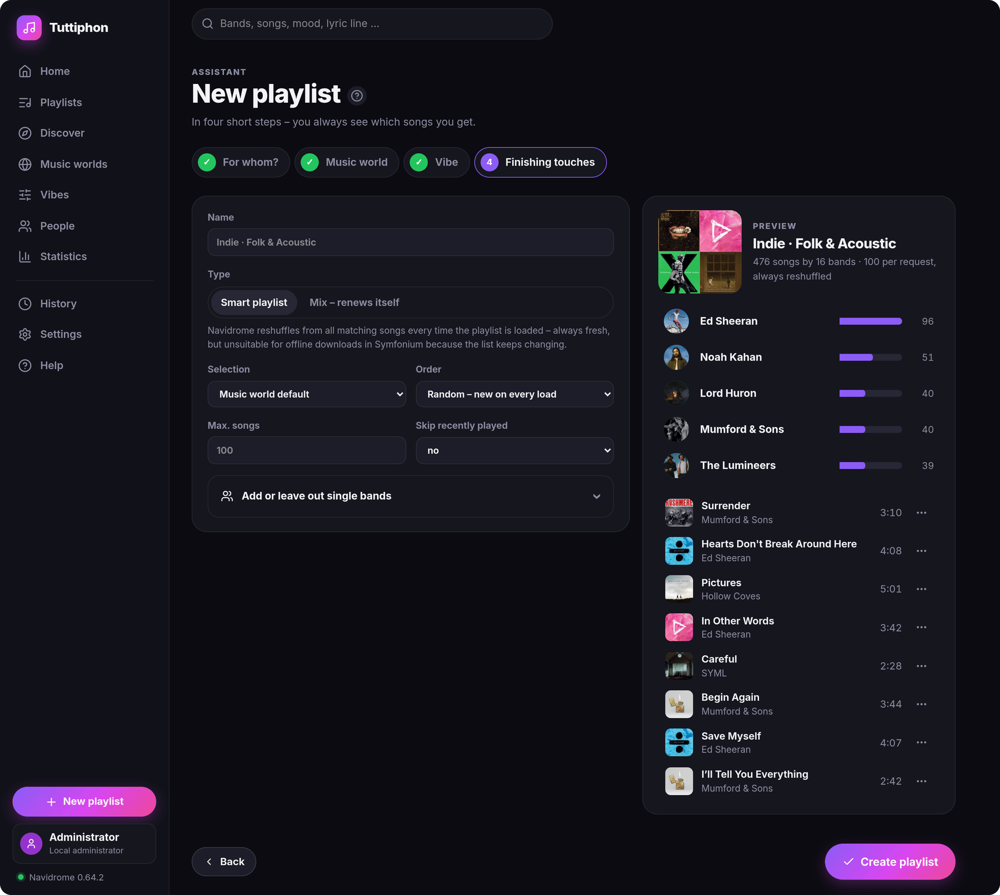
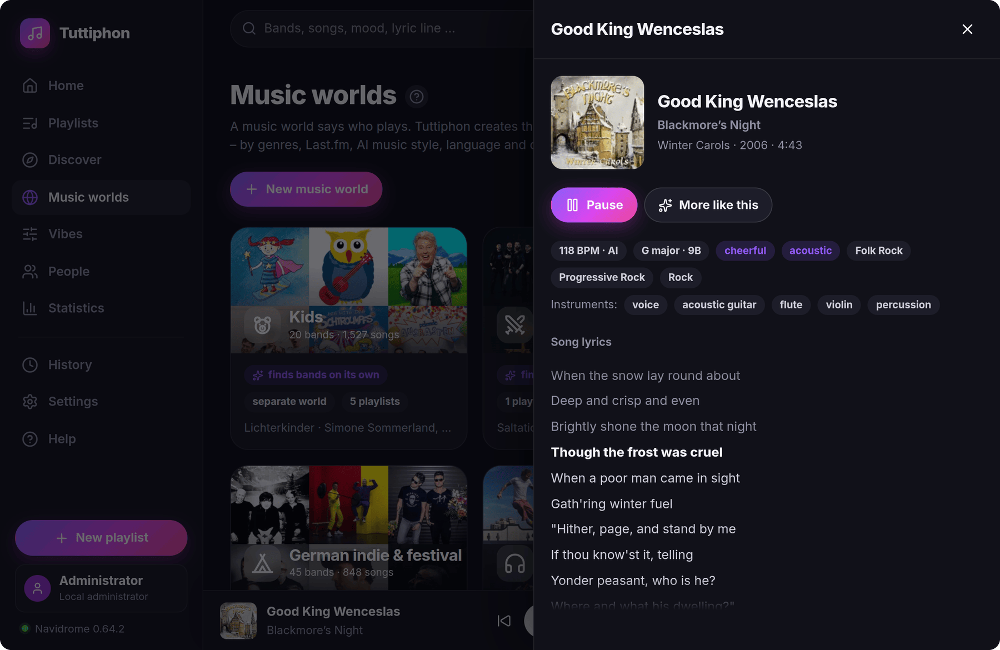
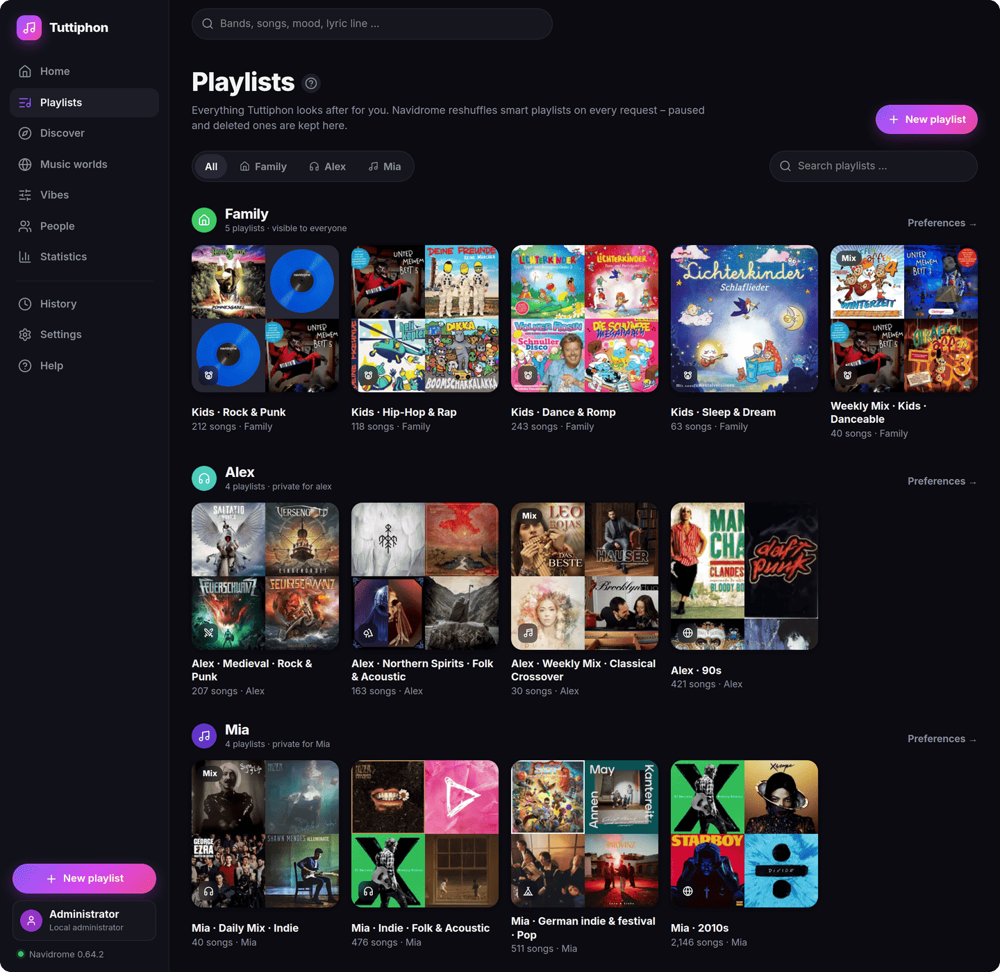

# Features

What Tuttiphon does, in detail. Installation and settings: [Installation](installation.md). How it works inside:
the [technical handbook](README.md).

- [Playlists that build themselves](#playlists-that-build-themselves)
- [FLAC to Opus or AAC](#flac-to-opus-or-aac)
- [Star ratings from Deezer](#star-ratings-from-deezer)
- [Lyrics, synced and plain](#lyrics-synced-and-plain)
- [Understanding the music](#understanding-the-music)
- [For the whole family](#for-the-whole-family)
- [Housekeeping](#housekeeping)
- [Privacy and external services](#privacy-and-external-services)
- [Under the hood: why these models](#under-the-hood-why-these-models)

## Playlists that build themselves

A playlist is **music world × vibe × person** – for example *The 90s × Good mood for the family*.

- **Music worlds** form on their own from your library: genres, Last.fm tags, the AI's music styles, the language of
  the lyrics and the decade. A catalog of 30 scenes knows their typical bands, so new albums join automatically.
- **Vibes** narrow it down: genres, topics, seasons, decades – or the sound itself (calm, danceable, falling asleep,
  in the background …).
- **Smart playlists** are written as Navidrome `.nsp` files; Navidrome re-evaluates them whenever they are loaded.
  **Mixes** are a fixed selection that renews itself daily, weekly or monthly – ideal for offline playlists on the
  phone: at most a few songs per band, never the same band twice in a row, smooth transitions in sound, tempo and key.
- **Only the hits**: the most popular 30 % of a world, based on the star ratings below.
- Mixes **learn from listening** – what is skipped comes up less often, a 1-star rating removes a song for that person,
  and the sound of what someone plays shapes their personal mixes.
- **Discover** suggests ready-made playlists per person and season: new songs from favorite bands, a good-night mix
  with a fixed length, "what everyone likes", a monthly recap.

## FLAC to Opus or AAC

Lossless files are converted to **Opus** (smallest, ideal for Android; default 160 kbit/s) or **AAC** (plays
everywhere on iPhone, iPad and Mac; default 224 kbit/s) – FLAC by default; WAV, AIFF, ALAC, APE and WavPack can be
added. Tags, MusicBrainz IDs, ISRC, multiple artists, lyrics and the cover move along the way Navidrome reads them.
The new file is decoded completely and compared with the length the original declares; only then does the original
go to an archive folder – or is kept or deleted, as you choose. Fresh imports from Lidarr get a few minutes of rest
before they are touched. Conversion is off until you turn it on (in the setup assistant or under
Settings → Conversion).

**Using Lidarr?** When the originals go to the archive or are deleted, the FLAC files Lidarr knows are gone. So that
it does not download them again, let its quality profile accept Opus/AAC as good enough, or stop monitoring the
converted albums.

## Star ratings from Deezer

Tuttiphon looks up every song on Deezer and turns its popularity rank into **one to five stars** in Navidrome, for
every family account. Apps that sort by rating – like the *top tracks* of an artist in Symfonium – then show what
people actually know, and the *only the hits* playlists know what a hit is. The match is careful (band and title must
fit, with a fallback over MusicBrainz and ISRC), the levels are adjustable, the best-known songs of each band get a
bonus star, and **stars someone gave by hand are kept** unless you choose to overwrite them.

The idea and the default rank levels come from [dztnr](https://github.com/scatolo/dztnr) by scatolo (a fork of
[sptnr](https://github.com/krestaino/sptnr) by Kevin Restaino); Tuttiphon extends it to several accounts.

## Lyrics, synced and plain

Missing lyrics come from [LRCLIB](https://lrclib.net) and, if you like, NetEase – **synced lyrics win** (`.lrc`),
otherwise plain text (`.txt`); instrumentals are marked as such. Tuttiphon keeps it tidy: plain lyrics are replaced
as soon as a synced version turns up, a `.txt` next to an `.lrc` with real synced lines is removed, and songs that
weren't found are retried later, staggered.

The lyrics are also **analyzed**: a search across all lyrics finds a song by a line, the language of the lyrics helps
to form music worlds such as *German rap*, and the **kid-safe mode** keeps songs with explicit words out of
children's playlists (with a list to allow single songs again).

## Understanding the music

Every song is listened to – locally, at night, gently on a few cores:

- **Sound analysis** (ffmpeg): loudness, energy, brightness, danceability, liveliness.
- **AI sound analysis** (Essentia): mood (happy, sad, relaxed, aggressive, party), vocals or instrumental, acoustic
  or electronic, 400 music styles, themes such as film music, epic or Christmas, **instruments** (piano, guitar,
  strings, brass …), how **easy to listen to** and how **engaging** a song is, **tempo and key**.
- **Sounds alike**: from the sound of every song Tuttiphon finds similar songs and bands – for "more like this", the
  radio, "sounds like these bands", and to sort new bands into the right music world.
- **Taste per person**: what someone plays, favors and rates – including how it sounds – shapes their suggestions.
- Last.fm (optional, free key) adds similar bands and tags.

## For the whole family

Everyone signs in with their own **Navidrome account** and gets their own view: their mixes, their statistics, their
profile with likes and dislikes. Administrators see and change everything; users can create their own playlists and
see what others share with everyone – but cannot change it. A **local administrator** works even when Navidrome is
down. The interface speaks **English and German**, works on the phone and can be installed as an app; "Show me"
guides walk through each task right on the page.

## Housekeeping

- **Update everything** in one go – convert, lyrics, understand music, write playlists, scan, rate – or let the
  **folder watch** do it whenever new music lands (e.g. from Lidarr).
- **Check library**: the same recording stored twice (found by **audio fingerprints**, across formats and albums),
  duplicates in an album, albums without a cover or with gaps, very short files, songs without a genre.
- **Covers**: designed playlist covers (mosaic, band photo, gradient) and missing album covers from the Cover Art
  Archive or Deezer.
- **Even loudness** via ReplayGain tags, **statistics and a recap** per person, **daily backups** of the settings,
  **notifications** on the phone (Web Push or ntfy), and a self-check after every scan that Navidrome shows each
  playlist the way Tuttiphon calculated it.

## Privacy and external services

Tuttiphon works locally. It contacts these services only for the functions named:

| Service | for | when |
|---|---|---|
| Deezer API | popularity for stars, missing album covers | rating new songs, cover search |
| LRCLIB, NetEase | lyrics | lyrics search (NetEase optional) |
| Last.fm | similar bands, tags | only with your own API key |
| MusicBrainz, Cover Art Archive | ISRC for the Deezer search, album covers | when needed |
| Push services (Google, Mozilla, Apple, Microsoft), ntfy | notifications | only if turned on |
| essentia.upf.edu | the AI models | once, while the image is built |

## Under the hood: why these models

Everything has to run on a small NAS without a GPU, next to Navidrome, without slowing it down. That decided every
choice below – the most accurate model is not always the right one if it needs a week per pass.

| Task | Used | Why not … |
|---|---|---|
| Basic sound features | **ffmpeg** filters (loudness, spectrum, onsets) | a neural model – ffmpeg runs everywhere, also on a PC without the AI |
| Mood, styles, themes, instruments, easy/engaging | **Essentia** with **Discogs-EffNet** (an EfficientNet-B0, about 18 MB) and small classifier heads | **MAEST** (transformer, better genre scores, many times slower on a CPU), **MERT / MuQ** (large self-supervised models built for GPUs), **MusiCNN / VGGish** (older and weaker) |
| Similar songs and bands | the EffNet embedding, projected to 128 dimensions (int8, about 4.5 MB for 25,000 songs) | **PCA** (would change with the library), a **vector database** (plain Python finds neighbors among 25,000 songs in under 0.1 s) |
| Tempo | Essentia **PercivalBpmEstimator** at 16 kHz, ffmpeg as fallback | **RhythmExtractor2013** (needs a second decode at 44.1 kHz), **TempoCNN** (another model, no measurable gain here) |
| Key | Essentia **KeyExtractor** | CNN key models – a few percent more accuracy for an extra model |
| Same recording twice | **Chromaprint** (`fpcalc`, the AcoustID fingerprint) | comparing AI embeddings (would also merge live and karaoke versions), file hashes (only find identical files) |
| Taste per person | prototypes of the sound of what someone plays, plus genres and worlds | a trained recommender – needs far more listening data than a family produces |
| Search by description | music worlds, moods, styles, themes and instruments the AI already found | **CLAP** text-to-music models – measured on a real library: about half of the top 10 fit, the text side only understands English, and the image would grow by 0.6–2 GB |

One embedding pass of Discogs-EffNet feeds all AI classifiers at once, so each additional property costs almost
nothing. On the reference NAS the first full pass over a large library takes about a week of nights; after that only
new songs are analyzed. The AI runs as a separate, low-priority process limited to a few cores and frees its memory
when it is done.

Search by description ("calm guitar by the campfire") was tested with MTG's current CLAP model on 300 songs from a
real library. It would run on the N100 (about 1.6 s per song with ONNX Runtime), but it was only reliable for what
Tuttiphon already covers – children's songs, Eurodance, workout music – and weak on the new things it was meant for,
such as choirs, bagpipes or growling vocals. It may come back as an option when the models get better.
